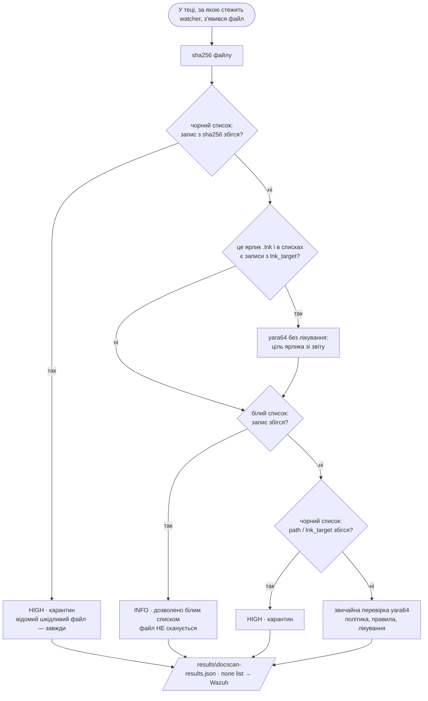
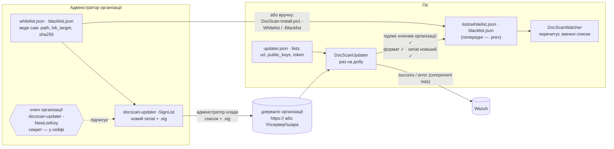

<a id="top"></a>

# DocScan — документація

Єдиний документ про DocScan: що це, як влаштовано, з якими файлами працює кожна служба, правила, списки,
оновлення, веб, Wazuh, розробка і код. Окремо лишаються лише:

- [README.md](../README.md) — вітрина на GitHub (англійською);
- [deploy/README.txt](deploy/README.txt) — інструкція адміна, лежить у пакеті DocScan;
- [ci/README.md](ci/README.md) — CI: конвеєр, стенди, комбат, реліз;
- [SECURITY.md](../SECURITY.md), [CONTRIBUTING.md](../CONTRIBUTING.md) — стандартні файли GitHub.

У коді біля важливих місць стоїть посилання на розділ цього документа: `// Опис: docscan-project/DOCSCAN.md#<розділ>`.

## Зміст

| Розділ | Про що |
|---|---|
| [Огляд](#overview) | мета, принципи, DocScan і антивірус |
| [Архітектура](#architecture) | три служби, спільні файли, хто кого зупиняє |
| [Ядро: watcher і yara64](#watcher) | запуск, звідки файли, що сканується, обробка файлу, знешкодження, усі файли |
| [Правила і політика](#rules) | політика `docscan-policy.yar`, файли правил |
| [Третій прохід](#critical) | критична інформація для E5Search: як писати правила |
| [Списки організації](#lists) | білий і чорний списки |
| [Служба оновлень](#updater) | DocScanUpdater: програма, правила, списки |
| [Веб-інтерфейс](#web) | DocScanWeb: сторінки, файли, безпека |
| [Wazuh](#wazuh) | агент, менеджер, поля подій |
| [Встановлення, тести, реліз](#deploy) | де що описано |
| [Розробка: Mac і Windows](#dev) | що справжнє на Mac, що лише на ВМ |
| [Код](#code) | путівник по коду: C, Go, PowerShell, рецепти, пастки |
| [Відомі обмеження](#limits) | що DocScan не робить або робить не повністю |
| [Історія](#history) | чому watcher переписали на Go |

---

<a id="overview"></a>

## Огляд

На документ, що з'явився в системі, DocScan має:
1. **Виявити** техніку атаки структурним розбором → `findings` + `verdict` + докази.
2. **Перевірити** розпаковане vendor-правилами — «Шар 2»: код VBA і частини документа (зв'язки `.rels`,
   вбудовані об'єкти та їхній вміст, ActiveX, макроаркуші, altChunk, об'єкти RTF).
3. **Вилікувати** документ, зберігши його (вирізати макрос / зовнішній шаблон / DDE / вкладення;
   зламати `\objupdate`; LNK — видалити). Оригінал — у бекап.
4. **Повідомити** — JSON-рядок на файл, який забирає агент Wazuh (`docscan-results.json`).
5. **Зберегти код макросів** кожного документа з VBA — локально й копією на сервер ([Wazuh](#wazuh), поле `macro`).
6. **Третій прохід** (на всіх ПК, якщо не вимкнено `-NoCritical`): якщо в тексті документа є фрази з правил
   E5Search — поставити повний текст у чергу `critical.json` для служби E5Search ([Третій прохід](#critical)). Вердикту YARA тут не
   виносить.

Принципи:
- **Один бінарник, один запуск на файл.** Детект, Шар 2, витяг макросу, третій прохід, лікування, JSON —
  прапори `yara64.exe`, окремих exe немає; файл читається в одному запуску.
- **Модуль дає факти, політика вирішує.** Модуль (C) лише розбирає документ і викладає факти
  (текст макросу, зовнішні зв'язки, DDE-поля, вкладення, ціль/аргументи LNK). Що з цього HIGH чи
  MEDIUM, як назвати знахідку і що лікувати — вирішують **правила** у `docscan-policy.yar`
  (`meta.severity` / `meta.finding` / `meta.disarm`). Інженер змінює політику без перезбірки.
- **Модуль тільки читає.** Модуль працює на read-only буфері посеред скану й нічого не пише.
  Лікування — у CLI-шарі (`cli/yara.c` → `disarm.c`) **після** скану, коли файл закрито.
- **Ворожий документ не розбирається з правами SYSTEM.** На Windows `yara64` ділиться на брокер і воркер
  (той самий exe): усе, що торкається байтів документа, — у воркері без прав (пісочниця, див. [Код](#code)); файли
  пише лише брокер, який нічого не розбирає.
- **Тип — за magic-байтами**, не за розширенням (`invoice.pdf`, що насправді docx, — це OOXML).
- **Без XML-парсера.** `.rels`/`document.xml` розбираються пошуком токенів — безпечніше для
  недовіреного вводу. Усі бінарні читання bounds-checked.
- **Портативний C.** Розробка на macOS, прод — Windows (MSVC). Жодних POSIX-онлі API в модулі.
- **Без прив'язки до Wazuh.** `yara64.exe` видає чистий JSON; доставка — справа watcher/агента.
- Логіка детекту перенесена з попередньої PowerShell-реалізації (`doc-scan.ps1`, Mandiant) у C.

#### DocScan і антивірус (Microsoft Defender, ESET)

DocScan **не замінює** антивірус і не є ним. Це різні шари, які працюють поряд:

| | Антивірус (Defender, ESET) | DocScan |
|---|---|---|
| **Як шукає** | сигнатури й евристика **відомого** шкідливого ПЗ | структурний розбір документа: шукає **техніку атаки** — макрос з автозапуском, DDE, зовнішній шаблон, протокольні обробники (Follina), OLE / Equation Editor, ActiveX, `/Launch` і JavaScript у PDF, підозрілий LNK — незалежно від того, чи такий зразок уже десь відомий |
| **Новий документ без сигнатури** | часто пропускає, доки не вийде оновлення бази | виявляє, бо дивиться на будову, а не на хеш чи сигнатуру |
| **Що робить з файлом** | блокує або видаляє файл цілком | **лікує**: вирізає макрос / DDE / зовнішній шаблон / вкладення, документ лишається робочим; оригінал — у карантин ([Ядро](#watcher), «знешкодження») |
| **Що всередині** | — | дістає код макросу й вкладені частини і перевіряє їх vendor-правилами YARA (Шар 2); код макросу зберігається для аналізу |
| **Критична інформація** | — | третій прохід: документи з критичною інформацією — у чергу E5Search ([Третій прохід](#critical)) |
| **Для SOC** | подія «знайдено загрозу» | запис у Wazuh: що знайдено, де саме (частина документа, код макросу), що зроблено, `summary` для алерту ([Wazuh](#wazuh)) |

Приклад з навантажувального тесту ([Історія](#history), результати тестів): на тому самому наборі
з 4 579 документів (42 зразки атак, документи для перевірки хибних спрацювань, публічні тестові корпуси)
Microsoft Defender зі свіжими сигнатурами спрацював на **4** файли (тестові DDE-документи корпусу oletools),
DocScan — на **~176 HIGH і ~155 MEDIUM** (документи з активним вмістом, з них HIGH — вилікувано). Обидва
однаково впізнали ті 4 DDE-документи: два незалежні шари ловлять ту саму техніку.

На робочих машинах антивірус лишається. Щоб він не заважав DocScan (не блокував `yara64`, не видаляв
оригінали з карантину DocScan, не сповільнював кожен скан), потрібні винятки: `install.ps1` сам додає
винятки Microsoft Defender для `C:\Program Files\DocScan` і `C:\ProgramData\DocScan` (`-NoAvExclusion` —
не додавати); для ESET — винятки тих самих тек і процесів `yara64.exe` / `yarac64.exe` політикою ESET
PROTECT (`install.ps1`, [deploy/README.txt](deploy/README.txt)).

---

---

<a id="architecture"></a>

## Архітектура: три служби

DocScan на ПК — це **три служби Windows** і **одна тека даних**. Усі три приходять одним пакетом з однією версією.

| Служба | Програма | Що робить |
|---|---|---|
| **DocScanWatcher** (ядро) | `watcher\docscan-watcher.exe` + `bin\yara64.exe` + `rules\` | стежить за теками, сканує, знешкоджує, карантин, списки, скани на вимогу і флешки. Працює і без двох інших |
| **DocScanUpdater** | `updater\docscan-updater.exe` | ставить підписані оновлення програми, правил і списків організації; відкат, якщо нове не стартувало |
| **DocScanWeb** | `web\docscan-web.exe` | інтерфейс адміна на `https://127.0.0.1:8741/`: стан, знахідки, налаштування, карантин, скани. Сам нічого не сканує |

**Як вони спілкуються.** Не напряму, а через файли в `C:\ProgramData\DocScan`. Доступ до теки мають лише SYSTEM і
адміністратори. Один і той самий файл може писати одна служба і читати інша:

| Файл | Пише | Читає |
|---|---|---|
| `settings.json` | веб, `install.ps1` | watcher |
| `lists\*.local.json` | веб | watcher |
| `lists\whitelist.json`, `blacklist.json` | updater, `install.ps1` | watcher, веб |
| `update\updater.json`, `update\check-now` | веб, `install.ps1` | updater |
| `scan\request-*.json`, `cancel-*` | веб, `docscan-watcher -ScanPath` | watcher |
| `scan\status.json`, `history.json` | watcher | веб |
| `results\docscan-results.json` | watcher, веб (аудит), інсталятор | агент Wazuh, веб |
| `results\docscan-updates.json` | updater | агент Wazuh, веб |
| `results\watcher.log` | watcher | updater (рядок `start: watching`), веб |
| `quarantine\`, `macros\` | watcher (і yara64) | веб |

**Прямий вплив на службу — лише зупинка і запуск DocScanWatcher:**

| Хто | Коли |
|---|---|
| updater | оновлення правил: зупинити watcher, замінити `rules\`, запустити, дочекатися `start: watching`, інакше відкат |
| updater через `install.ps1 -Reuse` | оновлення програми: інсталятор зупиняє й запускає всі три служби |

**Спільний код Go:**
- `orglists` — формат і перевірка списків (усі три);
- `winsvc` — запуск як служба Windows (усі три);
- `drives` — диски, USB, теки програм (watcher і веб);
- `manifest` — підпис релізів (updater і cirun).

Формат `settings.json` описаний двічі: у watcher (`cmd/watcher/settings.go`) і у вебі (`cmd/web/mode.go`). Це місце, де вони можуть
розійтися.

**Профілі встановлення** (зараз через параметри інсталятора):
- **ядро** — `install.ps1 -NoWeb -UpdateMode off`: лише watcher, yara64 і правила;
- **ядро + оновлення** — `-NoWeb`;
- **повний** — за замовчуванням.

---

<a id="watcher"></a>

## Ядро: DocScanWatcher і yara64

Як працює ядро DocScan і з якими файлами воно має справу. Написано за кодом `services/cmd/watcher/` (`main.go`, `config.go`,
`scan.go`, `lists.go`, `store.go`, `scanjob.go`, `audit.go`) і `libyara/modules/docscan/`.

**Дві програми:**
- `docscan-watcher.exe` — служба Windows **DocScanWatcher** від імені SYSTEM. Чекає на нові й змінені файли, веде чергу,
  пише записи для Wazuh.
- `yara64.exe` — сканер. Watcher запускає його **окремим процесом на кожен файл**. yara64 розбирає файл, перевіряє
  правилами, за потреби знешкоджує і повертає результат у JSON.

Шляхи — як після `install.ps1`: програма в `C:\Program Files\DocScan`, дані в `C:\ProgramData\DocScan`. Теку даних можуть
читати й змінювати лише SYSTEM і група Адміністратори.

---

### Запуск служби

`install.ps1` реєструє службу з такими параметрами:

```
docscan-watcher.exe -WatchPath C:\Users
    -Yara        "C:\Program Files\DocScan\bin\yara64.exe"
    -Rules       "C:\Program Files\DocScan\rules\docscan-index.yar"
    -OutDir      C:\ProgramData\DocScan\results
    -BackupDir   C:\ProgramData\DocScan\quarantine
    -Whitelist   C:\ProgramData\DocScan\lists\whitelist.json
    -Blacklist   C:\ProgramData\DocScan\lists\blacklist.json
    -CriticalRules "C:\Program Files\DocScan\rules\critical"
    -CriticalOut   C:\ProgramData\DocScan\critical\critical.json
    [-NoDisarm]                       ← лише повідомляти (install.ps1 -DetectOnly)
```

Що не задано явно, береться відносно `-OutDir`:
- `macros\` і `settings.json` лежать у `C:\ProgramData\DocScan`;
- `yarac64.exe` — поруч з `yara64.exe`.

**Що відбувається на старті (`start`, `prepareRules`, `run`):**

1. Створити теки `results`, `quarantine`, `macros`.
2. Відкрити журнали `watcher.log` і `docscan-results.json`.
3. Прочитати списки організації і `settings.json`. Налаштування можуть змінити режим, теки і кількість паралельних
   сканувань.
4. Якщо в теці `rules\critical\` є `.yar`, увімкнути третій прохід і додати до сканованих типів `odt ods odp txt csv`.
5. Якщо правил ще немає, нічого не сканувати і чекати, перевіряючи раз на 15 с. Їх покладе `install.ps1 -Rules` або
   DocScanUpdater.
6. **Перевірити правила:** `yara64 --file-vars <правила> results\probe.txt`. Є помилка компіляції — служба не стартує.
   З критичними правилами так само перевіряється ще й третій прохід (`probe-critical.json`).
7. **Скомпілювати правила один раз:**
   `yarac64 -w -d filename= -d filepath= -d extension= -d filetype= -d owner= docscan-index.yar results\rules.yarc`.
   Далі кожен скан іде з `-C rules.yarc`: без цього кожен файл перекомпільовував би тисячі правил. Немає `yarac64` або
   не скомпілювалось — сканує з вихідних `.yar`, повільніше, і пише WARN.
8. Взяти під нагляд кожну теку з `-WatchPath` (ReadDirectoryChangesW, рекурсивно). Жодної теки немає — служба не
   стартує.
9. Записати в `watcher.log` рядок `start: watching ...`. Саме його чекають DocScanUpdater і тест CI як знак, що watcher
   працює.
10. Записати аудит `watcher-started` у `docscan-results.json`.

---

### Звідки беруться файли на перевірку

| Джерело | Подія в записі | Коли |
|---|---|---|
| файл створено, змінено, перейменовано в теці під наглядом | `Created`, `Changed`, `Renamed` | щойно Windows повідомила |
| переповнився буфер подій Windows | `Rescan` | теки обходяться наново, береться все змінене з того моменту |
| змінились списки організації / старт служби | `ListSweep` | обхід лише тек під масками шляхів чорного списку (`sweep.go`) |
| знешкодити не вдалось, бо файл відкритий (наприклад у Word) | `DisarmRetry` | кожні 30 с протягом 60 хв, далі кожні 5 хв; переживає перезапуск (`retry.json`) |
| файл заблокований довше 24 год | `DisarmPending` | запис для Wazuh: треба перевірити вручну |
| скан на вимогу (веб або `-ScanDocs` / `-ScanPath`) | `DocsScan`, `PathScan` | запит у `scan\request-*.json` |
| вставили флешку, USB-диск, SD | `USBScan` | диски опитуються раз на 5 с |

**Перш ніж файл піде в чергу:**
- чекає 2 с тиші від останньої події цього файлу (`-SettleSeconds`);
- той самий файл повторно — не частіше разу на 60 с (`-RescanCooldown`), бо Office автозберігає;
- без змін вмісту (той самий sha256) повторно не сканується.

**Порядок черги:** повтори знешкодження → поодинокі файли (новіші першими) → масові копіювання (по колу між
користувачами, щоб чиїсь 100 000 файлів не загальмували інших) → скани на вимогу.

**Паралельно:**
- автоматично від 2 до кількості ядер (максимум 32), залежно від довжини черги і завантаження процесора: ріст до 60%,
  зменшення від 85%;
- `-Workers N` — фіксована кількість.

---

### Що сканується

| Група | Розширення |
|---|---|
| **документи** | `doc dot docx docm dotx dotm xls xlt xlsx xlsm xltx xltm xlsb ppt pps pot pptx pptm potx potm ppsx ppsm xla xlam ppa ppam rtf pdf lnk one iqy slk` |
| **загальні файли** | `exe dll sys scr cpl ocx com msi ps1 psm1 vbs vbe js jse wsf wsh hta bat cmd jar xll msc url svg htm html zip rar 7z iso img vhd vhdx` |
| **документи, лише коли увімкнено третій прохід** | `odt ods odp txt csv` — у них немає макросів чи шкідливого коду, тож без третього проходу вони не потрібні |

Будь-яке інше розширення не сканується.

**Не сканується, навіть якщо розширення підходить:**
- шляхи з `-ExcludePattern`. За замовчуванням це:
  - кошик `$Recycle.Bin`;
  - `AppData\Local\Temp\chocolatey`, `Packages`, кеші Edge, OneDrive, WebCache, Explorer, Notifications, INetCache;
  - Chrome, Mozilla, `D3DSCache`;
  - `AppData\Roaming\Code`, `Mozilla`, `Microsoft\Windows\Recent`, `Microsoft\Office\Recent`;
  - файли `*.docscan-bak` (карантин) і `~$*` (lock-файли Office);
- власні теки DocScan: `results`, `quarantine`, `macros`, `critical`;
- файли понад 100 МБ (`-MaxSizeMB`): запис `SKIPPED`. Списки за шляхом до них усе одно застосовуються;
- файл у білому списку: запис `INFO` без скану.

---

### Обробка одного файлу (`scanFile`)

1. **Дочекатися, поки файл допишуть:** його можна відкрити, і розмір не змінюється. Чекає до 60 с (`-ReadyTimeout`).
   Скани на вимогу не чекають: файл уже лежить на диску.
2. **Розмір.** Понад 100 МБ — лише списки за шляхом, далі `SKIPPED`.
3. **sha256** вмісту.
4. **Списки організації** (`lists.go`), до будь-якого скану, у такому порядку:
   1. чорний за sha256 → `HIGH`, карантин;
   2. білий (шлях, ціль ярлика, sha256) → `INFO`, не сканується;
   3. чорний за шляхом або ціллю ярлика → `HIGH`, карантин.

   Карантину немає в режимі «лише повідомляти» (`detect-only`) і на паузі чорного списку (`paused`): тоді лише запис.
   Списки організації (`whitelist.json`, `blacklist.json`) і локальні списки ПК (`*.local.json`) діють разом.
5. **Кеш** (лише скани на вимогу): цей sha256 уже був чистим з цими правилами → `CACHED`, без yara64.
6. **yara64** (нижче, «yara64: що він отримує і що робить»):
   - **документи** і **`.zip`**: повний розбір модулем docscan (для архіву — документи всередині), у повному режимі
     знешкодження;
   - лише **документи**: ще копія макросів у сховище і третій прохід (якщо увімкнено і цей вміст ще не
     перевірявся);
   - **інші загальні файли**: лише правила постачальників.
7. **Вердикт:**
   - для документа — вердикт політики з JSON yara64, а збіг правила постачальника піднімає його щонайменше до `MEDIUM`;
   - для загального файлу збіг правила постачальника — `HIGH`. Карантин лише з `-QuarantineGeneral` (за замовчуванням
     вимкнено);
   - для архіву під чужим ім'ям (ZIP, названий `.exe`) yara64 упізнає архів за вмістом; збіг на файлі всередині —
     `MEDIUM`, лише повідомлення;
   - не вдалось просканувати — `ERROR`.
8. **Макроси:** код VBA документа зберігається в `macros\` (нижче, «Файли»). Якщо задано `-MacroUpload`, він відправляється
   ще й на колектор.
9. **Третій прохід:** знайдене дописується в чергу `critical\critical.json`.
10. **Запис** у `docscan-results.json`. Однаковий результат того самого файлу вдруге не пишеться, крім `HIGH`.

#### Що означає «знешкодження»

Що робити з небезпечною частиною, вирішує **політика** (`docscan-policy.yar`), а виконує модуль у yara64. Оригінал до
змін завжди зберігається в `quarantine\<ім'я>.<N>.docscan-bak`. Можливі дії (поле `disarm` у записі):

| Дія | Приклад |
|---|---|
| `removed:vbaProject.bin` | з `docm` / `xlsm` вирізано макроси |
| `stripped:dde` | з документа прибрано команду DDE |
| `removed:remote-template` | прибрано віддалений шаблон |
| `stripped:objupdate` | з RTF прибрано автооновлення OLE-об'єкта |
| `deleted:lnk` | небезпечний ярлик видалено |
| `quarantined` | файл цілком прибрано в карантин (небезпечний PDF, архів з небезпечним вмістом, файл з чорного списку) |
| `detect-only` / `paused` | нічого не змінено: режим «лише повідомляти» або пауза чорного списку |
| `failed:...` | дія не вдалась; якщо файл відкритий — буде повтор |

У режимі «лише повідомляти» (`-NoDisarm` або `detect_only` у `settings.json`) файли не змінюються взагалі.

---

### yara64: що він отримує і що робить

```
yara64.exe -w --docscan-json
    [--docscan-disarm --docscan-backup-dir=C:\ProgramData\DocScan\quarantine]   повний режим, документ або .zip
    [--docscan-extract=C:\ProgramData\DocScan\macros\extract-<N>.tmp]           документ або .zip
    [--critical-rules=C:\Program Files\DocScan\rules\critical
     --critical-out=C:\ProgramData\DocScan\critical\critical-<N>.part]          документ, третій прохід
    -C C:\ProgramData\DocScan\results\rules.yarc
    <файл>
```

`<N>` — номер воркера, тож паралельні скани не заважають один одному. Пріоритет процесу знижений. Запуск, довший за
600 с (`-ScanTimeout`), убивається.

| yara64 | Що саме |
|---|---|
| **читає** `rules.yarc` | скомпільовані правила: політика + правила постачальників |
| **читає** файл | на Windows документ розбирається в **пісочниці** (`cli/docscan_sandbox.c`): окремий процес з обмеженим токеном, без доступу до файлів, мережі й реєстру; брокер передає йому вміст і забирає результат |
| **переписує** файл | лише з `--docscan-disarm`: зберігає знешкоджену копію на місці оригіналу |
| **пише** `quarantine\*.docscan-bak` | оригінал до знешкодження або файл, прибраний цілком |
| **пише** `macros\extract-<N>.tmp` | код VBA, ще до знешкодження |
| **пише** `critical-<N>.part` | знайдені фрагменти критичної інформації |
| **stdout** | JSON: тип файлу, вердикт політики, знахідки з доказами, збіги правил (на самому файлі, на частинах документа, у коді макросів), що знешкоджено |

**Третій прохід** шукає текст у: `docx xlsx pptx` (і варіантах з макросами та шаблонах), `doc xls ppt`, `rtf`,
`odt ods odp`, `txt csv`. **Текст з PDF не дістається**, тож PDF перевіряється лише на загрози (JavaScript, автозапуск,
вкладення).

---

### Файли

#### Програма — `C:\Program Files\DocScan` (watcher лише читає)

| Файл | Що це |
|---|---|
| `watcher\docscan-watcher.exe` | сам watcher |
| `bin\yara64.exe`, `bin\yarac64.exe` | сканер і компілятор правил |
| `rules\docscan-index.yar` | головний файл правил: підключає політику і правила постачальників |
| `rules\docscan-policy.yar` | політика: що є виявленням, рівень, що знешкоджувати |
| `rules\file-index.yar`, `rules\general\`, `rules\maldoc\` | правила постачальників |
| `rules\critical\*.yar` | правила третього проходу |

Правила читаються лише на старті. Нові правила діють після перезапуску служби: його роблять DocScanUpdater (оновлення
правил) та інсталятор; веб службу не перезапускає. Політика `docscan-policy.yar` приходить лише з пакетом правил
(дзеркало організації); локальної правки політики на ПК немає (вкладку «Політика» прибрано 2026-11-25).

#### Дані — `C:\ProgramData\DocScan`

| Файл | Watcher | Хто ще |
|---|---|---|
| `results\docscan-results.json` | **дописує**: запис на кожен файл і аудит. Ротація при 50 МБ, 5 копій (`-MaxLogMB`, `-KeepLogs`) | дописують веб та інсталятор; читає агент Wazuh і веб |
| `results\watcher.log` | **дописує** журнал: старт, черга щохвилини, знахідки, помилки. Ротація так само | читають DocScanUpdater (рядок `start:`) і веб |
| `results\rules.yarc` | пише на старті | читає yara64 |
| `results\probe.txt`, `probe-critical.json` | тимчасові файли перевірки правил на старті, одразу видаляються | — |
| `results\retry.json` | пише і читає: файли, що чекають знешкодження | — |
| `quarantine\*.docscan-bak` | пише (сам і через yara64) | веб: повернути або видалити |
| `macros\` | **пише** код VBA (зберігається 90 днів, до 500 МБ: `-MacroKeepDays`, `-MacroMaxMB`); `sent.txt` — що вже на колекторі; `extract-<N>.tmp` | читає веб (сторінка «Макроси») |
| `critical\critical.json` | **дописує** чергу третього проходу; `critical-<N>.part` — тимчасові | окрема програма відправки в E5Search |
| `settings.json` | **читає**, перевіряє зміну раз на 5 с: режим, пауза чорного списку, режим флешок — одразу; теки й кількість сканувань — лише при старті | пишуть веб та `install.ps1` |
| `lists\whitelist.json`, `blacklist.json` | **читає**, перечитує при зміні; зламаний файл не береться, лишається попередній | пише DocScanUpdater або `install.ps1` |
| `lists\whitelist.local.json`, `blacklist.local.json` | **читає** так само | пише веб |
| `scan\request-*.json`, `cancel-*` | **читає і видаляє** раз на 2 с | пишуть веб і `docscan-watcher -ScanPath` |
| `scan\status.json`, `history.json` | **пише** хід сканів і останні 50 | читає веб |
| `scan\cache.json` | пише і читає: sha256 файлів, що були чистими з цими правилами | — |
| `settings.json`, `lists\*.local.json`, `update\updater.json` | раз на 30 с рахує sha256: зміна не через веб (без збігу з `<файл>.websha`) → аудит `config-changed-outside-web` | — |

#### Аудит у `docscan-results.json` (`event: "Admin"`, `via: service` / `file`)

| Запис | Коли |
|---|---|
| `watcher-started` | служба стартувала |
| `watcher-stopped` | служба зупиняється; причина: команда служби (`services.msc`, `sc stop`, `Stop-Service`, інсталятор) або вимкнення Windows |
| `config-changed-outside-web`, `config-deleted-outside-web` | файл налаштувань змінили чи видалили не через веб |

---

### Якщо чогось немає

| Немає | Що робить watcher |
|---|---|
| `settings.json` | працює з параметрами служби |
| списки організації | працює без списків; з'явились — бере |
| зламаний список | лишає попередню справну версію, пише ERROR |
| `rules\critical\*.yar` | третій прохід вимкнено |
| файл правил `docscan-index.yar` | чекає, нічого не сканує |
| `yarac64.exe` або компіляція не вдалась | сканує з вихідних `.yar`, повільніше |
| правила з помилкою | служба не стартує; для DocScanUpdater це знак відкотити правила |
| жодної теки з `-WatchPath` | служба не стартує |

---

### Що watcher не чіпає

- Файли поза теками під наглядом. Виняток — скани на вимогу, але й там у теках програм (Windows, Program Files тощо)
  лише повідомлення.
- Теки й файли інших служб: `web\`, `updater\`, `update\` (крім перевірки `updater.json` на зміну в обхід вебу).
- Конфіг агента Wazuh: його налаштовує інсталятор. Watcher лише пише файл, який агент читає.

---

<a id="rules"></a>

## Правила і політика

#### Політика — `rules/docscan-policy.yar`

Головний файл, який інженер налаштовує під себе. Кожне правило з `meta.severity` — правило політики:

| meta | Обов'язкове | Значення |
|---|---|---|
| `severity` | так | `HIGH` / `MEDIUM` / `INFO` — позначає правило як політику |
| `finding` | ні | назва в `findings` (за замовчуванням — ім'я правила) |
| `text` | ні | пояснення людською мовою → `findings_text` → поле `summary` вотчера → опис алерту Wazuh |
| `disarm` | ні | що лікувати: `macro`, `remote_template`, `protocol_handler`, `dde`, `embedded`, `rtf_objupdate`, `lnk_delete`, `quarantine` |
| `mitre` | ні | ID техніки, потрапляє в `details` |

Правило політики не може бути `private` (YARA не повідомляє про private-правила).

**Політика за замовчуванням:**

| Правило | Умова (коротко) | severity | disarm |
|---|---|---|---|
| `DS_REMOTE_TEMPLATE` | external `attachedTemplate` на http(s)/ftp/UNC/`file://host` (не `file:///C:`) | HIGH | `remote_template` |
| `DS_PROTOCOL_HANDLER` | external target `ms-msdt:`, `search-ms:`, `search:`, `ms-officecmd:`, `mhtml:`, `ms-word:`… | HIGH | `protocol_handler` |
| `DS_DDE_AUTO` | `dde[]` починається з `DDEAUTO` | HIGH | `dde` |
| `DS_DDE_LINK` | `DDE ` (не AUTO): поле Word, формула Excel `cmd\|'…'!A0`, Excel `ddeLink` — і в ній cmd/powershell/mshta/rundll32/regsvr32/msiexec/certutil/bitsadmin/wscript/cscript | HIGH | `dde` |
| `DS_EMBEDDED_PE` / `DS_EMBEDDED_LNK` | `embedded[].is_pe` / `.is_lnk` | HIGH | `embedded` |
| `DS_EXTERNAL_OLE` / `DS_EXTERNAL_FRAME` | external `oleObject` на **віддалену** ціль (http/ftp/webdav, `\\сервер`, `file://сервер`; локальний файл — ні, напр. дані діаграми) (не Follina) / `frame` | MEDIUM | — |
| `DS_MACRO_PRESENT` | є VBA з кодом (`vba_procedures > 0`); проєкт лише з порожніми модулями аркушів — не знахідка | **INFO** | — |
| `DS_MACRO_UNREADABLE` | є VBA-проєкт, але код не прочитався зовсім (`vba_code` порожній) | MEDIUM | — |
| `DS_MACRO_STOMPED` | VBA stomping: процедур у коді 0, але є ім'я автозапуску і модуль без коду з p-code ≥ 2 КБ (T1564.007) | MEDIUM | — |
| `DS_MACRO_SUSPICIOUS` | у `vba_lines`: Shell, WScript.Shell, powershell, cmd.exe, mshta, rundll32, regsvr32, certutil, bitsadmin, URLDownloadToFile, DownloadFile/String, FromBase64String, StrReverse; `.Run`/`.Exec` на об'єкті оболонки | HIGH | `macro` |
| `DS_MACRO_AUTOEXEC` | AutoOpen, Document_Open, Workbook_Open… — запуск сам по собі не небезпека | **INFO** | — |
| `DS_MACRO_COM` | CreateObject, GetObject (T1559.001) | MEDIUM | — |
| `DS_MACRO_API` | Declare … Lib (Windows API, T1106) | MEDIUM | — |
| `DS_MACRO_FILES` | Open … For Output/Append/Binary/Random, Kill, FileCopy, MkDir, RmDir, SaveToFile, FileSystemObject, ADODB.Stream | MEDIUM | — |
| `DS_MACRO_REGISTRY` | RegWrite/RegRead/RegDelete, SaveSetting/DeleteSetting, HKEY_/HKCU/HKLM (T1112) | MEDIUM | — |
| `DS_MACRO_SYSTEM` | Environ, SendKeys, CallByName, ExecuteExcel4Macro | MEDIUM | — |
| `DS_MACRO_SELFCODE` | VBProject, VBComponents, CodeModule | MEDIUM | — |
| `DS_MACRO_OBFUSCATED` | ланцюжки `Chr(n)&Chr(n)&Chr(n)…`, hex-рядки ≥ 64 символів (T1027); один `Chr(65 + m)` — не ланцюжок | MEDIUM | — |
| `DS_MACRO_NETWORK` | XMLHTTP, WinHttp, InternetOpen, Net.WebClient | MEDIUM | — |
| `DS_RTF_OBJUPDATE` | RTF і справжнє керувальне слово `\objupdate` (`rtf_objupdate`) | HIGH | `rtf_objupdate` |
| `DS_ENCRYPTED` | документ зашифровано паролем | INFO | — |
| `DS_ENCRYPTED_MACRO` | зашифровано **і** ім'я з макросами (docm/xlsm/xlsb/pptm/xlam…) або видно VBA-проєкт: макрос не перевірено, Excel відкриває стандартний пароль (VelvetSweatshop) без запиту (T1027) | MEDIUM | — |
| `DS_ARCHIVE_SCRIPT` | в архіві ярлик чи скрипт (lnk/url/js/jse/vbs/vbe/wsf/hta/scr/cpl/msc/chm/xll…) або подвійне розширення (`invoice.pdf.exe`) (T1566.001) | HIGH | `quarantine` (весь архів) |
| `DS_ARCHIVE_EXECUTABLE` | в архіві програма, інсталятор чи образ (exe/dll/msi/bat/cmd/ps1/jar/iso/img/vhd) | MEDIUM | — |
| `DS_ARCHIVE_ENCRYPTED` | архів з паролем: вміст не перевірено, імена видно | INFO | — |
| `DS_ZIP_UNREADABLE` | архів не відкривається (`.zip` або в каталозі не пакет Office): вміст не перевірено (T1027) | MEDIUM | — |
| `DS_ZIP_UNREADABLE_DOC` | пошкоджений документ Office (недокачаний тощо) | INFO | — |
| `DS_PDF_LAUNCH` | `/Launch` (усі правила PDF беруть прапорці модуля `docscan.pdf_*`, тобто справжні імена PDF, а не пошук рядка; з 2026-11-16) | HIGH | `quarantine` |
| `DS_PDF_JS_AUTO` / `DS_PDF_JS` | `/JavaScript`/`/JS` з небезпечним API / без | HIGH (`quarantine`) / MEDIUM | |
| `DS_PDF_OPENACTION` | `/OpenAction`/`/AA` без JS (звичайно — стартова сторінка/масштаб) | INFO | — |
| `DS_PDF_EMBEDDED` | `/EmbeddedFile` | MEDIUM | — |
| `DS_LNK_URL_ARGS` | URL/UNC в аргументах, крім ярликів браузерів (Edge, Chrome, Firefox, Brave, Opera, Vivaldi: сайти й веб-застосунки PWA) | HIGH | `lnk_delete` |
| `DS_LNK_OBFUSCATED` | `-enc`, `iex`, `-w hidden`, `downloadstring`… | HIGH | `lnk_delete` |
| `DS_LNK_REMOTE_EXEC` | ціль — виконуваний файл на мережевій шарі (`\\сервер\…\x.exe`, `.ps1`, `.vbs`, `.hta`…) | HIGH | `lnk_delete` |
| `DS_LNK_REMOTE_TARGET` | ціль на шарі, але не виконувана (тека, документ) | MEDIUM | — |
| `DS_LNK_LOLBIN` | ціль — LOLBin | MEDIUM | — (ярлик не видаляється) |
| `DS_EQUATION_EDITOR` | `equation_objects > 0` — Equation Editor 3.0 (прибраний з Office у 2018; CVE-2017-11882/2018-0802) | HIGH | `embedded` (RTF — карантин) |
| `DS_PACKAGE_EXECUTABLE` | `packages[].name` — exe/scr/com/pif/bat/cmd/ps1/vbs/vbe/js/jse/wsf/wsh/hta/lnk/dll/cpl/msi/jar/reg/url/chm/iso/img/vhd(x) | HIGH | `embedded` (RTF — карантин) |
| `DS_ACTIVEX_BROWSER` | `activex[]` — Shell.Explorer.1 / WebBrowser (Shell.Explorer.2) / htmlfile | HIGH | — |
| `DS_ACTIVEX` | інший ActiveX-елемент | MEDIUM | — |
| `DS_ALTCHUNK` | `number_of_altchunks > 0` — docx імпортує інший документ (CVE-2023-36884) | MEDIUM | — |
| `DS_XLM_MACROSHEET` | `xlm_macrosheets > 0` — макроаркуш Excel 4.0 (xlsm/xlsb `xl/macrosheets/`, xls BIFF `BOUNDSHEET` тип 1) | MEDIUM | — |

**Як змінювати:**
```yara
// зробити будь-який макрос з автозапуском HIGH:
rule DS_MACRO_AUTOEXEC { meta: severity = "HIGH" finding = "MACRO_AUTOEXEC" disarm = "macro"
  condition: docscan.vba_code matches /\b(AutoOpen|Document_Open|Workbook_Open)\b/i }

// свій вектор: документ з частиною > 20 МБ
rule ORG_HUGE_PART { meta: severity = "MEDIUM" finding = "HUGE_PART"
  condition: for any e in docscan.entries : (e.size > 20MB) }
```
Після зміни — перевірити компіляцію (`yara64 -w docscan-policy.yar будь-який-файл`) і прогнати `run_tests.ps1`.

**Що виявив тест на хибні спрацювання** (~4 000 відкритих документів, 2026-11-02) і що виправлено в
політиці за замовчуванням: локальні шаблони `file:///C:\…` (раніше HIGH), `Selection.Find.Execute`
(`.Exec`), `Application.Run "Macro"` (`.Run`), лише `Workbook_Open` чи `CreateObject` (раніше HIGH →
тепер MEDIUM), ярлики меню «Пуск» на PowerShell/cmd (раніше видалялися б лікуванням). Офісних HIGH на
чистих файлах POI — з 11 до 0 (Excel DDE — 0); RTF 0; LNK 0 HIGH (32 MEDIUM: LOLBin, ярлики на файлові
сервери). PDF: 2 HIGH на тестових файлах pdf.js саме для `/Launch` і `launchURL` — за політикою вони
йдуть у **карантин**; якщо у вас бувають такі легітимні PDF — приберіть `disarm = "quarantine"`.

#### Файли правил

> **Правила тепер в окремому репозиторії [yara-docscan-rules](https://github.com/rifatismailov/yara-docscan-rules)** (підписані релізи; у git цього проєкту їх немає, `docscan-project/rules` — у `.gitignore`). `rules/…` нижче — шляхи в ньому; у робочій теці проєкту cirun кладе реліз прогону в `docscan-project/rules/`. Реліз правил: `DocScan-rules.zip` + `rules-manifest.json`/`.sig` + `DocScan-rules-bundle.zip`; у `DocScan-rules.zip` є й `critical/*.yar` — критичні правила третього проходу ([Третій прохід](#critical)). **З v1.0.6 правил у пакеті програми немає**: новий ПК — `install.ps1 -Rules <bundle | URL>` (або `DocScan-Install.ps1 -Rules …`), далі правила оновлює служба `DocScanUpdater`.

| Файл | Для чого | Вміст |
|---|---|---|
| `rules/docscan-policy.yar` | політика | `import "docscan"` + правила `DS_*` |
| `rules/docscan.yar` | тільки наш детект | `include "docscan-policy.yar"` |
| `rules/docscan-index.yar` | **повний скан** (watcher, run_tests) | `include "docscan-policy.yar"` + `include "file-index.yar"` |
| `rules/file-index.yar` | vendor-правила (**генерується**) | 1654 файли, 8068 правил: `general/` (signature-base; ReversingLabs `*.yara`; YARA-Forge `yara-rules-core.yar`), `general/elastic/` (Elastic protections-artifacts, Windows/Multi), `general/bartblaze/`, `general/inquest/`, `maldoc/signature-base/`, `maldoc/community/`, `maldoc/bartblaze/`, `maldoc/inquest/`, `maldoc/ditekshen/` + `maldoc/vba_plaintext.yar` |
| `rules/general/**`, `rules/maldoc/**` (крім `vba_plaintext.yar`) | vendor-правила (**генеруються**, не правити руками) | signature-base + Elastic + Yara-Rules + bartblaze + InQuest + ditekSHen + ReversingLabs + YARA-Forge, відфільтровано по кожному правилу |
| `rules/maldoc/vba_plaintext.yar` | наші правила на розпакований VBA | правиться руками |
| `rules/tools/build_vendor_rules.py` | генератор | джерела на зафіксованих комітах, фільтр, перейменування, теги, перевірка компіляції |
| `rules/tools/vendor-selection.txt` | які файли джерел беремо | `<тека> <джерело> <шлях>` |
| `rules/tools/vendor-report.md` | звіт збірки | що відкинуто й чому, які дублі пропущено, що перейменовано, що позначено `docscan_info` |
| `rules/tools/make_candidates.py` | кандидати на додавання | усі ще не вибрані файли signature-base і Elastic Windows/Multi, з тим самим фільтром; кожен файл компілюється окремо; усе разом → `cand.yarc` (namespace = файл) |
| `rules/tools/fp_scan.ps1` | перевірка на хибні спрацювання | `cand.yarc` по чистій Windows (`C:\Windows`, `Program Files`, `ProgramData`) з `--file-vars` → `hits.txt`, `summary.txt` |

**Як збирається vendor-набір** (`python3 rules/tools/build_vendor_rules.py [--fetch]`):
1. Джерела — `docscan-project/vendor-sources/` (не в git), коміти зафіксовані в `SOURCES`:
   Neo23x0/signature-base, Yara-Rules/rules, elastic/protections-artifacts, bartblaze/Yara-rules,
   InQuest/yara-rules, ditekshen/detection, reversinglabs/reversinglabs-yara-rules; YARA-Forge — не git, а
   зафіксований реліз (`release:20261108`, zip пакета `core`) (**власних правил ми не пишемо — лише готові
   публічні**); `--fetch` клонує/перемикає на них.
   **YARA-Forge** — збірка правил з десятків репозиторіїв. Беремо лише правила з репозиторіїв у
   `FORGE_SOURCES` (перевірка за `source_url` у meta, `forge_reason`): з дозвільною ліцензією і ті, яких
   у нас ще немає як окремого джерела (SEKOIA, Mandiant, Volexity, CAPEv2, Chronicle, ESET, Trellix ATR,
   WithSecure, elceef, cod3nym, craiu, dr4k0nia, Synacktiv, deadbits). Решта (signature-base, Elastic,
   ditekSHen… — уже тут; без ліцензії) відкидається з причиною у звіті;
2. Беруться файли з `vendor-selection.txt`; кожне правило перевіряється окремо:
   - **відкидається**, якщо не може спрацювати на робочій станції Windows: умова вимагає ELF / Mach-O /
     Java `.class`, Android, назва правила `LNX_`/`ESXi`/`_SH_`/`_PY_` без перевірки типу, вихідний код
     вебшела PHP/JSP/ASPX (такі файли не скануються). Якщо умова допускає PE або ZIP/JAR — правило
     лишається (наприклад, «PE або ELF», скомпільовані вебшели-DLL). Назва файлу сама нічого не вирішує;
   - **відкидається вручну** (`DROP`: ім'я або `(файл, ім'я)` + причина) — хибні спрацювання, застарілі копії;
   - **пропускається як дубль**, якщо правило з тим самим ім'ям і тими самими рядками/умовою вже взяте з
     іншого файлу (у звіті — «Duplicates skipped»);
   - **відкидається як старе** — остання зміна (`modified`, інакше `date`/`creation_date`) у `OLD_YEAR` = 2016
     або раніше: правила під зразки й кампанії того часу. Правила без дати лишаються;
   - **відкидається як не-Windows** — умова не перевіряє PE, а назва правила чи файлу вказує на іншу
     платформу, мережевий пристрій, серверне ПЗ чи скрипти, яких вотчер не сканує (Linux, Solaris, Cisco,
     Fortinet, Ivanti, Citrix, F5, Palo Alto, VMware, Confluence, MOVEit, PHP, JSP/Java, Python, Perl, Bash…);
   - **перейменовується** при збігу ідентифікаторів різних правил (`RENAME`) — замість виключення цілого файлу;
   - **позначається тегом `docscan_info`** (`INFO`), якщо це індикатор, а не детект: «є макрос»,
     слово `powershell`, аномалії структури/метаданих PDF, функції PDF, які політика оцінює сама.
     Для bartblaze і InQuest — **за класифікацією самого автора** (`SOURCE_INFO`): bartblaze
     `category = "INFO"`, InQuest `Severity = "0"`;
3. Генерується `file-index.yar`, усе компілюється `yarac` (зі змінними THOR); будь-яка помилка або
   збіг імен різних правил — збірка падає. `--check` — чи `rules/` збігається з тим, що збирає генератор.

**Як додаються нові правила** (так зібрано набір 2026-11-04):
1. `python3 rules/tools/make_candidates.py DIR` → кандидати й `DIR/cand.yarc`. На Windows компілювати
   там же її `yarac` (`.yarc` з іншої збірки може не завантажитись: інший набір полів модуля `pe`).
2. `fp_scan.ps1 -Rules cand.yarc` на **чистій** Windows; додатково — скан легітимних документів.
3. Кожне правило зі збігом розібрати вручну: хибне → `DROP` з причиною; файли, яких вотчер не сканує
   (журнали `.evtx`, кеш Defender), — не привід викидати.
4. Файли без хибних — у `vendor-selection.txt`, перезібрати генератором, `run_tests.ps1`.

Перевірка 2026-11-04: Windows Server 2022, 129 564 файли, 4 правила зі збігами — 2 викинуто
(`Windows_VulnDriver_Csc`, `Windows_VulnDriver_SmSerl64`: штатні драйвери Microsoft), 2 лишено
(`SUSP_PS1_JAB_Pattern_Jun22_1` — журнали PowerShell, `SUSP_XORed_MSDOS_Stub_Message` — кеш Defender);
476 легітимних документів — 0. Далі робоча станція Windows 10 з Office/Adobe/Acronis (`yara64`
з OpenSSL): 14 файлів із `pe.number_of_signatures` — 0 збігів; повний набір — нові правила чисті
(`Windows_VulnDriver_Ksld` викинуто: драйвер Defender), хибні HIGH давали лише старі `maldoc_*`/`ppaction`/
`possible_exploit`/`Contains_VBE_File` на бінарниках → тег `docscan_doc`. Збіги в журналах/транскриптах
PowerShell, `.xml`, `.lua`, файлах самих правил — не враховано (вотчер такі файли не сканує).

**Теги в JSON:** збіг vendor-правила → `yara_file_matches` (детект: document → щонайменше MEDIUM,
general → HIGH); збіг правила з тегом `docscan_info` → `yara_info_matches` (лише для аналітика,
вердикт **не** підвищує, у Шарі 2 не враховується). Тег `docscan_doc` (генератор ставить його всім
правилам `maldoc/`) — правило для документів: його збіг іде в окреме поле `yara_doc_matches`, і вотчер
рахує його детектом **лише для категорії `document`** (за розширенням); для `general` (exe, dll, msi,
скрипти, HTML) — тільки видно в JSON. Шаблони шелкоду (`getEIP`, доступ до PEB) і слова на кшталт
`ppaction` — сильна ознака в документі, але звичайний код у будь-якому бінарнику: без цього на чистій
Windows 10 вони дали ~2900 хибних HIGH на .NET/Adobe/Acronis/MSI. Категорія береться з розширення, а не
з розбору модуля, бо модуль не розбирає частину документних форматів (`.one`, `.mht`), а `.msi` має
формат OLE.

**Чистка набору (2026-11-05).** Принцип: правил не вигадуємо, працюємо з готовими; кожне правило
унікальне; старе, неефективне й не-Windows — геть. Було 7239 правил, стало **5560** (1364 файли):

| Що видалено | Скільки | Як |
|---|---|---|
| точні дублі (ті самі рядки й умова під іншим іменем) | 2 | `DROP`: `PHISH_02Dez2015_dropped_p0o6543f` (копія community), `office_document_vba` |
| варіанти (ті самі рядки + додаткова умова — спрацьовують лише там, де вже спрацювало основне) | ~505 | файл `yara-rules_vuln_drivers_strict_renamed.yar`; `PAExec_Cloaked`, `SUSP_VULN_DRV_PROCEXP152_Renamed_May23`, `Windows_VulnDriver_MyPortIO_37c35201`, `EquationGroup_Toolset_Apr17_msgks_mskgu` |
| не за призначенням (гігієна конфігурації, не шкідливе ПЗ) | 3 | файл `configured_vulns_ext_vars.yar` |
| застаріла технологія (Adobe Flash) | 5 | InQuest `Adobe_Flash_DRM_Use_After_Free`, `CVE_2018_4878_0day_ITW`, `Microsoft_Office_Document_with_Embedded_Flash_File`; `Flash_in_LNK`, `crime_ole_loadswf_cve_2018_4878` |
| повільні (YARA: «slowing down scanning») | 14 | `DROP`; після чистки `yarac` не дає жодного такого попередження |
| старі (остання зміна ≤ 2016) | ~985 | `OLD_YEAR` |
| не-Windows (за назвою, без перевірки PE) | ~170 | фільтр платформ |
| хибні / неефективні на робочій станції Windows 10 (повний диск, з `C:\Users`) | 3 | InQuest `PE.rule` (будь-який PE), `Embedded_PE.rule` (555 .NET-образів), `ClamAV_Emotet_String_Aggregrate.rule` (`Microsoft.CSharp.dll`) |

Кожне видалене правило з причиною — у `rules/tools/vendor-report.md`. Регресія 23 зразків не змінилась.

**Крок 5 (2026-11-13) — ReversingLabs і YARA-Forge.** Додано reversinglabs-yara-rules (MIT; 288 файлів,
1464 правила; PE-родини, .NET-бекдори й шифрувальники, сертифікати з чорного списку) і YARA-Forge core
(1258 правил з 14 джерел, див. вище). Разом: **8068 правил** (було 5594). Перевірка:

| Набір | Результат |
|---|---|
| 7531 легітимний файл (POI, Tika, oletools, pdf.js, LNK, RTF, plaso) | рішення DocScan не змінилися; **0** збігів правил з нових джерел |
| шкідливе ПЗ: майнер, EICAR, theZoo, InQuest, MalwareBazaar — 949 зразків | виявлено **437** (до нових джерел — 296 зі старого набору; Bazaar: xls/xlsm 20/20, lnk 19/20, docm 18/20, doc 17/20, zip 15/20, rtf 11/15, one 7/10; exe 3/25, dll 3/10; iso/pdf/vbs/msi/xll — 0) |
| швидкість | компіляція < 1 с; корпус 7531 файл — 70 с на Маці (паралельно) |

Нові правила додають найбільше на PE і у другому проході (обфускатори ConfuserEx/Eazfuscator, PowerShell
Empire у OneNote, WannaCry, TeslaCrypt, Raccoon); документи вже ловили політика й старі джерела. Слабкі місця
— чисті PE, скрипти (vbs/js/ps1), iso/msi/pdf: це межа публічних правил, своїх сигнатур не пишемо.
Під час перевірки знайдено два давні хибні спрацювання у другому проході (частини документа) — у `DROP`:
`INDICATOR_OLE_RemoteTemplate` (ditekSHen: шукає рядки по всьому `.rels`, тому локальний вбудований об'єкт +
будь-яке гіперпосилання = збіг; правильну перевірку робить політика `DS_EXTERNAL_OLE`) і `Brooxml_Hunting`
(signature-base, «hunting»: збігалося з кожним OOXML, вбудованим як OLE-об'єкт).

**Крок 4 (2026-11-05) — техніки в документах.** Готові правила: ditekSHen/detection `indicator_office.yar`
(BSD-2-Clause; ActiveX, Equation, вбудовані файли в RTF/OLE, Excel 4.0, віддалені шаблони) + те, що вже було:
CVE-2017-11882 (signature-base, Yara-Rules), `mhtml:`/CVE-2021-40444 (signature-base; у модулі `mhtml:` —
протокол-хендлер → `DS_PROTOCOL_HANDLER`), XLM (InQuest, signature-base). Прибрано: `INDICATOR_RTF_MalVer_Objects`
(копія правила signature-base), `INDICATOR_OLE_ObjectPool_Embedded_Files` (повільне). Нюанс: vendor-правила
бачать сирий файл, а OOXML — це ZIP (XML стиснутий), тому правила на кшталт `EXPL_CVE_2021_40444_Document_Rels_XML`
по `.docx` не спрацюють — для OOXML вирішують факти модуля (`packages[]`, `equation_objects`, `activex[]`,
`altchunks[]`, `xlm_macrosheets`) і правила політики `DS_EQUATION_EDITOR`, `DS_PACKAGE_EXECUTABLE`,
`DS_ACTIVEX_BROWSER`, `DS_ACTIVEX`, `DS_ALTCHUNK`, `DS_XLM_MACROSHEET` (таблиця в 6.1). Перевірка: 476 + 400
легітимних Office-файлів — 0 спрацювань нових правил.

**Крок 3 (2026-11-05) — нові формати.** Додано джерела bartblaze/Yara-rules (MIT, `rules/generic/`, 21 файл)
і InQuest/yara-rules (MIT, 25 файлів; `GlowSpark_Downloader` не компілюється — не взято). Покриття:

| Формат | Готові правила |
|---|---|
| `.msc` (GrimResource) | `GrimResource` (bartblaze; автор позначив INFO → індикатор) |
| `.one` | `OneNote_BuildPath` (bartblaze), `gen_onenote_phish` (signature-base) |
| `.iqy` | `IQY_File` (INFO), `IQY_File_With_Suspicious_URL`, `IQY_File_With_Pivot_Extension_URL` (InQuest) |
| `.slk` | `Symbolic_Link_Files_Macros_File_Characteristic`, `…_DLL_Reference_Suspicious_Characteristics` (InQuest) |
| XLM-макроси (Excel 4.0) | `Excel_Hidden_Macro_Sheet`, `Microsoft_XLSX_with_Macrosheet` (InQuest) |
| `.xll` | `gen_excel_xll_addin_suspicious` (signature-base, перенесено в `general/`) |
| `.url` | `URL_File_Local_EXE`, `gen_url_persitence` (signature-base) |
| `.svg` | `SUSP_SVG_JS_Payload_Mar25` (signature-base) |
| `.lnk` | набір `LNK_Ruleset` (bartblaze, усі INFO — індикатори) |
| PDF / DDE / RTF | `NTLM_Credentials_Theft_via_PDF_Files`, `PDF_Document_with_Embedded_IQY_File`, `Microsoft_Office_DDE_Command_Execution`, `RTF_Byte_Nibble_Obfuscation` (InQuest), `Generic_Phishing_PDF`, `oAuth_Phishing_PDF` (bartblaze) |

Для `.odt/.ods/.odp`, `.scf`, `.library-ms`, `.chm` і `.mht/.mhtml` (єдине правило `Office_as_MHTML` —
2015 року, видалене як старе) готових правил немає — на шкідливе ці розширення вотчер **не сканує** (додамо,
коли з'являться правила; delivr-to/detections і gist Nick Carr — без ліцензії). Виняток — увімкнений третій прохід
(за замовчуванням — на всіх ПК): тоді `.odt .ods .odp .txt .csv` скануються заради тексту ([Третій прохід](#critical)). Перевірка нових джерел: 476 легітимних документів — 0.

Правила для index-файлів:
- Шляхи в `include` — **через `/`**, відносні до index-файлу або абсолютні (`\` YARA сприймає як escape).
- Лише правила, що компілюються самостійно. Одне зламане правило ламає весь index.
- У vendor-правил **немає** `meta.severity` — інакше CLI вважатиме їх політикою.

---

<a id="critical"></a>

## Третій прохід: критична інформація (E5Search)

YARA тут лише швидкий відбір: шукає в **тексті** документа фрази з критичних правил і, якщо знайшла,
кладе повний текст у чергу. Вердикт виносить E5Search; відправляє в нього інший watcher.

- **Виклик** (watcher додає для категорії `document`, той самий запуск yara64, що й `--docscan-json`):
  `yara64 --critical-rules=<InstallDir>\rules\critical --critical-out=<critical.json> [--critical-chunk=700,120] ...`
  (`--critical-rules` — файл `.yar` або тека: усі `*.yar` верхнього рівня компілюються разом, кожен файл у своєму
  namespace — ім'я файлу без `.yar`; не більше 256 файлів / 64 МБ).
- **Текст**: `.docx .xlsx .pptx`, `.odt .ods .odp`, `.doc .xls .ppt`, `.rtf`, `.txt .csv` (UTF-8 / UTF-16 з BOM /
  Windows-1251). PDF, зображення та інше — `docscan-critical: skipped (...)` у stderr, нічого не пишеться. Текст
  звичайний (без Markdown), абзаци через `\n`; метадані з `docProps/core.xml`, ODF `meta.xml`, OLE
  `SummaryInformation`, RTF `\info`, інакше дати файлової системи. Код: `libyara/modules/docscan/text.c`.
- **Пошук** іде по копії тексту: нижній регістр (латиниця й кирилиця), пробіли й переноси → один пробіл, м'які
  переноси прибрано, апострофи → `'`. Тому фрази в правилах — малими літерами з одним пробілом. Відправляється
  оригінальний текст.
- **Ділення** — точно за `yara_sender_ref.py` E5Search (code points, 700/120 за замовчуванням; пріоритет: `meta`
  правила `e5_chunk_size`/`e5_chunk_overlap`, потім `--critical-chunk`, потім 700/120; межі 200..1500 і 0..size/2).
  Код: `libyara/modules/docscan/critical.c`.
- **Черга** `C:\ProgramData\DocScan\critical\critical.json` — JSON Lines: один документ (схема 2.0, як
  `yara_sender_example.json`) на рядок. YARA лише **дописує** рядок (один запис) у кінець. Інший watcher **забирає файл
  перейменуванням** (`critical.json` → напр. `critical.sending.json`; якщо yara64 саме пише — перейменування
  відмовить, повторити за мить), відправляє рядки по одному й видаляє файл. Тека доступна лише SYSTEM і
  адміністраторам (повні тексти документів).
- **Вивід**: `docscan-critical: queued fragments=N rules=a,b` у stdout; текст документа ніде не друкується.
  Окремих кодів завершення немає. У записі для Wazuh — лише `critical: {queued, fragments, rules}`.
- **На всіх ПК.** Критичні правила — частина пакета правил: `critical/*.yar` у `DocScan-rules.zip` (будь-яка кількість
  файлів), на ПК — `<InstallDir>\rules\critical\*.yar`; оновлюються разом з рештою правил службою `DocScanUpdater`.
  `install.ps1` передає watcher `-CriticalRules <InstallDir>\rules\critical` і перевіряє, що правила компілюються;
  `-NoCritical` (`install.ps1` / `DocScan-Install.ps1`) вимикає третій прохід на цьому ПК. З увімкненим третім проходом
  watcher стежить ще й за `.odt .ods .odp .txt .csv` (`-CriticalExt`). Стара тека `<InstallDir>\critical\`
  (`critical-rules.yar` попередніх версій) інсталятор видаляє; параметрів `install.ps1 -CriticalRules` і
  `DocScan-Install.ps1 -Critical / -CriticalToken` більше немає.
- **Перевірка компіляції.** Watcher на старті перевіряє, що критичні правила компілюються (помилка → `[ERROR]` у лозі;
  updater тоді відкочує новий пакет правил). Updater, ставлячи пакет правил, і сам компілює `critical\` через `yara64`
  до заміни.
- **Звідки правила.** Джерела — приватний репозиторій `docscan-critical` (`critical/`, `tests/match`, `tests/no-match`).
  Увесь пакет правил (основні + `critical/`) збирає й перевіряє одна команда:
  `cirun rules-release --dir <yara-docscan-rules> --critical <docscan-critical> [--dry-run]`. Як писати критичні
  правила — [`DOCSCAN.md`](#critical).
- **Один раз на вміст**: той самий документ (sha256) watcher ставить у чергу один раз за запуск (повторні скани —
  лікування відкритого файлу, DisarmPending, копія в іншій теці — не дублюють); змінена версія — знову.
- **Обмеження**: текст до 16 МБ (≈ 8 000 сторінок; далі обрізається, фраза за межею не знайдеться); файл до 100 МБ;
  частина zip до 64 МБ розпакованою; `.txt/.csv` зі змішаним UTF-8 і 1251 читається як 1251 (кодування не вгадуємо);
  текст з altChunk, вкладених об'єктів і картинок не береться.
- **Тести**: `docscan-project/test-critical/run_tests.py`; «компот» (документи корпусу + безпечні вектори першого й
  другого проходів з `gen_test_range.py`): `mix_corpus.py` / `eval_mix.py`; ворожі файли: `hostile.py` /
  `hostile_run.py`; корпус E5Search (`.md` → docx/doc/odt/rtf/xlsx/xls/pptx/ppt): `md2office.py` + LibreOffice, оцінка — `eval_corpus.py` (ділення проти еталона, інваріанти JSON, формати,
  параметри, поведінка без опції); фазер — `docscan_parsers_fuzzer`, перший байт ≥ 0xF0.

### Як писати правила критичної інформації

Інструкція для адміністраторів і служби безпеки організації, яка користується DocScan. DocScan дає **механізм**
пошуку критичної інформації в документах; **що саме вважати критичним, вирішує і описує правилами кожна організація
сама**. Нижче: як DocScan застосовує правила, як організації визначити свою критичну інформацію, як перетворити це на
правила, як їх перевірити й розгорнути.

> Для військових частин і державних органів перелік критичних відомостей визначається їхніми нормативними
> документами (переліки відомостей, що становлять службову інформацію, тощо). Правила для них готуються окремо, за
> цими переліками; ця інструкція — загальний порядок.

---

#### Як DocScan застосовує правила

```
новий документ ─► текст (docx xlsx pptx odt ods odp doc xls ppt rtf txt csv) ─► нормалізація ─► правила організації
                                                                               │
                                   збіг: черга critical\critical.json + поле "critical" у записі для Wazuh
```

- **Що читається:** тіло документа, таблиці, колонтитули, виноски, коментарі, нотатки слайдів, а також метадані
  (автор, назва). **PDF і зображення не читаються** — текст із них не витягується.
- **Нормалізація перед перевіркою** — правила бачать НЕ оригінальний текст, а копію:
  - **усе в нижньому регістрі** (латиниця й кирилиця, разом з є, і, ї, ґ);
  - будь-які пробіли, табуляції, переноси рядків → **один пробіл** (розривів рядків немає);
  - м'які переноси прибрано, апострофи (’ ʼ ‘) → `'`.
- **Що відбувається при збігу:**
  - повний текст документа ділиться на фрагменти (700 символів з перекриттям 120) і записується рядком JSON у чергу
    `C:\ProgramData\DocScan\critical\critical.json` (її забирає інша програма організації);
  - у запис для Wazuh потрапляють назви правил, що спрацювали (поле `critical`).
- **Де вмикається:** на всіх ПК з DocScan. Критичні правила — частина пакета правил `DocScan-rules.zip` (тека
  `critical\`), на ПК — `C:\Program Files\DocScan\rules\critical\*.yar` (див. «Розгортання і зміни» нижче). Вимкнути на окремому ПК —
  `-NoCritical`. Окрім звичайних документів, з увімкненою перевіркою дивляться ще `.odt .ods .odp .txt .csv`.

---

#### Як організації визначити свою критичну інформацію

Правила — останній крок. Спершу треба зрозуміти, **що** захищати. Порядок:

1. **Зібрати робочу групу:** служба безпеки, юрист, кадри, бухгалтерія, ІТ, керівники ключових напрямів. Кожен знає,
   які дані в його ділянці не повинні виходити назовні.
2. **Скласти перелік видів інформації** з урахуванням:
   - **законодавства:** персональні дані працівників і клієнтів, банківська таємниця, комерційна таємниця
     (ст. 505 Цивільного кодексу), службова інформація, вимоги галузевих регуляторів;
   - **договорів:** угоди про нерозголошення з партнерами, вимоги замовників;
   - **власних інтересів:** нові продукти, ціни й умови для ключових клієнтів, плани, переговори, вихідний код,
     доступи до систем.
3. **Для кожного виду записати:**
   | Питання | Приклад |
   |---|---|
   | що це | персональні дані працівників |
   | як виглядає в документах | ПІБ + РНОКПП, паспорт, адреса; таблиці на десятки рядків |
   | у яких документах трапляється | особові справи, відомості, накази, вивантаження з 1С |
   | хто власник | відділ кадрів |
   | шкода від витоку | висока: штрафи, позови |
   | що робити при знахідці | повідомити безпеку, черга на розгляд |
4. **Визначити пріоритет:** почати з 3–5 видів, де шкода найбільша, а ознаки найчіткіші (ключі й паролі, бази
   персональних даних, грифовані документи). Решту додавати поступово.
5. **Знайти ознаки,** за якими цей вид упізнається в тексті (див. «Від виду інформації до правила»), і лише потім писати правила.
6. **Призначити відповідального** за правила і порядок змін: хто пропонує, хто перевіряє, хто розгортає.

---

#### Від виду інформації до правила

Добре правило поєднує **що шукаємо** і **контекст**, щоб не спрацьовувати на випадкові збіги.

| Тип ознаки | Приклади | Надійність |
|---|---|---|
| **чіткий формат** | `-----begin rsa private key-----`, токени з відомими префіксами, номер договору `рт-0123/26` | висока |
| **гриф / позначка** | «для службового користування», «комерційна таємниця», «конфіденційно» | висока, якщо гриф ставиться регулярно |
| **власні назви** | кодові назви проєктів, назви внутрішніх систем, домени `*.local`, імена серверів | висока, якщо назва рідкісна |
| **номер + контекстне слово** | «рнокпп» + 10 цифр, «iban» + `ua` + 27 цифр, «картка» + 16 цифр | середня: без слова поруч — купа хибних |
| **кількість** | 10+ номерів телефону, 20+ РНОКПП в одному документі | висока для «витоку бази» |
| **загальні слова** | «пароль», «секретно», «таємниця» | низька: лише разом з іншими ознаками |

**Принципи:**
- **Рідкісне краще за поширене.** «Проєкт Сокіл» в документах організації — рідкісне; слово «сокіл» — ні.
- **Номер без контексту не шукати.** 10 цифр — це й РНОКПП, і номер договору, і артикул; 16 цифр — і картка, і номер
  замовлення. Вимагайте слово поруч (у межах 30–40 символів).
- **Бази даних ловити кількістю:** одна адреса в листі — норма, 30 рядків «ПІБ + РНОКПП + адреса» — витік.
- **Грифи — окремими словами**, щоб «дск» не спрацьовувало всередині інших слів («дскп», «вудскрин») — див. «Технічні правила написання».
- **Публічне не позначати:** ЄДРПОУ в шапці бланка, телефон гарячої лінії, назва компанії — це не критичне.
- **Порожні бланки — не витік:** «РНОКПП: ______» не повинно спрацьовувати.

---

#### Технічні правила написання

##### Файл і формат
- Звичайний YARA 4.x: `rule`, `meta`, `strings`, `condition`. **Без `import`**, без зовнішніх змінних.
- **Скільки завгодно файлів `.yar`** у теці `critical/` репозиторію критичних правил (лише верхній рівень, імена
  файлів латиницею: `zsu.yar`, `bank.yar`, `keys.yar`). Усі компілюються разом, кожен у власному просторі імен
  (ім'я файлу без `.yar`). Директива `include` не працює: кожен файл компілюється як текст.
- Імена правил — латиницею, з префіксом організації й категорії: `ORG_PERS_RNOKPP_LIST`, `ORG_CLASS_DSK`. Назви
  мають бути унікальними в усіх файлах: у записі для Wazuh і в черзі стоїть лише назва правила, без імені файлу.
- `meta` у кожному правилі:
  ```
  meta:
      description = "Список працівників з РНОКПП (10+ записів)"
      category    = "personal"
      owner       = "відділ кадрів"
      author      = "служба безпеки"
      date        = "2026-11-21"
  ```

##### Текст нормалізований — враховуйте це
- **Лише малі літери** в рядках і регулярних виразах: `"для службового користування"`, `/рнокпп/`, не `/РНОКПП/`.
- **Між словами рівно один пробіл**, переносів немає: шукайте `"комерційна таємниця"`, а не `"комерційна\nтаємниця"`.
- **Відмінки й закінчення:** українська змінює закінчення — описуйте основу і обмежене закінчення:
  `/службов[^ ]{0,8} користуванн[^ ]{0,8}/` знайде «службового користування», «службове користування».

##### Кирилиця в регулярних виразах YARA — три пастки (перевірено)
1. **Квантори рахують БАЙТИ, а не літери.** Текст у UTF-8: кирилична літера (разом з є, і, ї, ґ) — 2 байти. Тому
   закінчення до 4 літер — це `{0,8}`, а не `{0,4}`. `/службов[^ ]{0,4}/` НЕ знайде «службового» (3 літери = 6 байтів).
2. **Кирилиця всередині класу `[...]` заборонена** — правило не компілюється («non-ascii character»). Замість
   `[дd]` пишіть альтернативу `(д|d)`. Класи лише з ASCII (`[^ ]`, `[0-9]`, `[.,;:]`) працюють.
3. **`\b` (межа слова) не працює з кирилицею** — YARA вважає «літерами» лише латиницю й цифри. Межу кириличного слова
   описуйте явно: на початку `(^| )`, у кінці `( |$|[.,;:!?)])` (текст нормалізований: між словами рівно один пробіл).

- **Схожі латинські й кириличні літери:** у текстах (навмисно чи випадково) трапляється латинська `c`, `o`, `i`, `a`,
  `e`, `k`, `p`, `x` замість кириличних. Для важливих слів — альтернативи: `/(д|d)(с|c)(к|k)/`,
  `/(к|k)онф(і|i)денц(і|i)йн/`.

##### Регулярні вирази YARA — обмеження
- Немає lookahead / lookbehind і зворотних посилань.
- **Квантори завжди обмежені:** `.{0,40}`, `\d{10}`, а не `.*` чи `\d+` — інакше повільно.
- Не пишіть виразів, що можуть збігтися з порожнім рядком.
- Простий рядок (`"рнокпп"`) працює швидше за регулярний вираз — де можна, користуйтеся рядками, а регулярний вираз
  лишайте для формату.

##### Приклади

```yara
// Гриф обмеженого доступу (рядок, окреме слово)
rule ORG_CLASS_DSK
{
    meta:
        description = "Гриф «Для службового користування» / «ДСК»"
        category    = "classified"
    strings:
        $full  = /для службов[^ ]{0,8} користуванн[^ ]{0,8}/
        $short = /(^| )(д|d)(с|c)(к|k)( |$|[.,;:!?)])/   // окреме слово, з латинськими двійниками
    condition:
        any of them
}

// Список працівників: багато РНОКПП поруч зі словом
rule ORG_PERS_RNOKPP_LIST
{
    meta:
        description = "Таблиця / список з РНОКПП (10+ записів)"
        category    = "personal"
    strings:
        $ctx = /(рнокпп|іпн|ідентифікаційн[^ ]{0,8} код)/
        $num = /\b\d{10}\b/
    condition:
        $ctx and #num >= 10
}

// Кодова назва проєкту організації
rule ORG_PROJECT_FALCON
{
    meta:
        description = "Згадка внутрішнього проєкту «Сокіл» / Project Falcon"
        category    = "org"
    strings:
        $ua = "проєкт «сокіл»"
        $en = "project falcon"
    condition:
        any of them
}

// Приватний ключ (чіткий формат: заголовок + тіло)
rule ORG_KEYS_PEM_PRIVATE
{
    meta:
        description = "Приватний ключ PEM у тексті документа"
        category    = "keys"
    strings:
        $k = /-----begin ([a-z]{2,10} )?private key----- ?[a-z0-9+\/]{40}/
    condition:
        $k
}
```

**Перевірок контрольних сум у правилах немає:** YARA не перевіряє номер картки за Луна чи IBAN за mod-97. Тому для
номерів — обов'язково контекстне слово, а для бази — кількість.

##### Типові помилки (знайдені на тестах DocScan)

| Помилка | Наслідок | Як правильно |
|---|---|---|
| англійське `confidential` будь-де | спрацьовує на «must be kept confidential» у звичайних листах | гриф шукати на початку документа: `$en in (0..200)`; або однозначні «strictly confidential», «internal use only» |
| номер картки як «чотири групи по 4 цифри» | роки «2003 2004 2005 2006», номери журналів ISSN | перша група — справжні діапазони карток: `4…`, `51–55`, `2221–2720`, `34/37`, `9804`; один роздільник на весь номер |
| `-` як роздільник «пароль - значення» | «password-controlled website» | дефіс лише з пробілами (` - `), або `:` / `—` |
| «паспорт» + 6 цифр | артикул товару «обкладинка паспорт … 112221» | вимагати «серія» поруч |
| виключити `*` зі значення пароля (щоб не ловити `********`) | пропускає справжні паролі з `*` | виключати лише ПЕРШИЙ символ (`*`, `_`, `<`, `[`) |
| у таблицях чекати пробіл між клітинками | csv: між клітинками коми | роздільник `[ ,;|]` |
| «слово + пароль поруч» | «як отримати КЕП; ключ або пароль не наведено» | вимагати значення: `пароль … : <значення>` |
| вікно `{0,40}` між словами українською | «пароль до тестового контейнера:» = 45 байтів — пропуск | рахувати 2 байти на літеру, брати з запасом (`{0,80}`) |

---

#### Перевірка правил перед розгортанням

1. **Компіляція.** Правила мають компілюватися без помилок і попереджень. Найпростіше — тестовий прогін нижче:
   помилка компіляції буде видна одразу.
2. **Тест на документах.** На тестовому ПК або в консолі адміністратора:
   ```
   yara64.exe -w --file-vars --critical-rules=<файл .yar або тека з .yar> --critical-out=test-queue.json ^
       "C:\Program Files\DocScan\rules\docscan-index.yar" <документ або тека>
   ```
   Рядок `docscan-critical: queued ... rules=<назви>` — спрацювало; у `test-queue.json` — що саме потрапило б у чергу.
3. **Три набори документів:**
   - **документи, які мають спрацювати** — справжні приклади критичних документів організації (на ізольованому ПК);
   - **схожі, але безпечні** — бланки, публічні документи, тексти з тими самими словами в іншому значенні;
   - **звичайні робочі документи** — кілька сотень типових файлів організації: тут правила НЕ мають спрацьовувати.
4. **Рахувати:** скільки знайдено з першого набору (пропуски) і скільки спрацювало на другому й третьому (хибні
   тривоги). Хибна тривога на кожному десятому документі — правило треба звужувати.
5. Для тренування можна згенерувати синтетичний набір:
   `python3 docscan-project/test-critical/gen_sensitive_dataset.py <тека>` — 179 документів з вигаданими, але
   правдоподібними даними і файлом очікувань `expected.tsv`.
6. Оцінка правил одною командою (на наборі з `expected.tsv` і на теці звичайних документів організації):
   ```
   python3 docscan-project/test-critical/eval_sensitive.py --yara <yara64> --rules <rules\docscan-index.yar> \
       --critical <файл .yar або тека> --dataset <набір> --corpus <звичайні документи> --out report.txt
   ```
   По кожній категорії: знайдено / пропущено / хибні; список пропусків і хибних; хибні на звичайних документах.
   Категорія правила — з імені `ORG_<КАТЕГОРІЯ>_…` (BANK PERS CRED KEYS TOK INFRA CLASS ORG) або з `meta category`.
   **Синтетичний набір не замінює звичайних документів:** правила, підігнані під нього, можуть хибно спрацьовувати
   на справжніх файлах — так і було на тестах DocScan (11 хибних на 2 255 публічних документах до виправлень).

---

#### Розгортання і зміни

Критичні правила йдуть у **тому самому** пакеті правил `DocScan-rules.zip`, що й основні, — у теці `critical/`.
Окремого пакета, маніфесту чи дзеркала немає.

**Де лежать джерела** — окремий репозиторій критичних правил (`docscan-critical`, приватний Forgejo):
```
critical/          правила: скільки завгодно *.yar
tests/match/       документи, які МАЮТЬ спрацювати
tests/no-match/    документи, які НЕ мають спрацювати
```

**Один інструмент перевіряє все й збирає пакет** (з репозиторію програми):
```
go run -C docscan-project/ci/cirun . rules-release --dir ~/yara-docscan-rules --critical ~/docscan-critical --dry-run
```
(у VS Code — задачі «Rules: check» = з `--dry-run`, «Rules: release» = без нього)
- основні правила компілюються (yarac);
- критичні: імена файлів, компіляція всіх `.yar` разом (як на ПК), прогін усіх документів `tests/`.
  Не знайдено документ з `tests/match/` — `NOT FOUND`; спрацювало на `tests/no-match/` — `FALSE ALARM`;
- будь-яка помилка — пакета немає;
- зелено — у `ci-out/rules-release-<версія>/` готовий підписаний `DocScan-rules.zip` з `critical/`; у `VERSION.txt`
  записано коміт критичних правил.

**Як змінити правила:**
1. Змінити або додати `.yar` у `critical/`, додати документи-приклади в `tests/`, `git commit`.
2. Перевірка — команда вище з `--dry-run`.
3. Зелено → `git push` обох репозиторіїв і та сама команда без `--dry-run` (підписаний реліз). Реліз робиться на
   коміт репозиторію правил: якщо змінилися лише критичні правила, спершу закомітьте й запуште щось у
   `yara-docscan-rules`.
4. ПК отримують новий пакет через службу DocScanUpdater разом з основними правилами. Перед заміною служба
   перевіряє підпис, sha256 кожного файлу і компіляцію основних і критичних правил; якщо watcher не стартував з
   новими правилами — відкат.

- **Вимкнути на ПК:** `install.ps1 -NoCritical` (або `DocScan-Install.ps1 -NoCritical`); ключ запам'ятовується в
  `C:\ProgramData\DocScan\install.json` і діє й після автооновлень.
- **Версії:** історія змін — git репозиторію критичних правил; у пакеті — його коміт.

---

#### Безпека самих правил і черги

- **Правила розкривають, що організація вважає важливим.** Пакет правил публікується (реліз публічного репозиторію
  `yara-docscan-rules` на GitHub, без шифрування), тож у `critical/` кладіть лише
  те, що можна розкрити (наприклад, ознаки з публічного переліку ПСІ). Назви внутрішніх проєктів, систем і клієнтів
  у правила пакета не кладіть.
- **Черга `critical.json` містить ПОВНИЙ текст** знайдених документів. Тека `C:\ProgramData\DocScan` доступна лише
  SYSTEM і адміністраторам; програма, що забирає чергу, має працювати так само обережно.
- **У Wazuh іде лише назва правила**, не зміст документа.

---

#### Чек-лист перед розгортанням

- [ ] Перелік видів критичної інформації погоджено робочою групою, у кожного є власник.
- [ ] Для кожного правила є `description`, `category`, `owner`.
- [ ] Усі рядки й вирази — малими літерами; між словами — один пробіл; закінчення й схожі літери враховано.
- [ ] Кирилиця: квантори з урахуванням 2 байтів на літеру, без кирилиці в `[...]`, без `\b` для кириличних слів.
- [ ] Номери шукаються лише з контекстним словом; бази — за кількістю.
- [ ] Квантори обмежені, немає виразів, що збігаються з порожнім.
- [ ] Документи-приклади додано в `tests/match/` і `tests/no-match/`; `rules-release --dry-run` зелений.
- [ ] Зміни закомічено в репозиторій критичних правил.
- [ ] Визначено, хто читає чергу і реагує на знахідки.

---

<a id="lists"></a>

## Списки організації: білий і чорний

Дві програми — дві задачі:

| Програма | Що робить зі списками |
|---|---|
| **docscan-watcher.exe** (служба DocScanWatcher) | застосовує списки до кожного нового файлу **до** сканування; при старті й після кожної зміни списків — ще й до файлів, що вже лежать під масками чорного списку |
| **docscan-updater.exe** (служба DocScanUpdater) | ставить списки з дзеркала організації (підпис, номер версії, бекап `.prev`); у адміністратора — команди `-CheckList`, `-NewListKey`, `-SignList` |

Модуль YARA списків не знає. Списки лежать на ПК у `C:\ProgramData\DocScan\lists\` (`whitelist.json`,
`blacklist.json`); організація веде їх сама. Формат і приклади — [deploy/README.txt](deploy/README.txt), розділ
«Білий і чорний списки»; код — `services/pkg/orglists` (формат і зіставлення, спільний для обох програм),
`services/cmd/watcher/lists.go`, `services/cmd/updater/lists.go`.

Запис списку впізнає файл за одним або кількома полями (якщо кілька — мають збігтися всі):

| Поле | Що порівнюється | Приклад |
|---|---|---|
| `path` | де лежить файл (маска: `*` у межах теки, `**` будь-яка глибина, `**\` — нуль або більше тек, `?` один символ) | `C:\Users\*\Downloads\**\*.exe` (і `Downloads\a.exe`, і `Downloads\x\a.exe`) |
| `lnk_target` | куди веде ярлик (мережева тека) | `\\fileserver\BIN\` |
| `sha256` | вміст файлу (хеш) | `3f5a98b1…` |

### Що робить watcher з новим файлом



Чому такий порядок: своя програма з `sha256` у білому списку проходить навіть з теки, де `*.exe` заборонені
(чорний `path`), а відомий шкідливий файл (чорний `sha256`) не пройде ніколи — навіть якщо його помилково внесли в
білий. На ПК з `-DetectOnly` замість карантину — лише повідомлення.

**Файли, що вже лежать.** Watcher бачить нові й змінені файли. Щоб заборонений файл, який лежав до появи запису
(чи до встановлення DocScan), не лишився непоміченим, при старті й після кожної зміни списків watcher обходить теки
під масками `path` чорного списку і пропускає кожен такий файл тим самим шляхом (подія `ListSweep`; у watcher.log —
`lists: existing files under the black list masks - N to check`). Обходяться лише ці теки, не весь диск. Записи без
`path` (лише `sha256` / `lnk_target`) діють тільки на нових і змінених файлах.

**Великі файли** (понад `-MaxSizeMB`) не скануються, але списки за `path` / `lnk_target` до них застосовуються
(заборонений інсталятор на 200 МБ теж HIGH); записи за `sha256` — ні: такі файли не хешуються.

**Чого списки не роблять:** не забороняють запуск. Файл, який уже запустили, DocScan не зупиняє — він прибирає файл
(карантин) і повідомляє; заборона запуску — AppLocker / WDAC або політика антивіруса.

### Як списки потрапляють на ПК



Будь-яка помилка (немає підпису, чужий ключ, змінений після підпису файл, старіший `serial`, неправильний формат) —
на ПК лишається поточний список, у Wazuh іде `error`. Ключ списків окремий від ключа релізів DocScan: він не
підпише програму, а ключ релізів не підпише список організації.

### Що лишається на совісті організації

- **Маска `path` без `lnk_target` / `sha256`** у білому списку пропускає будь-який файл з такою назвою в такій теці
  без перевірки — для ярлика на свою шару краще `path` + `lnk_target` разом.
- **Ціль ярлика** береться зі звіту модуля docscan: ярлик, у якого ціль записана лише в блоці змінних середовища
  (так їх пише WScript.Shell для недоступної шари), модуль поки не розбирає — ціль порожня, запис з `lnk_target` до
  нього не підходить, і ярлик перевіряється як звичайно.
- **Секретний ключ організації** — у сейфі; на ПК лише публічна частина.

---

<a id="updater"></a>

## Служба оновлень DocScanUpdater

**`docscan-updater.exe`** — служба Windows `DocScanUpdater` від імені SYSTEM. Вона ставить на ПК **лише підписане**:

- **програму** — новий реліз DocScan: watcher, yara64, веб, сам updater;
- **правила** — новий реліз yara-docscan-rules;
- **списки організації** — білий і чорний.

На старішу версію updater не міняє ніколи. Якщо нова версія не стартувала, він відкочується.

Шляхи — як після `install.ps1`: програма в `C:\Program Files\DocScan`, дані в `C:\ProgramData\DocScan`.

---

### Як служба запускається

```
docscan-updater.exe -DataDir C:\ProgramData\DocScan -InstallDir "C:\Program Files\DocScan"
```

Усе інше береться з `update\updater.json`. Служба реєструється, лише якщо їй є що робити: режим не `off` або задано
`lists.url`.

**Інші режими запуску (командний рядок):**

| Команда | Хто кличе | Що робить |
|---|---|---|
| `-Once` | вручну, тести | одна перевірка зараз і вихід |
| `-InstallRules <bundle>` | `install.ps1 -Rules` | перевірити підпис і поставити правила |
| `-CheckConfig <updater.json>` | веб, `install.ps1 -UpdateConfig` | перевірити конфіг тим самим кодом, що служба |
| `-CheckList`, `-NewListKey`, `-SignList` | `install.ps1`, адмін організації | перевірити список, створити ключ організації, підписати список |

---

### Що він робить

**Режими** (`mode` в `updater.json`):

| Режим | Звідки бере | Коли |
|---|---|---|
| `github` | релізи GitHub `rifatismailov/yara-docscan` (правила — `yara-docscan-rules`) | раз на `check_every_hours` (6 год) |
| `mirror` | своя тека або адреса організації (`mirror.url`, `rules.mirror.url`) | раз на 6 год |
| `marker` | чекає файл-маркер, який пише агент (Wazuh чи інший) | щойно маркер з'явився |
| `off` | програму й правила не оновлює (списки — так, якщо задано `lists.url`) | — |

Плюс `window` (наприклад `22:00-06:00`) — ставити лише в цей час. Файл `update\check-now` від вебу означає «перевірити
зараз».

#### Оновлення програми
1. Завантажити маніфест і підпис. Перевірити підпис довіреним ключем (ключ CI або `extra_public_keys` організації),
   продукт і що версія новіша.
2. Завантажити пакет, звірити розмір і sha256. Розпакувати в `update\packages\<версія>` і звірити sha256 **кожного**
   файлу; зайвих файлів бути не повинно.
3. Записати `update\state.json` (що, звідки, на що). Запустити `install.ps1 -Reuse -ResultFile` **з нового пакета**,
   від'єднаним процесом.
   - Інсталятор зупиняє всі служби, разом із самим updater, міняє файли і запускає служби знову.
   - Параметри ПК (режим, теки…) він бере з `install.json`.
4. Новий updater після старту читає `state.json` і `install-result.json`.
   - Успіх — запис `success`.
   - Невдача — `install.ps1` **попереднього** пакета (`packages\<стара версія>`), тобто відкат, і запис `rollback`.

#### Оновлення правил
1. Маніфест правил і підпис → пакет `DocScan-rules.zip` → sha256 кожного файлу.
2. Пробна компіляція `yarac64` з новими правилами, а з критичними — ще й пробний запуск `yara64`.
3. **Зупинити DocScanWatcher**, `rules\` → `rules.prev\`, нові правила на місце, запустити watcher і чекати рядка
   `start: watching` у `watcher.log` (до 3 хв). Не дочекався — повернути `rules.prev` і запустити знову (відкат).

#### Оновлення списків організації
1. Раз на `lists.check_every_hours` (24 год): `whitelist.json` і `blacklist.json` з `lists.url` разом з `.sig`.
2. Ставиться лише список, що:
   - підписаний ключем організації (`lists.public_keys`, окремий від ключа релізів);
   - проходить ту саму перевірку формату, що у watcher;
   - має `serial` більший за поточний, тож старий підписаний список повторно не підсунути.
3. Попередній зберігається як `<файл>.prev`. Watcher підхоплює новий сам за 30 с, без перезапуску.

---

### Файли

#### Програма — `C:\Program Files\DocScan`

| Файл / тека | Updater | Що це |
|---|---|---|
| `updater\docscan-updater.exe` | сам updater | — |
| `VERSION.txt` | **читає** | встановлена версія програми |
| `bin\yarac64.exe`, `bin\yara64.exe` | **запускає** | пробна компіляція нових правил і пробний запуск критичних |
| `rules\` | **замінює** (з паузою watcher) | правила; `rules\VERSION.txt` — встановлена версія правил |
| `rules.prev\` | **пише** | попередні правила для відкату |
| усе інше в теці програми | міняє лише через `install.ps1` нового пакета | — |

#### Дані — `C:\ProgramData\DocScan`

| Файл / тека | Updater | Хто ще | Що це |
|---|---|---|---|
| `update\updater.json` | **читає**, перечитує при зміні | пишуть веб і `install.ps1` | режим, джерела, ключі, вікно, списки |
| `update\check-now` | читає і видаляє | пише веб («Перевірити зараз») | перевірити зараз |
| `update\update.json` | читає; після виконання → `update.json.done` | пише агент (режим `marker`) | запит на оновлення з версією і sha256 |
| `update\state.json` | пише і читає | — | оновлення програми, що триває (переживає перезапуск самого updater) |
| `update\install-result.json` | читає | пише `install.ps1 -ResultFile` | чим закінчилось встановлення нового пакета |
| `update\packages\<версія>\` | **пише** | — | розпакований пакет: поточний і попередній, для відкату |
| `lists\whitelist.json`, `blacklist.json` (+`.prev`) | **пише** | читає watcher, показує веб | списки організації з її дзеркала |
| `install.json` | читає (через `install.ps1 -Reuse`) | пише `install.ps1` | параметри цього ПК |
| `results\watcher.log` | **читає** | пише watcher | чекає рядок `start: watching` після нових правил |
| `results\docscan-updates.json` | **пише** (дописує рядки) | читає агент Wazuh, показує веб | запис на кожну подію оновлення: `event: "Update"`, компонент, `success` / `rollback` / `error` |
| `results\updater.log` | **пише** | показує веб («Журнали») | журнал роботи |

#### Служби Windows
- **DocScanWatcher** — зупиняє і запускає під час заміни правил.
- **Усі три служби** — перезапускаються через `install.ps1` під час оновлення програми.

#### Мережа
- **GitHub** (режим `github`) — `releases/latest/download/...` програми і правил, без API.
- **Дзеркало організації** (режим `mirror`, `lists.url`) — `https://...` або `\\сервер\шара`. Для закритого дзеркала —
  `lists.token`.

---

### Що updater не чіпає

- Файли користувачів, карантин, макроси, черга E5Search.
- `settings.json` (режим, пауза — це веб і watcher) і локальні виключення `lists\*.local.json`.
- Веб і його паролі: їх оновлює лише `install.ps1` разом з усією програмою.

### Рішення і відкриті питання

#### Перший дизайн (2026-11-18): що не реалізовано і чим замінено

Перша версія цього документа описувала інший механізм. Його **не реалізовано**; чинне — описано вище в цьому розділі.

| Було в дизайні | Що зроблено замість |
|---|---|
| Критичні правила — окремий **зашифрований** пакет (AES-256-GCM) з джерела організації, `critical-manifest.json` / `.sig`, ключ організації, ключ розшифрування через спільні файли Wazuh, `key_id` | частина звичайного пакета правил (`critical/` у `DocScan-rules.zip`), підпис CI, без шифрування (див. вище; що можна класти в такі правила — [Третій прохід](#critical), «Безпека самих правил і черги») |
| `update-sources.json` з джерелами, ключами, `auth` (токен у DPAPI) | `updater.json` (див. вище); токен закритого дзеркала списків — `lists.token` відкритим текстом у файлі з доступом лише SYSTEM + адміністратори |
| Параметри інсталятора `-Critical`, `-CriticalPublicKey`, `-CriticalKeyFrom`, `-CriticalToken`, `-RulesSource`, `-RulesPublicKey` | немає; свій репозиторій правил — `rules.github.repo` / `rules.mirror.url` в `updater.json`, свій ключ підпису — `extra_public_keys` |
| Оновлення лише за командою Wazuh; маркер без адрес і хешів; компоненти `rules · critical · watcher · engine · updater · all` | режими `github` / `mirror` (періодично) / `marker` / `off`; маркер може містити `source` і `sha256` (довіра — лише підпис); компоненти маркера — `program` · `rules` |
| Версії `2026.11.18-1` / `20261116-53e5ce45`; `min_engine`, `rules[]` з `remove` у маніфесті | версії vX.Y.Z; маніфест: продукт, версія, збірка, коміт, пакет, sha256 кожного файлу |
| Watcher стежить за маркером і запускає updater завданням планувальника; updater оновлює себе через `.new` | updater — окрема служба, сам стежить за маркером; оновлюється разом з пакетом програми (`install.ps1`) |
| `installed.json`; запис «Update» у `docscan-results.json` з `result` / `duration_s` | версії — `VERSION.txt` і `rules\VERSION.txt`; стан встановлення — `update\state.json`; записи — `docscan-updates.json` (див. вище) |
| Щоденна перевірка правил з `ETag` / `304 Not Modified` | періодична перевірка раз на `check_every_hours` |
| Скрипт Active Response `docscan-update`, що пише маркер | у репозиторії немає; маркер може писати будь-який агент (режим `marker`) |

---

#### Відкриті питання

- **Правило Wazuh для подій `Update`** (`docscan-updates.json`) на менеджері — ще немає в
  `deploy/manager/local_rules.docscan.xml`.
- **CI репозиторію правил** (корпуси, `expected.txt` / `clean.txt`) перед кожним релізом правил — ще немає; зараз
  `rules-release` перевіряє компіляцію основних правил і тести критичних.
- **Паролі й логіни як критична інформація.** Правила за ознаками («пароль:», «login=», ключі API, рядки
  підключення, приватні ключі) — так, самі правила секретів не містять. Справжні паролі в правилах — ні: правило з
  конкретним паролем опиниться на кожному ПК з DocScan (а пакет правил публікується), тобто саме стане витоком. Для
  перевірки «чи не потрапив у документ наш справжній пароль» потрібен інший механізм — порівняння хешів на сервері,
  а не на ПК.

---

<a id="web"></a>

## Веб-інтерфейс DocScanWeb

**`docscan-web.exe`** — служба Windows `DocScanWeb` від імені SYSTEM. Це веб-інтерфейс адміністратора **на самому ПК**:
`https://127.0.0.1:8741/`. Слухає лише loopback, тож з інших машин він недоступний.

Головне правило: **веб нічого не сканує і не лікує сам**. Він показує стан, а дії адміна перетворює на файли в
`C:\ProgramData\DocScan`, які потім виконують watcher і updater. Кожна дія записується в аудит.

---

### Як служба запускається

```
docscan-web.exe -DataDir C:\ProgramData\DocScan -InstallDir "C:\Program Files\DocScan" -Listen 127.0.0.1:8741
```

**Що робить `install.ps1` перед стартом служби:**

| Команда | Що робить |
|---|---|
| `docscan-web.exe -InitTLS` | створює сертифікат і ключ (`web\cert.pem`, `key.pem`, `cert.cer`); інсталятор робить сертифікат довіреним у Windows (лише 127.0.0.1 / localhost, не CA) |
| `docscan-web.exe -InitAuth` | якщо пароля ще немає — тимчасовий пароль admin (діє 24 год) у `web\initial-password.txt` |
| `docscan-web -ResetPassword` | вручну, від адміністратора: новий тимчасовий пароль (запис аудиту `password-reset`). Команди `docscan-web`, `docscan-watcher`, `docscan-updater` — у системному `PATH` (інсталятор додає теки `watcher`, `web`, `updater`; видалення прибирає) |

---

### Сторінки і що за ними стоїть

| Сторінка | Читає | Пише / робить |
|---|---|---|
| **Стан** `/` | версії (`VERSION.txt`, `rules\VERSION.txt`), стан служб (диспетчер служб Windows), режим, останні записи й оновлення | — |
| **Виявлення** `/detections`, `/record` | `results\docscan-results.json` і ротовані копії `.1`…`.5` | — (з запису: «додати у виключення і повернути файл») |
| **Журнали** `/logs` | хвости `watcher.log`, `updater.log`, `web.log` | — |
| **Режим** `/mode`, `/pause` | `settings.json`, `install.json` | `settings.json`: режим (+ синхронізує `install.json`) і пауза блокування (`blacklist_paused_until`); теки й кількість сканувань у вебі не змінюються (інсталятор: `-WatchPath`, `-Workers`) |
| **Оновлення** `/updates` | `update\updater.json`, `results\docscan-updates.json` | `updater.json` (спершу перевіряє `docscan-updater -CheckConfig`; попередній → `updater.json.bak`); «Перевірити зараз» → файл `update\check-now` |
| **Дозволені й заблоковані** `/exceptions` | `lists\*.json`, `settings.json` (показ паузи) | розділи «Дозволені» (білий список) і «Заблоковані» (чорний): записи ПК → `lists\whitelist.local.json`, `blacklist.local.json`; записи організації — лише перегляд |
| **Карантин** `/quarantine` | `quarantine\*.docscan-bak`, записи | повернути файл на місце (з виключенням `whitelist.local.json`) або видалити назавжди |
| **Макроси** `/macros`, `/macro` | `macros\` (код VBA) | — |
| **Сканування** `/scan`, `/scan/browse` | `scan\status.json`, `history.json`, диски, імена файлів у провіднику «теки →» (вміст не відкриває; нічого не позначено — уся відкрита тека; ручного вводу шляху немає) | `scan\request-<id>.json`, `cancel-<id>`, `settings.json` (режим флешок) |
| **Пароль**, вхід, вихід | `web\auth.json` | `web\auth.json`; видаляє `initial-password.txt` після першої зміни пароля |

---

### Код (`services/cmd/web/`)

Один файл — одна сторінка або одна роль:

| Файл | Що в ньому |
|---|---|
| `main.go` | запуск, служба Windows, команди `-InitTLS` / `-InitAuth` / `-ResetPassword` |
| `server.go` | маршрути, заголовки безпеки, перевірка Host, CSRF, вивід сторінок |
| `auth.go` | пароль (PBKDF2), тимчасовий пароль, сесії, обмеження спроб; сторінки входу, виходу, пароля |
| `audit.go` | запис кожної дії: `web.log` і `event: "Admin"` у `docscan-results.json` |
| `paths.go` | усі файли й теки, з якими працює веб |
| `files.go` | читання / атомарний запис / копія / sha256 / `.websha`, журнал `web.log` |
| `records.go` | записи `docscan-results.json`: читання з кінця, фільтр, запис за посиланням |
| `status.go`, `detections.go`, `document.go` | «Стан»; «Виявлення», «Запис», «Журнали»; що знайдено в документі, «Макроси» |
| `scan.go`, `browse.go` | «Сканування»; провідник «теки →» |
| `mode.go`, `lists.go`, `quarantine.go`, `updates.go` | «Режим» і пауза; «Дозволені й заблоковані»; «Карантин»; «Оновлення» |
| `cert.go`, `svc_*.go`, `winuser_*.go` | сертифікат HTTPS; стан служб; хто з користувачів Windows відкрив веб |
| `templates/*.html`, `static/style.css` | сторінки (по файлу на сторінку) і стиль; вшиті в exe, без JavaScript |

### Файли

#### Програма — `C:\Program Files\DocScan`

| Файл | Веб | Навіщо |
|---|---|---|
| `web\docscan-web.exe` | сам веб | шаблони сторінок і стилі вшиті в exe |
| `VERSION.txt`, `rules\VERSION.txt` | читає | версії на сторінці «Стан» |
| `updater\docscan-updater.exe` | **запускає** | `-CheckConfig` перед збереженням налаштувань оновлень |

#### Дані — `C:\ProgramData\DocScan`

| Файл / тека | Веб | Хто ще | Що це |
|---|---|---|---|
| `web\auth.json` | пише і читає | — | хеш пароля admin (PBKDF2-SHA256), строк тимчасового пароля |
| `web\initial-password.txt` | пише (`-InitAuth`), **видаляє** після першого входу або через 24 год | читає адмін | тимчасовий пароль |
| `web\cert.pem`, `key.pem`, `cert.cer` | пише (`-InitTLS`), читає | `install.ps1` додає `cert.cer` у довірені | HTTPS |
| `settings.json` (+`.websha`) | **пише**, читає | читає watcher, пише `install.ps1` | режим, пауза чорного списку, режим флешок (теки й кількість сканувань пише лише `install.ps1`) |
| `install.json` | читає, оновлює параметри режиму | пише `install.ps1`, читає updater | параметри ПК для наступних оновлень |
| `lists\whitelist.local.json`, `blacklist.local.json` (+`.websha`) | **пише** | читає watcher | локальні виключення ПК |
| `lists\whitelist.json`, `blacklist.json` | читає | пише updater | списки організації (лише показ) |
| `update\updater.json` (+`.bak`, `.websha`) | **пише** | читає updater | налаштування оновлень |
| `update\check-now` | **пише** | читає і видаляє updater | «перевірити зараз» |
| `scan\request-*.json`, `cancel-*` | **пише**, прибирає свої з черги | читає і видаляє watcher | запити на скан |
| `scan\status.json`, `history.json` | читає | пише watcher | хід сканів |
| `quarantine\` | читає, **повертає / видаляє** файли | пишуть watcher і yara64 | карантин |
| `macros\` | читає | пише watcher | сховище коду макросів |
| `results\docscan-results.json` | читає; **дописує** записи аудиту | пише watcher, інсталятор; читає агент Wazuh | знахідки + аудит |
| `results\docscan-updates.json` | читає | пише updater | історія оновлень |
| `results\watcher.log`, `updater.log` | читає | пишуть watcher, updater | журнали |
| `results\web.log` | **пише** | — | журнал вебу (і рядки аудиту) |

#### Служби Windows
- Читає стан **DocScanWatcher**, **DocScanUpdater**, **DocScanWeb** і **WazuhSvc**.
- **DocScanWatcher не перезапускає** (режим і пауза діють без перезапуску; теки й кількість сканувань — лише інсталятор).

---

### Безпека

- Лише `127.0.0.1` і HTTPS. Перевірка заголовка `Host` захищає від DNS rebinding.
- Вхід `admin`.
  - Тимчасовий пароль діє 24 год, інсталятор його не друкує.
  - Після 3 невдалих спроб вхід блокується на час, що зростає до 15 хв.
- CSRF-токен на кожній формі. Сесії — у пам'яті служби: перезапуск означає вихід.
- **Аудит:** кожна дія — запис `event: "Admin"` у `docscan-results.json` → Wazuh. У записі й обліковий запис
  Windows, з якого відкрито веб (`windows_user`).
- Позначка `<файл>.websha` поруч із файлами, які пише веб: так watcher відрізняє зміну через веб від правки в обхід
  нього.

---

### Що веб не чіпає

- Сам не сканує, не лікує і не ставить оновлень: усе через файли для watcher і updater.
- Файли користувачів: провідник показує лише імена, не відкриває їх. Виняток — повернення файлу з карантину на місце.
- Правила постачальників і програмні файли інших служб.

### Принципи вебу

#### HTTPS і вхід

**Сертифікат** генерує `docscan-web.exe -InitTLS` під час встановлення:
- ECDSA P-256, самопідписаний, **не CA** (`CA:FALSE` — не може підписати інші сертифікати), лише для `127.0.0.1`
  і `localhost`, `serverAuth`, 5 років;
- ключ — `web\key.pem` (ACL: SYSTEM, Адміністратори); публічна частина — у довірені кореневі сертифікати Windows
  (`Cert:\LocalMachine\Root`), щоб браузер не попереджав; деінсталяція її прибирає;
- переустановлення: сертифікат лишається, доки не закінчується (менше 90 днів — новий).

**Пароль** генерує `docscan-web.exe -InitAuth` під час встановлення (користувач `admin`):
- 20 випадкових символів; зберігається лише хеш (PBKDF2-SHA256, 600 000 ітерацій, сіль) у `web\auth.json`;
- сам пароль — у `web\initial-password.txt` (ACL: SYSTEM, Адміністратори) і у виводі інсталятора;
- **перший вхід вимагає змінити пароль** (≥ 12 символів), після цього `initial-password.txt` видаляється;
- забули — `docscan-web -ResetPassword` від адміністратора (новий тимчасовий пароль і той самий файл).

**Захист** (як у Hive): сесія — cookie `Secure; HttpOnly; SameSite=Strict`, 30 хв без дій; CSRF-токен у кожній
формі; перевірка `Host` (лише `127.0.0.1:<порт>` / `localhost:<порт>` — від DNS rebinding); невдалі входи —
зростаюча затримка (1, 2, 4 … до 15 хв). На термінальному сервері до 127.0.0.1 може звернутися будь-який
користувач RDP — тому пароль, а не довіра до адреси.

#### Як веб змінює DocScan (без зламу оновлень)

- **`updater.json`** — веб пише файл, перевіряє його новою командою `docscan-updater -CheckConfig <файл>` (той самий
  код, що читає служба), лише тоді замінює і перезапускає DocScanUpdater.
- **Режим watcher** — `C:\ProgramData\DocScan\settings.json` (новий): watcher читає його поверх параметрів служби.
  Режим і пауза чорного списку діють одразу (перечитування, як у списків); теки / кількість сканувань —
  перезапуском служби. `install.json` оновлюється теж, щоб переустановлення не повернуло старе.
- **Пауза чорного списку** — `settings.json` → `blacklist_paused_until` (час або `manual`). Під час паузи збіг з
  чорним списком дає HIGH з `disarm: paused` (повідомлення є, карантину немає). Після паузи — прохід по наявних
  файлах (sweep.go). Пауза й кінець паузи — записи у Wazuh.
- **Локальні списки** — `lists\whitelist.local.json` / `blacklist.local.json`: watcher застосовує їх **разом** зі
  списками з дзеркала (у записі для Wazuh — `list.source: local | mirror`); дзеркало їх не перезаписує.
- **Політика** — у вебі її немає: `docscan-policy.yar` створюється централізовано і приходить з пакетом правил через
  дзеркало організації. Стара локальна політика ПК (`policy\docscan-policy.yar`, до 2026-11-25) більше ніде не
  застосовується: з наступним оновленням правил діє політика з пакета.
- **Карантин** — біля кожного файлу `*.docscan-bak` watcher пише `*.docscan-bak.json`: звідки, sha256, час, причина
  (правило / запис списку), вид (`quarantined` — файл прибрано; `backup` — оригінал до знешкодження документа).
  **Відновити** — файл повертається на місце, а в локальний білий список додається запис `path` + `sha256` (інакше
  watcher одразу забрав би його знову). **Видалити** — файл і опис зникають. Обидві дії — у Wazuh.
- **Аудит** — кожна дія у веб — запис `event: "Admin"` у `docscan-results.json` (Wazuh-агент уже читає цей файл):
  хто, що, було → стало. Правило на менеджері Wazuh — окремо (з погодженням).

---

<a id="wazuh"></a>

## Wazuh

`yara64.exe` і watcher про Wazuh не знають — вони лише пишуть JSON у файл. Решту робить штатний
Wazuh: агент читає файл, менеджер застосовує правила, Filebeat кладе алерти в індексатор.

```
watcher → C:\ProgramData\DocScan\results\docscan-results.json (JSON Lines)
        → агент Wazuh (<localfile> json) → менеджер (декодер json + правила docscan)
        → alerts.json → Filebeat → індексатор (wazuh-alerts-*) → Discover / дашборд
```

#### Агент (робоча машина) — робить `install.ps1`

Вручну нічого не потрібно. `install.ps1` у `ossec.conf` агента (з бекапом у `C:\ProgramData\DocScan\legacy\`):
- прибирає старі `<command>` і `<active-response>` для `doc-scan` / `yara-scan`;
- додає (один раз, з маркером `DocScan: managed`):
  ```xml
  <localfile>
    <log_format>json</log_format>
    <location>C:\ProgramData\DocScan\results\docscan-results.json</location>
  </localfile>
  ```
- заздалегідь створює порожній файл результатів (інакше агент пише `ERROR (1103) could not open file`);
- перезапускає `WazuhSvc`; якщо в `ossec.log` з'явилась помилка конфігурації — повертає бекап.

Якщо агенти керуються централізовано (`agent.conf` у групі на менеджері) — той самий `<localfile>` можна
покласти туди замість локального `ossec.conf`.

#### Менеджер — один раз, root

1. **Прибрати стару реалізацію** (AR-скрипт на агентах уже видалено, тригер на менеджері більше не потрібен):
   ```bash
   sh manager/cleanup_manager.sh --dry-run   # показати, що зміниться
   sh manager/cleanup_manager.sh             # бекап ossec.conf → видалення → wazuh-analysisd -t → рестарт
   ```
2. **Декодер.** `deploy/manager/0005-docscan_decoder.xml` → `/var/ossec/etc/decoders-pre/` (власник `wazuh`), а в
   `ossec.conf` у `<ruleset>` першим рядком — `<decoder_dir>etc/decoders-pre</decoder_dir>` (перед
   `ruleset/decoders`). Це той самий JSON-декодер, але з `<json_null_field>discard</json_null_field>` і лише для
   рядків `"source":"docscan"`. **Навіщо:** вбудований `json` перетворює `null` на рядок `"null"`; якщо першою
   подією дня була помилка сканування з `"docscan": null`, індексатор закріплював за `data.docscan` тип keyword у
   денному індексі й до півночі відкидав усі алерти DocScan з об'єктом `docscan` (у Telegram вони приходили — з
   `alerts.json`, — а в Discover ні; випадок 2026-11-09). Назва файлу має йти за алфавітом перед
   `0006-json_decoders.xml` — Wazuh упорядковує файли декодерів за назвою.
   **Правила.** Блок `deploy/manager/local_rules.docscan.xml` (група `docscan`) — у
   `/var/ossec/etc/rules/local_rules.xml`; база 101090 — `decoded_as docscan-json`. Поля доступні як є
   (`verdict`, `docfile.path`, `docscan.findings`…). Перевірка декодера: `wazuh-logtest` → `name: 'docscan-json'`.

   | ID | Рівень | Умова | Що означає |
   |---|---|---|---|
   | 101090 | 0 | `source = docscan` | база для всіх подій DocScan (INFO — без алерту) |
   | 101091 | 12 | `verdict = HIGH` | загальний HIGH (у т.ч. збіг вендорних YARA на exe/dll) |
   | 101092 | 7 | `verdict = MEDIUM` | MEDIUM |
   | 101097 | 3 | `verdict = ERROR` | файл не вдалось просканувати — лише в індекс |
   | 101098 | 3 | `event = DisarmRetry` (нащадок 101091/101092/101101–101108) | лікування виконано після закриття файлу — підтвердження, не нова тривога |
   | 101099 | 12 | `event = DisarmPending` | файл 24 год відкритий, не вилікувано — ручна перевірка |
   | 101101 | 12 | `REMOTE_TEMPLATE` | віддалений шаблон (T1221) |
   | 101102 | 12 | `PROTOCOL_HANDLER` | ms-msdt / протокол-хендлер (T1203) |
   | 101103 | 12 | `DDE_AUTO`, `DDE_LINK` | DDE (T1559.002) |
   | 101104 | 12 | `RTF_OBJUPDATE` | RTF objupdate (T1203) |
   | 101105 | 12 | `LNK_*`, `EMBEDDED_LNK` | шкідливий ярлик (T1204.001, T1059.001) |
   | 101106 | 12 | `PDF_JS_AUTO`, `PDF_LAUNCH` | шкідливий PDF |
   | 101107 | 12 | `EMBEDDED_PE` | вкладений виконуваний файл |
   | 101108 | 12 | `MACRO_SUSPICIOUS` | VBA-макрос (T1059.005) |
   | 101300 | 12 | `EQUATION_EDITOR` | Equation Editor (T1203) |
   | 101301 | 12 | `PACKAGE_EXECUTABLE` | OLE Package з exe/скриптом (T1204.002) |
   | 101302 | 12 | `ACTIVEX_BROWSER` | ActiveX-браузер (T1203) |
   | 101303 | 12 | `category = general` | шкідливий exe/dll/скрипт/архів (вендорні YARA) |
   | 101310 | **12** | `EXTERNAL_OLE`, `EXTERNAL_FRAME` | зовнішній вміст (T1221) |
   | 101311 | 7 | `MACRO_NETWORK`, `MACRO_STOMPED`, `MACRO_UNREADABLE`, `MACRO_COM`, `MACRO_API`, `MACRO_FILES`, `MACRO_REGISTRY`, `MACRO_SYSTEM`, `MACRO_SELFCODE`, `MACRO_OBFUSCATED`, `ENCRYPTED_MACRO` | макроси з небезпечними можливостями; `MACRO_PRESENT` і `MACRO_AUTOEXEC` — INFO, без алерту (T1059.005) |
   | 101312 | 7 | `PDF_JS`, `PDF_EMBEDDED` | PDF з JS / вкладенням |
   | 101313 | 7 | `LNK_REMOTE_TARGET`, `LNK_LOLBIN` | ярлик (T1204.001) |
   | 101314 | **12** | `ACTIVEX` | ActiveX-елемент |
   | 101315 | **12** | `ALTCHUNK` | altChunk (T1221) |
   | 101316 | **12** | `XLM_MACROSHEET` | макроаркуш Excel 4.0 |
   | 101317 | **12** | `yara_file_matches` не порожній | вендорна YARA-сигнатура в документі |
   | 101318 | 12 | 3+ подій `docscan_medium_low` з одного `host` за 10 хв | серія підозрілих документів (кореляція) |

   **Рівні під Telegram (поріг 12+).** MEDIUM ділиться на два кошики: напрямки, майже ніколи не легітимні
   в профілі користувача (зовнішній вміст, ActiveX, altChunk, XLM, вендорна сигнатура в документі), мають
   рівень **12** і групу `docscan_medium_alert` — опис «DocScan MEDIUM (тривога)»; шумніші (макроси, PDF з
   JS/вкладенням, ярлики, загальний MEDIUM) — рівень 7 і група `docscan_medium_low`, а серію з 3+ таких
   подій на одній машині за 10 хв ловить кореляція 101318 (рівень 12).

   Кожне правило має групу напрямку (`docscan_remote_template`, `docscan_dde`, `docscan_lnk`, `docscan_pdf`,
   `docscan_macro`, `docscan_equation`, `docscan_package`, `docscan_activex`, `docscan_general`,
   `docscan_external`, `docscan_altchunk`, `docscan_xlm`, `docscan_yara`…) — фільтр у дашборді: `rule.groups`.

   101101–101108 — дочірні до 101091, тобто лише для HIGH; в описі — доказ (URL, команда DDE, ціль LNK,
   рядки VBA) і результат лікування `$(disarm)`.
3. **Перевірити й застосувати:**
   ```bash
   /var/ossec/bin/wazuh-analysisd -t && systemctl restart wazuh-manager
   ```
4. **Перевірити правило без агента:** `/var/ossec/bin/wazuh-logtest`, вставити рядок:
   ```json
   {"source":"docscan","category":"document","docfile":{"path":"C:\\Users\\u\\Desktop\\a.docx","sha256":"00"},"verdict":"HIGH","docscan":{"findings":["DDE_AUTO"],"evidence":{"dde_command":"DDEAUTO cmd.exe"}},"yara_file_matches":[],"disarm":"stripped:dde","errors":[]}
   ```
   очікується `id: '101103'`, `level: '12'`.

`logall` / `logall_json` у `ossec.conf` менеджера для алертів **не потрібні** — вони пишуть усі події в
`archives.*` (корисно лише для налагодження, швидко займають диск).

#### Поля події

Верхній рівень: `timestamp`, `source` (= `docscan`), `host`, `event`, `category` (`document`/`general`),
`docfile.{path,name,ext,size,sha256}`, `verdict` (`HIGH`/`MEDIUM`/`INFO`/`ERROR`/`SKIPPED`),
`yara_file_matches[]`, `disarm` (`removed:…`, `stripped:…`, `deleted:lnk`, `quarantined`, `failed:…`), `errors[]`,
`summary` — **опис людською мовою**: `findings_text` правил політики + «YARA <правило> (in <частина>) - <meta.description>» для
кожного vendor-збігу, що рахується + правила по коду макросу + «action: <лікування>» (≤ 600 символів; службові
слова англійською, `findings_text` — з `meta.text` політики); його
показують описи правил менеджера 101091/101092 (`$(summary)`).
`macro` — **збережений код макросів** (лише документи з VBA): `{file, size, uploaded}`. Watcher передає yara64
`--docscan-extract`, код (до лікування) лягає в `C:\ProgramData\DocScan\macros\<sha256 документа>.vba.txt`:
заголовок (рядки-коментарі VBA, UTF-8: ПК, шлях, sha256, знахідки, час), далі код у кодуванні проєкту (зазвичай 1251).
Один файл на вміст документа. Зберігання: `-MacroKeepDays` 90 / `-MacroMaxMB` 500 (найстаріші видаляються першими),
перевірка раз на годину. `-MacroUpload <url>` — копія POST-ом на сервер-колектор (`install.ps1` / `DocScan-Install.ps1
-MacroUpload <url>`; без нього код лишається лише на ПК); надіслані файли записуються в `macros\sent.txt` (sha256 по рядку), невдале
надсилання повторюється щогодини. Тека входить у винятки Defender (інакше він видаляв би тексти шкідливих макросів).
Розбір документа: `docscan.{ftype, findings[], findings_text[], verdict, evidence.{template_url, dde_command,
vba_evidence, lnk_target, lnk_args}, yara_matches[], yara_file_matches[], yara_doc_matches[], yara_info_matches[],
yara_descriptions[{rule, description}], details[]}`. В індексі все це — під `data.`.

> **Імена правил — тільки значення, ніколи ключі.** Індексатор створює окреме поле на кожен ключ
> об'єкта: `{"Ім'я_правила": "опис"}` додавав би поле на кожне правило, що колись спрацює, до ліміту полів
> індексу — після чого алерти відкидаються. Тому `yara_descriptions` — масив `{"rule", "description"}`,
> `yara_part_matches` — масив `{"part", "rules"}`.

> **Не перейменовувати `docfile` на `file`.** В індексах `wazuh-alerts-*` поле `data.file` уже має тип
> `keyword` (його пишуть інші джерела); об'єкт там індексатор відкидає цілою подією
> (`mapper_parsing_exception … [data.file] of type [keyword]` у лозі Filebeat) — алерт є в `alerts.json`,
> але не в Discover. Будь-яке нове поле перевіряти: `GET wazuh-alerts-*/_mapping/field/data.<поле>`.

#### Перевірка ланцюга

| Де | Що | Очікується |
|---|---|---|
| агент | `C:\ProgramData\DocScan\results\watcher.log` | `[HIT] HIGH document … disarm:…` |
| агент | `ossec.log` агента | без `ERROR`; з debug-логом logcollector — `Read N lines from …docscan-results.json` |
| менеджер | `/var/ossec/logs/alerts/alerts.json` | `jq -c 'select(.rule.groups[]?=="docscan") \| {timestamp,agent:.agent.name,id:.rule.id,d:.rule.description}'` |
| менеджер | `/var/log/filebeat/filebeat*` | немає `Cannot index event` з `docscan` |
| дашборд | Discover, `wazuh-alerts-*` | `rule.groups:docscan` |

Типові проблеми: алерт є в `alerts.json`, але не в Discover → конфлікт типу поля (див. вище, лог Filebeat);
немає нічого в `alerts.json` → `wazuh-logtest` з рядком із `docscan-results.json` (правило/декодер) і
`ossec.log` агента (`localfile` не підхопився).

---

<a id="deploy"></a>

## Встановлення, тести, реліз

| Що | Де описано |
|---|---|
| встановлення на ПК, параметри інсталятора, списки, оновлення, веб | [deploy/README.txt](deploy/README.txt) (лежить у пакеті) |
| CI: кнопки ▷ / Cmd+Shift+B, конвеєр Forgejo з трьома етапами, стенди, комбат, навантажувальний тест, реліз | [ci/README.md](ci/README.md) |
| реліз правил (`cirun rules-release`) | [ci/README.md](ci/README.md), репозиторій yara-docscan-rules |

Правило проєкту: **реліз лише після зеленого бойового тесту** (етап 3 конвеєра: комбат на Win10 і Ubuntu).

---

<a id="dev"></a>

## Розробка: Mac і Windows

**Порядок роботи:**
1. Пишемо і перевіряємо на Mac.
2. **Cmd+Shift+B**: етапи 1–2 на всіх ВМ (~45 хв).
3. **▷**: етапи 1–3 з комбатом, push і реліз (~3 год).

Mac — для швидкого кола «написав — перевірив». Windows-поведінку він лише імітує, тож остаточне слово завжди за прогоном
на ВМ.

| Частина | На Mac | На Windows |
|---|---|---|
| yara64, модуль docscan, знешкодження (C) | справжнє: той самий код, clang | справжнє: MSBuild; плюс пісочниця (обмежений токен, job object) — лише тут |
| правила YARA, політика | справжнє | справжнє |
| логіка Go (черга, списки, скани, веб) | справжнє, `go test` | справжнє |
| стеження за теками | заглушка (`fs_other.go`): лише тести і скани | ReadDirectoryChangesW, буфер, переповнення |
| служби, зупинка і старт | немає, консольний процес | служби від SYSTEM з відновленням після збою |
| диски і флешки | імітація: «/» і тека `DOCSCAN_FAKE_USB` | справжні: літери, шина USB, лише читання |
| теки програм (лише повідомлення) | `/Applications`, `Library`, `*.app` | `Windows`, `Program Files`, `AppData\Local\Programs` |
| інсталятор, права доступу, Defender, агент Wazuh | немає | лише тут |
| оновлення програми | не працює (`install.ps1` лише Windows) | справжнє, з відкатом |
| веб | працює, але без перезапуску служб і без користувача Windows в аудиті | повністю, довірений сертифікат |

**Не запускати watcher на справжніх теках Mac у повному режимі.** На демо 23.11 повний скан у повному режимі прибрав у
карантин шаблони з теки встановленої IDE. Для демо — лише режим «лише повідомляти».

---

<a id="code"></a>

## Код

Цей документ для того, хто відкриває код DocScan, щоб розібратися в ньому або щось змінити. Він не повторює
`DOCSCAN.md` (там архітектура, поведінка, розгортання й довідкові таблиці), а пояснює **як читати код**:
що де лежить, яким шляхом проходить один файл, що робить кожна функція, і як безпечно додати своє.

Мова коду — C (модуль і CLI), Go (три служби в `services/`: watcher, updater, web; CI `cirun`),
PowerShell (інсталятор, запасний вотчер), Python (генератор правил, тести).
Розділ 2 — мінімум C, потрібний саме для цього коду, на прикладах з нього.

---

### Карта файлів

```
libyara/modules/docscan/          МОДУЛЬ (C) — розбір документа, лише факти
  docscan.c        поля модуля для правил + module_load (точка входу)
  inspect.h        docscan_result_t — спільна структура результатів; оголошення інспекторів
  magic.c/.h       тип файлу за першими байтами
  search.c/.h      пошук байтів/рядків у буфері (memmem, без регістру)
  dynbuf.h         буфер, що росте (malloc/realloc)
  zip.c/.h         обгортка над miniz: відкрити ZIP, ім'я/розмір/розпакування запису
  miniz.c/.h       сторонній ZIP/DEFLATE (не наш, не правити — крім позначеної латки)
  rels.c/.h        розбір *.rels (зв'язки OOXML) без XML-парсера
  inspect_ooxml.c  docx/xlsx/pptx: обхід частин ZIP, DDE, вкладення, ActiveX, altChunk, XLM; звичайний ZIP-архів
  cfb.c/.h         читач OLE Compound File (CFB) — «файлова система у файлі»
  msovba.c/.h      розпакування MS-OVBA (стиснений код VBA)
  vba.c/.h         пошук VBA у CFB, ключові слова, текст макросу
  oleobj.c         об'єкти в CFB: OLE Package, Equation, ActiveX, XLM у .xls; частини для 2-го скану
  inspect_ole.c    .doc/.xls/.ppt (весь файл — CFB)
  inspect_rtf.c    RTF: \objupdate, \objdata → OLE1 (Equation, Package)
  inspect_pdf.c    PDF: /Launch, JavaScript, /OpenAction, вкладення
  lnk.c            ярлики Windows (MS-SHLLINK): ціль, аргументи, UTF-16 → UTF-8
  disarm.c         ЛІКУВАННЯ (викликається тільки з CLI, не з модуля)
  text.c           ТРЕТІЙ ПРОХІД: повний текст + метадані документа (docx/xlsx/pptx, odt/ods/odp, doc/xls/ppt, rtf, txt/csv)
  critical.c       ТРЕТІЙ ПРОХІД: копія для пошуку, SHA-256, ділення на фрагменти, JSON для черги E5Search
libyara/include/yara/docscan_disarm.h   інтерфейс лікування (docscan_disarm_info, docscan_disarm, _plan / _apply / _free)
libyara/include/yara/docscan_critical.h інтерфейс третього проходу (docscan_text_t, docscan_text_extract, docscan_critical_json)
libyara/modules/module_list              рядок MODULE(docscan) — реєстрація модуля в YARA
cli/yara.c                                CLI yara64: прапори --docscan-*, JSON, 2-й скан, лікування, --file-vars, --critical-* (3-й прохід)
cli/docscan_sandbox.c/.h                  ПІСОЧНИЦЯ (Windows): той самий yara64 як брокер і воркер, токени, job object, записи X C D

docscan-project/
  rules/                     правила — НЕ в git (у .gitignore): реліз github.com/rifatismailov/yara-docscan-rules,
                             який розкладає cirun (ci/cirun/rulesrc); з v1.0.6 правил немає й у пакеті програми
  rules/docscan-policy.yar   політика: правила DS_* (рівень, лікування, текст для алерту)
  rules/docscan-index.yar    головний файл правил = політика + file-index.yar
  rules/file-index.yar       ГЕНЕРУЄТЬСЯ: include усіх вендорних файлів
  rules/general/, maldoc/    ГЕНЕРУЮТЬСЯ: вендорні правила
  (yara-docscan-rules) tools/   генератор правил та інструменти (Python, PowerShell) — у репозиторії правил
  (DocScan-rules.zip) critical/ правила третього проходу (critical/*.yar; на ПК <InstallDir>\rules\critical)
  services/                ТРИ СЛУЖБИ (Go, один модуль docscan/services, go.mod тут):
    cmd/watcher/             DocScanWatcher (docscan-watcher.exe): main.go, config.go, scan.go, store.go, pool.go,
                             sched.go, lists.go, sweep.go, settings.go, scanjob.go, scancli.go, audit.go, logx.go,
                             fs_windows.go / fs_other.go
    cmd/updater/             DocScanUpdater (docscan-updater.exe)
    cmd/web/                 DocScanWeb (docscan-web.exe), templates/, static/
    pkg/                     спільне для служб (і для cirun): drives/ (диски, USB, захищені теки), orglists/ (білий /
                             чорний списки), manifest/ (підписаний маніфест), winsvc/ (служба Windows)
  watcher/docscan-watcher.ps1   запасний вотчер (PowerShell 5.1, install.ps1 -WatcherEngine ps)
  deploy/                    install.ps1, uninstall.ps1, build_package.ps1, DocScan-Install.ps1, manager/ (Wazuh)
  test-range/                генератори тестових зразків, run_tests.ps1
  test-critical/             тести третього проходу (Python): run_tests.py, корпус, «компот», ворожі файли,
                             синтетичний набір і якість критичних правил
  test-samples/generated/    42 тестові зразки (у git); provided/ — реальні, НЕ в git
  fuzz/                      libFuzzer-харнеси, корпус, регресії (build.sh — Мак/Linux, build_windows.ps1 — Windows)
  ci/                        CI одною кнопкою: cirun (Go), build-test-unix.sh, check_verdicts.*, expected-verdicts.tsv,
                             check_watcher.py + combat_*.ps1 (бойовий тест), install_smoke.ps1, loadtest/
  vendor-sources/            клони джерел правил (НЕ в git)
  DOCSCAN.md                 цей документ — єдина документація проєкту
  ci/README.md, deploy/README.txt   CI і реліз; інструкція адміна в пакеті
```

Правило: **модуль лише збирає факти**, а рішення («це HIGH, вирізати макрос») приймають YARA-правила
`docscan-policy.yar`. Тому більшість змін поведінки — це правка `.yar`, а не C.

---

### Мінімум C для цього коду

#### Типи

| Тип | Що це | Де трапляється |
|---|---|---|
| `uint8_t` | байт 0…255 (`<stdint.h>`) | усі буфери з файлу: `const uint8_t* data` |
| `uint16_t`, `uint32_t`, `uint64_t` | беззнакові цілі 16/32/64 біти | поля форматів (розміри, зсуви) |
| `int32_t` | знакове 32-бітне | номери секторів CFB (`-1`, `-2` — спецзначення) |
| `size_t` | розмір/індекс у пам'яті (беззнаковий) | довжини буферів, індекси циклів |
| `char[N]` | рядок фіксованого розміру, закінчується `'\0'` | докази: `char template_url[512]` |

#### Буфер = вказівник + довжина

Майже кожна функція отримує дані парою `(const uint8_t* data, size_t size)`. `data` вказує на перший байт,
`size` каже, скільки байтів можна читати. **Читати за межами `size` не можна ніколи**: файл ворожий,
і будь-який зсув у ньому може бути підроблений.

```c
// cfb.c — безпечне читання 16-бітного числа: якщо виходить за межі, повертає 0
static uint16_t u16(const uint8_t* d, size_t n, size_t o)
{
  return (o + 2 <= n) ? (uint16_t) (d[o] | ((uint16_t) d[o + 1] << 8)) : 0;
}
```

`d[o] | (d[o+1] << 8)` — це **little-endian**: молодший байт першим (так зберігають числа Windows/Office).
Подібні допоміжні є в кожному парсері: `u16/i32/u32` (cfb.c), `rd16/rd32` (lnk.c, oleobj.c), `le32` (inspect_rtf.c).

#### Структури та `->`

```c
typedef struct { char name[256]; uint8_t* data; size_t len; } docscan_part_t;   // inspect.h

docscan_part_t* p = &r->parts[r->n_parts++];   // r — вказівник на структуру: поле через ->
snprintf(p->name, sizeof(p->name), "%s", name); // безпечне копіювання з обрізанням
```

`r->field` — те саме, що `(*r).field`. `&x` — адреса змінної. `sizeof(p->name)` — розмір масиву (256).

#### Пам'ять: `malloc` / `free` і хто власник

- `malloc(n)` виділяє n байтів у купі, повертає `NULL`, якщо пам'яті немає — **завжди перевіряти**.
- Те, що виділили, хтось мусить звільнити `free(p)` рівно один раз. У коді для кожного буфера ясно, хто власник:
  - `docscan_zip_extract` повертає буфер → викликач звільняє `docscan_zip_free(c)`;
  - `docscan_add_part` робить копію → її звільняє `module_load` після передачі в YARA;
  - `vba_code` → звільняє `module_load`; у CLI копії звільняє `docscan_state_reset`.
- **Великі структури — у купі, не на стеку.** `docscan_result_t` має сотні КБ, тому `calloc` у `module_load`.
  Стек потоку малий (на Windows головний потік — 1 МБ): велика локальна змінна → `STATUS_STACK_OVERFLOW`
  (див. «Пастки, на які ми вже наступали»).

#### Рядки й обмеження

- `snprintf(buf, sizeof(buf), "%s", src)` — копіює з обрізанням і завжди ставить `'\0'`. `strcpy` не використовуємо.
- Масиви фактів обмежені (`DOCSCAN_MAX_RELS 256`, `DOCSCAN_MAX_PARTS 64`…). Якщо даних більше —
  ставимо `*_truncated = 1`: документ, напханий сміттям, не має тихо ховати цікаве.

#### `static`, колбеки, `void* ud`

- `static` перед функцією = видима лише в цьому `.c` файлі (внутрішня допоміжна).
- **Колбек** — вказівник на функцію, яку інша функція викличе. Приклад: CFB-читач не знає, що шукати, тож
  викликає наш колбек на кожен потік:

```c
typedef int (*docscan_cfb_named_cb)(const char* name, const uint8_t* data, size_t size, void* ud);
docscan_cfb_foreach_named_stream(data, size, on_stream, &ctx);   // oleobj.c
```

  `void* ud` («user data») — довільний вказівник, який передається в колбек без змін; через нього колбек
  отримує контекст (наш `docscan_result_t*`). У колбеку його приводять назад: `ole_ctx* c = (ole_ctx*) ud;`.

#### Макроси й платформи

- `#define DOCSCAN_MAX_PARTS 64` — константа на етапі компіляції.
- `#if defined(_WIN32) ... #else ... #endif` — різний код для Windows і macOS/Linux (шляхи UTF-16, `_wfopen`).
- `char_t` / `_T("...")` у `yara.c` — на Windows це `wchar_t` (UTF-16), на інших — `char`.

#### Текст: UTF-16 і UTF-8

Windows і Office зберігають рядки в UTF-16LE (2 байти на символ латиниці/кирилиці). Ми все перетворюємо в
UTF-8 (`put_utf8`, `cpy_utf16` у lnk.c; `WideCharToMultiByte` у yara.c), щоб кирилиця дійшла до JSON і Wazuh.

---

### Шлях одного файлу через код

```
 1. Вотчер (Go): watchTree (ReadDirectoryChangesW) → подія → coordinator.onEvent (pend)
 2. Вотчер: onTick — тиша -SettleSeconds, пауза -RescanCooldown для повторів → черга sched → воркер пулу: waitFileReady, SHA256
 3. Вотчер: invokeScan → yara64.exe -w --docscan-json [--docscan-disarm] -C rules.yarc <файл>
 4. yara.c main: розбір прапорів; --docscan-json вмикає file_vars
 5. yara.c: завантаження rules.yarc → scan_file() → file_vars_set() (filename, extension…)
 6. libyara: yr_scanner_scan_fd → модулі правил → docscan module_load()
 7. module_load: docscan_detect_magic → docscan_inspect_<тип>() заповнює docscan_result_t
 8. module_load: yr_set_integer/yr_set_string — факти стають полями docscan.xxx; parts[] — для 2-го скану
 9. libyara: колбек MODULE_IMPORTED → yara.c docscan_capture() копіює факти й parts у DOCSCAN_STATE
10. libyara: оцінка умов правил; на кожне правило, що спрацювало → RULE_MATCHING → docscan_on_match()
      правило з meta.severity → політика: findings, findings_text, details, вердикт, дії лікування
      без severity → вендорне: yara_file_matches / yara_doc_matches / yara_info_matches + опис
11. libyara: SCAN_FINISHED → print_docscan_json(): 2-й скан (VBA і кожна частина parts[]) → друк JSON
12. yara.c: після скану, якщо --docscan-disarm і є дія/HIGH → do_disarm() → disarm.c docscan_disarm()
13. Вотчер: scanFile розбирає JSON, рахує вердикт запису, summary; coordinator.write — рядок у docscan-results.json
14. Агент Wazuh читає docscan-results.json (<localfile> json) → менеджер → правила local_rules.docscan.xml (101090…) → алерт
```

Запасний PowerShell-вотчер (`install.ps1 -WatcherEngine ps`) проходить ті самі кроки однією чергою:
`FileSystemWatcher` → `Wait-FileReady` → `Invoke-Scan` → `Scan-File`.

Чому факти копіюються в кроці 9, а не читаються пізніше: YARA вивантажує модуль **до** колбеків про збіги
правил, тож потім поля модуля вже недоступні.

**На Windows між кроками 4 і 5 з'являється пісочниця** (див. «Пісочниця» нижче). Процес, який запустив вотчер, стає
**брокером**: нічого не розбирає, а запускає себе ж воркером і чекає.

```
 4a. брокер (main → docscan_broker_run): токени, канал, CreateProcessAsUserW(yara64 --docscan-worker=<канал> …)
       призупинений → job object → LoaderThreads = 1 → SetThreadToken (початковий токен) → ResumeThread
 4b. воркер (main → docscan_worker_init): правила, docscan_worker_warmup(), docscan_worker_lockdown(файл):
       файл відкрито й відображено в пам'ять → SeImpersonate прибрано → untrusted → RevertToSelf
 5–11 як вище, але у воркері: scan_file → yr_scanner_scan_mem по відображенню
 12. воркер: do_disarm → docscan_disarm_plan (у пам'яті) → запис 'D'; --docscan-extract → запис 'X';
       critical_process → запис 'C'; JSON — у stdout
 12a. брокер: pump-потоки передають stdout/stderr вотчеру; apply_records: 'X' → файл, 'C' → черга,
       'D' → перевірка, що файл не змінився (file_stamp) → docscan_disarm_apply → рядок docscan-disarm:
```

Воркер, що впав, не призводить до повторного розбору в брокері: `docscan_broker_run` повертає 1 («воркер
стартував») і код падіння, вотчер бачить `ERROR`. Розбір у процесі — лише якщо воркер узагалі не стартував.

---

### Модуль `docscan`

#### `docscan.c` — поля і точка входу

**Як YARA знає про модуль.** Рядок `MODULE(docscan)` у `libyara/modules/module_list`; на початку `docscan.c`
`#define MODULE_NAME docscan` — макроси з `yara/modules.h` перейменовують наші `module_load` тощо в
`docscan__load`, тож усі модулі мають однакові імена функцій без конфліктів.

| Блок / функція | Що робить |
|---|---|
| `begin_declarations … end_declarations` | Оголошує поля, які бачать правила: `declare_integer("is_ooxml")`, `declare_string("template_url")`, масиви `begin_struct_array("packages") … end_struct_array`. **Нове поле, яке мають бачити правила, оголошується тут.** |
| `module_initialize` / `module_finalize` / `module_unload` | Порожні (`return ERROR_SUCCESS`). |
| `module_load(context, module_object, …)` | Вся робота на кожен файл: (1) `calloc` результату; (2) обнуляє `is_*`; (3) бере перший блок пам'яті (при скані файлу — весь файл); (4) `docscan_detect_magic` → `is_<тип>=1` і виклик інспектора; (5) переносить поля `docscan_result_t` у поля модуля (`yr_set_integer`, `yr_set_string`, `yr_set_sized_string` для двійкових даних, масиви через `"%i"`); (6) звільняє `vba_code`, буфери `parts[]` і сам результат. |
| `set_vba_lines(code, len, module_object)` (static) / `vba_skip_statement` | Масив `vba_lines`: код VBA по операторах (рядки-продовження склеєні), кожен шматок ≤ 4000 байтів (`VBA_PIECE` < ліміту `matches`), з перекриттям; порожні рядки, коментарі (`'`, `Rem`) і `Attribute …` пропускаються. |

#### `inspect.h` — спільна структура

`docscan_result_t` — усі факти одного документа: прапорці (`macro_present`…), масиви фактів (`external_rels[]`,
`entries[]`, `embedded[]`, `dde[]`, `packages[]`, `activex[]`, `altchunks[]`), лічильники (`equation_objects`,
`xlm_macrosheets`), ознаки VBA (`vba_procedures`, `vba_autoexec_names`, `vba_pcode_nosrc`), `encrypted`, звичайний
ZIP-архів (`is_archive`, `archive_entries[]`, `archive_docs[]`, `zip_unreadable`, `archive_depth`), докази (`char[512]`),
`vba_code` (malloc), `parts[]` (malloc). Тут же константи-ліміти
(`DOCSCAN_MAX_*`) і оголошення спільних функцій (`docscan_inspect_*`, `docscan_scan_ole_objects`,
`docscan_add_part`, `docscan_record_package`, `docscan_add_activex`).

Інспектори не залежать від YARA: отримують `(data, size, r)` і лише заповнюють `*r`. Тому їх легко тестувати
окремо (так робить фазер парсерів).

#### Утиліти: `magic.c`, `search.c`, `dynbuf.h`, `zip.c`

| Функція | Вхід → вихід | Що робить |
|---|---|---|
| `docscan_detect_magic(data, size)` | буфер → `docscan_type_t` | Перші байти: `PK` OOXML, `D0 CF 11 E0` OLE, `{\rt` RTF, `4C 00 00 00` LNK, `%PDF` PDF. |
| `docscan_memmem(hay, len, needle, nlen)` | → вказівник на збіг або `NULL` | Пошук байтів (у MSVC немає `memmem`). |
| `docscan_contains(hay, len, token)` | → 0/1 | Є рядок `token` у буфері (з регістром). |
| `docscan_contains_ci(...)` | → 0/1 | Те саме без урахування регістру. |
| `docscan_buf_push(b, src, n)` / `docscan_buf_free(b)` | | Буфер, що росте (подвоєння); `-1` при нестачі пам'яті. |
| `docscan_zip_open/close/count/entry_name/entry_size` | | Обгортка над miniz (ZIP у пам'яті). |
| `docscan_zip_extract(z, i, &out_size)` | → malloc-буфер | Розпаковує запис. Записи > 64 МБ (`DOCSCAN_ZIP_MAX_ENTRY`) не розпаковує (захист від zip-бомби). Звільняти `docscan_zip_free`. |
| `docscan_zip_entry_encrypted(z, i)` | → 0/1 | Запис під паролем (вміст не прочитати). |
| `docscan_zip_central_names(data, size, cb, ud)` | → кількість записів | ZIP, який miniz не відкриває (зламаний, можливо навмисно): імена, прапорець шифрування й розмір — прямо з центрального каталогу. |
| `docscan_rtf_control_word_at` / `docscan_rtf_has_control_word` | → 0/1 | Справжнє керівне слово RTF `\слово`: перед `\` парна кількість `\`, далі не літера (текст про `\\objupdate` — не спрацювання). |

#### `rels.c` — зв'язки OOXML

`*.rels` — XML зі списком `<Relationship Type="…" Target="…" TargetMode="External"/>`. Ми не тягнемо XML-парсер,
а шукаємо атрибути в межах тегу.

| Функція | Що робить |
|---|---|
| `docscan_scan_rels(xml, size, part, r)` | Кожен зовнішній (`TargetMode="External"`) зв'язок → `external_rels[]`. Протокол-хендлер (`ms-msdt:`, `mhtml:`…) → `protocol_handler`; `attachedTemplate` на віддалену адресу → `remote_template`; `oleObject` → `external_ole`; `frame` → `external_frame`. |
| `get_attr(tag, len, "Attr=\"", out, sz)` | Значення атрибута до наступної `"`. |
| `starts_with_ci`, `is_remote_target`, `is_protocol_handler` | Перевірки рядка цілі. |

#### `inspect_ooxml.c` — docx/xlsx/pptx

`docscan_inspect_ooxml(data, size, r)` відкриває ZIP і для кожного запису за іменем вирішує, що робити:

| Частина ZIP | Що відбувається |
|---|---|
| будь-яка | ім'я й розмір → `entries[]` |
| `*.rels` | `docscan_scan_rels` + `record_altchunks`; частина → 2-й скан (`docscan_add_part`) |
| `*vbaProject.bin` | `macro_present=1`, `docscan_scan_vba_container` (VBA) |
| тіло документа (`is_body_xml`) | `scan_dde`; у `xl/worksheets/` ще `record_excel_formulas`. **У 2-й скан не йде** (див. 12) |
| `xl/externalLinks/externalLink*.xml` | `record_excel_ddelink`; → 2-й скан |
| `embeddings/oleObject*.bin` | `scan_embedded_ole` (PE/LNK), `docscan_scan_ole_objects` (Package/Equation/OCX); → 2-й скан |
| `*/activeX/activeX*` | `.xml` → `record_activex_xml` (CLSID); → 2-й скан |
| `xl/macrosheets/*` | `xlm_macrosheets++`; → 2-й скан |
| інші `/embeddings/*`, частини altChunk (`is_altchunk_part`) | → 2-й скан |

**Не Office.** Якщо на верхньому рівні немає `[Content_Types].xml` / `mimetype` — це звичайний ZIP-архів:
`inspect_archive` (записи першого рівня → `archive_entries[]`, `archive_encrypted`; документи всередині, відібрані
`archive_doc_name`, розбираються тими самими інспекторами з `archive_depth = 1` → `archive_docs[]` і частина
`archive:<ім'я>`; без рекурсії, ліміти `DOCSCAN_MAX_ARCHIVE_DOCS` / `DOCSCAN_ARCHIVE_BUDGET`). ZIP, який miniz не
відкриває → `zip_unreadable = 1`, імена — `docscan_zip_central_names` з колбеком `central_name`.

Допоміжні:

| Функція | Що робить |
|---|---|
| `ends_with(s, suffix)` | Рядок закінчується на… |
| `is_body_xml`, `is_embedded_ole`, `is_altchunk_part` | Класифікація імені частини. |
| `record_dde(xml, n, r)` | Кожна інструкція `DDE…`/`DDEAUTO…` → `dde[]`; перша → доказ `dde_command`. |
| `record_complex_fields` | Word розбиває поле на кілька `<w:instrText>`; склеює їх від `fldChar begin` до `end` (ловить «DDE» + «AUTO…» окремо). |
| `add_dde(r, s)` | Додати інструкцію без дублікатів. |
| `is_dde_formula` / `record_excel_formulas` | Формула Excel `cmd|'…'!A0` → `dde[]`. |
| `record_excel_ddelink` | `<ddeLink ddeService ddeTopic>` → `dde[]`. |
| `scan_dde` | Усе вище + прапорці `dde_auto` / `dde_link`. |
| `record_altchunks(xml, n, r)` | `<Relationship … Type=".../aFChunk" Target="…">` → `altchunks[]`. |
| `record_activex_xml(xml, n, r)` | `classid="{…}"` → `docscan_add_activex`. |
| `scan_embedded_ole(d, n, e, r)` | Сигнатура LNK → `embedded_lnk` + розбір LNK; `MZ…PE\0\0` → `embedded_pe`. |

#### `cfb.c` — OLE Compound File

CFB — «FAT-файлова система» всередині файлу: сектори по 512 (v3) або 4096 (v4) байтів, таблиця FAT
(ланцюжки секторів), каталог (імена потоків), mini-stream для малих потоків. Сектор `n` починається з
`(n + 1) × розмір_сектора`.

| Функція | Що робить |
|---|---|
| `cfb_walk(data, size, cb, ncb, ud)` (static) | Уся робота: заголовок → DIFAT → FAT → каталог → mini stream → mini FAT → для кожного потоку збирає байти й викликає колбек. Усі ланцюжки обмежені кількістю секторів у файлі (підроблений FAT може зациклитись), потік ≤ 4 МБ, разом ≤ 64 МБ. |
| `docscan_cfb_foreach_stream(data, size, cb, ud)` | Колбек отримує `(data, size, ud)`. Використовує `vba.c`. |
| `docscan_cfb_foreach_named_stream(data, size, cb, ud)` | Колбек отримує ще й **ім'я потоку** (UTF-16 → ASCII, керуючі символи лишаються: `"\x01Ole10Native"`). Використовує `oleobj.c`. |
| `docscan_cfb_has_stream(data, size, name)` | Чи є потік з таким іменем (нічого не читає). |
| `docscan_cfb_get_stream(data, size, name, max_size, …)` | Копія першого потоку з таким іменем, до `max_size` (≤ 64 МБ) — третій прохід (великі `.doc/.xls`) і `ole_encrypted`. Звільняти `free()`. |
| `read_chain(...)` | Іде ланцюжком FAT і склеює сектори. |
| `u16` / `i32` / `u32` / `i32_push` | Безпечне читання чисел; масив, що росте. |

Повертає `-1`, якщо це не CFB або заголовок зіпсований.

#### VBA: `msovba.c`, `vba.c`

| Функція | Що робить |
|---|---|
| `docscan_msovba_decompress(buf, len, start, max_out, &out_size)` | Розпаковка MS-OVBA (стиснення коду VBA: літерали й посилання назад). Зупиняється на `max_out`. `NULL` при помилці. |
| `docscan_scan_vba_container(cfb, size, r)` | Обходить потоки CFB з колбеком `vba_stream_cb`. |
| `vba_stream_cb(data, size, ud)` (static) | Шукає контейнер MS-OVBA (`0x01` + заголовок чанка); спершу розпаковує 64 байти — якщо там `Attribut…`, розпаковує повністю (≤ 4 МБ). Ключові слова `SUS[]` (powershell, Shell, DownloadFile…) → `macro_suspicious` + `add_evidence`. Текст модуля → `vba_code` (≤ 2 МБ). |
| `add_evidence(r, kw)` | Дописує слово в доказ `vba_evidence` (`a | b | c`). |
| `docscan_vba_count_procedures(code, len)` | Кількість визначень `Sub` / `Function` / `Property` на початку рядка (без `End Sub`, коментарів, `Declare … Lib`) → `vba_procedures` (у `module_load`). У `vba_stream_cb`: скомпільований p-код у модулі, чиє джерело без процедур → `vba_pcode_nosrc` (VBA stomping). |
| `docscan_scan_vba_container` (кінець) | Імена автозапуску (`AUTOEXEC[]`: `AutoOpen`, `Workbook_Open`…) у всьому сирому контейнері, зокрема в таблиці ідентифікаторів p-коду → `vba_autoexec_names` (`DS_MACRO_STOMPED` у політиці). |

#### `oleobj.c` — об'єкти в CFB і частини для 2-го скану

Викликається для кожного `embeddings/oleObject*.bin` (OOXML) і для всього `.doc/.xls` (OLE).

| Функція | Що робить |
|---|---|
| `docscan_scan_ole_objects(data, size, source, r)` | Обхід потоків з іменами → `on_stream`. `source` — звідки об'єкт (ім'я частини, `"ole"`), йде в імена фактів і частин. |
| `on_stream(name, data, size, ud)` (static) | За іменем потоку: `\x01Ole10Native` → `docscan_record_package`; `Equation Native` → `equation_objects++` + частина; `CONTENTS`/`Package` → частина; `\x03OCXNAME` → ActiveX `"ocx"`; `Workbook`/`Book` → `scan_biff`. |
| `docscan_record_package(d, n, has_size_prefix, source, r)` | Розбирає `Ole10Native`: `[u32 size] u16, label\0, path\0, u32, u32, temp_path\0, u32 data_size, data`. Ім'я (label або остання частина шляху) → `packages[]`; **сам вкладений файл** → частина `<source>!<ім'я>`. Використовується й для RTF (`has_size_prefix = 0`). |
| `scan_biff(d, n, r)` (static) | Книга Excel 97–2003 (BIFF8): записи `[u16 тип][u16 довжина][дані]`; `BOUNDSHEET` (0x0085) з типом аркуша 1 = макроаркуш Excel 4.0 → `xlm_macrosheets++`. |
| `docscan_add_part(r, name, d, n)` | Копія шматка документа в `parts[]` для 2-го скану. Ліміти: 64 частини, 8 МБ на частину, 32 МБ разом (`parts_truncated`). |
| `docscan_add_activex(r, id)` / `add_activex` | Додати CLSID без дублікатів. |
| `take_cstr(d, n, &p, out, sz)` (static) | Прочитати рядок до `'\0'` з поточної позиції, зсунути позицію. |
| `rd32` (static) | Безпечне читання u32. |

#### `inspect_ole.c`, `inspect_rtf.c`, `inspect_pdf.c`

| Функція | Що робить |
|---|---|
| `docscan_inspect_ole(data, size, r)` | `_VBA_PROJECT` → `macro_present`; VBA (`docscan_scan_vba_container`); об'єкти (`docscan_scan_ole_objects(…, "ole", r)`). |
| `docscan_inspect_rtf(data, size, r)` | `\objupdate` → `rtf_objupdate`; `\objdata/\objlink/\objhtml` → `rtf_embedded_object`; `scan_objdata`; запасний пошук `\objclass Equation` / hex `Equation`. |
| `scan_objdata(d, n, r)` (static) | Після кожного `\objdata` розкодовує hex (пропускає пробіли/переноси) у буфер ≤ 8 МБ → частина `rtf:objdata[N]` + `parse_ole1`. |
| `parse_ole1(b, n, r)` (static) | Заголовок об'єкта OLE1: версія, формат, ім'я класу, topic, item, розмір native-даних. Клас `Equation…` → `equation_objects`; `Package` → `docscan_record_package`. |
| `hexval`, `le32` (static) | Hex-символ → число; безпечне u32. |
| `docscan_inspect_pdf(data, size, r)` | `/Launch`, `/JavaScript`/`/JS` (+ `pdf_has_dangerous_js`), `/OpenAction`/`/AA`, `/EmbeddedFile`. |
| `pdf_has_dangerous_js(d, n)` (static) | Список небезпечних JS-функцій (`app.launchURL`, `eval(`, …). |
| `pdf_names(d, n)` (static) | Справжні імена PDF (`/JS`, `/JavaScript`, `/OpenAction`, `/AA`, `/Launch`, `/EmbeddedFile(s)`) з розкодуванням `#xx` (`/J#61vaScript`); пропускає дані потоків (`pdf_stream_at`), рядки `(…)` (`pdf_string_end`) і коментарі `%`. Повертає бітові прапорці. |
| `pdf_is_delim`, `pdf_is_space` (static) | Класи символів PDF. |
| `ole_encrypted(data, size)` (static, `inspect_ole.c`) | Шифрування паролем (OOXML `EncryptedPackage`, `.doc` fEncrypted, `.xls` `FILEPASS`, `.ppt` EncryptedSummary) → `encrypted`. |

#### `lnk.c` — ярлики

| Функція | Що робить |
|---|---|
| `docscan_inspect_lnk(d, n, r)` | MS-SHLLINK: заголовок (0x4C) → прапорці → IDList → LinkInfo → StringData. Ціль — з `LocalBasePathUnicode`, `LocalBasePath`, мережевого шляху, `RelativePath` або IDList. Аргументи → `lnk_args`. Прапорці `lnk_lolbin`, `lnk_url_args`, `lnk_obfuscated`. |
| `cpy_utf16`, `cpy_ansi`, `cpy_stringdata`, `put_utf8` | Перетворення рядків у UTF-8 (кирилиця). |
| `idlist_path`, `beef0004_name`, `printable` | Шлях з IDList (елемент диска + довгі імена). |
| `rd16`, `rd32`, `ci_streq` | Безпечне читання; порівняння без регістру. |

---

#### Третій прохід: `text.c`, `critical.c` (критична інформація для E5Search)

Це не частина модуля для правил: функції викликає CLI (`critical_process`), як і `disarm.c`. Вони не залежать
від YARA (чистий C) і використовують наші парсери: `zip.c`, `cfb.c`, `magic.c`, `dynbuf.h`.

**`text.c` — витяг тексту.** Вихід — `docscan_text_t`: `text` (валідний UTF-8, без NUL, `\r\n` → `\n`, обрізаний
`strip()` як у Python), `kind` (що це за вміст), метадані (`author`, `last_modified_by`, `title`, `created_at`,
`modified_at`).

| Функція | Що робить |
|---|---|
| `docscan_text_extract(data, size, ext, out)` | Точка входу. Тип — за вмістом (`docscan_detect_magic`), розширення важить лише для `txt`/`csv`. Повертає `DOCSCAN_TEXT_OK` / `UNSUPPORTED` / `EMPTY` / `ENCRYPTED` / `BROKEN` / `NOMEM`. |
| `put_bytes`, `put_cp`, `put_utf16le` | Запис у вихідний буфер (`tout`) з обмеженням `DOCSCAN_TEXT_MAX` (16 МБ): те, що влазить, лишається, далі — ігнор. `put_cp` кодує код-пойнт у UTF-8, `put_utf16le` склеює сурогатні пари. |
| `cp_byte(b, cp)` | Байт у Windows-1251 або 1252 → код-пойнт (таблиці `cp1251_hi`, `cp1252_80`). |
| `utf8_seq`, `is_valid_utf8`, `py_space` | Перевірка UTF-8; пробільні символи — рівно як `str.isspace()` у Python (важливо для `strip`). |
| `finalize(t, raw)` | Єдиний вигляд тексту (див. вище). Після нього текст **не змінюється**: його ділять і рахують `start`/`end`. |
| `xml_text(o, x, n, profile)` | Невеликий обхід XML без парсера: збирає текст усередині потрібних тегів. `xml_profile` каже, які теги — текст (`t`), абзац (`p`, `si`, …), табуляція, перенос, що пропускати (`mc:Fallback`, `w:tabs`, `rPh`, ODF `tracked-changes`). Імена — без префікса (`w:t` = `a:t` = `t`). |
| `xml_entity`, `xml_chars`, `odf_count` | `&lt;` … `&#x…;`; символьні дані; `<text:s text:c="N"/>` у ODF. |
| `extract_zip` | docx (колонтитули → `document.xml` → виноски → коментарі), xlsx (`sharedStrings.xml` + рядки в аркушах), pptx (слайди за номером, потім нотатки), ODF (`content.xml`; тип — з `mimetype`). `ooxml_core` / `odf_meta` — метадані. |
| `extract_rtf` | Розбір керівних слів RTF: стек груп (`rtf_grp`: пропуск / захоплення метаданих / `\uc`), `\uN` + пропуск запасних символів, `\'hh` у кодуванні `\ansicpg` (або 1251, якщо є шрифт `\fcharset204`), пропуск службових груп (`RTF_SKIP`), `\author` / `\operator` / `\title`. |
| `extract_doc` | Word 97+: FIB у потоці `WordDocument` → таблиця шматків (CLX / PlcPcd) у `0Table`/`1Table` → кожен шматок 8-бітний (1252) або UTF-16. `word_filter` перетворює службові символи Word (кінець абзацу, клітинки, поля `0x13/0x14/0x15` — інструкція поля пропускається, результат лишається). |
| `extract_xls` | Excel 97+: таблиця рядків SST у потоці `Workbook`, з переходами через записи `CONTINUE` (`biff_rd`, `biff_next`, `biff_avail`, `biff_skip`). `FILEPASS` → «під паролем». |
| `extract_ppt` | PowerPoint 97+: рекурсивний обхід записів потоку `PowerPoint Document`, текст з `TextCharsAtom`/`TextBytesAtom`. Пропускаються зразок слайдів і роздатковий матеріал, повторні копії тексту полів (`ppt_seen`). |
| `ole_summary` | Метадані старих форматів з `\x05SummaryInformation` (автор, назва, дати `FILETIME` → ISO, кодування з PID 1). |
| `extract_plain` | txt/csv: BOM UTF-8 / UTF-16LE / UTF-16BE, інакше валідний UTF-8, інакше 1251 (не вгадуємо далі). |
| `docscan_text_free(t)` / `docscan_text_strerror(code)` | Звільнити результат (після `DOCSCAN_TEXT_OK`); коротка англійська причина для коду `DOCSCAN_TEXT_*`. |

**`critical.c` — після витягу.**

| Функція | Що робить |
|---|---|
| `docscan_text_normalize` | Копія для правил: нижній регістр (латиниця, кирилиця з Є/І/Ї/Ґ — функція `lower`), пробіли/переноси → один пробіл, м'який перенос геть, апострофи → `'`. Оригінал не змінюється. |
| `docscan_sha256_hex` | SHA-256 файлу (власна реалізація, без OpenSSL). |
| `cp_offsets` | Байтовий зсув кожного код-пойнта: `start`/`end` у JSON — у код-пойнтах, а різати треба байти. |
| `docscan_text_split` | Ділення **рівно** як `yara_sender_ref.py` E5Search (700/120; останній `\n` або пробіл у другій половині вікна). Не міняти — на цьому алгоритмі виміряно якість. |
| `docscan_critical_json` | Один рядок JSON (схема 2.0) з `\n` у кінці; `jstr` екранує за правилами JSON, не-ASCII лишає як UTF-8. |

### Лікування — `disarm.c`

Компілюється в libyara, але **викликається тільки з CLI** (`do_disarm`), бо модуль YARA має лише читати.
Усі шляхи — UTF-8; на Windows файлові операції через `_wfopen/_wremove/_wrename` (кирилиця в шляхах).

Лікування поділено на дві частини, бо на Windows їх виконують різні процеси: **план** (розбір ворожих байтів)
— у воркері без прав, **застосування** (файлові операції) — у брокері, який нічого не розбирає.

| Функція | Що робить |
|---|---|
| `docscan_disarm(path, info, out_action, sz)` | = `read_file` → `docscan_disarm_plan` → `docscan_disarm_apply`. Так працюють Мак/Linux, тека й `--docscan-no-sandbox`. |
| `docscan_disarm_plan(data, len, info, &cured, &cured_len, action, sz)` | **Лише пам'ять, жодного файлу.** Немає дії → `detect-only` (`NONE`). `.doc/.xls`, RTF з вбудованим об'єктом, ZIP, PDF з `quarantine`, LNK з `lnk_bad` → `DELETE` (карантин / видалення). RTF → `cure_rtf_mem`, OOXML → `cure_ooxml_mem` → `REPLACE` + вилікувані байти. Помилка → `FAILED` (`failed:unreadable-part`). |
| `docscan_disarm_apply(path, backup_dir, kind, cured, cured_len, plan_action, out, sz)` | **Лише файли, нічого не розбирає.** Спершу **бекап** (не вдався → `failed:backup`, файл не чіпається); `DELETE` → видалення; `REPLACE` → `<file>.docscan-tmp` і підміна оригіналу (`failed:write` / `failed:replace` — файл відкритий в іншій програмі, вотчер повторить). |
| `docscan_disarm_free(p)` | Звільнити вилікований буфер (виділений у libyara — звільняти там само). |
| `cure_ooxml_mem(data, len, info, &out, …)` | Перепаковує ZIP у пам'яті без макросу / вкладень / шкідливих зв'язків, правка DDE. Коди: `removed:…`, `stripped:dde`; частина не читається / > 64 МБ → лікування скасовано. |
| `cure_rtf_mem(data, len, &out, …)` | `\objupdate` → `\objupdatX` (та сама довжина) → `stripped:objupdate`. |
| `remove_elements(in, len, markers, n, &out_len)` | Копія XML без елементів `<Relationship>` / `<Override>`, що містять маркер. |
| `strip_dde`, `blank_dde_fields`, `remove_dde_formulas`, `blank_ddelink` | Знешкодження DDE у Word/Excel. |
| `backup(path, backup_dir)` | Копія оригіналу (`<тека>\<ім'я>.<n>.docscan-bak`). |
| `ds_fopen`, `ds_remove`, `ds_rename`, `to_wide` | Файлові операції з UTF-8 шляхами (Windows: UTF-16). |
| `read_file`, `write_file`, `file_exists`, `base_name`, `append`, `name_is`, `lower_c`, `is_dde_formula` | Допоміжні. |

---

### CLI — наші частини `cli/yara.c`

Решта `yara.c` — upstream YARA. Наше:

**Глобальні прапори:** `docscan_json`, `docscan_extract`, `docscan_disarm_flag`, `docscan_backup_dir(_utf8)`,
`docscan_confine_check`, `docscan_no_sandbox`, `docscan_worker_arg` (пісочниця),
`file_vars`, `g_rules` (завантажені правила — для 2-го скану); для третього проходу — `critical_rules` (окремо скомпільовані
правила E5Search), `critical_out_utf8`, `critical_rules_utf8`, `critical_chunk_size/overlap`.

**Стан одного файлу — `DOCSCAN_STATE`** (у `CALLBACK_ARGS`, поле `dsc`): тип, копії доказів, копія VBA, копії
`parts`, `max_severity`, JSON-списки (`findings`, `findings_text`, `file_matches`, `doc_matches`, `info_matches`,
`descriptions`, `details`), `docscan_disarm_info ds`.

| Функція | Що робить |
|---|---|
| `file_vars_set(scanner, path, head, head_len)` | Для кожного файлу задає змінні THOR/LOKI: `filename`, `filepath` (абсолютна тека), `extension`, `filetype` (з перших байтів `head`), `owner`. |
| `file_vars_type(h, n, ext)` | Тип за першими байтами (`EXE`, `ZIP`, `RTF`…) або за розширенням (`VBS`, `PowerShell`…). |
| `scan_file(scanner, filename)` | Відкриває файл і сканує (`file_vars_set` перед сканом). Дві версії: Windows і POSIX. У воркері — `yr_scanner_scan_mem` по файлу, відображеному до lockdown (`docscan_worker_data`). |
| `docscan_capture(m, st)` | На `MODULE_IMPORTED`: скидає стан, визначає тип, копіює докази, VBA і `parts[]` з полів модуля. |
| `docscan_on_match(rule, st)` | На кожне правило, що спрацювало. З `meta.severity` → політика: рівень, `findings`, `findings_text` (`meta.text`), `details`, прапори лікування з `meta.disarm`. Без — вендорне: `docscan_info` → `info_matches`; `docscan_doc` → `doc_matches`; інше → `file_matches`; `meta.description` → `descriptions`. |
| `print_docscan_json(st)` | На `SCAN_FINISHED`: 2-й скан (VBA → `yara_matches`, кожна частина → `yara_part_matches`) і друк одного JSON-рядка. |
| `vendor_match_cb(...)` | Колбек 2-го скану: збирає вендорні правила (не політику, не індикатори) і їхні описи. |
| `do_disarm(file_path, ds)` | Викликає `docscan_disarm`, друкує `docscan-disarm: <шлях> -> <дія>`. У воркері — `docscan_disarm_plan` і запис `D` (`[kind][дія]\0[вилікувані байти]`), рядок друкує брокер. |
| `docscan_worker_warmup()` | У воркері до lockdown: один скан правилом з `hash.md5/sha1/sha256/crc32` — OpenSSL ініціалізується ліниво, після lockdown це тихо не вдалося б. |
| `docscan_meta(rule, name)` | Значення рядкового `meta` правила. |
| `docscan_has_tag(rule, tag)` / `docscan_is_info(rule)` | Чи має правило тег. |
| `docscan_list_add`, `docscan_list_has`, `docscan_obj_add` | JSON-списки (`"a","b"`) і масив `{"rule","description"}` з екрануванням і обмеженням розміру. |
| `docscan_json_puts`, `docscan_json_evidence`, `docscan_defang` | Друк рядків у JSON; `http` → `hxxp` у доказах. |
| `docscan_state_reset`, `docscan_copy_string` | Скинути стан (звільнити копії); скопіювати рядок з поля модуля. |
| `critical_setup()` | Після завантаження основних правил: перевіряє `--critical-out` і `--critical-chunk`, компілює `--critical-rules` окремим компілятором (`yr_compiler_add_string`): один файл — простір імен за замовчуванням; тека — усі `*.yar` верхнього рівня за абеткою (`critical_list`, фільтр `critical_is_yar`, сортування `critical_cmp`; інші файли теки, напр. `VERSION.txt`, ігноруються), кожен у просторі імен = ім'я файлу без `.yar`; до 256 файлів і 64 МБ разом (`critical_read` через `critical_fopen`); помилка — з іменем файлу. |
| `critical_process(file_path)` | Третій прохід для одного файлу (після скану, **до** лікування): читає файл (≤ 100 МБ; у воркері — байти й дати з `docscan_worker_data` / `docscan_worker_times`, а рядок черги йде записом `C`) → `docscan_text_extract` → `docscan_text_normalize` → `yr_rules_scan_mem` з `critical_callback` → розмір фрагментів (meta правила → `--critical-chunk` → 700/120) → SHA-256, дати файлу, якщо в документі їх немає → `docscan_critical_json` → дописує рядок у чергу під `output_mutex` і друкує `docscan-critical: queued …`. Текст документа ніде не друкується. |
| `critical_callback` | Збирає назви правил, що спрацювали, і `e5_chunk_size` / `e5_chunk_overlap` з першого правила, де вони є. |
| `critical_print`, `iso_utc`, `filetime_utc`, `fopen_utf8` | Друк вузьким рядком (на Windows консоль у широкому режимі — тимчасово `_O_TEXT`); дати ISO UTC; відкриття файлу за UTF-8 шляхом (`_wfopen`). |

`THREAD_ARGS` для багатопотокового скану виділяються в купі (`calloc`) — див. «Пастки, на які ми вже наступали».

Шляхи `--docscan-backup-dir`, `--critical-rules`, `--critical-out` на Windows беруться з широкого `argv` (UTF-8):
парсер опцій віддає їх в ANSI і кирилиця губиться.

**`main`, Windows:** `--docscan-worker` → цей процес — воркер (`docscan_worker_init`; з `--docscan-confine-check` —
одразу перевірка). Інакше, якщо є будь-яка `--docscan-*`/`--critical-rules` опція і в командному рядку **один
файл** — брокер: `docscan_broker_run(&cfg, &rc)`; повернув 1 → вихід з кодом воркера (файл тут більше не
розбирається). Тека, список, `--docscan-no-sandbox` або воркер не стартував → `docscan_confine()` і скан у процесі.

---

### Пісочниця — `cli/docscan_sandbox.c`

Лише Windows (на інших системах `docscan_worker_active()` — макрос `0`). Повний опис і причини кожного рішення —
«Пісочниця: повний опис і причини рішень» нижче.

| Функція | Хто | Що робить |
|---|---|---|
| `docscan_broker_run(cfg, &exit_code)` | брокер | Усе: запам'ятати розмір і час файлу (`file_stamp`), токени (`make_tokens`), канали stdout / stderr / результатів (`make_pipe`), `STARTUPINFOEX` з рівно 4 дескрипторами, `CreateProcessAsUserW` призупиненим → `limited_job` → `single_loader_thread` → `SetThreadToken` → `ResumeThread`; потім `docscan_confine()` для себе, чекання з тайм-аутом (`--timeout` + 30 с, ≤ 630 с), `apply_records`. 1 — воркер стартував. |
| `make_tokens(&lockdown, &initial)` → `make_tokens_ex(…)` | брокер | Lockdown-токен: `CreateRestrictedToken`, обмежувальні SID Users / Everyone / Authenticated Users / RESTRICTED, привілеї лише `SeChangeNotify` + `SeImpersonate`. Початковий (для імперсонації до lockdown): обмежувальні SID — користувач + увімкнені групи + RESTRICTED, рівень імперсонації — impersonation. `DS_TOKEN_NULL` — варіант з NULL SID (повний lockdown, не стартує). |
| `single_loader_thread(proc)` | брокер | `PEB → ProcessParameters → LoaderThreads = 1` у призупиненому воркері (x64): DLL вантажить лише головний потік, який імперсонує. |
| `limited_job()` | обидва | Job object: 1 активний процес, UI-обмеження, `KILL_ON_JOB_CLOSE`. |
| `drop_privileges()`, `docscan_confine()`, `docscan_confine_report()` | обидва | Видалити всі привілеї токена; job для себе; звіт для `--docscan-confine-check`. |
| `pump(p)` | брокер | Потік, що копіює stdout / stderr воркера у свої (JSON іде вотчеру як і раніше). |
| `apply_records(cfg, buf, len, …)` | брокер | Розбирає записи `[тег][довжина LE32][дані]`: `X` → файл `--docscan-extract`; `C` → рядок повідомлення в stdout + рядок у `--critical-out`; `D` → `file_stamp` (змінився → `failed:changed`) → `docscan_disarm_apply` → `docscan-disarm: <шлях> -> <дія>`. |
| `docscan_worker_init(arg)` / `docscan_worker_active()` | воркер | Дескриптор каналу результатів з `--docscan-worker=`; чи цей процес — воркер. |
| `docscan_worker_lockdown(target)` | воркер | Поки головний потік імперсонує: відкрити й відобразити файл; прибрати `SeImpersonate`; `lower_integrity` (untrusted); `RevertToSelf` і перевірка, що імперсонації немає. |
| `docscan_worker_data(&size, &open_failed)` / `docscan_worker_times(&c, &m)` | воркер | Відображений файл і його дати (для третього проходу). |
| `docscan_worker_send(tag, a, alen, b, blen)` | воркер | Записати один запис у канал результатів. |
| `docscan_worker_confine_check()` | воркер | Проби після lockdown: приватний файл (`DOCSCAN_PROBE_SECRET`), запис у `%TEMP%` і `C:\ProgramData`, ключ у `HKLM\SOFTWARE`, читання `HKLM\SAM`, `cmd.exe` (`try_child_process`) — усе має бути заблоковано. |
| `probe_matrix()`, `probe_one`, `probe_start`, `probe_debug` | брокер | Діагностика в `--docscan-confine-check`: які комбінації токенів стартують; NULL-SID-воркер під налагоджувачем (DLL, виключення, код виходу). |
| `token_info`, `token_elevated`, `count_privileges`, `enable_privilege`, `can_read`, `confine_lines`, `write_all`, `wfopen_utf8` | обидва | Допоміжні: дані токена, кількість / увімкнення привілеїв, проба читання, рядки звіту, запис у канал повністю, відкриття файлу за UTF-8 шляхом. |

Що треба пам'ятати, змінюючи код, який виконується у воркері:
- після `docscan_worker_lockdown` **не можна** відкривати файли, писати, вантажити нові DLL, запускати процеси —
  усе це заблоковано. Потрібне від брокера — новий тип запису в `docscan_sandbox.h` і гілка в `apply_records`;
- усе, що ініціалізується ліниво (OpenSSL, нові модулі), прогріти до lockdown (`docscan_worker_warmup`);
- нова DLL на старті (особливо `user32`/`gdi32`) може зламати старт воркера — тоді `/DELAYLOAD` у `yara.vcxproj`;
- перевірка — крок CI `confine` і всі кроки Windows (вони йдуть через пісочницю).

---


#### Пісочниця: повний опис і причини рішень

Watcher запускає `yara64` від SYSTEM. Якби зловмисний документ скористався помилкою парсера, його код
виконувався б із правами SYSTEM. Тому на Windows **той самий `yara64.exe`** працює у двох ролях (задача 3121, крок 4):

```
watcher ── yara64 --docscan-json [--docscan-disarm ...] файл         ← той самий виклик, що й раніше
             БРОКЕР (SYSTEM): нічого не розбирає
               1. запускає себе: yara64 --docscan-worker=<канал> <ті самі аргументи>
                    ВОРКЕР: lockdown-токен, job object
                      поки головний потік ще імперсонує звичайний токен: правила, файл (відкрити + відобразити в пам'ять)
                      RevertToSelf → далі доступу немає ні до чого
                      модуль, правила, другий прохід, текст, план лікування — у пам'яті
                      stdout/stderr (JSON) → брокер → watcher;  записи 'X' 'C' 'D' → канал результатів
               2. записи: 'X' → файл --docscan-extract, 'C' → дописати в --critical-out,
                          'D' → docscan_disarm_apply (бекап / заміна / видалення) + рядок docscan-disarm:
```

| Що | Як |
|---|---|
| **Токен воркера** | `CreateRestrictedToken`, обмежувальні SID — **Users, Everyone, Authenticated Users, RESTRICTED**: кожна перевірка доступу робиться двічі, вдруге — лише з цими SID, тож воркер після lockdown **читає тільки те, що може прочитати будь-який звичайний користувач** (System32, Program Files), але **не** профілі користувачів, теки DocScan, SAM; рівень цілісності — **untrusted** (воркер знижує його сам) → **записати не може нічого** (файли, реєстр); привілеїв немає (лишається `SeChangeNotify`); job object → жодного процесу. Документ і правила він відкриває до lockdown через імперсонацію. З привілеїв на старті є ще `SeImpersonate` — щоб Windows не знизила імперсонацію; воркер видаляє його сам, ще до того, як торкнеться документа. **Повний lockdown** (обмежувальний SID — NULL SID: не читається нічого, як у Chrome) не стартує — процес падає з `0xC0000142` в ініціалізації KernelBase, ще до `main`. **Рішення (2026-11-14): лишаємо рівень Users** — воркер і так не може нічого записати, запустити чи прочитати з профілів і тек DocScan; повний lockdown додав би лише заборону читати файли, доступні всім користувачам. Діагностика для повернення до задачі лишилась: `--docscan-confine-check` друкує, які комбінації токенів стартують (`probe_matrix`), і запускає NULL-SID-воркер під налагоджувачем (`probe_debug`: DLL, виключення, код виходу) — це видно в лозі кроку CI `confine`. **Початковий токен** (імперсонація до lockdown) — обмежувальні SID: користувач + усі увімкнені групи + RESTRICTED |
| **Старт воркера** | `CreateProcessAsUserW` (призупинений) → job object (1 активний процес, UI-обмеження, `KILL_ON_JOB_CLOSE`) → `SetThreadToken` головного потоку — «початковий» токен (обмежений, але з тим самим доступом, що й брокер: Windows дає обмеженому процесу імперсонувати лише обмежений токен; **не підвищений** — `Administrators` deny-only, без привілеїв: не підвищений процес не може імперсонувати підвищений токен того самого користувача, Windows тихо знижує його до «identification», і процес падає з `0xC0000142`; доступ до файлів дає SID користувача SYSTEM) → `ResumeThread`. Так воркер завантажує DLL і правила, відкриває файл; потім `RevertToSelf()` і перевірка, що імперсонації більше немає |
| **Один потік завантажувача** | завантажувач Windows 10+ вантажить DLL нового процесу паралельно на службових потоках; вони **не імперсонують** — працюють з lockdown-токеном, не відкривають жодної DLL, і процес падає з `0xC0000142`, хоча імперсонація головного потоку діє (рівень 2). Брокер записує в призупинений воркер `RTL_USER_PROCESS_PARAMETERS.LoaderThreads = 1` (те саме, що опція `MaxLoaderThreads`): DLL вантажить лише головний потік |
| **Що воркер успадковує** | рівно 4 дескриптори (`PROC_THREAD_ATTRIBUTE_HANDLE_LIST`): `NUL` як stdin, канали stdout / stderr / результатів |
| **Файл** | відображається в пам'ять до lockdown (`CreateFileMapping`); скан — `yr_scanner_scan_mem`, змінні THOR (`filetype`) — з перших байтів, дати файлу для третього проходу — з дескриптора |
| **Розігрів** | до lockdown воркер один раз проганяє правило з `hash.md5/sha1/sha256/crc32`: OpenSSL ініціалізується ліниво (провайдери, конфігурація) — після lockdown це могло б тихо не вдатися |
| **`user32` / `crypt32` / `ws2_32`** | потрібні лише функціям OpenSSL, яких скан не торкається (вікно фатальної помилки, сховище сертифікатів Windows, сокети); у `yara.vcxproj` — `/DELAYLOAD`, щоб вони не вантажились на старті: `user32` на старті вимагає доступу до window station, і lockdown-процес падає з `0xC0000142`. Крок CI `confine` у разі збою показує (dumpbin), які DLL вантажаться на старті і хто тягне `user32`/`gdi32` |
| **Брокер** | після старту воркера сам застосовує `docscan_confine()` (job object з 1 процесом, привілеї видалено); чекає воркер (тайм-аут `--timeout` + 30 с, не більше 630 с — потім `TerminateJobObject`) |
| **Захист від підміни файлу** | брокер запам'ятовує розмір і час зміни файлу до старту воркера; якщо до лікування файл змінився — нічого не чіпає, дія `failed:changed` (watcher повторить) |
| **Збій воркера** | код NTSTATUS передається як є (`error: docscan worker crashed (0x…)`), JSON немає → watcher пише `ERROR`, як і раніше при падінні. Файл, який «вбив» воркер, **ніколи не сканується повторно в процесі брокера** (лише якщо воркер узагалі не стартував) |
| **Коли пісочниці немає** | тека чи список файлів, `--docscan-no-sandbox`, воркер не стартував (`docscan-sandbox: the worker could not be started … - scanning in-process` у stderr) → розбір у цьому ж процесі з `docscan_confine()`. `--docscan-confine-check` у цьому разі — `NOT CONFINED` (CI червоний) |

Інтерфейс для watcher не змінився: той самий командний рядок, ті самі рядки (`{json}`, `docscan-disarm: … -> …`,
`docscan-critical: queued …`, `error…`). Ціна — ще один процес на файл (десятки мс). Перевірка в CI: крок `confine`
і всі кроки Windows (documents з лікуванням, hostile, corpus, malware) — вони йдуть через пісочницю, а вердикти
корпусу мусять точно збігатися з Маком, де пісочниці немає.

### Вотчер, служба оновлень, веб

Що роблять служби і з якими файлами — розділи [Ядро](#watcher), [Служба оновлень](#updater), [Веб](#web).
Код Go — один модуль `docscan-project/services/`: служби `cmd/watcher`, `cmd/updater`, `cmd/web`, спільні пакети
`pkg/orglists`, `pkg/drives`, `pkg/manifest`, `pkg/winsvc` (саме `pkg/`, не `internal/`: `pkg/manifest` імпортує ще й
cirun, а з іншого модуля Go не дає брати `internal/`). Тести — `go test ./...` у `services`; збирання для Windows —
`GOOS=windows go build -o cmd/watcher/docscan-watcher.exe ./cmd/watcher` (так само updater і web).

### Правила — генератор та інструменти

Генератор та інструменти лежать у репозиторії правил **yara-docscan-rules** (`tools/`), не в репозиторії програми;
порядок зміни правил — генератор → локальний коміт → задача VS Code «Rules: check» → push → «Rules: release»
(обидві — `cirun rules-release`, див. «Тести й фазинг»).

`tools/build_vendor_rules.py` — збирає `general/`, `maldoc/` з `vendor-sources/`.

| Константа / функція | Що робить |
|---|---|
| `SOURCES` | Джерела: URL + зафіксований коміт. |
| `SOURCE_INFO` | Власна позначка «інформаційне» в джерелі (bartblaze `category="INFO"`, InQuest `Severity="0"`). |
| `RENAME`, `DROP` | Перейменування при збігу імен; правила, видалені вручну, з причиною (ім'я або `(файл, ім'я)`). |
| `OLD_YEAR` | Остання зміна ≤ цього року → видалити. |
| `INFO`, `INFO_TAG`, `DOC_TAG` | Індикатори (`docscan_info`); тег документних правил (`docscan_doc`). |
| `mask(text)` | Копія тексту правил, де коментарі й рядки замінені пробілами (той самий розмір) — щоб шукати синтаксис, не плутаючись у рядках. |
| `split_rules(text)` | Ділить файл на правила: преамбула, список правил (ім'я, текст, умова, рядки), хвіст. |
| `platform_reason(fname, r)` | Чому правило не для Windows-станції (ELF, Mach-O, вебшел, назва про Linux/пристрій…) або `None`. |
| `old_reason(r)` | «старе», якщо остання зміна ≤ `OLD_YEAR`. |
| `add_tag(rule_text, hoff, tag)` / `rename(...)` | Додати тег / перейменувати правило в заголовку. |
| `ensure_sources(vendor, fetch)` | Перевірити (або клонувати з `--fetch`) джерела на потрібних комітах. |
| `build(vendor, out, yarac)` | Основна збірка: відбір, дублі, теги, запис файлів, `file-index.yar`, ліцензії, перевірка компіляції, `vendor-report.md`. |
| `main()` | Аргументи: `--vendor`, `--fetch`, `--yarac`, `--check`. |

Інші інструменти: `vendor-selection.txt` (які файли брати), `vendor-report.md` (що відкинуто й чому),
`make_candidates.py` (кандидати на додавання + `cand.yarc`), `fp_scan.ps1` (скан чистої Windows на хибні).

---

### Тести й фазинг

Основна перевірка — **CI одною кнопкою** (▷ у VS Code, `go run -C docscan-project/ci/cirun .`): збірка й усі
тести на Маку і на ВМ Windows, push на GitHub лише після зеленого прогону. Що саме перевіряється — «Тести й фазинг» нижче
і `docscan-project/ci/README.md`.

| Файл | Що робить |
|---|---|
| `ci/cirun/` (Go) | `main.go` — один прогін: коміт з перевіркою для публічного репозиторію (`gitops/git.go`, винятки — `skipChecks`), платформи (`platform/unix.go` / `windows.go`; `platform/gowatcher.go` — крос-збірка `docscan-watcher.exe` і `docscan-updater.exe`), хвилі й підсумок (`orchestrator/`), push; доступ до машин — `transport/` (local / SSH / WinRM); налаштування — `config/` (`config.yaml`, секрети через `Resolver`); тестові файли поза git — `assets/`; правила прогону — `rulesrc/` (`Fetch`: реліз yara-docscan-rules, перевірка підпису, розкладання в `docscan-project/rules`); реліз програми — `deploy/release.go`, `deploy/manifest.go`, `deploy/version.go`; `prepare.go` (стенди перед прогоном), `pipeline.go` / `forgejo_run.go` / `forgejo/` (конвеєр Forgejo Actions). |
| `ci/build-test-unix.sh` | Збірка й тести на macOS / Linux: documents, critical, hostile, corpus, malware, fuzz. |
| `ci/cirun/rules_release.go`, `deploy/rules.go`, `deploy/critical.go` | Один інструмент для правил: `cirun rules-release --dir <yara-docscan-rules> [--critical <docscan-critical>] [--dry-run]` (задачі VS Code «Rules: check» — з `--dry-run`, «Rules: release») — компіляція основних правил (yarac), критичні (`CriticalFiles`: імена `critical/*.yar`; `CheckCritical`: компіляція разом через `yara --critical-rules`, прогін `tests/match` і `tests/no-match` одним `yara -r`, шляхи — з черги), пакет `DocScan-rules.zip` з `critical/` (`PrepareRules`), підпис, реліз (`Publish`). Updater ставить пакет як завжди; `compileRules` перевіряє ще й `critical\` (`compileCritical`, yara64). |
| `services/pkg/orglists`, `services/cmd/updater/lists.go`, `listsign.go`, `listscli.go` | Списки організації: формат, `Decide`; DocScanUpdater — `lists.url` / `lists.public_keys` (підпис ключем організації, `serial` новіший, бекап `.prev`, запис `component: lists`); `docscan-updater -CheckList / -NewListKey / -SignList`. Тести — `go test ./...`, на стенді — `install_smoke.ps1`. |
| `ci/install_smoke.ps1` | Крок стенду `install`: пакет цього коміту ставиться як на ПК (`install.ps1`, служба `DocScanWatcher`), кілька зразків у тестову теку — у вотчера мають бути записи з очікуваним вердиктом; потім `uninstall.ps1 -Purge`. |
| `ci/combat_setup.ps1`, `combat_feed.ps1`, `combat_cleanup.ps1`, `ci/check_watcher.py` | Бойовий тест (`cirun --combat`, Windows): встановлення пакета, подача тестових файлів у теку партіями від SYSTEM, прибирання всього, що приніс тест; `check_watcher.py` звіряє записи `docscan-results.json` з очікуваним (`expected-verdicts.tsv`, `malware/expected.txt`). |
| `ci/loadtest/` | Навантажувальний тест термінального сервера (RDP-сесії, генератор дій `loadgen.ps1`, звіт `loadtest_report.py`) — див. `DOCSCAN.md`. |
| `ci/check_verdicts.py` / `.ps1`, `ci/expected-verdicts.tsv` | Документи: вердикт, лікування, повторний скан, оригінали — проти еталона 42 зразків (`--write` — свідома зміна еталона). |
| `ci/check_corpus.py` | Корпуси й шкідливе ПЗ: вердикти в TSV для звірки Мак ↔ Windows; `expected.txt` — обов'язкові виявлення. |
| `test-range/gen_test_range.py` | Генерує нешкідливі зразки: `write_docx`, `write_xlsx`, `write_zip`, `rels`, `build_cfb(stream, name)`, `build_cfb_multi`, `vba_project`, `ovba_container`, `build_lnk`, `ole10native`, `ole1_object`, `gen()` / `gen_objects()` / `gen_vba_projects()` / `gen_fp_regressions()` / `gen_archives()`. Вихід (`range/`) — не в git; потрібні файли копіюються в `test-samples/generated/`. |
| `test-range/run_tests.ps1` | Регресія вручну на Windows: копія зразків → детект+лікування → повторний скан → підсумок. |
| `test-range/gen_range.ps1` | Справжні Office-документи через Word COM (на Windows з Office). |
| `fuzz/docscan_fuzzer.cc` | `LLVMFuzzerInitialize` компілює вбудоване правило з `import "docscan"`; `LLVMFuzzerTestOneInput` сканує випадковий вхід через модуль (`yr_rules_scan_mem`). |
| `fuzz/docscan_parsers_fuzzer.cc` | Перший байт обирає парсер (`% 8`): OLE, LNK, RTF, PDF, OOXML, MS-OVBA, rels, лікування. Звільняє `vba_code` і `parts[]`. |
| `fuzz/build.sh` | Окрема збірка з ASan/UBSan + прогін регресій `fuzz/regressions/`. Перший байт ≥ 0xF0 у `docscan_parsers_fuzzer` — третій прохід (витяг тексту, нормалізація, JSON). |
| `fuzz/build_windows.ps1` | Windows: фазер розборщиків через clang-cl + libFuzzer + ASan (`choco install llvm`). |
| `test-critical/run_tests.py` | Третій прохід: ділення проти еталона E5Search, інваріанти JSON, усі формати, параметри, поведінка без опції (`--yara`, `--legacy DIR`). |
| `test-critical/md2office.py`, `eval_corpus.py` | Корпус E5Search (`.md`) → docx/xlsx/pptx (далі LibreOffice → doc/odt/rtf/xls/ppt); оцінка: у черзі чи ні проти розмітки. |
| `test-critical/mix_corpus.py`, `eval_mix.py` | «Компот»: документи корпусу + безпечні вектори 1-го і 2-го проходів; перевірка вердикту, лікування й тексту в черзі (режими `cli` / `watcher`). |
| `test-critical/hostile.py`, `hostile_run.py` | 35 ворожих / зламаних файлів: без падінь і зависань, зрозуміла причина (тестове критичне правило — `crit-test.yar`). |
| `test-critical/gen_sensitive_dataset.py` | Синтетичний набір для третього проходу: вигадані українські ділові документи з чутливими даними в справжньому форматі (Luhn, IBAN mod-97, РНОКПП, префікси ключів / токенів), складні негативи, змішані й чисті, `expected.tsv`; категорії bank, personal, credentials, keys, tokens, infra, classified, org; docx/xlsx/pptx/odt/rtf/txt/csv. |
| `test-critical/eval_sensitive.py` | Якість критичних правил: кожен документ набору — через `yara64 --critical-rules`, як на ПК; по категоріях — знайдено / пропущено (recall) і хибні (precision); `--corpus` — хибні на чистому корпусі. `--critical` — файл `.yar` або тека. Категорія правила — з імені `ORG_<КАТЕГОРІЯ>_…` або `meta.category`. |
| `fuzz/fetch_corpus.sh`, `fuzz/make_corpus.py` | Корпус з відкритих джерел / з тестових зразків. |

Перевірити зміну модуля на Mac (`docscan-project/rules/` — реліз правил, який туди розклав cirun; у git його немає):

```sh
make -j8                                                    # збірка ./yara
./yara -D -w docscan-project/rules/docscan.yar <файл>       # -D: показати всі поля модуля (факти)
./yara -w --docscan-json docscan-project/rules/docscan-index.yar <файл>
python3 docscan-project/ci/check_verdicts.py --yara ./yara --rules docscan-project/rules/docscan-index.yar \
  --samples docscan-project/test-samples/generated --expected docscan-project/ci/expected-verdicts.tsv
sh docscan-project/fuzz/build.sh /шлях/до/теки             # фазер (потрібен brew llvm)
```

Новий зразок: функція в `gen_test_range.py` → файл у `test-samples/generated/` → рядок в `expected-verdicts.tsv`
(`check_verdicts.py --write` і переглянути різницю).

---

### Рецепти: як додати…

#### Новий факт модуля (на прикладі `xlm_macrosheets`)

1. **`inspect.h`** — поле в `docscan_result_t`: `int xlm_macrosheets;` (для масиву — масив + лічильник + ліміт `#define`).
2. **Інспектор** — заповнити поле там, де видно ознаку (`inspect_ooxml.c`: частина `xl/macrosheets/`;
   `oleobj.c`: `scan_biff`). Читати лише через безпечні функції (`rd32`, перевірка `p + len <= n`).
3. **`docscan.c`** — оголосити: `declare_integer("xlm_macrosheets");` між `begin_declarations`/`end_declarations`,
   і перенести значення в `module_load`: `yr_set_integer(r->xlm_macrosheets, module_object, "xlm_macrosheets");`.
4. **Якщо новий `.c` файл** — додати в `Makefile.am` (`MODULES += …`) і в три `windows/vs20{15,17,19}/libyara/libyara.vcxproj`
   (`<ClCompile Include=…>`), а також у `fuzz/build_windows.ps1`.
5. **Перевірка:** `./yara -D -w docscan-project/rules/docscan.yar <зразок>` — поле має з'явитися.
6. **Рішення** — правило в `docscan-policy.yar` (див. 11.2). Сам факт рівня не має.
7. **Тестовий зразок** — функція в `gen_test_range.py`, файл у `test-samples/generated/`, оновити еталон
   (`ci/expected-verdicts.tsv`).
8. **Фазинг** — новий код розбирає ворожі дані: прогнати обидва фазери.

#### Правило політики

```yara
rule DS_XLM_MACROSHEET
{
  meta:
    severity = "MEDIUM"                       // HIGH / MEDIUM / INFO — обов'язково
    text     = "Макроаркуш Excel 4.0 (XLM): макроси без VBA"   // піде в алерт
    finding  = "XLM_MACROSHEET"               // назва в findings
    mitre    = "T1059"
    // disarm = "embedded"                    // якщо треба лікувати: macro, remote_template, dde, embedded, quarantine…
  condition:
    docscan.xlm_macrosheets > 0
}
```

Правило політики не може бути `private`. Вендорні сигнатури самі **не пишемо** — лише готові публічні (див. «Правила — генератор та інструменти»).

#### Нове розширення у вотчері

Додати в `-DocExt` (документи: скан з лікуванням, документні правила рахуються) або `-GenExt` (решта) — у
Go-вотчері (`services/cmd/watcher/config.go`: `defDocExt` / `defGenExt`) і в запасному `docscan-watcher.ps1` —
**лише якщо для формату є готові правила**. Оновити таблицю «Що сканується» в розділі [Ядро](#watcher).

#### Нове джерело правил

1. Перевірити ліцензію (без ліцензії в публічний репозиторій не беремо).
2. `git clone` у `docscan-project/vendor-sources/<ім'я>`, записати коміт у `SOURCES`, ліцензію — у список у `build()`.
3. Рядки в `vendor-selection.txt`: `<тека> <джерело> <шлях>` (`maldoc/<ім'я>` для документних, `general/<ім'я>` для решти).
4. У репозиторії правил (yara-docscan-rules): `python3 tools/build_vendor_rules.py`, переглянути `vendor-report.md`; потім `cirun rules-release --critical <docscan-critical>` (з `--dry-run` — лише перевірка).
5. Перевірка на хибні: легітимні документи + `fp_scan.ps1` на чистій Windows; шумні → `DROP` з причиною.

#### Нове поле в JSON

Ключі JSON — **лише фіксовані**. Імена правил, частин, файлів — тільки як значення (див. 12).
Перевірити, що поле проходить у Discover: `GET wazuh-alerts-*/_mapping/field/data.<поле>`.

---

### Пастки, на які ми вже наступали

| Пастка | Що сталося | Як уникати |
|---|---|---|
| Великі масиви на стеку | `THREAD_ARGS[32]` у `main` перевищили 1 МБ стеку Windows → `yara64.exe` падав навіть на `--version` (на Mac стек 8 МБ — не видно) | Великі структури — `malloc`/`calloc`. Перевіряти на Windows |
| Читання за межами буфера | Підроблені зсуви в CFB/ZIP/LNK | Тільки безпечні `u16/rd32…`, перевірка `o + n <= size`, ліміти ланцюжків |
| Нескінченні цикли | Підроблений FAT/DIFAT CFB зациклювався (знайшов фазер) | Обмежувати кількість кроків кількістю секторів у файлі |
| Zip-бомба | Маленький ZIP розпаковується в гігабайти | Ліміт розміру запису (64 МБ), ліміти частин |
| `*/` у коментарі C | `*/activeX/…` у тексті коментаря закрив коментар → помилка компіляції | Не писати `*/` усередині `/* … */` |
| `data.file` у Wazuh | Поле `file` вже keyword в індексі → алерти відкидались | Поле `docfile`; нові імена перевіряти в мапінгу |
| Ключі-імена в JSON | `{"Ім'я_правила": "опис"}` додавав би поле на кожне правило → ліміт полів індексу | Масив `{"rule": …, "description": …}` |
| Скан тексту документа | Скриптові правила спрацювали на лекцію, що описує certutil | У 2-й скан — лише `.rels`, вкладення, ActiveX, макроаркуші, altChunk, об'єкти RTF |
| PowerShell і кирилиця | Кирилиця в скрипті без BOM → тихий збій; `irm \| iex` ламає і BOM, і кирилицю | Скрипти лише ASCII (повідомлення англійською) |
| PowerShell: регістр змінних | `$o` і `$O` — одна змінна | Різні імена, а не різний регістр |
| zsh: glob без збігу | `rm crash-*` без файлів обриває ланцюжок `&&` | `find … -delete` або `setopt nullglob` |
| vcxproj | Файли з CRLF (як в upstream) | Не перезберігати з LF; додавати рядок, не переписуючи файл |
| `yr_object_get_string(m, "%s", field)` | Щоб прибрати попередження компілятора, обгорнули ім'я поля в `"%s"`. libyara розгортає `%s`/`%i` лише всередині `[...]` — шукалось поле з назвою «%s», усі докази в JSON стали порожні (вердикти — ні, тому регресія не помітила; помітили в описі алерту Wazuh) | Не «лагодити» попередження без розуміння API; перевіряти не лише вердикт, а й `evidence` |
| Файл відкритий у Word | Лікування не може підмінити файл | `failed:replace` + повтор у вотчері (`retry.json`) |
| Опції CLI на Windows | Парсер віддає рядки в ANSI → кирилиця в шляху губиться | Брати значення з широкого `argv` і перетворювати в UTF-8 (`WideCharToMultiByte`) |
| `printf` у консоль Windows | Консоль у режимі `_O_U8TEXT` → вузький `printf` падає / нічого не друкує | Тимчасово `_setmode(..., _O_TEXT)`, як у `critical_print` і `print_docscan_json` |
| Потоки CFB > 4 МБ | `cfb_walk` пропускав великі потоки → немає тексту з великих .doc/.xls | `docscan_cfb_get_stream(name, max)` з окремим лімітом (до 64 МБ) |
| PowerPoint 97 | Текст полів зберігається двічі + зразок слайдів («Click to edit Master…») | Пропуск повторів (`ppt_seen`) і контейнерів MainMaster/Handout |
| Обмеження розміру | Великий шматок тексту, що не влазить, відкидався цілком | Дописувати те, що влазить, і різати на межі UTF-8 |
| Самоперевірка правил | `yara64 --critical-rules` без `--file-vars` → основні правила (змінні `filepath` тощо) не компілюються | Будь-який запуск з `docscan-index.yar` — з `--file-vars` або `--docscan-json` |
| Воркер падає з `0xC0000142` | Обмежений процес не завантажує DLL: `user32` на старті хоче window station; службові потоки завантажувача Windows не імперсонують; підвищений токен для імперсонації тихо знижується до identification; NULL SID не проходить ініціалізацію KernelBase | `/DELAYLOAD`, `LoaderThreads = 1`, не підвищений початковий токен, lockdown рівня Users; діагностика — `probe_matrix` у кроці `confine` |
| Код падіння як від'ємне `int` | `0xC0000142` у `int` < 0 → код сприймався як «воркер не стартував» → файл, що вбив воркер, сканувався повторно з правами брокера | `docscan_broker_run` повертає окремо «стартував» і код виходу |
| Нові файлові операції у воркері | Після lockdown воркер не може нічого відкрити чи записати — нова функція «тихо не працює» лише на Windows | Усе з файлами — у брокері через запис; читання — до lockdown |
| `slow-unit-*` у фазингу | libFuzzer зберіг повільний (> 10 с на завантаженій ВМ) вхід — CI рахував його як падіння | Падіння — лише `crash-` / `timeout-` / `oom-` / `leak-` |
| Вихід генератора в git | `gen_test_range.py` пише в `test-range/range/`, ця тека потрапила в коміт | Тека в `.gitignore`; у git — лише `test-samples/generated/` |
| Повторний скан | Повтор лікування відкритого файлу ставив документ у чергу E5Search ще раз | Один раз на вміст (sha256) за запуск: Go — `critClaim` **до** скану (кілька воркерів з копіями одного документа), PS — `$CritQueued` |

---

<a id="limits"></a>

## Відомі обмеження

**Модуль / політика / лікування**
- Правила макросів бачать код через `vba_lines`: коментарі (`'`, `Rem`) і рядки `Attribute` туди не входять, тож закоментований `Shell` не спрацює. Вендорні правила (Шар 2) і далі сканують весь `vba_code`, разом з коментарями.
- Масиви фактів обмежені (rels 256, entries 512, embedded 64, dde 32); при переповненні `*_truncated = 1`.
- Legacy OLE (`.doc/.xls`) з дією лікування → **карантин** (не лікується на місці); RTF з вбудованим об'єктом (`embedded`) — теж карантин; PDF — лише `quarantine` або `detect-only`.
- Excel: DDE-формула видаляється разом з `<f>` (лишається збережене значення); якщо це «головна» спільна
  формула (`t="shared"`), залежні комірки Excel може попросити відновити. `ddeLink` після лікування —
  порожній зовнішній зв'язок (Excel покаже його як недоступний).
- `protocol_handler`-лікування прибирає rel за маркерами обробників; свої нові схеми в правилі треба
  додати й у `disarm.c`, інакше rel лишиться.
- LNK: ANSI-рядки (старі ярлики) — кодова сторінка невідома, байти ≥ 0x80 показуються як U+0080…U+00FF
  (кирилиця CP1251 у таких ярликах буде «латинськими» символами; сучасні ярлики — UTF-16, ок). Ярлики на
  спецтеки/апплети (лише IDList без файлових елементів) лишаються без `lnk_target`.
- Модуль аналізує лише перший блок пам'яті (для файлів — увесь файл; для скану процесів не призначений).
- `vba_code` ≤ 2 МБ, `yara_matches` ≤ 4 КБ, докази ≤ 511 символів; частини OOXML > 64 МБ не аналізуються.
- Якщо скан завершився помилкою (таймаут), JSON-рядка для файлу немає (друкується на `SCAN_FINISHED`).

**CLI**
- `--docscan-json` придушує звичайний вивід збігів — vendor-збіги є в `yara_file_matches`.

**Пісочниця (Windows)**
- Діє лише для **одного файлу** в командному рядку (так працює watcher). Тека, список файлів (`--scan-list`) і
  `--docscan-no-sandbox` — розбір у процесі `yara64` з job object і видаленими привілеями, але з токеном
  того, хто запустив.
- Воркер читає все, що може прочитати будь-який звичайний користувач (System32, Program Files); повний
  lockdown з NULL SID не стартує (`0xC0000142`) — свідомо лишаємо рівень Users (див. «Пісочниця: повний опис»).
- Ще один процес на файл — десятки мс; таймаут воркера — `--timeout` + 30 с (не більше 630 с).
- `LoaderThreads = 1` записується в параметри процесу за зсувом структури — лише x64.

**Watcher**
- Defender у звичайних теках може забрати шкідливий файл раніше → у лозі `gone before scan`, у JSON запису немає.
- Скан — лише на **появу або зміну** файлу (Created / Changed / Renamed), не на відкриття чи запуск.
  Файли, що лежали на диску до встановлення, не скануються, доки їх не змінять або не скопіюють
  (початкового чи планового повного скану немає).
- Документ, який редагують, сканується не частіше ніж раз на `-RescanCooldown`; між сканами проміжні версії
  не перевіряються (перевіряється остання).
- Шумні індикатори (`invalid_trailer_structure`, `invalid_xref_numbers`, `powershell`, `Contains_VBA_macro_code`, …) мають тег `docscan_info` → `yara_info_matches`, вердикт не змінюють (на 476 легітимних локальних документах: 25 хибних MEDIUM → 0). `DS_PDF_OPENACTION` без JS — INFO (усі 35 таких були легітимні).
- ZIP: розбирається лише перший рівень (архів в архіві не відкривається), до 32 документів усередині, кожен ≤ 64 МБ, разом ≤ 128 МБ; не-документи всередині — вендорними правилами (до 8 МБ на файл, 32 МБ разом); зашифровані частини не читаються (лише імена). RAR, 7z, ISO/IMG, VHD — лише вендорні правила на сам файл, без розпакування.
- Переповнення буфера FileSystemWatcher (тисячі файлів разом) → події втрачаються; вотчер через 60 с
  доскановує файли, змінені з того моменту (обхід `-WatchPath` — на великих профілях займає час).
- `.odt/.ods/.odp`, `.scf`, `.library-ms`, `.chm`, `.mht/.mhtml` на шкідливе не скануються — готових правил немає
  (`.odt .ods .odp .txt .csv` скануються лише заради тексту, коли увімкнено третій прохід).
  `GrimResource` (`.msc`) автор позначив INFO — збіг видно в `yara_info_matches`, алерту немає.
- Тека карантину (`-BackupDir`) росте без обмежень — чистити вручну або політикою зберігання.
- Колектор на сервері (`~/collected`) копії макросів не чистить — стежити за місцем.

**Третій прохід**
- Текст до 16 МБ (далі обрізається), файл до 100 МБ, частина zip до 64 МБ; PDF, зображення, скани не підтримуються
  (OCR немає); текст з altChunk і вкладених об'єктів не береться; `.txt/.csv` зі змішаним UTF-8 і 1251 — як 1251.
- Той самий вміст ставиться в чергу один раз за запуск watcher (після перезапуску — знову, якщо файл змінять).
- Фрази правил — вимога E5Search; YARA лише відбирає, вердикт виносить E5Search.

**Репозиторій**
- vcxproj зберігають закінчення рядків CRLF (як в upstream) — не перезберігати їх з LF.

---

<a id="history"></a>

## Історія: чому watcher переписали на Go

### Коротко

| | Було (PowerShell) | Стало (Go) |
|---|---|---|
| Прийом подій файлової системи | черга подій PowerShell, розбір займає час, пропорційний квадрату її довжини | окремий потік читає `ReadDirectoryChangesW` і одразу віддає далі |
| Коли починається скан | лише коли черга подій повністю розібрана | одразу, паралельно з прийомом подій |
| Скільки файлів одночасно | 1 | автоматично від `-MinWorkers` до `-MaxWorkers` (за чергою і CPU машини) |
| Пріоритет `yara64` | звичайний | знижений (Below Normal): програми користувачів отримують CPU першими |
| Порядок сканування | у порядку появи | поодинокі файли (завантаження, збережений документ) раніше за масове копіювання; масові копіювання по колу між користувачами |
| Видимість черги | немає: watcher мовчить | у журналі щохвилини розмір черги, WARN коли вона росте |
| Наплив 114 450 файлів (25 RDP-сесій) | **0 сканувань за 45 хв**, пам'ять 330–410 МБ і росте | **усі 114 450 проскановано, пропусків 0**, пам'ять до ~100 МБ |

Формат записів `docscan-results.json` (Wazuh), рядки `watcher.log`, параметри запуску, лікування, карантин,
сховище макросів, черга критичної інформації й повтори лікування — ті самі.

---

### Як знайшли: навантажувальний тест термінального сервера

DocScan планувалося поставити на термінальний сервер (Windows Server 2019) з кількома сотнями користувачів
по RDP. До цього watcher перевіряли лише на ПК з одним користувачем. Щоб не гадати, зібрали тестовий
термінальний сервер і інструменти навантажувального тесту ([ci/loadtest/](ci/loadtest/)):

- тестовий сервер: Windows Server 2019 Standard, 16 vCPU, 32 ГБ, роль RD Session Host, 25 локальних
  користувачів; DocScan встановлено з GitHub-релізу з критичними правилами;
- **25 справжніх RDP-сесій одночасно** (відкриваються скриптом з іншої Windows-машини);
- тестовий набір — 4 579 документів: 42 інертні зразки атак (`test-samples`), документи для перевірки
  хибних спрацювань і критичної інформації (`seeds`), публічні корпуси (Apache POI, Apache Tika, pdf.js,
  plaso, LibreOffice, oletools, LNK);
- генератор дій користувача пише кожну дію в журнал з часом до мілісекунд; звіт зіставляє його із записами
  watcher-а: чи проскановано кожен файл (пропуски), затримка, вердикти, ресурси.

Сценарії:
1. **Звичайний темп** — кожен користувач раз на ~20 с створює, редагує, перейменовує або видаляє документ.
   PowerShell-watcher впорався: 0 пропусків, новий файл сканується за ~4 с.
2. **Стрес** — усі 25 користувачів одночасно копіюють на робочий стіл увесь набір: **114 450 файлів**
   (~9.4 ГБ) за ~6 хвилин. Так виглядає ранок, коли кілька людей розпаковують великі архіви, або
   синхронізація теки. Тут і виявилась вада.

---

### Вада PowerShell-watcher-а

**Що бачили.** За 5 хвилин скопійовано ~97 000 файлів, а watcher не зробив **жодного сканування**
(`yara64` не запускався). За 45 хвилин — так само 0. Процес не падав і не зависав: завдання в стані
`Running`, помилок у журналі немає, увесь час зайняте одне ядро CPU, пам'ять 330–413 МБ. Приблизно через
35 хвилин у журналі з'явились переповнення буфера (`Too many changes at once in directory`) — тобто частина
подій ще й загубилась.

**Наслідок.** Поки watcher у такому стані, DocScan на машині нічого не виявляє і не лікує, а зовні все
виглядає нормально: немає помилок і алертів. На сервері з сотнями користувачів достатньо кількох одночасних
масових копіювань.

**Причина** — у головному циклі ([watcher/docscan-watcher.ps1](watcher/docscan-watcher.ps1),
`while ($true)` після `Register-ObjectEvent`):

1. **Порядок роботи.** Внутрішній цикл `while ($e) { ... }` спершу вибирає з черги **всі** події і лише
   потім переходить до сканування. Поки події надходять швидше, ніж розбираються, до сканування черга не
   доходить.
2. **Квадратична складність.** Наступна подія береться через `Get-Event | Select-Object -First 1`.
   `Get-Event` щоразу повертає всю чергу, тож розбір N подій коштує ~N². При ~300 000 подіях (Created +
   кілька Changed на кожен файл) це сотні мільярдів кроків, і кожна нова подія робить решту ще довшою.
3. **Важкі об'єкти.** Кожна подія `FileSystemWatcher` у PowerShell обгортається в `PSEventArgs`; сотні
   тисяч таких об'єктів — це і є пам'ять, що росте.
4. **Один потік.** Навіть без п. 1–3 сканування йде строго по одному файлу: 114 450 файлів по ~0.5–0.8 с —
   це багато годин, а новий файл користувача стоїть у кінці черги.

На ПК з одним користувачем за раз приходять десятки подій, тому вада не проявлялась ні в роботі, ні в
тестах CI (бойовий тест подає файли партіями й чекає).

---

### Інші недоліки, які вилізли по дорозі

- **Черга критичної інформації при паралельному скані.** `yara64` дописує документ у `critical.json`
  через `fopen(..., "ab")` + `fwrite`. CRT пише великий рядок кількома `WriteFile`, і два процеси `yara64`,
  що пишуть одночасно, можуть перемішати рядки. У PowerShell-watcher-і це не траплялось (один `yara64`
  за раз), але паралельний watcher без захисту зіпсував би чергу. Рішення — заявка на вміст до скану (`critClaim`) і дописування через один процес.
- **Тиша замість сигналу.** Не було способу дізнатися, що watcher не встигає: ні розміру черги, ні
  попередження.
- **Завислий `yara64`** блокував би весь watcher назавжди (немає таймауту на один скан).
- **Формат рядка журналу:** `<час> [РІВЕНЬ] <вердикт> <категорія> <шлях>  <знахідки>` — шлях і знахідки
  розділені двома пробілами, а шлях сам може містити два пробіли поспіль (у корпусі є
  `WinHex  18.5 32-bit.lnk`). Хто розбирає `watcher.log`, має це враховувати (звіт навантажувального тесту
  перебирає всі варіанти розрізу). Формат не змінено — на нього спираються перевірки CI.

---

### Результати тестів

Тестовий термінальний сервер: 16 vCPU, 32 ГБ, Windows Server 2019, Microsoft Defender увімкнений,
25 активних RDP-сесій. Стрес: 25 × 4 579 = **114 450 файлів** за ~6 хв.

| | PowerShell | Go, 8 воркерів (фіксовано) | Go, автомасштабування + черговість |
|---|---|---|---|
| Проскановано | 0 за 45 хв (зупинено) | 114 450 / 114 450 | 114 450 + 400 поодиноких / усі |
| Пропуски / помилки скану | — | 0 / 0 | 0 / 0 |
| Переповнення буфера подій | так (події втрачено) | 0 | 0 |
| Воркери | 1 | 8 | 8 → 12 → 16 (автоматично; одна спроба +2 без приросту — відкат) |
| Швидкість | 0 | ~630 документів / хв | ~1 140 / хв у середньому, ~1 200 / хв на 16 воркерах |
| Час на всю чергу | — | 3 год 8 хв | **1 год 41 хв** |
| CPU машини під час сканування | ~6 % (одне ядро — розбір черги) | ~21 % | ~46 % |
| Пам'ять watcher-а | 330–413 МБ, росте | ≤ 103 МБ | ≤ 109 МБ |
| Поодинокий файл під час напливу | — | (стояв би в загальній черзі до 3 год) | медіана 2.7 с; у перші ~12 хв — до 7 хв (виправлено, див. нижче) |
| Знахідки | — | HIGH 4 400 (усі вилікувано), MEDIUM 3 875, у черзі критичної інформації 322 | HIGH 4 413, MEDIUM 3 885, у черзі критичної інформації 443 (з дублікатами — виправлено, див. нижче) |

**Що показав третій прогін і що виправлено після нього:**
- *Поодинокі файли в перші ~12 хв чекали 4.5–7 хв*, далі — 2.5–3.5 с. У скопійованому дереві сотні маленьких
  тек (< 10 файлів), тож ~5 000 файлів напливу потрапили у «швидку смугу», і справжні завантаження ставали
  за ними. Виправлення: швидка смуга обслуговується **з кінця** (найсвіжіший файл першим).
- *Дублікати в черзі критичної інформації* (443 рядки): однаковий документ у 25 профілях сканували кілька
  воркерів одночасно, і кожен бачив «ще не в черзі». Виправлення: вміст **бронюється до скану**.

**Четвертий прогін (з цими виправленнями)**: той самий стрес, 16 воркерів; Defender вимкнено на 7-й хвилині
(див. нижче), тож швидкість не порівнюється напряму.
- 114 685 сканувань, **пропусків 0**, помилок скану 0; уся черга — **1 год 38 хв**, ~1 170 файлів / хв.
- **Черга критичної інформації — 236 рядків** (було 443): дублікати зникли.
- **Поодинокі файли:** 90 % — за ≤ 3.2 с (медіана 2.6 с). Але 23 із 385 чекали 5.5–14 хв — усі з'явились
  у перші 6 хв, **поки ще тривало копіювання**: файли напливу з маленьких тек усе ще йшли у швидку смугу і
  були свіжішими за справжні завантаження. Після кінця копіювання — 2.5–3 с.
- Виправлення після прогону: масове копіювання визначається ще й **за гілкою** (профіль + дві теки,
  `C:\Users\<ім'я>\Desktop\<дерево>`): понад 30 файлів за хвилину в будь-які підтеки гілки — усе з неї йде
  в масову чергу. Файл у `Downloads` чи збережений просто на робочий стіл лишається поодиноким. Перевірено
  модульним тестом; на сервері — у наступному прогоні.

**Чому не швидше.** CPU при 8 воркерах ~21 %, тобто впираємось не в процесор: кожен скан — це два нові
процеси (`yara64`-брокер і його ізольований воркер, [Код: пісочниця](#code)), завантаження
`rules.yarc` і перевірка Defender-ом кожного запуску й файлу. Автомасштабування це бачить (+2 воркери без
приросту → відкат). Подальше прискорення — у розділі «Що ще не зроблено» нижче.

---

#### Microsoft Defender під час тесту

- **Що він виявив.** Після оновлення сигнатур Defender на тестовому сервері почав виявляти тестові
  документи з DDE з публічного корпусу oletools (`Exploit:O97M/DDEDownloader`, `Exploit:O97M/CVE-2016-7262`)
  і не давав скопіювати їх у профілі: 150 помилок копіювання за прогін (6 файлів × 25 користувачів), один вихідний файл
  він видалив і з тестового набору. Watcher-а це не зачепило (жодного «gone before scan»), але набір ставав
  неповним, а прогони — непорівнянними. На тих самих 4 579 документах DocScan дав ~176 HIGH і ~155 MEDIUM
  на користувача, Defender — 4 спрацювання: це різні шари (див. [Огляд](#overview), «DocScan і антивірус»).
- **Що зроблено.** На тестовому сервері Defender вимикається скриптом `rds_defender.ps1 -Off` (політикою —
  переживає перезавантаження й оновлення сигнатур; тека тестового набору у винятках), `rds_reset.ps1
  -DefenderOff` перевіряє це перед кожним прогоном. На робочих машинах антивірус лишається, з винятками для
  тек DocScan.
- **Скільки він забирав.** Коли Defender вимкнули посеред четвертого прогону, швидкість на 16 воркерах
  зросла лише з ~1 200 до ~1 270 файлів / хв (~6 %): головна ціна скану — запуск двох процесів і
  завантаження правил на кожен файл, а не антивірус.

---
