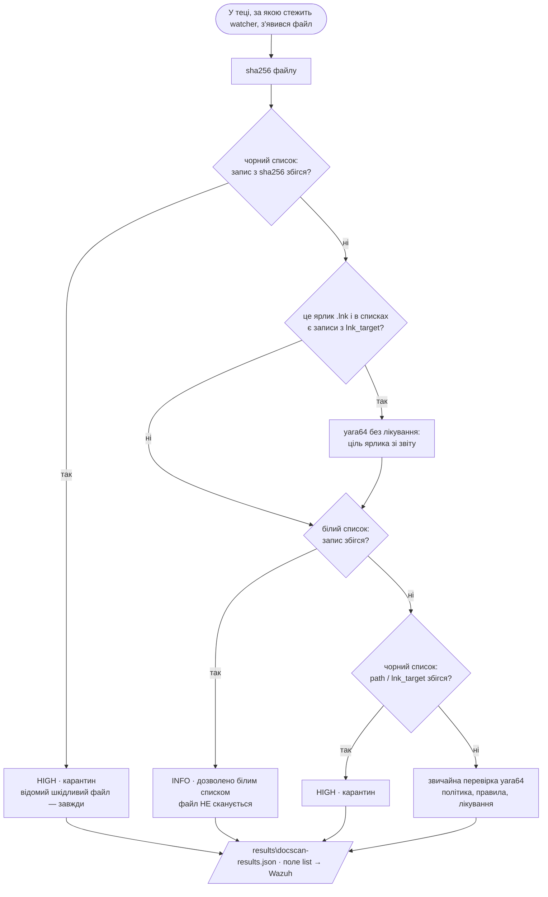
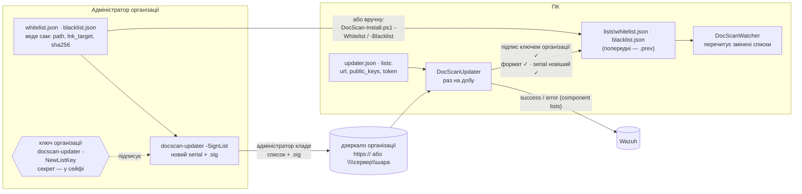

# Білий і чорний списки організації

Дві програми — дві задачі:

| Програма | Що робить зі списками |
|---|---|
| **docscan-watcher.exe** (служба DocScanWatcher) | застосовує списки до кожного нового файлу **до** сканування |
| **docscan-updater.exe** (служба DocScanUpdater) | ставить списки з дзеркала організації (підпис, номер версії, бекап `.prev`); у адміністратора — команди `-CheckList`, `-NewListKey`, `-SignList` |

Модуль YARA списків не знає. Списки лежать на ПК у `C:\ProgramData\DocScan\lists\` (`whitelist.json`,
`blacklist.json`); організація веде їх сама. Формат і приклади — [deploy/README.txt](deploy/README.txt), розділ
«Білий і чорний списки»; код — `watcher-go/orglists` (формат і зіставлення, спільний для обох програм),
`watcher-go/lists.go`, `watcher-go/updater/lists.go`.

Запис списку впізнає файл за одним або кількома полями (якщо кілька — мають збігтися всі):

| Поле | Що порівнюється | Приклад |
|---|---|---|
| `path` | де лежить файл (маска: `*` у межах теки, `**` будь-яка глибина, `?` один символ) | `C:\Users\*\Downloads\*.exe` |
| `lnk_target` | куди веде ярлик (мережева тека) | `\\fileserver\BIN\` |
| `sha256` | вміст файлу (хеш) | `3f5a98b1…` |

## 1. Що робить watcher з новим файлом

Чому такий порядок: своя програма з `sha256` у білому списку проходить навіть з теки, де `*.exe` заборонені
(чорний `path`), а відомий шкідливий файл (чорний `sha256`) не пройде ніколи — навіть якщо його помилково внесли в
білий. На ПК з `-DetectOnly` замість карантину — лише повідомлення.

## 2. Як списки потрапляють на ПК

Будь-яка помилка (немає підпису, чужий ключ, змінений після підпису файл, старіший `serial`, неправильний формат) —
на ПК лишається поточний список, у Wazuh іде `error`. Ключ списків окремий від ключа релізів DocScan: він не
підпише програму, а ключ релізів не підпише список організації.

## 3. Що лишається на совісті організації

- **Маска `path` без `lnk_target` / `sha256`** у білому списку пропускає будь-який файл з такою назвою в такій теці
  без перевірки — для ярлика на свою шару краще `path` + `lnk_target` разом.
- **Ціль ярлика** береться зі звіту модуля docscan: ярлик, у якого ціль записана лише в блоці змінних середовища
  (так їх пише WScript.Shell для недоступної шари), модуль поки не розбирає — ціль порожня, запис з `lnk_target` до
  нього не підходить, і ярлик перевіряється як звичайно.
- **Секретний ключ організації** — у сейфі; на ПК лише публічна частина.
