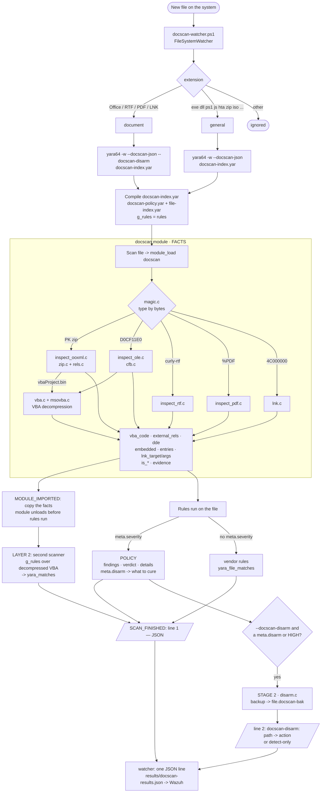

# DocScan on YARA — full documentation

**Language:** [Українська](SCAN-FLOW.md) · English

A fork of YARA 4.6.0 with a custom **`docscan`** module: it detects weaponised documents, runs vendor
rules over the extracted macro, disarms the document and reports the result as JSON. All of it lives
in **one binary**, `yara64.exe`. On top of it, a **watcher** automatically scans new files on the system.

> This is the single project document. Primary sources (the original `doc-scan.ps1`, Mandiant
> material, the article, the full vendor rule corpus) live in `reference/` (not published) and are
> not part of our documentation.

**Contents**
1. [Goals and principles](#1-goals-and-principles)
2. [Overall diagram](#2-overall-diagram)
3. [File map](#3-file-map)
4. [YARA changes — code, function by function](#4-yara-changes--code-function-by-function)
5. [Behaviour: how a scan runs](#5-behaviour-how-a-scan-runs)
6. [YARA rules and the detection policy](#6-yara-rules-and-the-detection-policy)
7. [Watcher — auto-scan of new files](#7-watcher--auto-scan-of-new-files)
8. [Running — cheat sheet](#8-running--cheat-sheet)
9. [Building](#9-building)
10. [Testing](#10-testing)
11. [Environment](#11-environment)
12. [Wazuh integration](#12-wazuh-integration)
13. [Known limitations and caveats](#13-known-limitations-and-caveats)
14. [Git and licensing](#14-git-and-licensing)

---

## 1. Goals and principles

For a document that appears on the system, DocScan must:
1. **Detect** the attack technique by structural parsing → `findings` + `verdict` + evidence.
2. **Check** the extracted (decompressed) VBA with vendor rules — "Layer 2".
3. **Disarm** the document while keeping it (strip the macro / external template / DDE / embedded
   objects; break `\objupdate`; delete a malicious LNK). The original goes to a backup.
4. **Report** — JSON that we currently read by hand and that Wazuh will collect later.

Principles:
- **One binary.** Detection, Layer 2, disarm and JSON are `yara64.exe` flags; there are no separate executables.
- **The module provides facts, the policy decides.** The module (C) only parses the document and
  exposes facts (macro source, external relationships, DDE fields, embedded objects, LNK target/args).
  What is HIGH or MEDIUM, what a finding is called and what gets disarmed is decided by **rules** in
  `docscan-policy.yar` (`meta.severity` / `meta.finding` / `meta.disarm`). An engineer changes the
  policy without rebuilding.
- **The module is read-only.** It runs on a read-only buffer in the middle of a scan and never writes.
  Disarm happens in the CLI layer (`cli/yara.c` → `disarm.c`) **after** the scan, once the file is closed.
- **Type by magic bytes**, not by extension (an `invoice.pdf` that is really a docx is OOXML).
- **No XML parser.** `.rels`/`document.xml` are parsed by token search — safer for untrusted input.
  Every binary read is bounds-checked.
- **Portable C.** Developed on macOS, production is Windows (MSVC). No POSIX-only APIs in the module.
- **No Wazuh coupling.** `yara64.exe` emits plain JSON; delivery is the job of the watcher/agent.
- The reference logic is `reference/doc-scan.ps1` + `reference/mandiant/` (ported from PowerShell to C).

---

## 2. Overall diagram



### The same as text

```
 new file ──► watcher ──► yara64 -w --docscan-json [--docscan-disarm] -C rules.yarc <file>
                             │
     ┌───────────────────────▼─────────────────────────────────┐
     │ docscan MODULE — FACTS only (read-only)                  │
     │  magic ─► ooxml │ ole │ rtf │ pdf │ lnk                  │
     │  vbaProject.bin ─► CFB ─► MS-OVBA ─► vba_code            │
     │  external_rels[] · dde[] · embedded[] · entries[] · lnk  │
     └──────────┬──────────────────────────────────────────────┘
                │ docscan-index.yar rules on the file
     ┌──────────┴───────────────┬─────────────────────────────┐
     ▼                          ▼                             ▼
 POLICY (meta.severity)     vendor rules on the file     LAYER 2: vendor rules
 findings, verdict, details  yara_file_matches            on vba_code → yara_matches
 meta.disarm → what to cure
     └──────────────► line 1: {JSON}   line 2: docscan-disarm: ... -> action | detect-only
                                        └──► watcher: results\docscan-results.json
```

## 3. File map

```
libyara/modules/docscan/            MODULE (C, built into libyara)
  docscan.c                         module fields + module_load → inspectors
  inspect.h                         docscan_result_t — shared result of all inspectors
  magic.{c,h}                       file type by magic bytes
  search.{c,h}                      portable memmem / contains / contains_ci
  dynbuf.h                          growable buffer (header-only)
  zip.{c,h}  miniz.{c,h}            ZIP reading (wrapper over miniz; miniz is public domain, 1 `docscan patch`)
  rels.{c,h}                        OOXML .rels parsing (external relationships)
  inspect_ooxml.c                   OOXML: rels / vbaProject.bin / DDE / embeddings
  cfb.{c,h}                         Compound File (OLE) reader
  msovba.{c,h}                      MS-OVBA VBA decompression
  vba.{c,h}                         locate VBA in a CFB + suspicious constructs
  inspect_ole.c                     legacy .doc/.xls (CFB → VBA)
  inspect_rtf.c / inspect_pdf.c     RTF / PDF
  lnk.c                             binary LNK parsing (MS-SHLLINK)
  disarm.c                          DISARM (called from the CLI, not from the module)
libyara/include/yara/docscan_disarm.h   disarm contract (docscan_disarm_info, docscan_disarm)
libyara/modules/module_list         + MODULE(docscan)
Makefile.am                         + 15 lines MODULES += .../docscan/*.c
windows/vs20{15,17,19}/libyara/libyara.vcxproj   + 15 docscan ClCompile entries
cli/yara.c                          + --docscan-json/-extract/-disarm flags, JSON, Layer 2, do_disarm

docscan-project/
  SCAN-FLOW.md / SCAN-FLOW.en.md    this document (Ukrainian / English)
  rules/
    docscan-policy.yar              POLICY: what is HIGH/MEDIUM, finding names, what to disarm
    docscan.yar                     include docscan-policy.yar (our detection only)
    docscan-index.yar               docscan-policy.yar + file-index.yar (detection + vendor + Layer 2)
    file-index.yar                  vendor rules (on the file and on the decompressed VBA)
    general/                        165 signature-base "strict" rule files (copied from reference)
    maldoc/                         36 document rule files (signature-base + community) + vba_plaintext.yar
  watcher/docscan-watcher.ps1       auto-scan of new files → results\docscan-results.json
  deploy/                           deployment package: build_package.ps1, install.ps1, uninstall.ps1, README.txt
  fuzz/                             libFuzzer: 2 fuzzers, dictionary, corpus, build.sh, regressions/
  test-range/
    run_tests.ps1                   regression test (copy → detect+disarm → re-scan)
    gen_range.ps1                   test-range generator (Windows + Word COM)
    gen_test_range.py               quick synthetic generator (no Office)
    samples/generated/              local duplicate of test-samples/generated (not in git)
  test-samples/                     ORIGINAL test set (never disarm in place!)
    provided/  (7)                  real customer samples (live C2) — NOT in git
    generated/ (16)                 safe test range, one file per vector
  reference/                        primary sources (PS script, Mandiant, article, full vendor corpus) — not in git
```

---

## 4. YARA changes — code, function by function

### 4.1 How the module is wired into YARA

**Registration** (three places):
- `libyara/modules/module_list` — the line `MODULE(docscan)`. `modules.c` includes this file twice
  (X-macro) and builds the `yr_modules_table[]` table of pointers to module functions.
- `Makefile.am` — 15 lines `MODULES += libyara/modules/docscan/*.c` (macOS/Linux, autotools).
- `windows/vs20{15,17,19}/libyara/libyara.vcxproj` — the same 15 files as `<ClCompile>` (MSVC).
  **A new `.c` file must be added to both build systems.**

**Name trick.** `docscan.c` starts with `#define MODULE_NAME docscan`; macros in `yara/modules.h`
rename `module_load` → `docscan__load`, `module_initialize` → `docscan__initialize` and so on. That
is why every YARA module can use the same function names without clashing.

**Lifecycle** (the core calls module functions through `yr_modules_table[]`; we never call them):

| Module function | Called by | When | How often | Ours |
|---|---|---|---|---|
| `module_initialize` | `yr_modules_initialize()` | `yr_initialize()` | once per process | empty |
| `begin_declarations…end_declarations` | `yr_modules_do_declarations()` | a rule has `import "docscan"` | once per compilation | builds the field tree |
| `module_load` | `yr_modules_load()` | **every file scan** | per file | all the work |
| `module_unload` | unload after the scan | after each file | per file | empty |
| `module_finalize` | `yr_modules_finalize()` | `yr_finalize()` | once per process | empty |

Data flow: raw bytes → `docscan_detect_magic` → inspector → `docscan_result_t` → module fields →
(a) rule conditions `docscan.xxx`, (b) `print_docscan_json` in the CLI, (c) `docscan_disarm`.

### 4.2 `docscan.c` — module fields and `module_load`

**Flag fields** (`begin_declarations`), integers 0/1. The "Level" column is what the **default
policy** (`docscan-policy.yar`) does with them; the module itself knows no levels. The flags are kept
for compatibility and convenience; the policy mostly works with the facts below.

| Group | Field | Level | Meaning |
|---|---|---|---|
| type | `is_ooxml` `is_ole` `is_rtf` `is_pdf` `is_lnk` | — | file type by magic |
| RTF | `rtf_objupdate` | HIGH | `\objupdate` — the OLE object updates (is fetched) on open (T1203) |
| | `rtf_embedded_object` | context | `\objdata` / `\objlink` / `\objhtml` (often legitimate; not counted in the verdict) |
| PDF | `pdf_launch` | HIGH | `/Launch` — runs an external program |
| | `pdf_js_auto` | HIGH | JS present plus a dangerous API (see 4.7) |
| | `pdf_js` | MEDIUM | JS without obviously dangerous APIs |
| | `pdf_openaction` | MEDIUM | `/OpenAction` or `/AA` without JS |
| | `pdf_embedded` | MEDIUM | `/EmbeddedFile` |
| OOXML | `remote_template` | HIGH | external `attachedTemplate` → remote URL (T1221) |
| | `protocol_handler` | HIGH | external rel `ms-msdt:` / `search-ms:` … (Follina, T1203) |
| | `dde_auto` | HIGH | `DDEAUTO` in the document body (T1559.002) |
| | `embedded_pe` | HIGH | PE (`MZ`…`PE\0\0`) in `embeddings/oleObject*.bin` |
| | `embedded_lnk` | HIGH | LNK signature in `embeddings/oleObject*.bin` |
| | `macro_suspicious` | HIGH | the decompressed VBA contains exec/download constructs |
| | `macro_present` | MEDIUM | `vbaProject.bin` / a VBA module is present |
| | `external_ole` | MEDIUM | external `oleObject` relationship |
| | `external_frame` | MEDIUM | external `frame` relationship |
| | `dde_link` | HIGH | `DDE ` + cmd/powershell/mshta/rundll32 (not AUTO) |
| LNK | `lnk_url_args` | HIGH | URL/UNC in the arguments |
| | `lnk_obfuscated` | HIGH | `-enc`, `iex`, `-w hidden`, `downloadstring`… in the arguments |
| | `lnk_lolbin` | MEDIUM* | target is a LOLBin (cmd/powershell/mshta/rundll32/…) |
| evidence | `template_url` `dde_command` `vba_evidence` `lnk_target` `lnk_args` | — | strings ≤ 511 chars |
| Layer 2 | `vba_code` | — | the whole decompressed VBA (≤ 2 MB) for re-scanning with vendor rules |

**Facts for policy rules** (arrays are capped; `*_truncated = 1` if there were more — padding a
document with junk must not silently hide the interesting part):

| Field | Type | Contents |
|---|---|---|
| `external_rels[i].part` / `.type` / `.target` | array of structs (≤ 256) | every `TargetMode="External"` relationship: source `.rels`, Type URI, Target as written |
| `number_of_external_rels`, `external_rels_truncated` | integer | |
| `entries[i].name` / `.size` | array (≤ 512) | every ZIP part and its size from the header |
| `number_of_entries`, `entries_truncated` | integer | |
| `embedded[i].name` / `.size` / `.is_pe` / `.is_lnk` | array (≤ 64) | every `embeddings/oleObject*.bin` |
| `number_of_embedded` | integer | |
| `dde[i]` | string array (≤ 32) | every DDE instruction: Word field `DDE…`/`DDEAUTO…` (also split over several `<w:instrText>` — joined), Excel formula `service\|'topic'!…` → `DDE service\|…`, Excel `ddeLink` → `DDE <ddeService> <ddeTopic>` |
| `number_of_dde` | integer | |
| `vba_code`, `lnk_target`, `lnk_args` | string | macro source; LNK target and arguments |

Example in a rule: `for any rel in docscan.external_rels : (rel.target matches /^https?:/i)`.

| Function | What it does |
|---|---|
| `module_initialize` / `module_finalize` / `module_unload` | Empty, `return ERROR_SUCCESS`. |
| `module_load(context, module_object, …)` | 0) allocates `docscan_result_t` on the heap (~250 KB — not on the small scanner-thread stack); 1) zeroes `is_*`; 2) takes the **first** memory block (`foreach_memory_block` + `yr_fetch_block_data`; for a file scan that is the whole file); 3) `docscan_detect_magic` → sets `is_<type>=1` and calls the type's inspector; 4) copies every `docscan_result_t` field into the module fields (`yr_set_integer` / `yr_set_string`); 5) `vba_code` via `yr_set_sized_string`, then frees the buffer (or sets an empty string); 6) sets the fact arrays (`external_rels[%i]…`, `entries`, `embedded`, `dde`) and counters; frees the result. |

### 4.3 `inspect.h` — shared result

`docscan_result_t` holds all flags (see the table above), five fixed `char[512]` evidence buffers
(no malloc) and `char* vba_code` + `vba_code_len` (malloc'd, freed by `module_load`). Inspectors are
plain C with no YARA dependency: they take `(data, size, *r)` and only set fields. Declarations:
`docscan_inspect_{rtf,pdf,ooxml,ole,lnk}`.

### 4.4 `magic.c`, `search.c`, `dynbuf.h` — basic utilities

| Function | What it does |
|---|---|
| `docscan_detect_magic(data, size)` | First 4 bytes: `PK` → OOXML; `D0 CF 11 E0` → OLE; `{\rt` → RTF; `4C 00 00 00` → LNK; `%PDF` → PDF; otherwise UNKNOWN. Safe on NULL/short buffers. |
| `docscan_memmem(hay, len, needle, nlen)` | Byte search (MSVC has no `memmem`). First byte via `memchr`, then `memcmp`. |
| `docscan_contains(hay, len, token)` | 1 if the NUL-terminated token occurs in the buffer (case-sensitive). |
| `docscan_contains_ci(hay, len, token)` | Same, case-insensitive (ASCII). |
| `docscan_buf_push(b, src, n)` / `docscan_buf_free(b)` | Growable buffer: starts at 4 KB, doubles; `-1` on allocation failure. Used by `cfb.c`, `msovba.c`. |

### 4.5 OOXML: `zip.c`, `rels.c`, `inspect_ooxml.c`

OOXML (docx/xlsx/pptx) is a DEFLATE-compressed ZIP, so a raw byte search cannot see the content —
the parts must be decompressed.

**`zip.c`** — a thin wrapper over miniz:

| Function | What it does |
|---|---|
| `docscan_zip_open(data, size)` | `mz_zip_reader_init_mem` over an in-memory buffer; NULL if not a ZIP. |
| `docscan_zip_count(z)` | Number of entries. |
| `docscan_zip_entry_name(z, i, buf, sz)` | Name of entry i (truncated to `sz-1`). |
| `docscan_zip_extract(z, i, &out_size)` | Decompresses an entry to the heap. Entries whose header claims > 64 MB (`DOCSCAN_ZIP_MAX_ENTRY`) are skipped — zip-bomb protection. |
| `docscan_zip_free(p)` / `docscan_zip_close(z)` | Release. |

**`rels.c`** — `.rels` parsing without an XML parser:

| Function | What it does |
|---|---|
| `docscan_scan_rels(xml, size, part, r)` | Walks every `<Relationship …>`; only `TargetMode="External"` is of interest. Each such relationship is recorded in the `external_rels[]` facts (with the `part` name). If `Target` is a protocol handler → `protocol_handler` + `template_url`. Otherwise by the last segment of `Type`: `attachedTemplate` with a remote target → `remote_template` + `template_url`; `oleObject` → `external_ole`; `frame` → `external_frame`. |
| `get_attr(tag, len, "Attr=\"", out, sz)` | Attribute value inside the tag up to the next `"`. Leaves the buffer untouched if the attribute is missing (hence the buffers start as `""`). |
| `starts_with_ci(s, prefix)` | Case-insensitive prefix test. |
| `is_remote_target(t)` | `http(s)://`, `ftp(s)://`, `sftp://`, UNC `\\host\share`, `file://host/…`, `file:////host/…`. `file:///C:/…` (no host) and `file://localhost` are local. |
| `is_protocol_handler(t)` | `ms-msdt:`, `search-ms:`, `search:`, `ms-officecmd:`, `mhtml:`, `ms-word:`, `ms-excel:`, `ms-powerpoint:`, `!x-usc:`. |

**`inspect_ooxml.c`**:

| Function | What it does |
|---|---|
| `docscan_inspect_ooxml(data, size, r)` | Opens the ZIP; records every part in the `entries[]` facts; by the name of each entry: `*.rels` → `docscan_scan_rels`; `*vbaProject.bin` → `macro_present=1` + `docscan_scan_vba_container`; document body (Word/Excel) → `scan_dde`, plus `record_excel_formulas` for `xl/worksheets/`; `xl/externalLinks/externalLink*.xml` → `record_excel_ddelink`; `embeddings/oleObject*.bin` → `scan_embedded_ole`. |
| `is_body_xml(name)` | `word/document.xml`, `word/header*.xml`, `word/footer*.xml`, `xl/worksheets/sheet*.xml`, `xl/workbook.xml`. |
| `is_embedded_ole(name)` | `embeddings/oleObject*.bin`. |
| `record_dde(xml, n, r)` | Fact: every `DDEAUTO…` or `DDE …` instruction (case-insensitive) → `dde[]` (≤ 32). End: in a `w:instr="…"` attribute — at `"`, in `<w:instrText>` text — at `<` (quotes inside the command are kept). The first instruction → `dde_command` evidence. |
| `scan_dde(xml, n, r)` | `record_dde` + `record_complex_fields`; then the flags: `DDEAUTO` (case-insensitive) → `dde_auto`; `DDE ` + cmd/powershell/mshta/rundll32 → `dde_link`. |
| `record_complex_fields(xml, n, r)` | Word complex fields: joins the text of every `<w:instrText>` from `fldChar begin` to `separate`/`end` — catches `DDE` + `AUTO …` split over several runs (a known way to dodge a string search). |
| `is_dde_formula` / `record_excel_formulas(xml, n, r)` | A formula in `<f>…</f>` of the form `service\|'…'!…` (`cmd\|' /c calc'!A0`) → `dde[]` as `DDE <formula>`. |
| `record_excel_ddelink(xml, n, r)` | `<ddeLink ddeService="…" ddeTopic="…">` → `dde[]` as `DDE <service> <topic>`. |
| `add_dde(r, s)` | Adds an instruction to `dde[]` (trimmed, deduplicated); the first one → `dde_command` evidence. |
| `scan_embedded_ole(d, n, e, r)` | Each object is recorded in `embedded[]` (name, size, `is_pe`, `is_lnk`). 20-byte LNK signature (header + CLSID) → `embedded_lnk` and parse of that LNK (`docscan_inspect_lnk` → target/args); `MZ` whose `e_lfanew` < 0x1000 points at `PE\0\0` → `embedded_pe`. |
| `ends_with(s, suffix)` | Helper. |

### 4.6 OLE and VBA: `cfb.c`, `msovba.c`, `vba.c`, `inspect_ole.c`

Macros live in a Compound File (`vbaProject.bin` in OOXML, or the whole legacy `.doc/.xls`) and are
MS-OVBA-compressed. The chain: **CFB → streams → find an MS-OVBA container → decompress → VBA source → keywords**.

**`cfb.c`** — a minimal CFB reader for v3 (512-byte sectors) and v4 (4096-byte sectors): sector `n` starts at
`(n+1) × sectorSize`. Every read is bounds-checked; every chain (FAT, DIFAT, mini FAT) and array is bounded
by the sectors in the file; stream ≤ 4 MB, ≤ 64 MB in total; sector-size exponents (7–16) are validated before shifting.
a longer chain means a cycle; stream ≤ 4 MB, at most 64 MB in total handed to the callback. The sector
size exponents are validated (7–16) before shifting.

| Function | What it does |
|---|---|
| `docscan_cfb_foreach_stream(data, size, cb, ud)` | 1) FAT sector numbers: 109 DIFAT entries in the header + the DIFAT chain; 2) builds the FAT; 3) directory stream; 4) mini stream (starts at the root entry, `dir+116`); 5) mini FAT; 6) for every type-2 (stream) entry: streams < `miniCutoff` via the mini FAT, larger ones via the FAT; calls `cb(bytes, len, ud)`; `cb` returns ≠0 to stop. `-1` — not a CFB / broken header. |
| `read_chain(…)` | Follows a FAT chain and concatenates sectors into a buffer. |
| `u16` / `i32` / `u32` / `i32_push` | Bounds-checked little-endian reads; growable int32 array. |

**`msovba.c`**:

| Function | What it does |
|---|---|
| `docscan_msovba_decompress(buf, len, start, max_out, &out_size)` | MS-OVBA decompression ([MS-OVBA] 2.4.1): signature `0x01`, then chunks with a 2-byte header (size, signature 3, compressed flag). An uncompressed chunk is copied; a compressed one has a flag byte per 8 tokens: literal or back-reference (offset/length with a bit count that depends on the position in the chunk). Reads the byte before `push` (realloc-safe). Stops at `max_out`. NULL on error/empty output. |

**`vba.c`**:

| Function | What it does |
|---|---|
| `docscan_scan_vba_container(cfb, size, r)` | `docscan_cfb_foreach_stream(..., vba_stream_cb, r)`. |
| `vba_stream_cb(data, size, r)` | In each stream looks for byte `0x01` + a chunk header with signature 3 → first a cheap preview (first 64 bytes), full decompression (≤ 4 MB) only if it looks like VBA. A real module starts with `Attribute VB_…` (checks `Attribut` in the first 48 bytes) → `macro_present=1`; every keyword from `SUS[]` (case-insensitive) → `macro_suspicious=1` + `add_evidence`. Appends the module source to `vba_code` (up to 2 MB, modules separated by `\n`). One module per stream. |
| `add_evidence(r, kw)` | Appends `kw` to `vba_evidence` as `a \| b \| c` without exceeding 512 bytes. |

`SUS[]` (suspicious constructs, from `$sus` in `doc-scan.ps1`): `powershell`, `cmd.exe`, `mshta`,
`rundll32`, `regsvr32`, `certutil`, `bitsadmin`, `WScript.Shell`, `CreateObject`, `Shell`, `.Run`,
`.Exec`, `DownloadString`, `DownloadFile`, `URLDownloadToFile`, `XmlHttp`, `WinHttp`, `FromBase64`,
`StrReverse`, `Environ`, `AutoOpen`, `Auto_Open`, `Document_Open`, `Workbook_Open`, `Auto_Exec`.

**`inspect_ole.c`**:

| Function | What it does |
|---|---|
| `docscan_inspect_ole(data, size, r)` | `_VBA_PROJECT` marker → `macro_present`; the whole file is a CFB → `docscan_scan_vba_container`. |

### 4.7 RTF, PDF, LNK

| Function | File | What it does |
|---|---|---|
| `docscan_inspect_rtf` | `inspect_rtf.c` | `\objupdate` → `rtf_objupdate`; `\objdata`/`\objlink`/`\objhtml` → `rtf_embedded_object`. |
| `docscan_inspect_pdf` | `inspect_pdf.c` | `/Launch` → `pdf_launch`; `/JavaScript` or `/JS` + a dangerous API → `pdf_js_auto`, without one → `pdf_js`; `/OpenAction` or `/AA` without JS → `pdf_openaction`; `/EmbeddedFile` → `pdf_embedded`. |
| `pdf_has_dangerous_js` | `inspect_pdf.c` | Looks for: `app.launchURL`, `exportDataObject`, `importDataObject`, `getAnnots`, `submitForm`, `Collab.`, `util.printf`, `getIcon`, `media.newPlayer`, `eval(`, `unescape(`, `String.fromCharCode`, `.exe`, `powershell`, `cmd.exe`, `rundll32`, `mshta`, `certutil`, `Net.HTTP`, `SOAP.`, `heapLib`, `shellcode`. Benign viewer JS (`this.print`, `app.alert`) is deliberately not listed. |
| `docscan_inspect_lnk` | `lnk.c` | MS-SHLLINK parsing (instead of the `WScript.Shell` COM object): HeaderSize=0x4C → LinkFlags → IDList → LinkInfo → StringData (Name, RelativePath, WorkDir, **Arguments**). **Target**, in order: `LocalBasePathUnicode` (if `LinkInfoHeaderSize ≥ 0x24`) → `LocalBasePath` (ANSI) → network: `NetName` + `CommonPathSuffix` (`\\server\share\…`) → `RelativePath` → path rebuilt from the IDList. UTF-16 strings → UTF-8 (Cyrillic preserved); ANSI bytes ≥ 0x80 → U+0080…U+00FF, so the output is always valid UTF-8. Flags `lnk_lolbin` / `lnk_url_args` / `lnk_obfuscated` (lists as in the policy). |
| `put_utf8` / `cpy_utf16` / `cpy_ansi` / `cpy_stringdata` | `lnk.c` | UTF-16LE → UTF-8 (surrogate pairs; a lone surrogate → U+FFFD); ANSI → valid UTF-8; StringData (count + chars). |
| `idlist_path` / `beef0004_name` / `printable` | `lnk.c` | Path from the LinkTargetIDList: volume item (`X:\`) + file/folder items (long name from the `0xBEEF0004` extension, offset by version: v9 0x2E, v8 0x2A, v7 0x26, v3 0x14; otherwise the 8.3 name); non-printable names are dropped. |
| `rd16` / `rd32` / `ci_streq` | `lnk.c` | Bounds-checked reads; case-insensitive compare (MSVC has no `strcasecmp`). |

### 4.8 Disarm: `docscan_disarm.h` + `disarm.c`

Compiled into libyara but **called only from the CLI** (`do_disarm` after the scan).

`docscan_disarm_info` — what the scan found: `present`, `type` (1 ooxml, 2 ole, 3 rtf, 4 pdf, 5 lnk),
`high`, `macro`, `remote_template`, `protocol_handler`, `dde_auto`, `embedded`, `rtf_objupdate`, `lnk_bad`,
`quarantine`, `backup_dir` (UTF-8; NULL → `<file>.docscan-bak` next to it).

All paths are UTF-8; on Windows file operations go through `_wfopen`/`_wremove`/`_wrename`
(`ds_fopen`/`ds_remove`/`ds_rename`), so Cyrillic file and folder names work. The cured ZIP is built in
memory (`mz_zip_writer_init_heap`) and written by our `write_file` — miniz's file API uses ANSI `fopen`.

| Function | What it does |
|---|---|
| `docscan_disarm(path, info, out_action, sz)` | Dispatcher: no action → `detect-only`; legacy OLE (`.doc/.xls`) with any action → quarantine (cannot be cured in place); PDF without `quarantine` → `detect-only`; **backup** — if it fails the file is not touched (`failed:backup`); `quarantine` or LNK with `lnk_bad` → delete (`quarantined` / `deleted:lnk`); RTF → `cure_rtf`; OOXML → `cure_ooxml`. |
| `cure_ooxml(path, info, action, sz)` | Repacks the ZIP with miniz into `<file>.docscan-tmp`: **does not copy** `vbaProject.bin`/`vbaData.xml` (macro) or `embeddings/oleObject*.bin`; in `*.rels` removes `<Relationship>` elements with the markers `vbaProject` / `oleObject` / `attachedTemplate` / every protocol handler (`ms-msdt:`, `search-ms:`, `search:`, `ms-officecmd:`, `mhtml:`, `ms-word:`, `ms-excel:`, `ms-powerpoint:`, `!x-usc:`); in `[Content_Types].xml` the `<Override>` with `vbaProject`; in `word/document.xml`/header/footer `DDEAUTO` → `REMOVED`. Then replaces the original. If any part cannot be read (or is > 64 MB) the cure is aborted, the original is left unchanged and the action is `failed:unreadable-part`. Actions: `removed:vbaProject.bin`, `removed:embeddings`, `removed:remote-template`, `removed:protocol-rel`, `stripped:dde`. |
| `cure_rtf(path, action, sz)` | `\objupdate` → `\objupdatX` (control word broken, same length) → `stripped:objupdate`. |
| `remove_elements(in, len, markers, n, &out_len)` | Copies the XML, dropping `<Relationship …>` / `<Override …>` elements that contain any marker. |
| `strip_dde(buf, len)` | In place, same length: `DDEAUTO` → `REMOVED`, `DDE ` → `REM `. Case-insensitive (like detection) and only at the start of a field instruction (after `>` or `"` plus spaces) — ordinary text containing "DDE" is left alone. |
| `backup(path, backup_dir)` | Copy of the original: with `backup_dir` — `<dir>\<name>.<n>.docscan-bak` (unique `n`, earlier backups are never overwritten), otherwise `<path>.docscan-bak`. On failure — a message on stderr with the path and `errno`. |
| `blank_dde_fields(buf, len)` | Word complex fields whose joined instruction starts with `DDE`: every `<w:instrText>` of that field is filled with spaces (same length). |
| `remove_dde_formulas(in, len, &out)` | Excel: removes `<f>…</f>` holding a DDE formula; the cached `<v>` value stays. |
| `blank_ddelink(buf, len)` | Excel: `ddeService`/`ddeTopic` values → spaces. |
| `read_file` / `write_file` / `file_exists` / `base_name` / `append` / `name_is` | File into memory / write (via `ds_fopen`); helpers. |

### 4.9 Changes in `cli/yara.c`

**Flags:**

| Flag | Variable | Action |
|---|---|---|
| `--docscan-json` | `docscan_json` | one JSON line per file: findings and verdict **from the policy rules**, vendor matches on the file and on the VBA; **suppresses the normal match output** |
| `--docscan-extract=FILE` | `docscan_extract` | writes `vba_code` to FILE (manual Layer 2) |
| `--docscan-disarm` | `docscan_disarm_flag` | after the scan, disarms the file according to `meta.disarm` of the matching rules; HIGH without actions → `detect-only` |
| `--docscan-backup-dir=DIR` | `docscan_backup_dir_utf8` | backups and quarantine go to DIR (must exist). On Windows the value is taken from the original Unicode arguments (YARA's parser hands string options over as ANSI — Cyrillic would be lost) |
| `--file-vars` (also implied by `--docscan-json`) | `file_vars` | THOR/LOKI external variables: `filename` (name), `filepath` (absolute directory), `extension` (`.exe`, lower case), `filetype` (`EXE`/`ELF`/`MACH-O`/`MDMP`/`ZIP`/`RAR`/`7Z`/`RTF`/`PDF`/`OLE` by magic; `VBS`/`BATCH`/`PowerShell`/`Python`/`PHP`/`JSP`/`ASP`/`JS`/`HTA` by extension), `owner` (empty). Declared empty at compile time and set per file (`file_vars_set` in `scan_file`), so signature-base rules such as `EXE_cloaked_as_TXT` work as in THOR. For `-C`: compile with `-d filename= -d filepath= -d extension= -d filetype= -d owner=` |

**Per-file state** — `DOCSCAN_STATE` in `CALLBACK_ARGS` (`dsc`): `ftype`, evidence copies, a copy of
`vba_code`, `max_severity`, `findings`, `details`, `file_matches`, `docscan_disarm_info ds`. Global:
`g_rules` — the loaded rules (for Layer 2).

**Why this way.** YARA unloads modules at the end of `yr_execute_code`, **before** the rule-match
callbacks. So the facts are copied at `MODULE_IMPORTED`, matches are collected at `RULE_MATCHING`, and
the JSON is printed at `SCAN_FINISHED`, when everything is known.

**Hooks into the YARA flow:**
- `CALLBACK_MSG_MODULE_IMPORTED` (the `docscan` object) → `docscan_capture`; with `--docscan-extract` — writes `vba_code`.
- `CALLBACK_MSG_RULE_MATCHING` → `docscan_on_match`; in `--docscan-json` mode the normal output is not printed.
- `CALLBACK_MSG_SCAN_FINISHED` → `print_docscan_json`.
- After `yr_scanner_scan_file` (single- and multi-threaded path): `--docscan-disarm` and (a policy
  action **or** a HIGH verdict) → `do_disarm`.

**Functions:**

| Function | What it does |
|---|---|
| `docscan_capture(m, st)` | Resets the state, determines `ftype`/`ds.type`, copies evidence and `vba_code` from the module object. |
| `docscan_on_match(rule, st)` | If the rule has `meta.severity` it is a **policy rule**: updates `max_severity`, adds `meta.finding` (or the rule name) to `findings`, an object to `details` (`rule`, `finding`, `severity`, `disarm`, `mitre`), `meta.disarm` → a flag in `ds`. Otherwise it is a **vendor rule** → `file_matches`. |
| `docscan_meta(rule, name)` | Value of a string meta field (via `yr_rule_metas_foreach`). |
| `print_docscan_json(st)` | Prints the JSON; **Layer 2**: a second `YR_SCANNER` with `g_rules` over the `vba_code` copy, matches via `vendor_match_cb` → `yara_matches`. |
| `vendor_match_cb(...)` | Second-scanner callback: adds rules **without** `meta.severity` (the policy describes documents, not VBA text). |
| `docscan_json_evidence` / `docscan_defang` / `docscan_json_puts` | Evidence printing with defang (`http`→`hxxp`) and JSON escaping. |
| `docscan_list_add` / `docscan_list_has` / `docscan_state_reset` / `docscan_copy_string` | Helpers: JSON lists, state reset (frees the VBA copy), copying module strings. |
| `do_disarm(file_path, ds)` | `docscan_disarm` + the line `docscan-disarm: <path> -> <action>`; on Windows Unicode — wide→UTF-8. |

**JSON format (line 1):**
```json
{"ftype":"ooxml","findings":["MACRO_PRESENT","MACRO_SUSPICIOUS","MACRO_AUTOEXEC"],"verdict":"HIGH",
 "evidence":{"vba_evidence":"powershell | DownloadFile | AutoOpen"},
 "yara_matches":["powershell","VBA_AutoExec_DownloadCradle"],
 "yara_file_matches":[],"yara_info_matches":["Contains_VBA_macro_code","office_document_vba"],
 "details":[{"rule":"DS_MACRO_SUSPICIOUS","finding":"MACRO_SUSPICIOUS","severity":"HIGH","disarm":"macro","mitre":"T1204.002"}, …]}
```
`verdict` — the highest `meta.severity` among matching policy rules (`INFO` if none). `evidence` —
non-empty module strings (`vba_evidence` is an informative keyword list from `vba.c`, it does not
affect the verdict). **Line 2** (only with `--docscan-disarm`): `docscan-disarm: <path> -> <action>[,…]`
or `detect-only`.

## 5. Behaviour: how a scan runs

1. **Preparation.** The original is never touched: for manual tests use a copy `work.<ext>`
   (`run_tests.ps1` does this itself and compares the originals' SHA256). The watcher scans the file in place.
2. **Rule compilation.** `docscan-index.yar` = `docscan-policy.yar` + `file-index.yar` → `g_rules`.
3. **Module.** `module_load`: magic → inspector → facts and flags (see §4). The facts are copied in the CLI.
4. **Rules on the file.** Policy rules (`meta.severity`) → findings, verdict, disarm actions; other
   rules → `yara_file_matches`, rules tagged `docscan_info` → `yara_info_matches`.
5. **LAYER 2.** The decompressed VBA is re-scanned with the same rules → `yara_matches`. Ordinary
   `$string` rules only see the input buffer, and VBA inside a document is compressed — without
   Layer 2 vendor rules never see the macro.
6. **STAGE 1 — JSON** at `SCAN_FINISHED`. `verdict`: **HIGH** → respond/disarm; **MEDIUM** → review; **INFO** → clean.
7. **STAGE 2 — disarm** (`--docscan-disarm`): the actions from `meta.disarm` of the matching rules.
   First a backup `<file>.docscan-bak`, then:

   | `meta.disarm` | Type | Action | Output |
   |---|---|---|---|
   | `macro` | OOXML | strip `vbaProject.bin`/`vbaData.xml` + rels/content-type | `removed:vbaProject.bin` |
   | `remote_template` | OOXML | remove the external `attachedTemplate` rel | `removed:remote-template` |
   | `protocol_handler` | OOXML | remove the rel with a protocol handler | `removed:protocol-rel` |
   | `dde` | Word | `DDEAUTO` → `REMOVED`, `DDE` → `REM`; a split field — every `<w:instrText>` → spaces | `stripped:dde` |
   | `dde` | Excel | DDE formulas `<f>` removed (the `<v>` value stays); `ddeLink` — `ddeService`/`ddeTopic` → spaces | `stripped:dde` |
   | `embedded` | OOXML | strip `embeddings/oleObject*.bin` | `removed:embeddings` |
   | `rtf_objupdate` | RTF | `\objupdate` → `\objupdatX` | `stripped:objupdate` |
   | `lnk_delete` | LNK | delete the file (backup kept) | `deleted:lnk` |
   | `quarantine` | any | back up to `--docscan-backup-dir` + delete the original | `quarantined` |
   | any | legacy OLE (`.doc/.xls`) | cannot be cured in place → quarantine | `quarantined` |
   | — (HIGH without actions, e.g. PDF) | any | nothing | `detect-only` |
   | any | OOXML with an unreadable / > 64 MB part | cure aborted | `failed:unreadable-part` |

   Any action: if the backup fails → `failed:backup`, the file is not changed. An action that does not fit the file type is ignored.
8. **Check.** Re-scan the disarmed copy → expect `INFO` (LNK gone, PDF stays HIGH).

## 6. YARA rules and the detection policy

### 6.1 The policy — `rules/docscan-policy.yar`

The main file an engineer tunes. Every rule with `meta.severity` is a policy rule:

| meta | Required | Meaning |
|---|---|---|
| `severity` | yes | `HIGH` / `MEDIUM` / `INFO` — marks the rule as policy |
| `finding` | no | name in `findings` (default: the rule name) |
| `disarm` | no | what to disarm: `macro`, `remote_template`, `protocol_handler`, `dde`, `embedded`, `rtf_objupdate`, `lnk_delete`, `quarantine` |
| `mitre` | no | technique ID, copied into `details` |

A policy rule must not be `private` (YARA never reports private rules).

**Default policy:**

| Rule | Condition (short) | severity | disarm |
|---|---|---|---|
| `DS_REMOTE_TEMPLATE` | external `attachedTemplate` to http(s)/ftp/UNC/`file://host` (not `file:///C:`) | HIGH | `remote_template` |
| `DS_PROTOCOL_HANDLER` | external target `ms-msdt:`, `search-ms:`, `search:`, `ms-officecmd:`, `mhtml:`, `ms-word:`… | HIGH | `protocol_handler` |
| `DS_DDE_AUTO` | a `dde[]` entry starts with `DDEAUTO` | HIGH | `dde` |
| `DS_DDE_LINK` | `DDE ` (not AUTO): Word field, Excel formula `cmd\|'…'!A0`, Excel `ddeLink` — containing cmd/powershell/mshta/rundll32/regsvr32/msiexec/certutil/bitsadmin/wscript/cscript | HIGH | `dde` |
| `DS_EMBEDDED_PE` / `DS_EMBEDDED_LNK` | `embedded[].is_pe` / `.is_lnk` | HIGH | `embedded` |
| `DS_EXTERNAL_OLE` / `DS_EXTERNAL_FRAME` | external `oleObject` (not Follina) / `frame` | MEDIUM | — |
| `DS_MACRO_PRESENT` | VBA present | MEDIUM | — |
| `DS_MACRO_SUSPICIOUS` | in `vba_code`: Shell, WScript.Shell, powershell, cmd.exe, mshta, rundll32, regsvr32, certutil, bitsadmin, URLDownloadToFile, DownloadFile/String, FromBase64String, StrReverse; `.Run`/`.Exec` on a shell object | HIGH | `macro` |
| `DS_MACRO_AUTOEXEC` | AutoOpen, Document_Open, Workbook_Open… | MEDIUM | — |
| `DS_MACRO_NETWORK` | XMLHTTP, WinHttp, InternetOpen, Net.WebClient | MEDIUM | — |
| `DS_RTF_OBJUPDATE` | RTF and `\objupdate` | HIGH | `rtf_objupdate` |
| `DS_PDF_LAUNCH` | `/Launch` | HIGH | `quarantine` |
| `DS_PDF_JS_AUTO` / `DS_PDF_JS` | `/JavaScript`/`/JS` with / without a dangerous API | HIGH (`quarantine`) / MEDIUM | |
| `DS_PDF_OPENACTION` | `/OpenAction`/`/AA` without JS (usually start page/zoom) | INFO | — |
| `DS_PDF_EMBEDDED` | `/EmbeddedFile` | MEDIUM | — |
| `DS_LNK_URL_ARGS` | URL/UNC in the arguments | HIGH | `lnk_delete` |
| `DS_LNK_OBFUSCATED` | `-enc`, `iex`, `-w hidden`, `downloadstring`… | HIGH | `lnk_delete` |
| `DS_LNK_REMOTE_EXEC` | the target is an executable on a network share (`\\server\…\x.exe`, `.ps1`, `.vbs`, `.hta`…) | HIGH | `lnk_delete` |
| `DS_LNK_REMOTE_TARGET` | the target is on a share but not executable (folder, document) | MEDIUM | — |
| `DS_LNK_LOLBIN` | the target is a LOLBin | MEDIUM | — (the shortcut is not deleted) |

**How to change it:**
```yara
// make any auto-run macro HIGH:
rule DS_MACRO_AUTOEXEC { meta: severity = "HIGH" finding = "MACRO_AUTOEXEC" disarm = "macro"
  condition: docscan.vba_code matches /\b(AutoOpen|Document_Open|Workbook_Open)\b/i }

// your own vector: a document with a part larger than 20 MB
rule ORG_HUGE_PART { meta: severity = "MEDIUM" finding = "HUGE_PART"
  condition: for any e in docscan.entries : (e.size > 20MB) }
```
After a change — check it compiles (`yara64 -w docscan-policy.yar any-file`) and run `run_tests.ps1`.

**What the false-positive test found** (~4,000 open documents, 2026-11-02) and what the default policy
now handles: local templates `file:///C:\…` (were HIGH), `Selection.Find.Execute` (`.Exec`),
`Application.Run "Macro"` (`.Run`), a bare `Workbook_Open` or `CreateObject` (were HIGH → now MEDIUM),
Start-menu shortcuts to PowerShell/cmd (would have been deleted by disarm). Office HIGHs on clean POI
files — from 11 to 0 (Excel DDE — 0); RTF 0; LNK 0 HIGH (32 MEDIUM: LOLBins, shortcuts to file servers).
PDF: 2 HIGHs on pdf.js test files made exactly for `/Launch` and `launchURL` — by policy they go to
**quarantine**; if you see such legitimate PDFs, remove `disarm = "quarantine"`.

### 6.2 Rule files

| File | Purpose | Contents |
|---|---|---|
| `rules/docscan-policy.yar` | policy | `import "docscan"` + the `DS_*` rules |
| `rules/docscan.yar` | our detection only | `include "docscan-policy.yar"` |
| `rules/docscan-index.yar` | **full scan** (watcher, run_tests) | `include "docscan-policy.yar"` + `include "file-index.yar"` |
| `rules/file-index.yar` | vendor rules (**generated**) | 1460 files, 7176 rules: `general/` (signature-base), `general/elastic/` (Elastic protections-artifacts, Windows/Multi), `maldoc/signature-base/`, `maldoc/community/` + `maldoc/vba_plaintext.yar` |
| `rules/general/`, `rules/general/elastic/`, `rules/maldoc/signature-base/`, `rules/maldoc/community/` | vendor rules (**generated**, do not edit) | signature-base + Elastic + Yara-Rules, filtered per rule |
| `rules/maldoc/vba_plaintext.yar` | our rules for decompressed VBA | edited by hand |
| `rules/tools/build_vendor_rules.py` | generator | pinned sources, filter, renames, tags, compile check |
| `rules/tools/vendor-selection.txt` | which source files are used | `<dir> <source> <path>` |
| `rules/tools/vendor-report.md` | build report | what was dropped and why, duplicates skipped, renamed, tagged `docscan_info` |
| `rules/tools/make_candidates.py` | candidates to add | every not-yet-selected signature-base file and Elastic Windows/Multi file, same filter; each file compiled alone; all of them → `cand.yarc` (namespace = file) |
| `rules/tools/fp_scan.ps1` | false-positive check | `cand.yarc` over a clean Windows (`C:\Windows`, `Program Files`, `ProgramData`) with `--file-vars` → `hits.txt`, `summary.txt` |

**How the vendor set is built** (`python3 rules/tools/build_vendor_rules.py [--fetch]`):
1. Sources live in `reference/vendor-rules-full-later/vendor/` (not in git), commits pinned in `SOURCES`;
   `--fetch` clones/checks them out.
2. Files from `vendor-selection.txt` are taken; every rule is checked on its own:
   - **dropped** if it cannot fire on a Windows workstation: the condition requires ELF / Mach-O /
     Java `.class`, Android, a rule named `LNX_`/`ESXi`/`_SH_`/`_PY_` without a file-type check, PHP/JSP/ASPX
     webshell source (such files are not scanned). A condition that accepts PE or ZIP/JAR keeps the rule
     (e.g. "PE or ELF", compiled webshell DLLs). The file name alone decides nothing;
   - **dropped by hand** (`DROP`: name or `(file, name)` + reason) — false positives, outdated copies;
   - **skipped as a duplicate** when a rule with the same name and the same strings/condition was already
     taken from another file ("Duplicates skipped" in the report);
   - **renamed** on identifier clashes between different rules (`RENAME`) instead of excluding a whole file;
   - **tagged `docscan_info`** (`INFO`) when it is an indicator rather than a detection: "a macro exists",
     the word `powershell`, PDF structure/metadata anomalies, PDF features the policy grades itself.
3. `file-index.yar` is generated and compiled with `yarac` (with the THOR variables); any error or a name
   clash between different rules fails the build. `--check` tells whether `rules/` matches the generator.

**How new rules are added** (this is how the 2026-11-04 set was built):
1. `python3 rules/tools/make_candidates.py DIR` → candidates and `DIR/cand.yarc`. On Windows compile them
   there with its own `yarac` (a `.yarc` from another build may not load: different `pe` module fields).
2. `fp_scan.ps1 -Rules cand.yarc` on a **clean** Windows; plus a scan of benign documents.
3. Review every rule with a hit by hand: a false positive → `DROP` with a reason; files the watcher never
   scans (`.evtx` logs, the Defender cache) are not a reason to drop.
4. Files without false positives go into `vendor-selection.txt`; rebuild with the generator; `run_tests.ps1`.

Check of 2026-11-04: Windows Server 2022, 129,564 files, 4 rules with hits — 2 dropped
(`Windows_VulnDriver_Csc`, `Windows_VulnDriver_SmSerl64`: inbox Microsoft drivers), 2 kept
(`SUSP_PS1_JAB_Pattern_Jun22_1` — PowerShell event logs, `SUSP_XORed_MSDOS_Stub_Message` — Defender cache);
476 benign documents — 0. Then a Windows 10 workstation with Office/Adobe/Acronis (`yara64` with
OpenSSL): the 14 files using `pe.number_of_signatures` — 0 hits; the full set — the new rules are clean
(`Windows_VulnDriver_Ksld` dropped: a Defender driver); false HIGHs came only from the old `maldoc_*`/
`ppaction`/`possible_exploit`/`Contains_VBE_File` rules on binaries → the `docscan_doc` tag. Hits in
PowerShell logs/transcripts, `.xml`, `.lua` and the rule files themselves are not counted (the watcher
does not scan such files).

**Tags in JSON:** a vendor match → `yara_file_matches` (detection: document → at least MEDIUM,
general → HIGH); a `docscan_info` match → `yara_info_matches` (for the analyst only, does **not** raise
the verdict, ignored in Layer 2). The `docscan_doc` tag (the generator puts it on every `maldoc/` rule) marks a document rule: on a
file the module did not recognise as a document (`ftype=unknown`: exe, dll, scripts) its match goes to
`yara_info_matches`. Shellcode patterns (`getEIP`, PEB access) and words like `ppaction` are strong in a
document but ordinary code in any binary: without this tag they gave ~2,900 false HIGHs on .NET/Adobe/
Acronis files of a clean Windows 10.

Rules for index files:
- `include` paths **use `/`**, relative to the index file or absolute (YARA treats `\` as an escape).
- Only rules that compile on their own. One broken rule breaks the whole index.
- Vendor rules must **not** have `meta.severity` — otherwise the CLI treats them as policy.

## 7. Watcher — auto-scan of new files

`docscan-project/watcher/docscan-watcher.ps1` (PowerShell 5.1, UTF-8 with BOM). **One `yara64` run per file.**
Rules are compiled **once at start** (`yarac64.exe` next to `yara64.exe` → `<OutDir>\rules.yarc`), then every
scan is `yara64 -C rules.yarc`: 7000+ rules take ~0.5 s or more to compile, scanning with the compiled set ~0.06 s.
No `yarac64.exe` or the compile fails — a WARN in the log and scans from the `.yar` sources (slow).

### What gets scanned

| Category | Extensions | Scan |
|---|---|---|
| `document` | doc dot docx docm dotx dotm, xls xlt xlsx xlsm xltx xltm xlsb, ppt pps pot pptx pptm potx potm ppsx ppsm, rtf, pdf, lnk | `yara64 -w --docscan-json [--docscan-disarm] -C rules.yarc` |
| `general` | exe dll sys scr cpl ocx com msi, ps1 psm1 vbs vbe js jse wsf wsh hta bat cmd jar, zip rar 7z iso img vhd vhdx | the same without `--docscan-disarm` (only vendor rules apply) |
| other | — | ignored |

- **Record verdict:** the verdict from the JSON (policy); if there are `yara_file_matches` — a document
  is raised to at least `MEDIUM`, a general file becomes `HIGH`. Also `SKIPPED` (> `-MaxSizeMB`) and
  `ERROR` (scan failed).
- Vendor rules see the bytes **before** disarm: yara collects the matches before `--docscan-disarm` runs.
- **Not scanned** (`-ExcludePattern`): `results\`, `*.docscan-bak`, Office lock files `~$*`,
  `$Recycle.Bin`, browser/Packages/OneDrive/WebCache caches, `Recent` (it gets an `.lnk` on every file open).

### How it works

1. A `FileSystemWatcher` per `-WatchPath` folder (recursive; Created / Changed / Renamed + Error).
2. Event → `pending` dictionary (several events for one file are merged).
3. After `-SettleSeconds` of quiet — `Wait-FileReady`: the file opens for reading and its size is
   stable (up to `-ReadyTimeout` s).
4. If the SHA256 equals the last scan of that path — skip.
5. `Scan-File`: SHA256 → `Invoke-Scan` → write the JSON line + a log line.
6. Ctrl+C / task stop → `finally`: unregister events, `Dispose` the watchers.
On start it checks that `yara64.exe` and `-Rules` exist and compile.

| Function | What it does |
|---|---|
| `Get-Category` | `document` / `general` / `$null` by extension |
| `Test-Excluded` | path is in `OutDir` or matches `-ExcludePattern` |
| `Wait-FileReady` | `ready` / `gone` / `timeout` |
| `Invoke-Scan` | one `yara64` run → parsed JSON + disarm action |
| `Scan-File` | builds the record, computes the verdict, writes JSON and log |
| `Max-Verdict` / `Log` | the higher of two verdicts; log to console and `watcher.log` |

### Parameters

`-WatchPath` (`C:\Users`), `-Base` (`C:\docscan-build`), `-Yara`, `-Yarac` (`yarac64.exe` next to `-Yara`), `-Rules` (`<Base>\yara\docscan-project\rules\docscan-index.yar`),
`-OutDir` (`<Base>\results`), `-BackupDir` (`<Base>\quarantine`; not watched),
**disarm is always on** (`-NoDisarm` — diagnostics only), `-QuarantineGeneral` (off: exe/scripts/archives
with a vendor-rule match → quarantine), `-MaxSizeMB` (100), `-SettleSeconds` (2), `-ReadyTimeout` (60),
`-MaxLogMB` (50) and `-KeepLogs` (5) — rotation of `docscan-results.json` and `watcher.log`
(`file` → `file.1` … `file.5`), `-DocExt`, `-GenExt`, `-ExcludePattern`.

### Running

```powershell
# manually (Ctrl+C to stop)
powershell -ExecutionPolicy Bypass -File C:\docscan-build\yara\docscan-project\watcher\docscan-watcher.ps1

# several folders (arrays only work with -Command); disarm and quarantine are the default
powershell -ExecutionPolicy Bypass -Command "& 'C:\...\docscan-watcher.ps1' -WatchPath 'C:\docscan-build\inbox','C:\Users'"

# in the background as SYSTEM
$s = "C:\docscan-build\yara\docscan-project\watcher\docscan-watcher.ps1"
$a = New-ScheduledTaskAction -Execute powershell.exe -Argument "-NoProfile -ExecutionPolicy Bypass -Command & '$s' -WatchPath 'C:\Users'"
Register-ScheduledTask docscan-watcher -Action $a -User SYSTEM -RunLevel Highest `
  -Settings (New-ScheduledTaskSettingsSet -ExecutionTimeLimit 0) -Force
Start-ScheduledTask docscan-watcher          # Stop-ScheduledTask docscan-watcher to stop
```

### Output

- `results\docscan-results.json` — UTF-8, one JSON object per line:
  ```json
  {"timestamp":"2026-11-02T13:24:36.205+02:00","source":"docscan","host":"WIN-TEST","event":"Created",
   "category":"document","docfile":{"path":"C:\\...\\Rakhunok_2026_315368.docm","name":"Rakhunok_2026_315368.docm",
   "ext":".docm","size":1924,"sha256":"822f99e6…"},"verdict":"HIGH",
   "docscan":{"ftype":"ooxml","findings":["MACRO_PRESENT","MACRO_SUSPICIOUS","MACRO_AUTOEXEC","MACRO_NETWORK"],
              "verdict":"HIGH","evidence":{"vba_evidence":"powershell | WScript.Shell | …"},
              "yara_matches":["powershell","VBA_AutoExec_DownloadCradle"],
              "yara_file_matches":[],"yara_info_matches":["Contains_VBA_macro_code","office_document_vba"],"details":[…]},
   "yara_file_matches":[],"disarm":null,"errors":[]}
  ```
- `results\watcher.log` — human-readable log. Follow it live:
  `Get-Content C:\docscan-build\results\watcher.log -Encoding UTF8 -Wait` (without `-Encoding UTF8`
  PowerShell 5.1 garbles Cyrillic).

### Deploying to workstations (package)

`docscan-project/deploy/`:

| File | What it does |
|---|---|
| `build_package.ps1` | on the build machine: `DocScan-<version>.zip` = `bin\yara64.exe` + `vcruntime140*.dll` (yara64 is built with `/MD`; the UCRT ships with Windows 10/11) + `rules\` + `watcher\` + scripts + `VERSION.txt` + `SHA256SUMS.txt` |
| `install.ps1` | on the target as administrator: verifies SHA256 → copies to `C:\Program Files\DocScan` → `C:\ProgramData\DocScan\{results,quarantine}` accessible only to SYSTEM + Administrators → **removes the old implementation completely** (Wazuh active-response: `doc-scan.ps1`, `doc-scan.cmd`, `tmp\docscan`, the old YARA `active-response\bin\yara` + `yara-scan.*`; the old quarantine is moved to `quarantine\legacy\`; other ARs are left alone; `-KeepLegacy`/`-KeepLegacyYara` to keep them) → **Wazuh agent**: `ossec.conf` (backed up) — removes doc-scan/yara-scan `<command>`/`<active-response>`, adds a json `<localfile>` for `results\docscan-results.json`, restarts `WazuhSvc`; rolled back if the agent rejects it → self-test (yara64, rule compilation, a test JSON) → task **"DocScan Watcher"**: at Windows startup, as SYSTEM, no time limit, restart on failure (999 × 1 min) → starts it and checks the watcher came up. Re-running = upgrade (previous rules → `rules.prev\`). Parameters: `-WatchPath`, `-InstallDir`, `-DataDir`, `-QuarantineGeneral`, `-NoStart` |
| `uninstall.ps1` | removes the task and the watcher process, deletes the program; `-Purge` also removes results and quarantine. Does not bring the old implementation back |
| `README.txt` | administrator instructions (shipped in the package) |
| `manager/cleanup_manager.sh` | **on the Wazuh manager** (root): backs up `ossec.conf`, removes doc-scan/yara-scan `<active-response>`/`<command>`, rules separately: the `manager/local_rules.docscan.xml` block into `local_rules.xml` (section 12.2), `wazuh-analysisd -t`, restarts only then; `--dry-run` shows the changes |

```powershell
# build the package (after building yara64.exe with MSBuild):
powershell -ExecutionPolicy Bypass -File docscan-project\deploy\build_package.ps1
# on every machine (unzip, PowerShell as administrator):
powershell -ExecutionPolicy Bypass -File .\install.ps1                     # watches C:\Users
powershell -ExecutionPolicy Bypass -File .\install.ps1 -WatchPath 'C:\Users','D:\Shares'
```
Verified on Windows 10 (2026-11-04): install, disarm right after start, upgrade, refusal of a tampered package,
uninstall with `-Purge`; complete removal of the old implementation on a mock Wazuh agent (all traces removed,
old quarantine moved, an unrelated AR left intact).
After rollout remove the `<command>`/`<active-response>` for `doc-scan` and `yara-scan` on the Wazuh manager. The startup trigger is registered (`MSFT_TaskBootTrigger`); a reboot was not tested separately.

## 8. Running — cheat sheet

```powershell
$y   = "C:\docscan-build\yara\windows\vs2019\Release\yara64.exe"
$r   = "C:\docscan-build\yara\docscan-project\rules"
```

| I want to | Command |
|---|---|
| Full scan (policy + vendor + Layer 2) | `& $y -w --docscan-json $r\docscan-index.yar <file>` |
| Our detection only | `& $y -w --docscan-json $r\docscan.yar <file>` |
| + disarm (**on a copy!**) | `Copy-Item <file> C:\docscan-build\work.docm -Force; & $y -w --docscan-json --docscan-disarm $r\docscan-index.yar C:\docscan-build\work.docm` |
| Disarm only | `& $y -w --docscan-disarm $r\docscan-index.yar <copy>` (prints normal matches + the action line) |
| Disarm with backups in a separate folder | `& $y -w --docscan-json --docscan-disarm --docscan-backup-dir=C:\docscan-build\quarantine $r\docscan-index.yar <file>` |
| Which policy rules matched | `& $y -w $r\docscan-policy.yar <file>` |
| See every module fact | `& $y -D $r\docscan.yar <file>` |
| Extract VBA to a file | `& $y --docscan-extract=vba.out $r\docscan.yar <file>` |
| Change what counts as HIGH / what gets disarmed | edit `docscan-policy.yar` (§6.1) |
| Regression test | `powershell -ExecutionPolicy Bypass -File ...\test-range\run_tests.ps1 -Yara $y -Samples ...\test-samples -Rules $r\docscan-index.yar` |
| Auto-scan new files | §7 |

`-w` hides the compiler warnings from the vendor rules (`file-index.yar`).

**Golden rules:** always disarm a copy (the originals in `test-samples` stay untouched);
`include` paths use `/`; vendor rules have no `meta.severity`.

## 9. Building

### macOS / Linux (development)
```sh
brew install autoconf automake libtool pkg-config     # Linux: autotools packages
LIBTOOLIZE=glibtoolize autoreconf --force --install   # after changing Makefile.am / module_list
./configure && make -j4                               # → ./yara, ./yarac
```
macOS notes: `libtoolize` is called `glibtoolize`; `PATH=/opt/homebrew/bin:$PATH`;
linker warnings about `/opt/local/lib` are harmless.

### Windows / MSVC (production)
Prerequisites (once): VS Build Tools 2022 + C++ workload, git, nuget.
```powershell
choco install visualstudio2022buildtools visualstudio2022-workload-vctools git nuget.commandline -y
```
Sources: this repository (branch `feature/docscan-module`), or upstream `virustotal/yara` at commit
`6d47342e` + our overlay (module, `cli/yara.c`, `module_list`, `Makefile.am`, vcxproj, `docscan_disarm.h`).
```powershell
$msb = "C:\Program Files (x86)\Microsoft Visual Studio\2022\BuildTools\MSBuild\Current\Bin\MSBuild.exe"
$sln = "C:\docscan-build\yara\windows\vs2019\yara.sln"
nuget restore $sln                                   # OpenSSL + Jansson from the appveyor feeds
& $msb $sln /t:yara /p:Configuration=Release /p:Platform=x64 `
   /p:PlatformToolset=v143 /p:WindowsTargetPlatformVersion=10.0.26100.0 /m /v:minimal
# → C:\docscan-build\yara\windows\vs2019\Release\yara64.exe  (2,501,632 bytes, 4.6.0)
```
`LNK4006 __NULL_IMPORT_DESCRIPTOR` warnings are harmless. `yarac64.exe` — `/t:yarac`; the package needs both
(`/t:yara;yarac`), `build_package.ps1` stops without `yarac64.exe`.

### Windows / MinGW cross-build on macOS (fallback for tests)
```sh
brew install mingw-w64
# in a CLEAN copy of the tree (an in-tree macOS build confuses configure)
./configure --host=x86_64-w64-mingw32 --without-crypto --disable-shared --enable-static LDFLAGS=-static
make -j8 yara.exe      # PE32+ x64, depends only on UCRT (present on Win10+/Server 2022)
```
Limitations: no OpenSSL (PE signature checks are unavailable — rules using `pe.number_of_signatures`
do not compile; the `hash` module works via wincrypt), not Unicode
(Cyrillic paths may fail to open). Production builds are MSVC only.

### Adding a new `.c` to the module
`Makefile.am` (`MODULES += …`) **and** `windows/vs20{15,17,19}/libyara/libyara.vcxproj` (`<ClCompile>`),
then `autoreconf` + `configure` (macOS).

---

## 10. Testing

### Test set `docscan-project/test-samples/` (23 files, originals)

`provided/` — real customer samples (all point to one internal C2; not in git):

| File | Vector | Expected (findings, verdict) |
|---|---|---|
| `Dogovir_postachannya_315368.docx` | Remote template in `word/_rels/settings.xml.rels` | REMOTE_TEMPLATE, HIGH, `template_url` |
| `Akt_zvirky_315368.docx` | Follina, `ms-msdt:/id PCWDiagnostic … IEX(IWR …/f.ps1)` | PROTOCOL_HANDLER, HIGH |
| `Vypyska_bank_315368.docx` | `DDEAUTO cmd.exe /c powershell …` | DDE_AUTO, HIGH, `dde_command` |
| `Rakhunok_2026_315368.docm` | VBA AutoOpen/Document_Open + powershell/Shell/DownloadFile | MACRO_SUSPICIOUS + MACRO_PRESENT, HIGH |
| `Pretenziya_315368.rtf` | `\objupdate` + `\objdata` | RTF_OBJUPDATE, HIGH |
| `Platizhka_315368.pdf` | `/OpenAction` + `/JavaScript` | PDF_JS_AUTO, HIGH |
| `Rakhunok-faktura_315368.pdf.lnk` | LNK → powershell -w Hidden IEX DownloadString | LNK_URL_ARGS + LNK_OBFUSCATED + LNK_LOLBIN, HIGH |

`generated/` — safe test range (`gen_range.ps1`; inert macros, URLs to `malware-test.local`):

| File | Expected |
|---|---|
| `remote_template.docx` | REMOTE_TEMPLATE, HIGH |
| `protocol_handler.docx` | PROTOCOL_HANDLER, HIGH |
| `dde_auto.docx` | DDE_AUTO, HIGH |
| `dde_link.docx` | DDE_LINK (`DDE cmd.exe /c …`, not AUTO), HIGH |
| `dde_split.docx` | DDE_AUTO (`DDE` + `AUTO cmd.exe …` in two `<w:instrText>`), HIGH |
| `excel_dde_formula.xlsx` | DDE_LINK (formula `cmd\|' /C notepad.exe'!A0`), HIGH |
| `excel_ddelink.xlsx` | DDE_LINK (`<ddeLink ddeService="cmd" ddeTopic="/c notepad.exe">`), HIGH |
| `external_ole.docx` | EXTERNAL_OLE, **MEDIUM** |
| `embedded_pe.docx` | EMBEDDED_PE, HIGH |
| `embedded_lnk.docx` | EMBEDDED_LNK, HIGH |
| `macro_suspicious.docm` | MACRO_SUSPICIOUS + MACRO_PRESENT, HIGH |
| `vendor_shellexec.docm` | same + Layer 2 `gen_macro_ShellExecute_action` |
| `rtf_objupdate.rtf` | RTF_OBJUPDATE, HIGH |
| `pdf_js_auto.pdf` | PDF_JS_AUTO, HIGH |
| `pdf_launch.pdf` | PDF_LAUNCH + PDF_OPENACTION, HIGH |
| `lnk_lolbin.lnk` | LNK_URL_ARGS + LNK_OBFUSCATED + LNK_LOLBIN, HIGH |

### `test-range/run_tests.ps1` — regression
For each file: copy → `work.<ext>`; run 1 `--docscan-json --docscan-disarm`; run 2 `--docscan-json`
(check after disarm); delete the copy and backup. Table + JSON + summary; at the end the originals'
SHA256 before/after. Parameters: `-Yara`, `-Rules`, `-Samples`, `-WorkDir`.
The file must be **UTF-8 with BOM** (otherwise PowerShell 5.1 garbles Cyrillic).

**Reference result (23 files):** detection HIGH 22 / MEDIUM 1; after disarm INFO 17 / DELETED 5
(2 LNK deleted, 3 PDF quarantined) / MEDIUM 1 (`external_ole`); originals unchanged; with
`docscan-index.yar` `vendor_shellexec.docm` → `yara_matches:["gen_macro_ShellExecute_action"]`.
Identical on macOS and Windows (MSVC).

### Fuzzing (libFuzzer)

`docscan-project/fuzz/` — fuzzing the module with AddressSanitizer + UndefinedBehaviorSanitizer:

| File | What |
|---|---|
| `docscan_fuzzer.cc` | the whole module via `yr_rules_scan_mem` with an `import "docscan"` rule (like `tests/oss-fuzz/pe_fuzzer.cc`) |
| `docscan_parsers_fuzzer.cc` | parsers called directly; the first input byte picks the target: 0 CFB/VBA, 1 LNK, 2 RTF, 3 PDF, 4 OOXML, 5 MS-OVBA, 6 `.rels`, 7 disarm (temp file). CFB/MS-OVBA are barely reachable through the module because they sit inside a deflated ZIP |
| `docscan.dict` | token dictionary (`DDEAUTO`, `<Relationship`, `/JavaScript`, magic bytes…) |
| `make_corpus.py` | seed corpus from `test-samples/` (+ extracted `vbaProject.bin`, `.rels`, embedded OLE, MS-OVBA containers) |
| `build.sh` | builds libyara with sanitizers in a separate tree, links the fuzzers, **replays `regressions/`** (fails if any input breaks the code again) |
| `build_windows.ps1` | Windows: the parser fuzzer via clang-cl + libFuzzer + ASan (`choco install llvm` + VS Build Tools). The disarm temp file has a Cyrillic name — exercises the `_wfopen`/`_wrename` path. The whole-module fuzzer is `build.sh` only (macOS/Linux) |
| `regressions/` | inputs that once broke the code (see the table below) |

```sh
brew install llvm                      # macOS: Apple clang has no libFuzzer
docscan-project/fuzz/build.sh          # → /tmp/docscan-fuzz
cd /tmp/docscan-fuzz
./docscan_parsers_fuzzer -dict=<repo>/docscan-project/fuzz/docscan.dict -max_len=262144 -max_total_time=900 corpus/parsers
./docscan_fuzzer         -dict=<repo>/docscan-project/fuzz/docscan.dict -max_len=262144 -max_total_time=900 corpus/module
```
Findings are saved as `crash-*` / `oom-*` / `timeout-*`; reproduce with `./docscan_parsers_fuzzer <file>`.
Once fixed, the input goes into `regressions/` with a descriptive name.
`-fno-sanitize=function` is needed because upstream `hash.c:218` calls a destructor through a generic
pointer type (not our code, but without the flag every run aborts before docscan is reached).

**Found and fixed (2026-11-02, ~1 h of fuzzing):**

| Input in `regressions/` | Where | Defect | Fix |
|---|---|---|---|
| `parsers-ub-cfb-sector-shift` | `cfb.c` | `1 << shift` with an exponent from the header (UB when ≥ 32) | exponent validated (7–16) before the shift |
| — (input not kept) | `miniz.c` | out-of-bounds pointer formed when reading 0 bytes | `docscan patch` in `mz_zip_mem_read_func` |
| `parsers-oom-cfb-difat-loop`, `parsers-slow-…`, `module-dos-cfb-difat-loop` | `cfb.c` | looping DIFAT → FAT with billions of entries: 4 GB malloc / > 13 s on an 8 KB file | every chain and array bounded by the sectors in the file + a 64 MB total budget |
| `parsers-asan-rels-missing-type` | `rels.c` | `<Relationship>` without `Type` → `strrchr` over an uninitialised stack buffer | buffers initialised to `""` |
| `module-dos-zip-bomb` | `zip.c` | a 1.3 KB ZIP claims a 3 GB entry → miniz allocates 3 GB | entries > 64 MB (`DOCSCAN_ZIP_MAX_ENTRY`) are not decompressed |
| `parsers-asan-disarm-remove-elements` | `disarm.c` | `strncmp` past the end of a non-NUL-terminated part | length-checked compare |

Final runs after the fixes: module — 2.28 M inputs, parsers — 0.96 M inputs (15 min each), no findings.

### Test-range generators
- `gen_range.ps1` (Windows + Word): real Office documents via Word COM + zip injection of structural
  vectors + rtf/pdf/lnk. Needs `AccessVBOM=1` (set by the script) and the
  `systemprofile\Desktop` folder (Word COM in a non-interactive session).
- `gen_test_range.py` (anywhere): quick synthetic files without Office (macro via a minimal CFB —
  Word may refuse to open it).

### Verification history
- macOS: all vectors.
- Windows 10 (MSVC): 12 test-range + 7 real samples, detection + disarm, Layer 2 — 2026-10-30.
- Clean Windows 11 VM (MSVC v143, fresh build): `run_tests.ps1` with both indexes — 2026-11-02.
- Policy in rules (2026-11-02, macOS): 19/19 verdicts (with `dde_link.docx` — 20/20) and disarm actions match the reference; false-positive test — see §6.1.
- Watcher on the VM: 23 files in `inbox`/`Downloads` + documents dropped on the desktop by hand (2
  clean work reports → INFO, 3 samples → HIGH) — 2026-11-02. No false positives.
- Windows (MSVC, 2026-11-02): Cyrillic file names and a Cyrillic quarantine folder — 7/7 cured/quarantined;
  `run_tests.ps1` — 23/23 as the reference; watcher with disarm on by default — 27 files, 24 backups,
  27/27 valid JSON lines (UTF-8), after disarm 20 INFO + 1 MEDIUM.

---

## 11. Environment

| Machine | Role | State |
|---|---|---|
| macOS | development, autotools build | primary |
| Windows 11 LTSC VM (local admin) | MSVC build + tests + watcher | primary Windows; everything in `C:\docscan-build`; Defender exclusion on `C:\docscan-build` (Tamper Protection prevents disabling it) |
| Windows 10 (domain-joined) | first Windows build | powered off |

Access from the Mac — WinRM (HTTP 5985, NTLM). To enable on a new machine (PowerShell as administrator):
```powershell
Enable-PSRemoting -Force -SkipNetworkProfileCheck
Set-ItemProperty HKLM:\SOFTWARE\Microsoft\Windows\CurrentVersion\Policies\System -Name LocalAccountTokenFilterPolicy -Value 1 -Type DWord
New-NetFirewallRule -Name WinRM-From-Mac -DisplayName "WinRM from Mac" -Protocol TCP -LocalPort 5985 -RemoteAddress 192.168.0.0/16 -Action Allow -Profile Any
```
The VM is not on the Mac's subnet: traffic goes through NAT routers, so the firewall sees the
router's address rather than the Mac's IP — hence the rule allows `192.168.0.0/16`.

---

## 12. Wazuh integration

`yara64.exe` and the watcher know nothing about Wazuh — they only write JSON to a file. Stock Wazuh does
the rest: the agent reads the file, the manager applies rules, Filebeat ships alerts to the indexer.

```
watcher → C:\ProgramData\DocScan\results\docscan-results.json (JSON Lines)
        → Wazuh agent (<localfile> json) → manager (json decoder + docscan rules)
        → alerts.json → Filebeat → indexer (wazuh-alerts-*) → Discover / dashboard
```

### 12.1 Agent (workstation) — done by `install.ps1`

Nothing manual. `install.ps1` edits the agent's `ossec.conf` (backup in `C:\ProgramData\DocScan\legacy\`):
- removes the old `<command>` and `<active-response>` blocks for `doc-scan` / `yara-scan`;
- adds (once, marked `DocScan: managed`):
  ```xml
  <localfile>
    <log_format>json</log_format>
    <location>C:\ProgramData\DocScan\results\docscan-results.json</location>
  </localfile>
  ```
- pre-creates the empty results file (otherwise the agent logs `ERROR (1103) could not open file`);
- restarts `WazuhSvc`; if `ossec.log` reports a configuration error, restores the backup.

With centrally managed agents (`agent.conf` in a manager group) the same `<localfile>` can go there instead.

### 12.2 Manager — once, as root

1. **Remove the old implementation** (the AR script is already gone from agents; the manager trigger is obsolete):
   ```bash
   sh manager/cleanup_manager.sh --dry-run   # show what would change
   sh manager/cleanup_manager.sh             # backup ossec.conf → remove → wazuh-analysisd -t → restart
   ```
2. **Rules.** Put the `deploy/manager/local_rules.docscan.xml` block (group `docscan`) into
   `/var/ossec/etc/rules/local_rules.xml`. **No custom decoder**: each line is plain JSON, handled by the
   built-in `json` decoder; fields are used as is (`verdict`, `docfile.path`, `docscan.findings`…).

   | ID | Level | Condition | Meaning |
   |---|---|---|---|
   | 101090 | 0 | `source = docscan` | base for every DocScan event (INFO — no alert) |
   | 101091 | 12 | `verdict = HIGH` | generic HIGH (incl. vendor YARA hits on exe/dll) |
   | 101092 | 7 | `verdict = MEDIUM` | MEDIUM |
   | 101097 | 3 | `verdict = ERROR` | file could not be scanned — indexed only |
   | 101101 | 12 | `REMOTE_TEMPLATE` | remote template (T1221) |
   | 101102 | 12 | `PROTOCOL_HANDLER` | ms-msdt / protocol handler (T1203) |
   | 101103 | 12 | `DDE_AUTO`, `DDE_LINK` | DDE (T1559.002) |
   | 101104 | 12 | `RTF_OBJUPDATE` | RTF objupdate (T1203) |
   | 101105 | 12 | `LNK_*`, `EMBEDDED_LNK` | malicious shortcut (T1204.001, T1059.001) |
   | 101106 | 12 | `PDF_JS_AUTO`, `PDF_LAUNCH` | malicious PDF |
   | 101107 | 12 | `EMBEDDED_PE` | embedded executable |
   | 101108 | 12 | `MACRO_SUSPICIOUS`, `MACRO_PRESENT` | VBA macro (T1059.005) |

   101101–101108 are children of 101091, i.e. HIGH only; the description carries the evidence (URL, DDE
   command, LNK target, VBA strings) and the disarm result `$(disarm)`.
3. **Check and apply:**
   ```bash
   /var/ossec/bin/wazuh-analysisd -t && systemctl restart wazuh-manager
   ```
4. **Test a rule without an agent:** `/var/ossec/bin/wazuh-logtest`, paste:
   ```json
   {"source":"docscan","category":"document","docfile":{"path":"C:\\Users\\u\\Desktop\\a.docx","sha256":"00"},"verdict":"HIGH","docscan":{"findings":["DDE_AUTO"],"evidence":{"dde_command":"DDEAUTO cmd.exe"}},"yara_file_matches":[],"disarm":"stripped:dde","errors":[]}
   ```
   expected `id: '101103'`, `level: '12'`.

`logall` / `logall_json` in the manager's `ossec.conf` are **not needed** for alerts — they write every
event to `archives.*` (debugging only; fills the disk quickly).

### 12.3 Event fields

Top level: `timestamp`, `source` (= `docscan`), `host`, `event`, `category` (`document`/`general`),
`docfile.{path,name,ext,size,sha256}`, `verdict` (`HIGH`/`MEDIUM`/`INFO`/`ERROR`/`SKIPPED`),
`yara_file_matches[]`, `disarm` (`removed:…`, `stripped:…`, `deleted:lnk`, `quarantined`, `failed:…`), `errors[]`.
Document analysis: `docscan.{ftype, findings[], verdict, evidence.{template_url, dde_command, vba_evidence,
lnk_target, lnk_args}, yara_matches[], details[]}`. In the index all of it sits under `data.`.

> **Do not rename `docfile` to `file`.** In `wazuh-alerts-*` indices `data.file` is already a `keyword`
> (other sources write it); an object there makes the indexer drop the whole event
> (`mapper_parsing_exception … [data.file] of type [keyword]` in the Filebeat log) — the alert is in
> `alerts.json` but not in Discover. Check any new field: `GET wazuh-alerts-*/_mapping/field/data.<field>`.

### 12.4 Checking the chain

| Where | What | Expected |
|---|---|---|
| agent | `C:\ProgramData\DocScan\results\watcher.log` | `[HIT] HIGH document … disarm:…` |
| agent | agent `ossec.log` | no `ERROR`; with logcollector debug — `Read N lines from …docscan-results.json` |
| manager | `/var/ossec/logs/alerts/alerts.json` | `jq -c 'select(.rule.groups[]?=="docscan") \| {timestamp,agent:.agent.name,id:.rule.id,d:.rule.description}'` |
| manager | `/var/log/filebeat/filebeat*` | no `Cannot index event` mentioning `docscan` |
| dashboard | Discover, `wazuh-alerts-*` | `rule.groups:docscan` |

Typical problems: alert in `alerts.json` but not in Discover → field type conflict (see above, Filebeat log);
nothing in `alerts.json` → `wazuh-logtest` with a line from `docscan-results.json` (rule/decoder) and the
agent's `ossec.log` (`localfile` not picked up).

---

## 13. Known limitations and caveats

**Module / policy / disarm**
- Rules see the whole `vba_code` **including comments**: a commented-out `Shell` also matches.
- Fact arrays are capped (rels 256, entries 512, embedded 64, dde 32); on overflow `*_truncated = 1`.
- Legacy OLE (`.doc/.xls`) with a disarm action → **quarantine** (not cured in place); PDF — only `quarantine` or `detect-only`.
- Excel: a DDE formula is removed together with `<f>` (the cached value stays); if it is the "master" of a
  shared formula (`t="shared"`), Excel may offer to repair dependent cells. A `ddeLink` becomes an empty
  external link after disarm (Excel shows it as unavailable).
- `protocol_handler` disarm removes rels by handler markers; new schemes added to the rule must also be
  added in `disarm.c`, otherwise the rel stays.
- LNK: ANSI strings (old shortcuts) — the code page is unknown, bytes ≥ 0x80 are shown as U+0080…U+00FF
  (CP1251 Cyrillic in such shortcuts looks like Latin-1; modern shortcuts are UTF-16 and fine). Shortcuts
  to special folders/applets (IDList without file items) have no `lnk_target`.
- `--docscan-extract=FILE` on Windows gets its path through YARA's ANSI parser (no Cyrillic in that path).
- The module analyses only the first memory block (for files that is the whole file; not meant for process scans).
- `vba_code` ≤ 2 MB, `yara_matches` ≤ 4 KB, evidence ≤ 511 chars; OOXML parts > 64 MB are not analysed.
- If a scan fails (timeout), there is no JSON line for that file (it is printed at `SCAN_FINISHED`).

**CLI**
- `--docscan-json` suppresses the normal match output — vendor matches are in `yara_file_matches`.

**Watcher**
- Defender in ordinary folders may remove a malicious file first → the log says the file vanished before the scan, and there is no JSON record.
- Noisy indicators (`invalid_trailer_structure`, `invalid_xref_numbers`, `powershell`, `Contains_VBA_macro_code`, …) are tagged `docscan_info` → `yara_info_matches`, no verdict change (on 476 benign local documents: 25 false MEDIUM → 0). `DS_PDF_OPENACTION` without JS is INFO (35 of them were benign).
- Archives are scanned as-is, not unpacked.
- FileSystemWatcher buffer overflow (thousands of files at once) → some events are lost (logged).
- The quarantine folder (`-BackupDir`) grows without limit — clean it manually or with a retention job.

**Repository**
- The vcxproj files keep CRLF line endings (as upstream) — do not re-save them with LF.

## 14. Git and licensing

**Repository:** https://github.com/rifatismailov/yara-docscan (public).
- `master` — upstream YARA 4.6.0 (`6d47342e`) with full history;
- `feature/docscan-module` — our work on top of it, the default branch.

Locally: remote `origin` = `virustotal/yara`, remote `docscan` = our repository.
```sh
git push docscan feature/docscan-module
```

**Never published** (`.gitignore`): `docscan-project/test-samples/provided/` (live customer samples,
internal C2), `attack-vectors`, `docscan-project/reference/` (Mandiant, Elastic rules), `.claude/`,
`docscan-project/test-range/samples/`, `*.docscan-bak`, `*.docscan-tmp`. The upstream rule
`test-*[^.c]` hides the `test-range`/`test-samples` folders — `.gitignore` re-includes them explicitly.
The repository is public: before every push check that there are no internal IPs, host names or credentials.

Upstream will not accept such a module: YARA is in maintenance mode and new work goes into YARA-X
(Rust, modules via Protobuf). The only official path is porting the logic to YARA-X (a separate task).

**Licensing:** the fork is under YARA's BSD-3-Clause (`COPYING`); miniz — public domain / MIT;
`rules/general/` and `rules/maldoc/signature-base/` — Detection Rule License 1.1 (a few rules are
CC BY 4.0 or Volexity); `rules/maldoc/community/` — GNU GPLv2. Do not remove rule headers or the
`license` meta field.
