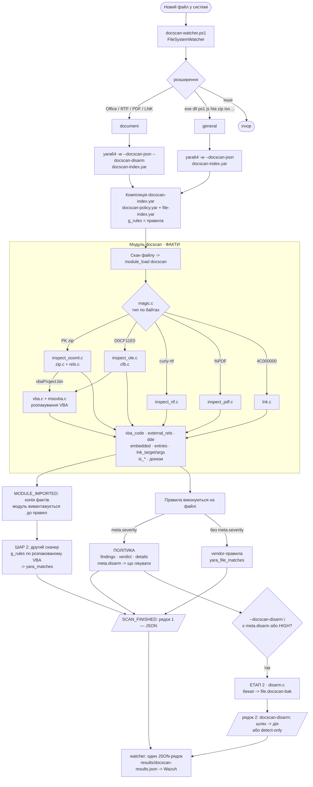

# DocScan on YARA — повна документація

**Мова:** українська · [English](SCAN-FLOW.en.md)

Форк YARA 4.6.0 з власним модулем **`docscan`**: виявляє заражені документи, перевіряє витягнутий
макрос vendor-правилами, лікує документ і віддає результат у JSON. Усе — в **одному бінарнику**
`yara64.exe`. Поверх нього — **watcher**, що автоматично сканує нові файли в системі.

> Це єдиний документ проєкту. Першоджерела (оригінальний `doc-scan.ps1`, матеріали Mandiant, стаття,
> повний корпус vendor-правил) — у `reference/`, вони не наша документація.

**Зміст**
1. [Мета і принципи](#1-мета-і-принципи)
2. [Загальна схема](#2-загальна-схема)
3. [Карта файлів](#3-карта-файлів)
4. [Доопрацювання YARA — код, функція за функцією](#4-доопрацювання-yara--код-функція-за-функцією)
5. [Поведінка: як проходить скан](#5-поведінка-як-проходить-скан)
6. [Правила YARA і політика детекту](#6-правила-yara-і-політика-детекту)
7. [Watcher — авто-скан нових файлів](#7-watcher--авто-скан-нових-файлів)
8. [Запуск — шпаргалка](#8-запуск--шпаргалка)
9. [Збірка](#9-збірка)
10. [Тестування](#10-тестування)
11. [Середовище](#11-середовище)
12. [Інтеграція з Wazuh](#12-інтеграція-з-wazuh)
13. [Відомі обмеження і нюанси](#13-відомі-обмеження-і-нюанси)
14. [Git і ліцензії](#14-git-і-ліцензії)

---

## 1. Мета і принципи

На документ, що з'явився в системі, DocScan має:
1. **Виявити** техніку атаки структурним розбором → `findings` + `verdict` + докази.
2. **Перевірити** витягнутий (розпакований) VBA vendor-правилами — «Шар 2».
3. **Вилікувати** документ, зберігши його (вирізати макрос / зовнішній шаблон / DDE / вкладення;
   зламати `\objupdate`; LNK — видалити). Оригінал — у бекап.
4. **Повідомити** — JSON, який зараз дивимось вручну, а згодом забиратиме Wazuh.

Принципи:
- **Один бінарник.** Детект, Шар 2, лікування, JSON — прапори `yara64.exe`, окремих exe немає.
- **Модуль дає факти, політика вирішує.** Модуль (C) лише розбирає документ і викладає факти
  (текст макросу, зовнішні зв'язки, DDE-поля, вкладення, ціль/аргументи LNK). Що з цього HIGH чи
  MEDIUM, як назвати знахідку і що лікувати — вирішують **правила** у `docscan-policy.yar`
  (`meta.severity` / `meta.finding` / `meta.disarm`). Інженер змінює політику без перезбірки.
- **Модуль тільки читає.** Модуль працює на read-only буфері посеред скану й нічого не пише.
  Лікування — у CLI-шарі (`cli/yara.c` → `disarm.c`) **після** скану, коли файл закрито.
- **Тип — за magic-байтами**, не за розширенням (`invoice.pdf`, що насправді docx, — це OOXML).
- **Без XML-парсера.** `.rels`/`document.xml` розбираються пошуком токенів — безпечніше для
  недовіреного вводу. Усі бінарні читання bounds-checked.
- **Портативний C.** Розробка на macOS, прод — Windows (MSVC). Жодних POSIX-онлі API в модулі.
- **Без прив'язки до Wazuh.** `yara64.exe` видає чистий JSON; доставка — справа watcher/агента.
- Еталон логіки — `reference/doc-scan.ps1` + `reference/mandiant/` (перенесено з PowerShell у C).

---

## 2. Загальна схема



### Те саме текстом

```
 новий файл ──► watcher ──► yara64 -w --docscan-json [--docscan-disarm] docscan-index.yar <файл>
                               │
     ┌─────────────────────────▼───────────────────────────────┐
     │ МОДУЛЬ docscan — тільки ФАКТИ (read-only)                │
     │  magic ─► ooxml │ ole │ rtf │ pdf │ lnk                  │
     │  vbaProject.bin ─► CFB ─► MS-OVBA ─► vba_code            │
     │  external_rels[] · dde[] · embedded[] · entries[] · lnk  │
     └──────────┬──────────────────────────────────────────────┘
                │ правила docscan-index.yar на файлі
     ┌──────────┴───────────────┬─────────────────────────────┐
     ▼                          ▼                             ▼
 ПОЛІТИКА (meta.severity)   vendor-правила по файлу      ШАР 2: vendor-правила
 findings, verdict, details  yara_file_matches            по vba_code → yara_matches
 meta.disarm → що лікувати
     └──────────────► рядок 1: {JSON}   рядок 2: docscan-disarm: ... -> дія | detect-only
                                         └──► watcher: results\docscan-results.json
```

## 3. Карта файлів

```
libyara/modules/docscan/            МОДУЛЬ (C, вшитий у libyara)
  docscan.c                         поля модуля + module_load → інспектори
  inspect.h                         docscan_result_t — спільний результат усіх інспекторів
  magic.{c,h}                       тип файлу по magic-байтах
  search.{c,h}                      портативний memmem / contains / contains_ci
  dynbuf.h                          growable буфер (header-only)
  zip.{c,h}  miniz.{c,h}            ZIP-читання (обгортка над miniz; miniz — public domain, 1 латка `docscan patch`)
  rels.{c,h}                        розбір OOXML .rels (external relationships)
  inspect_ooxml.c                   OOXML: rels / vbaProject.bin / DDE / embeddings
  cfb.{c,h}                         Compound File (OLE) reader
  msovba.{c,h}                      MS-OVBA декомпресія VBA
  vba.{c,h}                         пошук VBA у CFB + підозрілі конструкції
  inspect_ole.c                     legacy .doc/.xls (CFB → VBA)
  inspect_rtf.c / inspect_pdf.c     RTF / PDF
  lnk.c                             бінарний розбір LNK (MS-SHLLINK)
  disarm.c                          ЛІКУВАННЯ (викликається з CLI, не з модуля)
libyara/include/yara/docscan_disarm.h   контракт лікування (docscan_disarm_info, docscan_disarm)
libyara/modules/module_list         + MODULE(docscan)
Makefile.am                         + 15 рядків MODULES += .../docscan/*.c
windows/vs20{15,17,19}/libyara/libyara.vcxproj   + 15 ClCompile docscan
cli/yara.c                          + прапори --docscan-json/-extract/-disarm, JSON, Шар 2, do_disarm

docscan-project/
  SCAN-FLOW.md / SCAN-FLOW.en.md    цей документ (українська / англійська)
  rules/
    docscan-policy.yar              ПОЛІТИКА: що HIGH/MEDIUM, назви знахідок, що лікувати
    docscan.yar                     include docscan-policy.yar (тільки наш детект)
    docscan-index.yar               docscan-policy.yar + file-index.yar (детект + vendor + Шар 2)
    file-index.yar                  vendor-правила (по файлу й по розпакованому VBA)
    general/                        165 правил signature-base "strict" (копія з reference)
    maldoc/                         36 документних правил (signature-base + community) + vba_plaintext.yar
  watcher/docscan-watcher.ps1       авто-скан нових файлів → results\docscan-results.json
  deploy/                           пакет розгортання: build_package.ps1, install.ps1, uninstall.ps1, README.txt
  fuzz/                             libFuzzer: 2 фазери, словник, корпус, build.sh, regressions/
  test-range/
    run_tests.ps1                   регресійний тест (копія → детект+лікування → повторний скан)
    gen_range.ps1                   генератор полігону (Windows + Word COM)
    gen_test_range.py               швидкий синтетичний генератор (без Office)
    samples/generated/              локальний дубль test-samples/generated (не в git)
  test-samples/                     ОРИГІНАЛИ тест-набору (не лікувати напряму!)
    provided/  (7)                  реальні семпли замовника (живий C2) — НЕ в git
    generated/ (16)                 безпечний полігон, по файлу на вектор
  reference/                        першоджерела (PS-скрипт, Mandiant, стаття, повний vendor-корпус)
```

---

## 4. Доопрацювання YARA — код, функція за функцією

### 4.1 Як модуль вбудовано в YARA

**Реєстрація** (три місця):
- `libyara/modules/module_list` — рядок `MODULE(docscan)`. `modules.c` інклудить цей файл двічі
  (X-macro) і будує таблицю `yr_modules_table[]` з покажчиками на функції модуля.
- `Makefile.am` — 15 рядків `MODULES += libyara/modules/docscan/*.c` (macOS/Linux, autotools).
- `windows/vs20{15,17,19}/libyara/libyara.vcxproj` — ті самі 15 файлів як `<ClCompile>` (MSVC).
  **Новий `.c` треба додавати в обидві системи збірки.**

**Трюк з іменами.** На початку `docscan.c` стоїть `#define MODULE_NAME docscan`; макроси з
`yara/modules.h` перейменовують `module_load` → `docscan__load`, `module_initialize` →
`docscan__initialize` тощо. Тому в кожному модулі YARA функції звуться однаково без конфліктів.

**Життєвий цикл** (функції модуля викликає ядро через `yr_modules_table[]`, ми їх не кличемо):

| Функція модуля | Хто викликає | Коли | Як часто | У нас |
|---|---|---|---|---|
| `module_initialize` | `yr_modules_initialize()` | `yr_initialize()` | раз на процес | порожня |
| `begin_declarations…end_declarations` | `yr_modules_do_declarations()` | правило має `import "docscan"` | раз на компіляцію | будує дерево полів |
| `module_load` | `yr_modules_load()` | **кожен скан файлу** | на кожен файл | вся робота |
| `module_unload` | вивантаження після скану | після кожного файлу | на кожен файл | порожня |
| `module_finalize` | `yr_modules_finalize()` | `yr_finalize()` | раз на процес | порожня |

Потік даних: сирі байти → `docscan_detect_magic` → інспектор → `docscan_result_t` → поля модуля →
(а) умови правил `docscan.xxx`, (б) `print_docscan_json` у CLI, (в) `docscan_disarm`.

### 4.2 `docscan.c` — поля модуля і `module_load`

**Поля-прапорці** (`begin_declarations`), integer 0/1. Колонка «Рівень» — що з ними робить
**політика за замовчуванням** (`docscan-policy.yar`); сам модуль рівнів не знає. Прапорці лишились
для сумісності й зручності; політика переважно працює з фактами нижче.

| Група | Поле | Рівень | Значення |
|---|---|---|---|
| тип | `is_ooxml` `is_ole` `is_rtf` `is_pdf` `is_lnk` | — | тип файлу по magic |
| RTF | `rtf_objupdate` | HIGH | `\objupdate` — OLE-об'єкт оновлюється (завантажується) при відкритті (T1203) |
| | `rtf_embedded_object` | контекст | `\objdata` / `\objlink` / `\objhtml` (часто легітимно; у verdict не йде) |
| PDF | `pdf_launch` | HIGH | `/Launch` — запуск зовнішньої програми |
| | `pdf_js_auto` | HIGH | є JS і небезпечний API (див. 4.7) |
| | `pdf_js` | MEDIUM | JS без явно небезпечних API |
| | `pdf_openaction` | MEDIUM | `/OpenAction` або `/AA` без JS |
| | `pdf_embedded` | MEDIUM | `/EmbeddedFile` |
| OOXML | `remote_template` | HIGH | external `attachedTemplate` → віддалений URL (T1221) |
| | `protocol_handler` | HIGH | external rel `ms-msdt:` / `search-ms:` … (Follina, T1203) |
| | `dde_auto` | HIGH | `DDEAUTO` у тілі документа (T1559.002) |
| | `embedded_pe` | HIGH | PE (`MZ`…`PE\0\0`) у `embeddings/oleObject*.bin` |
| | `embedded_lnk` | HIGH | сигнатура LNK у `embeddings/oleObject*.bin` |
| | `macro_suspicious` | HIGH | у розпакованому VBA є exec/download-конструкції |
| | `macro_present` | MEDIUM | є `vbaProject.bin` / VBA-модуль |
| | `external_ole` | MEDIUM | external `oleObject` relationship |
| | `external_frame` | MEDIUM | external `frame` relationship |
| | `dde_link` | HIGH | `DDE ` + cmd/powershell/mshta/rundll32 (не AUTO) |
| LNK | `lnk_url_args` | HIGH | URL/UNC в аргументах |
| | `lnk_obfuscated` | HIGH | `-enc`, `iex`, `-w hidden`, `downloadstring`… в аргументах |
| | `lnk_lolbin` | MEDIUM* | ціль — LOLBin (cmd/powershell/mshta/rundll32/…) |
| докази | `template_url` `dde_command` `vba_evidence` `lnk_target` `lnk_args` | — | рядки ≤ 511 символів |
| Шар 2 | `vba_code` | — | весь розпакований VBA (≤ 2 МБ) для перескану vendor-правилами |

**Факти для правил політики** (масиви обмежені; `*_truncated = 1`, якщо елементів було більше —
напихання документа сміттям не повинно тихо ховати цікаве):

| Поле | Тип | Що містить |
|---|---|---|
| `external_rels[i].part` / `.type` / `.target` | масив структур (≤ 256) | кожен `TargetMode="External"` зв'язок: з якого `.rels`, Type URI, Target як записано |
| `number_of_external_rels`, `external_rels_truncated` | integer | |
| `entries[i].name` / `.size` | масив (≤ 512) | кожна частина ZIP і її розмір із заголовка |
| `number_of_entries`, `entries_truncated` | integer | |
| `embedded[i].name` / `.size` / `.is_pe` / `.is_lnk` | масив (≤ 64) | кожен `embeddings/oleObject*.bin` |
| `number_of_embedded` | integer | |
| `dde[i]` | масив рядків (≤ 32) | кожна DDE-інструкція: поле Word `DDE…`/`DDEAUTO…` (і розбите на кілька `<w:instrText>` — склеєне), формула Excel `сервіс\|'тема'!…` → `DDE сервіс\|…`, Excel `ddeLink` → `DDE <ddeService> <ddeTopic>` |
| `number_of_dde` | integer | |
| `vba_code`, `lnk_target`, `lnk_args` | string | текст макросу; ціль і аргументи LNK |

Приклад у правилі: `for any rel in docscan.external_rels : (rel.target matches /^https?:/i)`.

| Функція | Що робить |
|---|---|
| `module_initialize` / `module_finalize` / `module_unload` | Порожні, `return ERROR_SUCCESS`. |
| `module_load(context, module_object, …)` | 0) виділяє `docscan_result_t` у купі (~250 КБ — не на малому стеку потоку сканера); 1) обнуляє `is_*`; 2) бере **перший** блок пам'яті (`foreach_memory_block` + `yr_fetch_block_data`; при скані файлу це весь файл); 3) `docscan_detect_magic` → ставить `is_<тип>=1` і викликає інспектор типу; 4) переносить усі поля `docscan_result_t` у поля модуля (`yr_set_integer` / `yr_set_string`); 5) `vba_code` — `yr_set_sized_string`, після чого звільняє буфер (або порожній рядок); 6) виставляє масиви фактів (`external_rels[%i]…`, `entries`, `embedded`, `dde`) і лічильники; звільняє результат. |

### 4.3 `inspect.h` — спільний результат

`docscan_result_t` — структура з усіма прапорами (див. таблицю вище), п'ятьма фіксованими
буферами доказів `char[512]` (без malloc) і `char* vba_code` + `vba_code_len` (malloc, звільняє
`module_load`). Інспектори — чистий C без залежності від YARA: приймають `(data, size, *r)` і лише
виставляють поля. Оголошення: `docscan_inspect_{rtf,pdf,ooxml,ole,lnk}`.

### 4.4 `magic.c`, `search.c`, `dynbuf.h` — базові утиліти

| Функція | Що робить |
|---|---|
| `docscan_detect_magic(data, size)` | Перші 4 байти: `PK` → OOXML; `D0 CF 11 E0` → OLE; `{\rt` → RTF; `4C 00 00 00` → LNK; `%PDF` → PDF; інакше UNKNOWN. Безпечна на NULL/коротких буферах. |
| `docscan_memmem(hay, len, needle, nlen)` | Пошук байтів (MSVC не має `memmem`). Перший байт через `memchr`, далі `memcmp`. |
| `docscan_contains(hay, len, token)` | 1, якщо NUL-термінований токен є в буфері (з урахуванням регістру). |
| `docscan_contains_ci(hay, len, token)` | Те саме без урахування регістру (ASCII). |
| `docscan_buf_push(b, src, n)` / `docscan_buf_free(b)` | Growable буфер: старт 4 КБ, подвоєння; `-1` при нестачі пам'яті. Використовують `cfb.c`, `msovba.c`. |

### 4.5 OOXML: `zip.c`, `rels.c`, `inspect_ooxml.c`

OOXML (docx/xlsx/pptx) — ZIP із DEFLATE, тому сирий пошук не бачить вмісту — потрібна розпаковка.

**`zip.c`** — тонка обгортка над miniz:

| Функція | Що робить |
|---|---|
| `docscan_zip_open(data, size)` | `mz_zip_reader_init_mem` по буферу в пам'яті; NULL, якщо не ZIP. |
| `docscan_zip_count(z)` | Кількість записів. |
| `docscan_zip_entry_name(z, i, buf, sz)` | Ім'я i-го запису (обрізається до `sz-1`). |
| `docscan_zip_extract(z, i, &out_size)` | Розпаковує запис у heap. Записи, що за заголовком > 64 МБ (`DOCSCAN_ZIP_MAX_ENTRY`), не розпаковує — захист від zip-бомб. |
| `docscan_zip_free(p)` / `docscan_zip_close(z)` | Звільнення. |

**`rels.c`** — розбір `.rels` без XML-парсера:

| Функція | Що робить |
|---|---|
| `docscan_scan_rels(xml, size, part, r)` | Проходить кожен `<Relationship …>`; цікавлять лише `TargetMode="External"`. Кожен такий зв'язок записується у факти `external_rels[]` (з іменем `part`). Якщо `Target` — protocol handler → `protocol_handler` + `template_url`. Інакше за останнім сегментом `Type`: `attachedTemplate` з віддаленим target → `remote_template` + `template_url`; `oleObject` → `external_ole`; `frame` → `external_frame`. |
| `get_attr(tag, len, "Attr=\"", out, sz)` | Значення атрибута в межах тега до наступної `"`. Якщо атрибута немає — буфер не чіпає (тому буфери ініціалізовані `""`). |
| `starts_with_ci(s, prefix)` | Префікс без урахування регістру. |
| `is_remote_target(t)` | `http(s)://`, `ftp(s)://`, `sftp://`, UNC `\\host\share`, `file://host/…`, `file:////host/…`. `file:///C:/…` (без хоста) і `file://localhost` — локальні. |
| `is_protocol_handler(t)` | `ms-msdt:`, `search-ms:`, `search:`, `ms-officecmd:`, `mhtml:`, `ms-word:`, `ms-excel:`, `ms-powerpoint:`, `!x-usc:`. |

**`inspect_ooxml.c`**:

| Функція | Що робить |
|---|---|
| `docscan_inspect_ooxml(data, size, r)` | Відкриває ZIP; кожну частину записує у факти `entries[]`; за іменем кожного запису: `*.rels` → `docscan_scan_rels`; `*vbaProject.bin` → `macro_present=1` + `docscan_scan_vba_container`; тіло документа (Word/Excel) → `scan_dde`, для `xl/worksheets/` ще `record_excel_formulas`; `xl/externalLinks/externalLink*.xml` → `record_excel_ddelink`; `embeddings/oleObject*.bin` → `scan_embedded_ole`. |
| `is_body_xml(name)` | `word/document.xml`, `word/header*.xml`, `word/footer*.xml`, `xl/worksheets/sheet*.xml`, `xl/workbook.xml`. |
| `is_embedded_ole(name)` | `embeddings/oleObject*.bin`. |
| `record_dde(xml, n, r)` | Факт: кожна інструкція `DDEAUTO…` або `DDE …` (без регістру) → `dde[]` (≤ 32). Кінець: в атрибуті `w:instr="…"` — до `"`, у тексті `<w:instrText>` — до `<` (лапки всередині команди зберігаються). Перша інструкція → доказ `dde_command`. |
| `scan_dde(xml, n, r)` | `record_dde` + `record_complex_fields`; далі прапорці: `DDEAUTO` (без регістру) → `dde_auto`; `DDE ` + cmd/powershell/mshta/rundll32 → `dde_link`. |
| `record_complex_fields(xml, n, r)` | Складені поля Word: склеює текст усіх `<w:instrText>` від `fldChar begin` до `separate`/`end` — ловить `DDE` + `AUTO …`, розбиті на кілька runs (відомий обхід пошуку рядка). |
| `is_dde_formula` / `record_excel_formulas(xml, n, r)` | Формула в `<f>…</f>` з конструкцією `сервіс\|'…'!…` (`cmd\|' /c calc'!A0`) → `dde[]` як `DDE <формула>`. |
| `record_excel_ddelink(xml, n, r)` | `<ddeLink ddeService="…" ddeTopic="…">` → `dde[]` як `DDE <service> <topic>`. |
| `add_dde(r, s)` | Додає інструкцію в `dde[]` (обрізає пробіли, без дублікатів); перша → доказ `dde_command`. |
| `scan_embedded_ole(d, n, e, r)` | Кожен об'єкт записується у `embedded[]` (ім'я, розмір, `is_pe`, `is_lnk`). 20-байтова сигнатура LNK (header + CLSID) → `embedded_lnk` і розбір цього LNK (`docscan_inspect_lnk` → target/args); `MZ` з `e_lfanew` < 0x1000, що вказує на `PE\0\0` → `embedded_pe`. |
| `ends_with(s, suffix)` | Допоміжна. |

### 4.6 OLE і VBA: `cfb.c`, `msovba.c`, `vba.c`, `inspect_ole.c`

Макроси лежать у Compound File (`vbaProject.bin` в OOXML, або весь legacy `.doc/.xls`) і стиснуті
MS-OVBA. Ланцюжок: **CFB → потоки → пошук контейнера MS-OVBA → декомпресія → текст VBA → ключові слова**.

**`cfb.c`** — мінімальний CFB-reader для v3 (сектор 512) і v4 (сектор 4096): сектор `n` починається з
`(n+1) × розмір_сектора`. Усі читання з перевіркою меж; усі ланцюги (FAT, DIFAT, mini FAT) і масиви
обмежені кількістю секторів у файлі; потік ≤ 4 МБ, сумарно ≤ 64 МБ; показники розміру сектора (7–16) перевіряються до зсуву.
ланцюг означає цикл; потік ≤ 4 МБ, сумарно віддається колбеку ≤ 64 МБ. Показники розміру сектора
перевіряються (7–16) до зсуву.

| Функція | Що робить |
|---|---|
| `docscan_cfb_foreach_stream(data, size, cb, ud)` | 1) номери FAT-секторів: 109 записів DIFAT у заголовку + ланцюг DIFAT; 2) збирає FAT; 3) directory stream; 4) mini stream (старт — у root entry, `dir+116`); 5) mini FAT; 6) для кожного запису типу 2 (stream): потоки < `miniCutoff` — через mini FAT, більші — через FAT; викликає `cb(bytes, len, ud)`; `cb` повертає ≠0, щоб зупинитись. `-1` — не CFB / зіпсований заголовок. |
| `read_chain(…)` | Йде FAT-ланцюгом і конкатенує сектори в буфер. |
| `u16` / `i32` / `u32` / `i32_push` | Little-endian читання з перевіркою меж; growable масив int32. |

**`msovba.c`**:

| Функція | Що робить |
|---|---|
| `docscan_msovba_decompress(buf, len, start, max_out, &out_size)` | Декомпресія MS-OVBA ([MS-OVBA] 2.4.1): сигнатура `0x01`, далі чанки з 2-байтовим заголовком (розмір, сигнатура 3, прапор стиснення). Нестиснений чанк копіюється; стиснений — flag-байт на 8 токенів: літерал або back-reference (зсув/довжина з динамічною кількістю біт від позиції в чанку). Читає байт перед `push` (безпечно щодо realloc). Зупиняється на `max_out`. NULL при помилці/порожньому виході. |

**`vba.c`**:

| Функція | Що робить |
|---|---|
| `docscan_scan_vba_container(cfb, size, r)` | `docscan_cfb_foreach_stream(..., vba_stream_cb, r)`. |
| `vba_stream_cb(data, size, r)` | У кожному потоці шукає байт `0x01` + заголовок чанка з сигнатурою 3 → спершу дешевий попередній перегляд (перші 64 байти), повна декомпресія (≤ 4 МБ) лише якщо він схожий на VBA. Справжній модуль починається з `Attribute VB_…` (перевірка `Attribut` у перших 48 байтах) → `macro_present=1`; кожне з ключових слів `SUS[]` (без регістру) → `macro_suspicious=1` + `add_evidence`. Дописує текст модуля в `vba_code` (до 2 МБ, модулі через `\n`). Один модуль на потік. |
| `add_evidence(r, kw)` | Дописує `kw` у `vba_evidence` у форматі `a \| b \| c`, не виходячи за 512 байт. |

`SUS[]` (підозрілі конструкції, з `$sus` у `doc-scan.ps1`): `powershell`, `cmd.exe`, `mshta`,
`rundll32`, `regsvr32`, `certutil`, `bitsadmin`, `WScript.Shell`, `CreateObject`, `Shell`, `.Run`,
`.Exec`, `DownloadString`, `DownloadFile`, `URLDownloadToFile`, `XmlHttp`, `WinHttp`, `FromBase64`,
`StrReverse`, `Environ`, `AutoOpen`, `Auto_Open`, `Document_Open`, `Workbook_Open`, `Auto_Exec`.

**`inspect_ole.c`**:

| Функція | Що робить |
|---|---|
| `docscan_inspect_ole(data, size, r)` | Маркер `_VBA_PROJECT` → `macro_present`; весь файл — CFB → `docscan_scan_vba_container`. |

### 4.7 RTF, PDF, LNK

| Функція | Файл | Що робить |
|---|---|---|
| `docscan_inspect_rtf` | `inspect_rtf.c` | `\objupdate` → `rtf_objupdate`; `\objdata`/`\objlink`/`\objhtml` → `rtf_embedded_object`. |
| `docscan_inspect_pdf` | `inspect_pdf.c` | `/Launch` → `pdf_launch`; `/JavaScript` або `/JS` + небезпечний API → `pdf_js_auto`, без нього → `pdf_js`; `/OpenAction` або `/AA` без JS → `pdf_openaction`; `/EmbeddedFile` → `pdf_embedded`. |
| `pdf_has_dangerous_js` | `inspect_pdf.c` | Шукає: `app.launchURL`, `exportDataObject`, `importDataObject`, `getAnnots`, `submitForm`, `Collab.`, `util.printf`, `getIcon`, `media.newPlayer`, `eval(`, `unescape(`, `String.fromCharCode`, `.exe`, `powershell`, `cmd.exe`, `rundll32`, `mshta`, `certutil`, `Net.HTTP`, `SOAP.`, `heapLib`, `shellcode`. Безпечний JS переглядача (`this.print`, `app.alert`) навмисно не в списку. |
| `docscan_inspect_lnk` | `lnk.c` | Розбір MS-SHLLINK (замість COM `WScript.Shell`): HeaderSize=0x4C → LinkFlags → IDList → LinkInfo → StringData (Name, RelativePath, WorkDir, **Arguments**). **Ціль** — по черзі: `LocalBasePathUnicode` (якщо `LinkInfoHeaderSize ≥ 0x24`) → `LocalBasePath` (ANSI) → мережева: `NetName` + `CommonPathSuffix` (`\\сервер\шара\…`) → `RelativePath` → шлях, відновлений з IDList. Рядки UTF-16 → UTF-8 (кирилиця зберігається); ANSI-байти ≥ 0x80 → U+0080…U+00FF, тож вихід — завжди валідний UTF-8. Прапорці `lnk_lolbin` / `lnk_url_args` / `lnk_obfuscated` (списки — як у політиці). |
| `put_utf8` / `cpy_utf16` / `cpy_ansi` / `cpy_stringdata` | `lnk.c` | UTF-16LE → UTF-8 (сурогатні пари; одиночний сурогат → U+FFFD); ANSI → валідний UTF-8; StringData (лічильник + символи). |
| `idlist_path` / `beef0004_name` / `printable` | `lnk.c` | Шлях з LinkTargetIDList: елемент диска (`X:\`) + елементи файлів/тек (довге ім'я з розширення `0xBEEF0004`, зсув за версією: v9 0x2E, v8 0x2A, v7 0x26, v3 0x14; інакше коротке 8.3); непридатні до друку імена відкидаються. |
| `rd16` / `rd32` / `ci_streq` | `lnk.c` | Читання з перевіркою меж; порівняння без регістру (MSVC не має `strcasecmp`). |

### 4.8 Лікування: `docscan_disarm.h` + `disarm.c`

Компілюється в libyara, але **викликається тільки з CLI** (`do_disarm` після скану).

`docscan_disarm_info` — що знайшов скан: `present`, `type` (1 ooxml, 2 ole, 3 rtf, 4 pdf, 5 lnk),
`high`, `macro`, `remote_template`, `protocol_handler`, `dde_auto`, `embedded`, `rtf_objupdate`, `lnk_bad`,
`quarantine`, `backup_dir` (UTF-8; NULL → `<file>.docscan-bak` поруч).

Усі шляхи — UTF-8; на Windows файлові операції йдуть через `_wfopen`/`_wremove`/`_wrename`
(`ds_fopen`/`ds_remove`/`ds_rename`), тож кириличні імена файлів і тек працюють. Вилікуваний ZIP
збирається в пам'яті (`mz_zip_writer_init_heap`) і записується нашим `write_file` — файловий API miniz
використовує ANSI `fopen`.

| Функція | Що робить |
|---|---|
| `docscan_disarm(path, info, out_action, sz)` | Диспетчер: немає жодної дії → `detect-only`; legacy OLE (`.doc/.xls`) з будь-якою дією → карантин (вилікувати на місці неможливо); PDF без `quarantine` → `detect-only`; **бекап** — якщо не вдався, файл не чіпається (`failed:backup`); `quarantine` або LNK з `lnk_bad` → видалення (`quarantined` / `deleted:lnk`); RTF → `cure_rtf`; OOXML → `cure_ooxml`. |
| `cure_ooxml(path, info, action, sz)` | Перепаковує ZIP через miniz у `<file>.docscan-tmp`: **не копіює** `vbaProject.bin`/`vbaData.xml` (макрос) і `embeddings/oleObject*.bin`; у `*.rels` видаляє `<Relationship>` з маркерами `vbaProject` / `oleObject` / `attachedTemplate` / усі обробники протоколів (`ms-msdt:`, `search-ms:`, `search:`, `ms-officecmd:`, `mhtml:`, `ms-word:`, `ms-excel:`, `ms-powerpoint:`, `!x-usc:`); у `[Content_Types].xml` — `<Override>` з `vbaProject`; у `word/document.xml`/header/footer `DDEAUTO` → `REMOVED`. Потім підміняє оригінал. Якщо будь-яку частину не вдалося прочитати (чи вона > 64 МБ) — лікування скасовується, оригінал не змінюється, дія `failed:unreadable-part`. Дії: `removed:vbaProject.bin`, `removed:embeddings`, `removed:remote-template`, `removed:protocol-rel`, `stripped:dde`. |
| `cure_rtf(path, action, sz)` | `\objupdate` → `\objupdatX` (керуюче слово зламане, довжина та сама) → `stripped:objupdate`. |
| `remove_elements(in, len, markers, n, &out_len)` | Копіює XML, викидаючи елементи `<Relationship …>` / `<Override …>`, що містять будь-який маркер. |
| `strip_dde(buf, len)` | На місці, тієї ж довжини: `DDEAUTO` → `REMOVED`, `DDE ` → `REM `. Без урахування регістру (як детекція) і лише на початку інструкції поля (після `>` або `"` і пробілів) — звичайний текст зі словом «DDE» не чіпається. |
| `backup(path, backup_dir)` | Копія оригіналу: з `backup_dir` — `<тека>\<ім'я>.<n>.docscan-bak` (унікальне `n`, старі бекапи не перезаписуються), інакше `<path>.docscan-bak`. При помилці — повідомлення в stderr з шляхом і `errno`. |
| `blank_dde_fields(buf, len)` | Складені поля Word, чия склеєна інструкція починається з `DDE`: усі `<w:instrText>` цього поля заповнюються пробілами (та сама довжина). |
| `remove_dde_formulas(in, len, &out)` | Excel: видаляє `<f>…</f>` з DDE-формулою; збережене значення `<v>` лишається. |
| `blank_ddelink(buf, len)` | Excel: значення `ddeService`/`ddeTopic` → пробіли. |
| `read_file` / `write_file` / `file_exists` / `base_name` / `append` / `name_is` | Файл у пам'ять / запис (через `ds_fopen`); допоміжні. |

### 4.9 Зміни в `cli/yara.c`

**Прапори:**

| Прапор | Змінна | Дія |
|---|---|---|
| `--docscan-json` | `docscan_json` | один рядок JSON на файл: знахідки й вердикт **з правил політики**, vendor-збіги по файлу й по VBA; **придушує звичайний вивід збігів** |
| `--docscan-extract=FILE` | `docscan_extract` | пише `vba_code` у FILE (ручний Шар 2) |
| `--docscan-disarm` | `docscan_disarm_flag` | після скану лікує файл за `meta.disarm` правил, що спрацювали; HIGH без дій → `detect-only` |
| `--docscan-backup-dir=DIR` | `docscan_backup_dir_utf8` | бекапи й карантин у DIR (має існувати). На Windows значення береться з оригінальних Unicode-аргументів (парсер YARA віддає рядкові опції в ANSI — кирилиця б загубилась) |

**Стан на файл** — `DOCSCAN_STATE` у `CALLBACK_ARGS` (`dsc`): `ftype`, копії доказів, копія `vba_code`,
`max_severity`, `findings`, `details`, `file_matches`, `docscan_disarm_info ds`. Глобально: `g_rules` —
завантажені правила (для Шару 2).

**Чому так.** Модулі YARA вивантажуються в кінці `yr_execute_code`, **до** колбеків про збіги правил.
Тому факти копіюються в момент `MODULE_IMPORTED`, збіги збираються на `RULE_MATCHING`, а JSON
друкується на `SCAN_FINISHED`, коли відомо все.

**Точки входу в потік YARA:**
- `CALLBACK_MSG_MODULE_IMPORTED` (об'єкт `docscan`) → `docscan_capture`; з `--docscan-extract` — запис `vba_code`.
- `CALLBACK_MSG_RULE_MATCHING` → `docscan_on_match`; у режимі `--docscan-json` звичайний вивід не друкується.
- `CALLBACK_MSG_SCAN_FINISHED` → `print_docscan_json`.
- Після `yr_scanner_scan_file` (одно- і багатопотоковий шлях): `--docscan-disarm` і (є дія з
  політики **або** вердикт HIGH) → `do_disarm`.

**Функції:**

| Функція | Що робить |
|---|---|
| `docscan_capture(m, st)` | Скидає стан, визначає `ftype`/`ds.type`, копіює докази й `vba_code` з об'єкта модуля. |
| `docscan_on_match(rule, st)` | Якщо в правила є `meta.severity` — **правило політики**: рахує `max_severity`, додає `meta.finding` (або ім'я правила) у `findings`, об'єкт у `details` (`rule`, `finding`, `severity`, `disarm`, `mitre`), `meta.disarm` → прапор у `ds`. Інакше — **vendor-правило** → `file_matches`. |
| `docscan_meta(rule, name)` | Значення рядкового meta-поля правила (через `yr_rule_metas_foreach`). |
| `print_docscan_json(st)` | Друкує JSON; **Шар 2**: другий `YR_SCANNER` з `g_rules` по копії `vba_code`, збіги через `vendor_match_cb` → `yara_matches`. |
| `vendor_match_cb(...)` | Колбек другого сканера: додає правила **без** `meta.severity` (політика описує документи, не текст VBA). |
| `docscan_json_evidence` / `docscan_defang` / `docscan_json_puts` | Друк доказів з defang (`http`→`hxxp`) і JSON-екрануванням. |
| `docscan_list_add` / `docscan_list_has` / `docscan_state_reset` / `docscan_copy_string` | Допоміжні: JSON-списки, скидання стану (звільняє копію VBA), копіювання рядків модуля. |
| `do_disarm(file_path, ds)` | `docscan_disarm` + рядок `docscan-disarm: <шлях> -> <дія>`; на Windows Unicode — wide→UTF-8. |

**Формат JSON (рядок 1):**
```json
{"ftype":"ooxml","findings":["MACRO_PRESENT","MACRO_SUSPICIOUS","MACRO_AUTOEXEC"],"verdict":"HIGH",
 "evidence":{"vba_evidence":"powershell | DownloadFile | AutoOpen"},
 "yara_matches":["powershell","VBA_AutoExec_DownloadCradle"],
 "yara_file_matches":["Contains_VBA_macro_code","office_document_vba"],
 "details":[{"rule":"DS_MACRO_SUSPICIOUS","finding":"MACRO_SUSPICIOUS","severity":"HIGH","disarm":"macro","mitre":"T1204.002"}, …]}
```
`verdict` — найвищий `meta.severity` серед правил політики, що спрацювали (`INFO`, якщо жодне).
`evidence` — непорожні рядки модуля (`vba_evidence` — інформативний список ключових слів із `vba.c`,
на вердикт не впливає). **Рядок 2** (лише з `--docscan-disarm`): `docscan-disarm: <шлях> -> <дія>[,…]`
або `detect-only`.

## 5. Поведінка: як проходить скан

1. **Підготовка.** Оригінал не чіпаємо: для ручних тестів — копія `work.<ext>`
   (`run_tests.ps1` робить це сам і звіряє SHA256 оригіналів). Watcher сканує файл на місці.
2. **Компіляція правил.** `docscan-index.yar` = `docscan-policy.yar` + `file-index.yar` → `g_rules`.
3. **Модуль.** `module_load`: magic → інспектор → факти й прапорці (див. §4). Факти копіюються в CLI.
4. **Правила на файлі.** Правила політики (`meta.severity`) → знахідки, вердикт, дії лікування;
   решта правил → `yara_file_matches`.
5. **ШАР 2.** Розпакований VBA пересканується тими ж правилами → `yara_matches`. Звичайні
   `$string`-правила бачать тільки вхідний буфер, а VBA в документі стиснутий — без Шару 2
   vendor-правила макросу не бачать.
6. **ЕТАП 1 — JSON** на `SCAN_FINISHED`. `verdict`: **HIGH** → реагувати/лікувати; **MEDIUM** → переглянути; **INFO** → чисто.
7. **ЕТАП 2 — лікування** (`--docscan-disarm`): дії з `meta.disarm` правил, що спрацювали. Спершу бекап
   `<file>.docscan-bak`, потім:

   | `meta.disarm` | Тип | Дія | Вивід |
   |---|---|---|---|
   | `macro` | OOXML | вирізати `vbaProject.bin`/`vbaData.xml` + rels/content-type | `removed:vbaProject.bin` |
   | `remote_template` | OOXML | прибрати external `attachedTemplate` rel | `removed:remote-template` |
   | `protocol_handler` | OOXML | прибрати rel з обробником протоколу | `removed:protocol-rel` |
   | `dde` | Word | `DDEAUTO` → `REMOVED`, `DDE` → `REM`; розбите поле — усі `<w:instrText>` → пробіли | `stripped:dde` |
   | `dde` | Excel | DDE-формули `<f>` видаляються (значення `<v>` лишається); `ddeLink` — `ddeService`/`ddeTopic` → пробіли | `stripped:dde` |
   | `embedded` | OOXML | вирізати `embeddings/oleObject*.bin` | `removed:embeddings` |
   | `rtf_objupdate` | RTF | `\objupdate` → `\objupdatX` | `stripped:objupdate` |
   | `lnk_delete` | LNK | видалити файл (бекап є) | `deleted:lnk` |
   | `quarantine` | будь-який | бекап у `--docscan-backup-dir` + видалити оригінал | `quarantined` |
   | будь-яка | legacy OLE (`.doc/.xls`) | вилікувати на місці неможливо → карантин | `quarantined` |
   | — (HIGH без дій, напр. PDF) | будь-який | нічого | `detect-only` |
   | будь-яка | OOXML з частиною, що не читається / > 64 МБ | лікування скасовано | `failed:unreadable-part` |

   Будь-яка дія: якщо бекап не вдався → `failed:backup`, файл не змінюється. Дія, що не підходить до типу файлу, ігнорується.
8. **Контроль.** Повторний скан вилікуваної копії → очікуємо `INFO` (LNK відсутній, PDF лишається HIGH).

## 6. Правила YARA і політика детекту

### 6.1 Політика — `rules/docscan-policy.yar`

Головний файл, який інженер налаштовує під себе. Кожне правило з `meta.severity` — правило політики:

| meta | Обов'язкове | Значення |
|---|---|---|
| `severity` | так | `HIGH` / `MEDIUM` / `INFO` — позначає правило як політику |
| `finding` | ні | назва в `findings` (за замовчуванням — ім'я правила) |
| `disarm` | ні | що лікувати: `macro`, `remote_template`, `protocol_handler`, `dde`, `embedded`, `rtf_objupdate`, `lnk_delete`, `quarantine` |
| `mitre` | ні | ID техніки, потрапляє в `details` |

Правило політики не може бути `private` (YARA не повідомляє про private-правила).

**Політика за замовчуванням:**

| Правило | Умова (коротко) | severity | disarm |
|---|---|---|---|
| `DS_REMOTE_TEMPLATE` | external `attachedTemplate` на http(s)/ftp/UNC/`file://host` (не `file:///C:`) | HIGH | `remote_template` |
| `DS_PROTOCOL_HANDLER` | external target `ms-msdt:`, `search-ms:`, `search:`, `ms-officecmd:`, `mhtml:`, `ms-word:`… | HIGH | `protocol_handler` |
| `DS_DDE_AUTO` | `dde[]` починається з `DDEAUTO` | HIGH | `dde` |
| `DS_DDE_LINK` | `DDE ` (не AUTO): поле Word, формула Excel `cmd\|'…'!A0`, Excel `ddeLink` — і в ній cmd/powershell/mshta/rundll32/regsvr32/msiexec/certutil/bitsadmin/wscript/cscript | HIGH | `dde` |
| `DS_EMBEDDED_PE` / `DS_EMBEDDED_LNK` | `embedded[].is_pe` / `.is_lnk` | HIGH | `embedded` |
| `DS_EXTERNAL_OLE` / `DS_EXTERNAL_FRAME` | external `oleObject` (не Follina) / `frame` | MEDIUM | — |
| `DS_MACRO_PRESENT` | є VBA | MEDIUM | — |
| `DS_MACRO_SUSPICIOUS` | у `vba_code`: Shell, WScript.Shell, powershell, cmd.exe, mshta, rundll32, regsvr32, certutil, bitsadmin, URLDownloadToFile, DownloadFile/String, FromBase64String, StrReverse; `.Run`/`.Exec` на об'єкті оболонки | HIGH | `macro` |
| `DS_MACRO_AUTOEXEC` | AutoOpen, Document_Open, Workbook_Open… | MEDIUM | — |
| `DS_MACRO_NETWORK` | XMLHTTP, WinHttp, InternetOpen, Net.WebClient | MEDIUM | — |
| `DS_RTF_OBJUPDATE` | RTF і `\objupdate` | HIGH | `rtf_objupdate` |
| `DS_PDF_LAUNCH` | `/Launch` | HIGH | `quarantine` |
| `DS_PDF_JS_AUTO` / `DS_PDF_JS` | `/JavaScript`/`/JS` з небезпечним API / без | HIGH (`quarantine`) / MEDIUM | |
| `DS_PDF_OPENACTION` / `DS_PDF_EMBEDDED` | `/OpenAction`/`/AA` без JS / `/EmbeddedFile` | MEDIUM | — |
| `DS_LNK_URL_ARGS` | URL/UNC в аргументах | HIGH | `lnk_delete` |
| `DS_LNK_OBFUSCATED` | `-enc`, `iex`, `-w hidden`, `downloadstring`… | HIGH | `lnk_delete` |
| `DS_LNK_REMOTE_EXEC` | ціль — виконуваний файл на мережевій шарі (`\\сервер\…\x.exe`, `.ps1`, `.vbs`, `.hta`…) | HIGH | `lnk_delete` |
| `DS_LNK_REMOTE_TARGET` | ціль на шарі, але не виконувана (тека, документ) | MEDIUM | — |
| `DS_LNK_LOLBIN` | ціль — LOLBin | MEDIUM | — (ярлик не видаляється) |

**Як змінювати:**
```yara
// зробити будь-який макрос з автозапуском HIGH:
rule DS_MACRO_AUTOEXEC { meta: severity = "HIGH" finding = "MACRO_AUTOEXEC" disarm = "macro"
  condition: docscan.vba_code matches /\b(AutoOpen|Document_Open|Workbook_Open)\b/i }

// свій вектор: документ з частиною > 20 МБ
rule ORG_HUGE_PART { meta: severity = "MEDIUM" finding = "HUGE_PART"
  condition: for any e in docscan.entries : (e.size > 20MB) }
```
Після зміни — перевірити компіляцію (`yara64 -w docscan-policy.yar будь-який-файл`) і прогнати `run_tests.ps1`.

**Що виявив тест на хибні спрацювання** (~4 000 відкритих документів, 2026-11-02) і що виправлено в
політиці за замовчуванням: локальні шаблони `file:///C:\…` (раніше HIGH), `Selection.Find.Execute`
(`.Exec`), `Application.Run "Macro"` (`.Run`), лише `Workbook_Open` чи `CreateObject` (раніше HIGH →
тепер MEDIUM), ярлики меню «Пуск» на PowerShell/cmd (раніше видалялися б лікуванням). Офісних HIGH на
чистих файлах POI — з 11 до 0 (Excel DDE — 0); RTF 0; LNK 0 HIGH (32 MEDIUM: LOLBin, ярлики на файлові
сервери). PDF: 2 HIGH на тестових файлах pdf.js саме для `/Launch` і `launchURL` — за політикою вони
йдуть у **карантин**; якщо у вас бувають такі легітимні PDF — приберіть `disarm = "quarantine"`.

### 6.2 Файли правил

| Файл | Для чого | Вміст |
|---|---|---|
| `rules/docscan-policy.yar` | політика | `import "docscan"` + правила `DS_*` |
| `rules/docscan.yar` | тільки наш детект | `include "docscan-policy.yar"` |
| `rules/docscan-index.yar` | **повний скан** (watcher, run_tests) | `include "docscan-policy.yar"` + `include "file-index.yar"` |
| `rules/file-index.yar` | vendor-правила | 165 × `general/` + 33 × `maldoc/` (198 include) |
| `rules/general/` | загальний YARA-скан | підмножина signature-base з `index_strict.yar` (score ≥ 75), 1022 правила |
| `rules/maldoc/` | документні правила | `signature-base/` 15 + `community/` 20 + `vba_plaintext.yar` |
| `reference/vendor-rules-full-later/` | повний корпус (85 МБ, не в git) | `gen_index.py` → `dist/index_strict.yar` (компілюється), `index_advisory.yar` (потребує зовнішніх змінних — не використовуємо) |

Правила для index-файлів:
- Шляхи в `include` — **через `/`**, відносні до index-файлу або абсолютні (`\` YARA сприймає як escape).
- Лише правила, що компілюються самостійно. Одне зламане правило ламає весь index.
- Ідентифікатори правил унікальні. У `file-index.yar` через дублікати виключено:
  `maldoc/signature-base/exploit_rtf_ole2link.yar`, `…/susp_office_template_injection.yar`,
  `…/general_officemacros.yar` (втрачено `Office_as_MHTML`, `Docm_in_PDF`).
- У vendor-правил **немає** `meta.severity` — інакше CLI вважатиме їх політикою.

## 7. Watcher — авто-скан нових файлів

`docscan-project/watcher/docscan-watcher.ps1` (PowerShell 5.1, UTF-8 з BOM). **Один запуск `yara64` на файл.**

### Що сканується

| Категорія | Розширення | Скан |
|---|---|---|
| `document` | doc dot docx docm dotx dotm, xls xlt xlsx xlsm xltx xltm xlsb, ppt pps pot pptx pptm potx potm ppsx ppsm, rtf, pdf, lnk | `yara64 -w --docscan-json [--docscan-disarm] docscan-index.yar` |
| `general` | exe dll sys scr cpl ocx com msi, ps1 psm1 vbs vbe js jse wsf wsh hta bat cmd jar, zip rar 7z iso img vhd vhdx | те саме без `--docscan-disarm` (працюють тільки vendor-правила) |
| інше | — | ігнорується |

- **Verdict запису:** verdict із JSON (політика); якщо є `yara_file_matches` — document щонайменше
  `MEDIUM`, general → `HIGH`. Також `SKIPPED` (> `-MaxSizeMB`), `ERROR` (скан не вдався).
- Vendor-правила бачать байти **до** лікування: yara збирає збіги до `--docscan-disarm`.
- **Не скануються** (`-ExcludePattern`): `results\`, `*.docscan-bak`, lock-файли Office `~$*`,
  `$Recycle.Bin`, кеші браузерів/Packages/OneDrive/WebCache, `Recent` (там `.lnk` на кожне відкриття).

### Як працює

1. `FileSystemWatcher` на кожну теку `-WatchPath` (рекурсивно; Created / Changed / Renamed + Error).
2. Подія → словник `pending` (кілька подій по файлу зливаються).
3. Після `-SettleSeconds` тиші — `Wait-FileReady`: файл відкривається на читання і розмір стабільний
   (до `-ReadyTimeout` с).
4. Якщо SHA256 збігається з минулим сканом цього шляху — пропуск.
5. `Scan-File`: SHA256 → `Invoke-Scan` → запис JSON-рядка + рядок у лог.
6. Ctrl+C / зупинка завдання → `finally`: відписка від подій, `Dispose` watcher-ів.
На старті перевіряє, що `yara64.exe` і `-Rules` є та компілюються.

| Функція | Що робить |
|---|---|
| `Get-Category` | `document` / `general` / `$null` за розширенням |
| `Test-Excluded` | шлях у `OutDir` або відповідає `-ExcludePattern` |
| `Wait-FileReady` | `ready` / `gone` / `timeout` |
| `Invoke-Scan` | один запуск `yara64` → розібраний JSON + дія лікування |
| `Scan-File` | збирає запис, рахує verdict, пише JSON і лог |
| `Max-Verdict` / `Log` | максимум з двох вердиктів; лог у консоль і `watcher.log` |

### Параметри

`-WatchPath` (`C:\Users`), `-Base` (`C:\docscan-build`), `-Yara`, `-Rules` (`<Base>\yara\docscan-project\rules\docscan-index.yar`),
`-OutDir` (`<Base>\results`), `-BackupDir` (`<Base>\quarantine`; watcher її не сканує),
**лікування увімкнене завжди** (`-NoDisarm` — тільки для діагностики), `-QuarantineGeneral` (вимкнено:
exe/скрипти/архіви зі збігом vendor-правил → у карантин), `-MaxSizeMB` (100), `-SettleSeconds` (2),
`-ReadyTimeout` (60), `-MaxLogMB` (50) і `-KeepLogs` (5) — ротація `docscan-results.json` і `watcher.log`
(`file` → `file.1` … `file.5`), `-DocExt`, `-GenExt`, `-ExcludePattern`.

### Запуск

```powershell
# вручну (Ctrl+C — стоп)
powershell -ExecutionPolicy Bypass -File C:\docscan-build\yara\docscan-project\watcher\docscan-watcher.ps1

# кілька тек (масив — тільки через -Command); лікування й карантин — за замовчуванням
powershell -ExecutionPolicy Bypass -Command "& 'C:\...\docscan-watcher.ps1' -WatchPath 'C:\docscan-build\inbox','C:\Users'"

# фоном як SYSTEM
$s = "C:\docscan-build\yara\docscan-project\watcher\docscan-watcher.ps1"
$a = New-ScheduledTaskAction -Execute powershell.exe -Argument "-NoProfile -ExecutionPolicy Bypass -Command & '$s' -WatchPath 'C:\Users'"
Register-ScheduledTask docscan-watcher -Action $a -User SYSTEM -RunLevel Highest `
  -Settings (New-ScheduledTaskSettingsSet -ExecutionTimeLimit 0) -Force
Start-ScheduledTask docscan-watcher          # Stop-ScheduledTask docscan-watcher — зупинити
```

### Результат

- `results\docscan-results.json` — UTF-8, один JSON на рядок:
  ```json
  {"timestamp":"2026-11-02T13:24:36.205+02:00","source":"docscan","host":"WIN-TEST","event":"Created",
   "category":"document","file":{"path":"C:\\...\\Rakhunok_2026_315368.docm","name":"Rakhunok_2026_315368.docm",
   "ext":".docm","size":1924,"sha256":"822f99e6…"},"verdict":"HIGH",
   "docscan":{"ftype":"ooxml","findings":["MACRO_PRESENT","MACRO_SUSPICIOUS","MACRO_AUTOEXEC","MACRO_NETWORK"],
              "verdict":"HIGH","evidence":{"vba_evidence":"powershell | WScript.Shell | …"},
              "yara_matches":["powershell","VBA_AutoExec_DownloadCradle"],
              "yara_file_matches":["Contains_VBA_macro_code","office_document_vba"],"details":[…]},
   "yara_file_matches":["Contains_VBA_macro_code","office_document_vba"],"disarm":null,"errors":[]}
  ```
- `results\watcher.log` — людський лог. Дивитись наживо:
  `Get-Content C:\docscan-build\results\watcher.log -Encoding UTF8 -Wait` (без `-Encoding UTF8`
  PowerShell 5.1 ламає кирилицю).

### Розгортання на робочі машини (пакет)

`docscan-project/deploy/`:

| Файл | Що робить |
|---|---|
| `build_package.ps1` | на машині збірки: `DocScan-<версія>.zip` = `bin\yara64.exe` + `vcruntime140*.dll` (yara64 зібраний з `/MD`; UCRT є у Windows 10/11) + `rules\` + `watcher\` + скрипти + `VERSION.txt` + `SHA256SUMS.txt` |
| `install.ps1` | на цільовій машині від адміністратора: перевіряє SHA256 → копіює в `C:\Program Files\DocScan` → `C:\ProgramData\DocScan\{results,quarantine}` з доступом лише SYSTEM + Administrators → **повністю прибирає стару реалізацію** (Wazuh active-response: `doc-scan.ps1`, `doc-scan.cmd`, `tmp\docscan`, старий YARA `active-response\bin\yara` + `yara-scan.*`; старий карантин переноситься в `quarantine\legacy\`; інші AR не чіпаються; `-KeepLegacy`/`-KeepLegacyYara` — залишити) → **агент Wazuh**: `ossec.conf` (бекап) — прибирає `<command>`/`<active-response>` doc-scan/yara-scan, додає `<localfile>` json на `results\docscan-results.json`, перезапускає `WazuhSvc`; якщо агент не прийняв конфіг — відкат → самоперевірка (yara64, компіляція правил, тестовий JSON) → завдання **«DocScan Watcher»**: при старті Windows, від SYSTEM, без ліміту часу, перезапуск при збої (999 × 1 хв) → запуск і перевірка, що watcher стартував. Повторний запуск = оновлення (попередні правила → `rules.prev\`). Параметри: `-WatchPath`, `-InstallDir`, `-DataDir`, `-QuarantineGeneral`, `-NoStart` |
| `uninstall.ps1` | знімає завдання й процес watcher, видаляє програму; `-Purge` — ще й результати та карантин. Стару реалізацію не повертає |
| `README.txt` | інструкція для адміністратора (кладеться в пакет) |
| `manager/cleanup_manager.sh` | **на менеджері Wazuh** (root): бекап `ossec.conf`, прибирає `<active-response>`/`<command>` doc-scan і yara-scan, ставить `rules/docscan_rules.xml` (101200 база, 101201 HIGH → рівень 12, 101202 MEDIUM → 7, 101203 лікування не вдалось → 10, 101204 помилка скану), `wazuh-analysisd -t`, лише тоді рестарт; `--dry-run` — показати зміни |

```powershell
# збірка пакета (після MSBuild yara64.exe):
powershell -ExecutionPolicy Bypass -File docscan-project\deploy\build_package.ps1
# на кожній машині (розпакувати zip, PowerShell від адміністратора):
powershell -ExecutionPolicy Bypass -File .\install.ps1                     # стежить за C:\Users
powershell -ExecutionPolicy Bypass -File .\install.ps1 -WatchPath 'C:\Users','D:\Shares'
```
Перевірено на Windows 10 (2026-11-04): встановлення, лікування одразу після старту, оновлення, відмова на зміненому
пакеті, видалення з `-Purge`; повне прибирання старої реалізації на імітації агента Wazuh (усі сліди видалено,
старий карантин перенесено, сторонній AR лишився).
На менеджері Wazuh після розгортання приберіть `<command>`/`<active-response>` для `doc-scan` і `yara-scan`. Тригер «при завантаженні» зареєстровано (`MSFT_TaskBootTrigger`); перезавантаження
окремо не перевірялось.

## 8. Запуск — шпаргалка

```powershell
$y   = "C:\docscan-build\yara\windows\vs2019\Release\yara64.exe"
$r   = "C:\docscan-build\yara\docscan-project\rules"
```

| Хочу | Команда |
|---|---|
| Повний скан (політика + vendor + Шар 2) | `& $y -w --docscan-json $r\docscan-index.yar <file>` |
| Тільки наш детект | `& $y -w --docscan-json $r\docscan.yar <file>` |
| + лікувати (**на копії!**) | `Copy-Item <file> C:\docscan-build\work.docm -Force; & $y -w --docscan-json --docscan-disarm $r\docscan-index.yar C:\docscan-build\work.docm` |
| Тільки лікувати | `& $y -w --docscan-disarm $r\docscan-index.yar <copy>` (друкує звичайні збіги + рядок дії) |
| Лікувати з бекапами в окремій теці | `& $y -w --docscan-json --docscan-disarm --docscan-backup-dir=C:\docscan-build\quarantine $r\docscan-index.yar <file>` |
| Які правила політики спрацювали | `& $y -w $r\docscan-policy.yar <file>` |
| Подивитись усі факти модуля | `& $y -D $r\docscan.yar <file>` |
| Витягти VBA у файл | `& $y --docscan-extract=vba.out $r\docscan.yar <file>` |
| Змінити, що вважати HIGH / що лікувати | редагувати `docscan-policy.yar` (§6.1) |
| Регресійний тест | `powershell -ExecutionPolicy Bypass -File ...\test-range\run_tests.ps1 -Yara $y -Samples ...\test-samples -Rules $r\docscan-index.yar` |
| Авто-скан нових файлів | §7 |

`-w` прибирає попередження компілятора vendor-правил (`file-index.yar`).

**Золоті правила:** лікування — завжди на копії (оригінали в `test-samples` недоторкані);
у `include` — шляхи з `/`; у vendor-правил немає `meta.severity`.

## 9. Збірка

### macOS / Linux (розробка)
```sh
brew install autoconf automake libtool pkg-config     # Linux: пакети autotools
LIBTOOLIZE=glibtoolize autoreconf --force --install   # після зміни Makefile.am / module_list
./configure && make -j4                               # → ./yara, ./yarac
```
Нотатки macOS: `libtoolize` зветься `glibtoolize`; `PATH=/opt/homebrew/bin:$PATH`;
попередження лінкера про `/opt/local/lib` нешкідливі.

### Windows / MSVC (прод)
Передумови (раз): VS Build Tools 2022 + C++ workload, git, nuget.
```powershell
choco install visualstudio2022buildtools visualstudio2022-workload-vctools git nuget.commandline -y
```
Джерела: upstream `virustotal/yara` на коміті `6d47342e` + наш overlay (модуль, `cli/yara.c`,
`module_list`, `Makefile.am`, vcxproj, `docscan_disarm.h`), або наш fork.
```powershell
$msb = "C:\Program Files (x86)\Microsoft Visual Studio\2022\BuildTools\MSBuild\Current\Bin\MSBuild.exe"
$sln = "C:\docscan-build\yara\windows\vs2019\yara.sln"
nuget restore $sln                                   # OpenSSL + Jansson з appveyor-фідів
& $msb $sln /t:yara /p:Configuration=Release /p:Platform=x64 `
   /p:PlatformToolset=v143 /p:WindowsTargetPlatformVersion=10.0.26100.0 /m /v:minimal
# → C:\docscan-build\yara\windows\vs2019\Release\yara64.exe  (2 501 632 байти, 4.6.0)
```
`LNK4006 __NULL_IMPORT_DESCRIPTOR` — нешкідливі. `yarac64.exe` — `/t:yarac`.

### Windows / MinGW крос-збірка на macOS (запасний варіант для тестів)
```sh
brew install mingw-w64
# у ЧИСТІЙ копії дерева (in-tree macOS-збірка заважає configure)
./configure --host=x86_64-w64-mingw32 --without-crypto --disable-shared --enable-static LDFLAGS=-static
make -j8 yara.exe      # PE32+ x64, залежить лише від UCRT (є у Win10+/Server 2022)
```
Обмеження: без OpenSSL (модуль `hash`, перевірка підписів PE недоступні), не-Unicode (кириличні
шляхи можуть не відкритись). Прод — тільки MSVC.

### Додати новий `.c` у модуль
`Makefile.am` (`MODULES += …`) **і** `windows/vs20{15,17,19}/libyara/libyara.vcxproj` (`<ClCompile>`),
потім `autoreconf` + `configure` (macOS).

---

## 10. Тестування

### Тест-набір `docscan-project/test-samples/` (23 файли, оригінали)

`provided/` — реальні семпли замовника (усі ведуть на один внутрішній C2; у git не входять):

| Файл | Вектор | Очікувано (findings, verdict) |
|---|---|---|
| `Dogovir_postachannya_315368.docx` | Remote template у `word/_rels/settings.xml.rels` | REMOTE_TEMPLATE, HIGH, `template_url` |
| `Akt_zvirky_315368.docx` | Follina, `ms-msdt:/id PCWDiagnostic … IEX(IWR …/f.ps1)` | PROTOCOL_HANDLER, HIGH |
| `Vypyska_bank_315368.docx` | `DDEAUTO cmd.exe /c powershell …` | DDE_AUTO, HIGH, `dde_command` |
| `Rakhunok_2026_315368.docm` | VBA AutoOpen/Document_Open + powershell/Shell/DownloadFile | MACRO_SUSPICIOUS + MACRO_PRESENT, HIGH |
| `Pretenziya_315368.rtf` | `\objupdate` + `\objdata` | RTF_OBJUPDATE, HIGH |
| `Platizhka_315368.pdf` | `/OpenAction` + `/JavaScript` | PDF_JS_AUTO, HIGH |
| `Rakhunok-faktura_315368.pdf.lnk` | LNK → powershell -w Hidden IEX DownloadString | LNK_URL_ARGS + LNK_OBFUSCATED + LNK_LOLBIN, HIGH |

`generated/` — безпечний полігон (`gen_range.ps1`; інертні макроси, URL на `malware-test.local`):

| Файл | Очікувано |
|---|---|
| `remote_template.docx` | REMOTE_TEMPLATE, HIGH |
| `protocol_handler.docx` | PROTOCOL_HANDLER, HIGH |
| `dde_auto.docx` | DDE_AUTO, HIGH |
| `dde_link.docx` | DDE_LINK (`DDE cmd.exe /c …`, не AUTO), HIGH |
| `dde_split.docx` | DDE_AUTO (`DDE` + `AUTO cmd.exe …` у двох `<w:instrText>`), HIGH |
| `excel_dde_formula.xlsx` | DDE_LINK (формула `cmd\|' /C notepad.exe'!A0`), HIGH |
| `excel_ddelink.xlsx` | DDE_LINK (`<ddeLink ddeService="cmd" ddeTopic="/c notepad.exe">`), HIGH |
| `external_ole.docx` | EXTERNAL_OLE, **MEDIUM** |
| `embedded_pe.docx` | EMBEDDED_PE, HIGH |
| `embedded_lnk.docx` | EMBEDDED_LNK, HIGH |
| `macro_suspicious.docm` | MACRO_SUSPICIOUS + MACRO_PRESENT, HIGH |
| `vendor_shellexec.docm` | те саме + Шар 2 `gen_macro_ShellExecute_action` |
| `rtf_objupdate.rtf` | RTF_OBJUPDATE, HIGH |
| `pdf_js_auto.pdf` | PDF_JS_AUTO, HIGH |
| `pdf_launch.pdf` | PDF_LAUNCH + PDF_OPENACTION, HIGH |
| `lnk_lolbin.lnk` | LNK_URL_ARGS + LNK_OBFUSCATED + LNK_LOLBIN, HIGH |

### `test-range/run_tests.ps1` — регресія
Для кожного файлу: копія → `work.<ext>`; прогін 1 `--docscan-json --docscan-disarm`; прогін 2
`--docscan-json` (контроль після лікування); видалення копії й бекапу. Таблиця + JSON + підсумок;
наприкінці SHA256 оригінали до/після. Параметри: `-Yara`, `-Rules`, `-Samples`, `-WorkDir`.
Файл має бути **UTF-8 з BOM** (інакше PowerShell 5.1 ламає кирилицю).

**Еталонний результат (23 файли):** детект HIGH 22 / MEDIUM 1; після лікування INFO 17 / DELETED 5
(2 LNK видалено, 3 PDF у карантині) / MEDIUM 1 (`external_ole`); оригінали не змінені; з
`docscan-index.yar` — `vendor_shellexec.docm` → `yara_matches:["gen_macro_ShellExecute_action"]`.
Однаковий на macOS і Windows (MSVC).

### Фазинг (libFuzzer)

`docscan-project/fuzz/` — фазинг модуля з AddressSanitizer + UndefinedBehaviorSanitizer:

| Файл | Що |
|---|---|
| `docscan_fuzzer.cc` | увесь модуль через `yr_rules_scan_mem` з правилом `import "docscan"` (як `tests/oss-fuzz/pe_fuzzer.cc`) |
| `docscan_parsers_fuzzer.cc` | парсери напряму; перший байт входу — ціль: 0 CFB/VBA, 1 LNK, 2 RTF, 3 PDF, 4 OOXML, 5 MS-OVBA, 6 `.rels`, 7 лікування (тимчасовий файл). До CFB/MS-OVBA через модуль майже не дістатися — вони всередині стиснутого ZIP |
| `docscan.dict` | словник токенів (`DDEAUTO`, `<Relationship`, `/JavaScript`, magic-байти…) |
| `make_corpus.py` | початковий корпус із `test-samples/` (+ витягнуті `vbaProject.bin`, `.rels`, embedded OLE, MS-OVBA-контейнери) |
| `build.sh` | збирає libyara з санітайзерами в окремій теці, компонує фазери, **проганяє `regressions/`** (падає, якщо хоч один вхід знову ламає код) |
| `build_windows.ps1` | Windows: фазер парсерів через clang-cl + libFuzzer + ASan (`choco install llvm` + VS Build Tools). Тимчасовий файл лікування має кириличне ім'я — перевіряє гілку `_wfopen`/`_wrename`. Фазер усього модуля — лише `build.sh` (macOS/Linux) |
| `regressions/` | входи, що колись ламали код (див. таблицю нижче) |

```sh
brew install llvm                      # macOS: Apple clang не має libFuzzer
docscan-project/fuzz/build.sh          # → /tmp/docscan-fuzz
cd /tmp/docscan-fuzz
./docscan_parsers_fuzzer -dict=<repo>/docscan-project/fuzz/docscan.dict -max_len=262144 -max_total_time=900 corpus/parsers
./docscan_fuzzer         -dict=<repo>/docscan-project/fuzz/docscan.dict -max_len=262144 -max_total_time=900 corpus/module
```
Знахідки зберігаються як `crash-*` / `oom-*` / `timeout-*`; відтворення — `./docscan_parsers_fuzzer <файл>`.
Після виправлення вхід кладеться в `regressions/` з описовою назвою.
`-fno-sanitize=function` — бо upstream `hash.c:218` викликає деструктор через узагальнений тип покажчика
(це не наш код, але без прапора кожен прогін падає ще до docscan).

**Знайдено й виправлено (2026-11-02, ~1 год фазингу):**

| Вхід у `regressions/` | Де | Дефект | Виправлення |
|---|---|---|---|
| `parsers-ub-cfb-sector-shift` | `cfb.c` | `1 << shift` з показником із заголовка (UB при ≥ 32) | показник перевіряється (7–16) до зсуву |
| — (вхід не збережено) | `miniz.c` | адреса за межами буфера при читанні 0 байтів | латка `docscan patch` у `mz_zip_mem_read_func` |
| `parsers-oom-cfb-difat-loop`, `parsers-slow-…`, `module-dos-cfb-difat-loop` | `cfb.c` | зациклений DIFAT → FAT на мільярди записів: 4 ГБ malloc / > 13 с на 8 КБ файлі | усі ланцюги й масиви обмежені кількістю секторів у файлі + загальний бюджет 64 МБ |
| `parsers-asan-rels-missing-type` | `rels.c` | `<Relationship>` без `Type` → `strrchr` по неініціалізованому стековому буферу | буфери ініціалізуються `""` |
| `module-dos-zip-bomb` | `zip.c` | ZIP 1.3 КБ заявляє запис 3 ГБ → miniz виділяє 3 ГБ | записи > 64 МБ (`DOCSCAN_ZIP_MAX_ENTRY`) не розпаковуються |
| `parsers-asan-disarm-remove-elements` | `disarm.c` | `strncmp` за кінцем не-NUL-термінованої частини | порівняння з перевіркою довжини |

Підсумкові прогони після виправлень: модуль — 2,28 млн входів, парсери — 0,96 млн входів (по 15 хв) без знахідок.

### Генератори полігону
- `gen_range.ps1` (Windows + Word): справжні Office-документи через Word COM + zip-інжект
  структурних векторів + rtf/pdf/lnk. Потребує `AccessVBOM=1` (вмикає сам) і теки
  `systemprofile\Desktop` (Word COM у неінтерактивній сесії).
- `gen_test_range.py` (будь-де): швидкі синтетичні файли без Office (макро через мінімальний CFB —
  Word може не відкрити).

### Історія перевірок
- macOS: усі вектори.
- Windows 10 (MSVC): 12 полігон + 7 реальних, детект + лікування, Шар 2 — 2026-10-30.
- Чиста VM Windows 11 (MSVC v143, свіжа збірка): `run_tests.ps1` з обома index — 2026-11-02.
- Політика в правилах (2026-11-02, macOS): 19/19 вердиктів (з `dde_link.docx` — 20/20) і дій лікування як в еталоні; тест на хибні спрацювання — див. §6.1.
- Watcher на VM: 23 файли в `inbox`/`Downloads` + ручні документи на робочому столі (2 чисті
  робочі звіти → INFO, 3 семпли → HIGH) — 2026-11-02. Хибних спрацювань не було.
- Windows (MSVC, 2026-11-02): кириличні імена файлів і теки «Карантин» — 7/7 вилікувано/у карантині;
  `run_tests.ps1` — 23/23 як еталон; watcher з лікуванням за замовчуванням — 27 файлів, 24 бекапи,
  27/27 валідних JSON-рядків (UTF-8), після лікування 20 INFO + 1 MEDIUM.

---

## 11. Середовище

| Машина | Роль | Стан |
|---|---|---|
| macOS | розробка, autotools-збірка | основна |
| VM Windows 11 LTSC (локальний адмін) | MSVC-збірка + тести + watcher | основна Windows; усе в `C:\docscan-build`; Defender — виняток `C:\docscan-build` (Tamper Protection не дає вимкнути) |
| Windows 10 (доменна) | перша Windows-збірка | вимкнена |

Доступ з Mac — WinRM (HTTP 5985, NTLM). Увімкнути на новій машині (PowerShell від адміністратора):
```powershell
Enable-PSRemoting -Force -SkipNetworkProfileCheck
Set-ItemProperty HKLM:\SOFTWARE\Microsoft\Windows\CurrentVersion\Policies\System -Name LocalAccountTokenFilterPolicy -Value 1 -Type DWord
New-NetFirewallRule -Name WinRM-From-Mac -DisplayName "WinRM from Mac" -Protocol TCP -LocalPort 5985 -RemoteAddress 192.168.0.0/16 -Action Allow -Profile Any
```
VM не в підмережі Mac: трафік іде через роутери з NAT, тому firewall бачить не IP Mac, а адресу
роутера — правило дозволяє `192.168.0.0/16`.

---

## 12. Інтеграція з Wazuh

`yara64.exe` про Wazuh не знає. Шлях даних:
```
watcher → results\docscan-results.json (JSON Lines) → агент Wazuh (localfile json) → менеджер
```
Конфіг агента (ossec.conf), коли дійде черга:
```xml
<localfile>
  <log_format>json</log_format>
  <location>C:\docscan-build\results\docscan-results.json</location>
</localfile>
```
На менеджері — правила на поля `source:"docscan"`, `verdict`, `docscan.findings`,
`yara_file_matches`. (Старий варіант через AR-скрипт і `active-responses.log` з префіксом
`wazuh-docscan:` описаний у `reference/doc-scan.ps1`.)

---

## 13. Відомі обмеження і нюанси

**Модуль / політика / лікування**
- Правила бачать `vba_code` повністю, **включно з коментарями**: закоментований `Shell` теж спрацює.
- Масиви фактів обмежені (rels 256, entries 512, embedded 64, dde 32); при переповненні `*_truncated = 1`.
- Legacy OLE (`.doc/.xls`) з дією лікування → **карантин** (не лікується на місці); PDF — лише `quarantine` або `detect-only`.
- Excel: DDE-формула видаляється разом з `<f>` (лишається збережене значення); якщо це «головна» спільна
  формула (`t="shared"`), залежні комірки Excel може попросити відновити. `ddeLink` після лікування —
  порожній зовнішній зв'язок (Excel покаже його як недоступний).
- `protocol_handler`-лікування прибирає rel за маркерами обробників; свої нові схеми в правилі треба
  додати й у `disarm.c`, інакше rel лишиться.
- LNK: ANSI-рядки (старі ярлики) — кодова сторінка невідома, байти ≥ 0x80 показуються як U+0080…U+00FF
  (кирилиця CP1251 у таких ярликах буде «латинськими» символами; сучасні ярлики — UTF-16, ок). Ярлики на
  спецтеки/апплети (лише IDList без файлових елементів) лишаються без `lnk_target`.
- `--docscan-extract=FILE` на Windows отримує шлях через ANSI-парсер YARA (кирилиця в цьому шляху не підтримується).
- Модуль аналізує лише перший блок пам'яті (для файлів — увесь файл; для скану процесів не призначений).
- `vba_code` ≤ 2 МБ, `yara_matches` ≤ 4 КБ, докази ≤ 511 символів; частини OOXML > 64 МБ не аналізуються.
- Якщо скан завершився помилкою (таймаут), JSON-рядка для файлу немає (друкується на `SCAN_FINISHED`).

**CLI**
- `--docscan-json` придушує звичайний вивід збігів — vendor-збіги є в `yara_file_matches`.

**Watcher**
- Defender у звичайних теках може забрати шкідливий файл раніше → у лозі `зник до скану`, у JSON запису немає.
- `invalid_trailer_structure` / `invalid_xref_numbers` (maldoc/PDF) шумні: зіпсований чистий PDF → `yara_file_matches` → MEDIUM.
- Архіви скануються як є, без розпакування.
- Переповнення буфера FileSystemWatcher (тисячі файлів разом) → частина подій втрачається (пишеться в лог).
- Тека карантину (`-BackupDir`) росте без обмежень — чистити вручну або політикою зберігання.

**Репозиторій**
- vcxproj зберігають закінчення рядків CRLF (як в upstream) — не перезберігати їх з LF.

## 14. Git і ліцензії

**Репозиторій:** https://github.com/rifatismailov/yara-docscan (публічний).
- `master` — upstream YARA 4.6.0 (`6d47342e`) з повною історією;
- `feature/docscan-module` — наша робота поверх нього, гілка за замовчуванням.

Локально: remote `origin` = `virustotal/yara`, remote `docscan` = наш репозиторій.
```sh
git push docscan feature/docscan-module
```

**Ніколи не публікується** (`.gitignore`): `docscan-project/test-samples/provided/` (живі семпли
замовника, внутрішній C2), `attack-vectors`, `docscan-project/reference/` (Mandiant, правила Elastic),
`.claude/`, `docscan-project/test-range/samples/`, `*.docscan-bak`, `*.docscan-tmp`. Upstream-правило
`test-*[^.c]` ховає теки `test-range`/`test-samples` — для них у `.gitignore` є явний виняток.
Репозиторій публічний: перед кожним пушем перевіряти, що немає внутрішніх IP, імен хостів, облікових даних.

Апстрім такий модуль не прийме: YARA в maintenance mode, нове — у YARA-X (Rust, модулі через
Protobuf). Офіційний шлях — лише порт логіки на YARA-X (окрема задача).

**Ліцензії:** форк — BSD-3-Clause YARA (`COPYING`); miniz — public domain / MIT;
`rules/general/` і `rules/maldoc/signature-base/` — Detection Rule License 1.1 (кілька правил — CC BY 4.0,
Volexity); `rules/maldoc/community/` — GNU GPLv2. Заголовки й поле `license` у правилах не прибирати.
