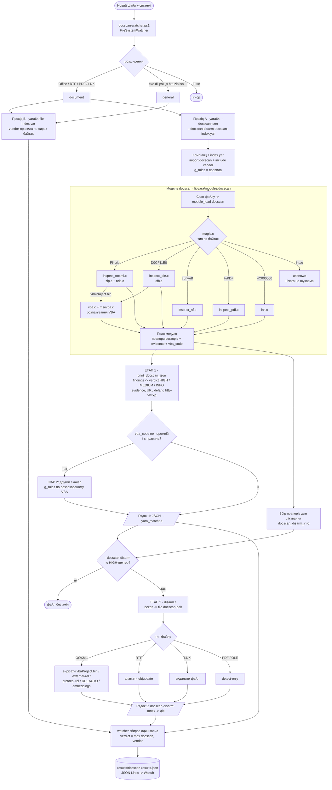

# DocScan on YARA — повна документація

**Мова:** українська · [English](SCAN-FLOW.en.md)

Форк YARA 4.6.0 з власним модулем **`docscan`**: виявляє заражені документи, перевіряє витягнутий
макрос vendor-правилами, лікує документ і віддає результат у JSON. Усе — в **одному бінарнику**
`yara64.exe`. Поверх нього — **watcher**, що автоматично сканує нові файли в системі.

> Це єдиний документ проєкту. Першоджерела (оригінальний `doc-scan.ps1`, матеріали Mandiant, стаття,
> повний корпус vendor-правил) — у `reference/`, вони не наша документація.

**Зміст**
1. [Мета і принципи](#1-мета-і-принципи)
2. [Загальна схема](#2-загальна-схема)
3. [Карта файлів](#3-карта-файлів)
4. [Доопрацювання YARA — код, функція за функцією](#4-доопрацювання-yara--код-функція-за-функцією)
5. [Поведінка: як проходить скан](#5-поведінка-як-проходить-скан)
6. [Правила YARA](#6-правила-yara)
7. [Watcher — авто-скан нових файлів](#7-watcher--авто-скан-нових-файлів)
8. [Запуск — шпаргалка](#8-запуск--шпаргалка)
9. [Збірка](#9-збірка)
10. [Тестування](#10-тестування)
11. [Середовище](#11-середовище)
12. [Інтеграція з Wazuh](#12-інтеграція-з-wazuh)
13. [Відомі обмеження і нюанси](#13-відомі-обмеження-і-нюанси)
14. [Git і ліцензії](#14-git-і-ліцензії)

---

## 1. Мета і принципи

На документ, що з'явився в системі, DocScan має:
1. **Виявити** техніку атаки структурним розбором → `findings` + `verdict` + докази.
2. **Перевірити** витягнутий (розпакований) VBA vendor-правилами — «Шар 2».
3. **Вилікувати** документ, зберігши його (вирізати макрос / зовнішній шаблон / DDE / вкладення;
   зламати `\objupdate`; LNK — видалити). Оригінал — у бекап.
4. **Повідомити** — JSON, який зараз дивимось вручну, а згодом забиратиме Wazuh.

Принципи:
- **Один бінарник.** Детект, Шар 2, лікування, JSON — прапори `yara64.exe`, окремих exe немає.
- **Модуль тільки читає.** Модуль працює на read-only буфері посеред скану й нічого не пише.
  Лікування — у CLI-шарі (`cli/yara.c` → `disarm.c`) **після** скану, коли файл закрито.
- **Тип — за magic-байтами**, не за розширенням (`invoice.pdf`, що насправді docx, — це OOXML).
- **Без XML-парсера.** `.rels`/`document.xml` розбираються пошуком токенів — безпечніше для
  недовіреного вводу. Усі бінарні читання bounds-checked.
- **Портативний C.** Розробка на macOS, прод — Windows (MSVC). Жодних POSIX-онлі API в модулі.
- **Без прив'язки до Wazuh.** `yara64.exe` видає чистий JSON; доставка — справа watcher/агента.
- Еталон логіки — `reference/doc-scan.ps1` + `reference/mandiant/` (перенесено з PowerShell у C).

---

## 2. Загальна схема



### Те саме текстом

```
 новий файл ──► watcher (FileSystemWatcher) ──► категорія за розширенням
                                                │
            ┌──────────── document ─────────────┼──────────── general ───────────┐
            │                                   │                                │
   Прохід B: yara64 file-index.yar     Прохід A: yara64 --docscan-json     Прохід B: yara64 file-index.yar
   (vendor по сирих байтах)            [--docscan-disarm] docscan-index.yar
                                                │
     ┌──────────────────────────────────────────▼─────────────────────────┐
     │ МОДУЛЬ docscan (read-only)                                          │
     │  magic ─► ooxml │ ole │ rtf │ pdf │ lnk                             │
     │            │     │                                                  │
     │            └──┬──┘ vbaProject.bin ─► CFB ─► MS-OVBA ─► VBA текст    │
     │  ► прапори векторів + evidence + vba_code                           │
     └───────┬────────────────────────────────────────┬────────────────────┘
             │                                        │
   ЕТАП 1 ДЕТЕКЦІЯ (cli/yara.c)              ЕТАП 2 ЛІКУВАННЯ (тільки якщо HIGH)
   findings ► verdict, evidence (hxxp)       бекап ► .docscan-bak
   ШАР 2: vba_code ► vendor-правила          OOXML ► перепакувати zip без вектора
             │                               RTF   ► зламати \objupdate
             ▼                               LNK   ► видалити;  PDF/OLE ► detect-only
   рядок 1: {JSON ... yara_matches}                   ▼
                                             рядок 2: docscan-disarm: ... -> дія
             └────────────────► watcher: один JSON-рядок у results\docscan-results.json
```

---

## 3. Карта файлів

```
libyara/modules/docscan/            МОДУЛЬ (C, вшитий у libyara)
  docscan.c                         поля модуля + module_load → інспектори
  inspect.h                         docscan_result_t — спільний результат усіх інспекторів
  magic.{c,h}                       тип файлу по magic-байтах
  search.{c,h}                      портативний memmem / contains / contains_ci
  dynbuf.h                          growable буфер (header-only)
  zip.{c,h}  miniz.{c,h}            ZIP-читання (обгортка над miniz; miniz — public domain, 1 латка `docscan patch`)
  rels.{c,h}                        розбір OOXML .rels (external relationships)
  inspect_ooxml.c                   OOXML: rels / vbaProject.bin / DDE / embeddings
  cfb.{c,h}                         Compound File (OLE) reader
  msovba.{c,h}                      MS-OVBA декомпресія VBA
  vba.{c,h}                         пошук VBA у CFB + підозрілі конструкції
  inspect_ole.c                     legacy .doc/.xls (CFB → VBA)
  inspect_rtf.c / inspect_pdf.c     RTF / PDF
  lnk.c                             бінарний розбір LNK (MS-SHLLINK)
  disarm.c                          ЛІКУВАННЯ (викликається з CLI, не з модуля)
libyara/include/yara/docscan_disarm.h   контракт лікування (docscan_disarm_info, docscan_disarm)
libyara/modules/module_list         + MODULE(docscan)
Makefile.am                         + 15 рядків MODULES += .../docscan/*.c
windows/vs20{15,17,19}/libyara/libyara.vcxproj   + 15 ClCompile docscan
cli/yara.c                          + прапори --docscan-json/-extract/-disarm, JSON, Шар 2, do_disarm

docscan-project/
  SCAN-FLOW.md / SCAN-FLOW.en.md    цей документ (українська / англійська)
  rules/
    docscan.yar                     мінімальний: import "docscan" (тільки наш детект)
    docscan-index.yar               import "docscan" + include vendor → детект + Шар 2 (VBA)
    file-index.yar                  vendor-правила по сирих байтах (прохід B watcher)
    general/                        165 правил signature-base "strict" (копія з reference)
    maldoc/                         36 документних правил (signature-base + community) + vba_plaintext.yar
  watcher/docscan-watcher.ps1       авто-скан нових файлів → results\docscan-results.json
  fuzz/                             libFuzzer: 2 фазери, словник, корпус, build.sh, regressions/
  test-range/
    run_tests.ps1                   регресійний тест (копія → детект+лікування → повторний скан)
    gen_range.ps1                   генератор полігону (Windows + Word COM)
    gen_test_range.py               швидкий синтетичний генератор (без Office)
    samples/generated/              локальний дубль test-samples/generated (не в git)
  test-samples/                     ОРИГІНАЛИ тест-набору (не лікувати напряму!)
    provided/  (7)                  реальні семпли замовника (живий C2) — НЕ в git
    generated/ (12)                 безпечний полігон, по файлу на вектор
  reference/                        першоджерела (PS-скрипт, Mandiant, стаття, повний vendor-корпус)
```

---

## 4. Доопрацювання YARA — код, функція за функцією

### 4.1 Як модуль вбудовано в YARA

**Реєстрація** (три місця):
- `libyara/modules/module_list` — рядок `MODULE(docscan)`. `modules.c` інклудить цей файл двічі
  (X-macro) і будує таблицю `yr_modules_table[]` з покажчиками на функції модуля.
- `Makefile.am` — 15 рядків `MODULES += libyara/modules/docscan/*.c` (macOS/Linux, autotools).
- `windows/vs20{15,17,19}/libyara/libyara.vcxproj` — ті самі 15 файлів як `<ClCompile>` (MSVC).
  **Новий `.c` треба додавати в обидві системи збірки.**

**Трюк з іменами.** На початку `docscan.c` стоїть `#define MODULE_NAME docscan`; макроси з
`yara/modules.h` перейменовують `module_load` → `docscan__load`, `module_initialize` →
`docscan__initialize` тощо. Тому в кожному модулі YARA функції звуться однаково без конфліктів.

**Життєвий цикл** (функції модуля викликає ядро через `yr_modules_table[]`, ми їх не кличемо):

| Функція модуля | Хто викликає | Коли | Як часто | У нас |
|---|---|---|---|---|
| `module_initialize` | `yr_modules_initialize()` | `yr_initialize()` | раз на процес | порожня |
| `begin_declarations…end_declarations` | `yr_modules_do_declarations()` | правило має `import "docscan"` | раз на компіляцію | будує дерево полів |
| `module_load` | `yr_modules_load()` | **кожен скан файлу** | на кожен файл | вся робота |
| `module_unload` | вивантаження після скану | після кожного файлу | на кожен файл | порожня |
| `module_finalize` | `yr_modules_finalize()` | `yr_finalize()` | раз на процес | порожня |

Потік даних: сирі байти → `docscan_detect_magic` → інспектор → `docscan_result_t` → поля модуля →
(а) умови правил `docscan.xxx`, (б) `print_docscan_json` у CLI, (в) `docscan_disarm`.

### 4.2 `docscan.c` — поля модуля і `module_load`

**Поля** (`begin_declarations`), усі integer 0/1, крім рядків доказів:

| Група | Поле | Рівень | Значення |
|---|---|---|---|
| тип | `is_ooxml` `is_ole` `is_rtf` `is_pdf` `is_lnk` | — | тип файлу по magic |
| RTF | `rtf_objupdate` | HIGH | `\objupdate` — OLE-об'єкт оновлюється (завантажується) при відкритті (T1203) |
| | `rtf_embedded_object` | контекст | `\objdata` / `\objlink` / `\objhtml` (часто легітимно; у verdict не йде) |
| PDF | `pdf_launch` | HIGH | `/Launch` — запуск зовнішньої програми |
| | `pdf_js_auto` | HIGH | є JS і небезпечний API (див. 4.7) |
| | `pdf_js` | MEDIUM | JS без явно небезпечних API |
| | `pdf_openaction` | MEDIUM | `/OpenAction` або `/AA` без JS |
| | `pdf_embedded` | MEDIUM | `/EmbeddedFile` |
| OOXML | `remote_template` | HIGH | external `attachedTemplate` → віддалений URL (T1221) |
| | `protocol_handler` | HIGH | external rel `ms-msdt:` / `search-ms:` … (Follina, T1203) |
| | `dde_auto` | HIGH | `DDEAUTO` у тілі документа (T1559.002) |
| | `embedded_pe` | HIGH | PE (`MZ`…`PE\0\0`) у `embeddings/oleObject*.bin` |
| | `embedded_lnk` | HIGH | сигнатура LNK у `embeddings/oleObject*.bin` |
| | `macro_suspicious` | HIGH | у розпакованому VBA є exec/download-конструкції |
| | `macro_present` | MEDIUM | є `vbaProject.bin` / VBA-модуль |
| | `external_ole` | MEDIUM | external `oleObject` relationship |
| | `external_frame` | MEDIUM | external `frame` relationship |
| | `dde_link` | MEDIUM | `DDE ` + cmd/powershell/mshta/rundll32 (не AUTO) |
| LNK | `lnk_url_args` | HIGH | URL/UNC в аргументах |
| | `lnk_obfuscated` | HIGH | `-enc`, `iex`, `-w hidden`, `downloadstring`… в аргументах |
| | `lnk_lolbin` | MEDIUM* | ціль — LOLBin (cmd/powershell/mshta/rundll32/…) |
| докази | `template_url` `dde_command` `vba_evidence` `lnk_target` `lnk_args` | — | рядки ≤ 511 символів |
| Шар 2 | `vba_code` | — | весь розпакований VBA (≤ 2 МБ) для перескану vendor-правилами |

\* `lnk_lolbin` у JSON рахується як MEDIUM, а для рішення «лікувати» — як HIGH (див. §13).

| Функція | Що робить |
|---|---|
| `module_initialize` / `module_finalize` / `module_unload` | Порожні, `return ERROR_SUCCESS`. |
| `module_load(context, module_object, …)` | 1) обнуляє `is_*`; 2) бере **перший** блок пам'яті (`foreach_memory_block` + `yr_fetch_block_data`; при скані файлу це весь файл); 3) `docscan_detect_magic` → ставить `is_<тип>=1` і викликає інспектор типу; 4) переносить усі поля `docscan_result_t` у поля модуля (`yr_set_integer` / `yr_set_string`); 5) `vba_code` — `yr_set_sized_string`, після чого звільняє буфер (або порожній рядок). |

### 4.3 `inspect.h` — спільний результат

`docscan_result_t` — структура з усіма прапорами (див. таблицю вище), п'ятьма фіксованими
буферами доказів `char[512]` (без malloc) і `char* vba_code` + `vba_code_len` (malloc, звільняє
`module_load`). Інспектори — чистий C без залежності від YARA: приймають `(data, size, *r)` і лише
виставляють поля. Оголошення: `docscan_inspect_{rtf,pdf,ooxml,ole,lnk}`.

### 4.4 `magic.c`, `search.c`, `dynbuf.h` — базові утиліти

| Функція | Що робить |
|---|---|
| `docscan_detect_magic(data, size)` | Перші 4 байти: `PK` → OOXML; `D0 CF 11 E0` → OLE; `{\rt` → RTF; `4C 00 00 00` → LNK; `%PDF` → PDF; інакше UNKNOWN. Безпечна на NULL/коротких буферах. |
| `docscan_memmem(hay, len, needle, nlen)` | Пошук байтів (MSVC не має `memmem`). Перший байт через `memchr`, далі `memcmp`. |
| `docscan_contains(hay, len, token)` | 1, якщо NUL-термінований токен є в буфері (з урахуванням регістру). |
| `docscan_contains_ci(hay, len, token)` | Те саме без урахування регістру (ASCII). |
| `docscan_buf_push(b, src, n)` / `docscan_buf_free(b)` | Growable буфер: старт 4 КБ, подвоєння; `-1` при нестачі пам'яті. Використовують `cfb.c`, `msovba.c`. |

### 4.5 OOXML: `zip.c`, `rels.c`, `inspect_ooxml.c`

OOXML (docx/xlsx/pptx) — ZIP із DEFLATE, тому сирий пошук не бачить вмісту — потрібна розпаковка.

**`zip.c`** — тонка обгортка над miniz:

| Функція | Що робить |
|---|---|
| `docscan_zip_open(data, size)` | `mz_zip_reader_init_mem` по буферу в пам'яті; NULL, якщо не ZIP. |
| `docscan_zip_count(z)` | Кількість записів. |
| `docscan_zip_entry_name(z, i, buf, sz)` | Ім'я i-го запису (обрізається до `sz-1`). |
| `docscan_zip_extract(z, i, &out_size)` | Розпаковує запис у heap. Записи, що за заголовком > 64 МБ (`DOCSCAN_ZIP_MAX_ENTRY`), не розпаковує — захист від zip-бомб. |
| `docscan_zip_free(p)` / `docscan_zip_close(z)` | Звільнення. |

**`rels.c`** — розбір `.rels` без XML-парсера:

| Функція | Що робить |
|---|---|
| `docscan_scan_rels(xml, size, r)` | Проходить кожен `<Relationship …>`; цікавлять лише `TargetMode="External"`. Якщо `Target` — protocol handler → `protocol_handler` + `template_url`. Інакше за останнім сегментом `Type`: `attachedTemplate` з віддаленим target → `remote_template` + `template_url`; `oleObject` → `external_ole`; `frame` → `external_frame`. |
| `get_attr(tag, len, "Attr=\"", out, sz)` | Значення атрибута в межах тега до наступної `"`. Якщо атрибута немає — буфер не чіпає (тому буфери ініціалізовані `""`). |
| `starts_with_ci(s, prefix)` | Префікс без урахування регістру. |
| `is_remote_target(t)` | `http(s)://`, `ftp(s)://`, `sftp://`, UNC `\\host\share`, `file://` (крім `file://localhost`). |
| `is_protocol_handler(t)` | `ms-msdt:`, `search-ms:`, `search:`, `ms-officecmd:`, `mhtml:`, `ms-word:`, `ms-excel:`, `ms-powerpoint:`, `!x-usc:`. |

**`inspect_ooxml.c`**:

| Функція | Що робить |
|---|---|
| `docscan_inspect_ooxml(data, size, r)` | Відкриває ZIP і за іменем кожного запису: `*.rels` → `docscan_scan_rels`; `*vbaProject.bin` → `macro_present=1` + `docscan_scan_vba_container`; тіло документа → `scan_dde`; `embeddings/oleObject*.bin` → `scan_embedded_ole`. |
| `is_body_xml(name)` | `word/document.xml`, `word/header*.xml`, `word/footer*.xml`, `xl/worksheets/sheet*.xml`, `xl/workbook.xml`. |
| `is_embedded_ole(name)` | `embeddings/oleObject*.bin`. |
| `scan_dde(xml, n, r)` | `DDEAUTO` (без регістру) → `dde_auto` + `dde_command` (фрагмент від `DDEAUTO` до `<`). Інакше `DDE ` + cmd/powershell/mshta/rundll32 → `dde_link`. |
| `scan_embedded_ole(d, n, r)` | 20-байтова сигнатура LNK (header + CLSID) → `embedded_lnk` і розбір цього LNK (`docscan_inspect_lnk` → target/args); `MZ` з `e_lfanew` < 0x1000, що вказує на `PE\0\0` → `embedded_pe`. |
| `ends_with(s, suffix)` | Допоміжна. |

### 4.6 OLE і VBA: `cfb.c`, `msovba.c`, `vba.c`, `inspect_ole.c`

Макроси лежать у Compound File (`vbaProject.bin` в OOXML, або весь legacy `.doc/.xls`) і стиснуті
MS-OVBA. Ланцюжок: **CFB → потоки → пошук контейнера MS-OVBA → декомпресія → текст VBA → ключові слова**.

**`cfb.c`** — мінімальний CFB-reader (v3, сектори від офсету 512), усі читання з перевіркою меж;
усі ланцюги (FAT, DIFAT, mini FAT) і розміри масивів обмежені кількістю секторів у файлі — довший
ланцюг означає цикл; потік ≤ 4 МБ, сумарно віддається колбеку ≤ 64 МБ. Показники розміру сектора
перевіряються (7–16) до зсуву.

| Функція | Що робить |
|---|---|
| `docscan_cfb_foreach_stream(data, size, cb, ud)` | 1) номери FAT-секторів: 109 записів DIFAT у заголовку + ланцюг DIFAT; 2) збирає FAT; 3) directory stream; 4) mini stream (старт — у root entry, `dir+116`); 5) mini FAT; 6) для кожного запису типу 2 (stream): потоки < `miniCutoff` — через mini FAT, більші — через FAT; викликає `cb(bytes, len, ud)`; `cb` повертає ≠0, щоб зупинитись. `-1` — не CFB / зіпсований заголовок. |
| `read_chain(…)` | Йде FAT-ланцюгом і конкатенує сектори в буфер. |
| `u16` / `i32` / `u32` / `i32_push` | Little-endian читання з перевіркою меж; growable масив int32. |

**`msovba.c`**:

| Функція | Що робить |
|---|---|
| `docscan_msovba_decompress(buf, len, start, max_out, &out_size)` | Декомпресія MS-OVBA ([MS-OVBA] 2.4.1): сигнатура `0x01`, далі чанки з 2-байтовим заголовком (розмір, сигнатура 3, прапор стиснення). Нестиснений чанк копіюється; стиснений — flag-байт на 8 токенів: літерал або back-reference (зсув/довжина з динамічною кількістю біт від позиції в чанку). Читає байт перед `push` (безпечно щодо realloc). Зупиняється на `max_out`. NULL при помилці/порожньому виході. |

**`vba.c`**:

| Функція | Що робить |
|---|---|
| `docscan_scan_vba_container(cfb, size, r)` | `docscan_cfb_foreach_stream(..., vba_stream_cb, r)`. |
| `vba_stream_cb(data, size, r)` | У кожному потоці шукає байт `0x01` + заголовок чанка з сигнатурою 3 → спершу дешевий попередній перегляд (перші 64 байти), повна декомпресія (≤ 4 МБ) лише якщо він схожий на VBA. Справжній модуль починається з `Attribute VB_…` (перевірка `Attribut` у перших 48 байтах) → `macro_present=1`; кожне з ключових слів `SUS[]` (без регістру) → `macro_suspicious=1` + `add_evidence`. Дописує текст модуля в `vba_code` (до 2 МБ, модулі через `\n`). Один модуль на потік. |
| `add_evidence(r, kw)` | Дописує `kw` у `vba_evidence` у форматі `a \| b \| c`, не виходячи за 512 байт. |

`SUS[]` (підозрілі конструкції, з `$sus` у `doc-scan.ps1`): `powershell`, `cmd.exe`, `mshta`,
`rundll32`, `regsvr32`, `certutil`, `bitsadmin`, `WScript.Shell`, `CreateObject`, `Shell`, `.Run`,
`.Exec`, `DownloadString`, `DownloadFile`, `URLDownloadToFile`, `XmlHttp`, `WinHttp`, `FromBase64`,
`StrReverse`, `Environ`, `AutoOpen`, `Auto_Open`, `Document_Open`, `Workbook_Open`, `Auto_Exec`.

**`inspect_ole.c`**:

| Функція | Що робить |
|---|---|
| `docscan_inspect_ole(data, size, r)` | Маркер `_VBA_PROJECT` → `macro_present`; весь файл — CFB → `docscan_scan_vba_container`. |

### 4.7 RTF, PDF, LNK

| Функція | Файл | Що робить |
|---|---|---|
| `docscan_inspect_rtf` | `inspect_rtf.c` | `\objupdate` → `rtf_objupdate`; `\objdata`/`\objlink`/`\objhtml` → `rtf_embedded_object`. |
| `docscan_inspect_pdf` | `inspect_pdf.c` | `/Launch` → `pdf_launch`; `/JavaScript` або `/JS` + небезпечний API → `pdf_js_auto`, без нього → `pdf_js`; `/OpenAction` або `/AA` без JS → `pdf_openaction`; `/EmbeddedFile` → `pdf_embedded`. |
| `pdf_has_dangerous_js` | `inspect_pdf.c` | Шукає: `app.launchURL`, `exportDataObject`, `importDataObject`, `getAnnots`, `submitForm`, `Collab.`, `util.printf`, `getIcon`, `media.newPlayer`, `eval(`, `unescape(`, `String.fromCharCode`, `.exe`, `powershell`, `cmd.exe`, `rundll32`, `mshta`, `certutil`, `Net.HTTP`, `SOAP.`, `heapLib`, `shellcode`. Безпечний JS переглядача (`this.print`, `app.alert`) навмисно не в списку. |
| `docscan_inspect_lnk` | `lnk.c` | Розбір MS-SHLLINK (замість COM `WScript.Shell`): HeaderSize=0x4C → LinkFlags → пропуск IDList → `LinkInfo.LocalBasePath` = **target** → StringData (Name, RelPath, WorkDir пропускаються) → **Arguments**. Заповнює `lnk_target`/`lnk_args`. Ім'я файлу цілі ∈ {cmd, powershell, pwsh, mshta, rundll32, wscript, cscript, regsvr32, certutil, bitsadmin, msiexec, forfiles, conhost}`.exe` → `lnk_lolbin`; `http://`/`https://`/`ftp://`/`\\`/`www.` в аргументах → `lnk_url_args`; `-enc`, `-encodedcommand`, `frombase64string`, `-w hidden`, `-windowstyle hidden`, `iex`, `invoke-expression`, `downloadstring` → `lnk_obfuscated`. |
| `rd16` / `rd32` / `ci_streq` / `cpy_ansi` / `cpy_stringdata` | `lnk.c` | Читання з перевіркою меж; порівняння без регістру (MSVC не має `strcasecmp`); копіювання ANSI-рядка та StringData (UTF-16 → беремо молодший байт). |

### 4.8 Лікування: `docscan_disarm.h` + `disarm.c`

Компілюється в libyara, але **викликається тільки з CLI** (`do_disarm` після скану).

`docscan_disarm_info` — що знайшов скан: `present`, `type` (1 ooxml, 2 ole, 3 rtf, 4 pdf, 5 lnk),
`high`, `macro`, `remote_template`, `protocol_handler`, `dde_auto`, `embedded`, `rtf_objupdate`, `lnk_bad`.

| Функція | Що робить |
|---|---|
| `docscan_disarm(path, info, out_action, sz)` | Диспетчер. LNK + `lnk_bad` → бекап + видалення (`deleted:lnk`). RTF + `rtf_objupdate` → бекап + `cure_rtf`. OOXML з будь-яким вектором → бекап + `cure_ooxml`. PDF/OLE → `detect-only`. |
| `cure_ooxml(path, info, action, sz)` | Перепаковує ZIP через miniz у `<file>.docscan-tmp`: **не копіює** `vbaProject.bin`/`vbaData.xml` (макрос) і `embeddings/oleObject*.bin`; у `*.rels` видаляє `<Relationship>` з маркерами `vbaProject` / `oleObject` / `attachedTemplate` / `ms-msdt` / `search-ms`; у `[Content_Types].xml` — `<Override>` з `vbaProject`; у `word/document.xml`/header/footer `DDEAUTO` → `REMOVED`. Потім підміняє оригінал. Якщо будь-яку частину не вдалося прочитати (чи вона > 64 МБ) — лікування скасовується, оригінал не змінюється, дія `failed:unreadable-part`. Дії: `removed:vbaProject.bin`, `removed:embeddings`, `removed:remote-template`, `removed:protocol-rel`, `stripped:dde`. |
| `cure_rtf(path, action, sz)` | `\objupdate` → `\objupdatX` (керуюче слово зламане, довжина та сама) → `stripped:objupdate`. |
| `remove_elements(in, len, markers, n, &out_len)` | Копіює XML, викидаючи елементи `<Relationship …>` / `<Override …>`, що містять будь-який маркер. |
| `strip_dde(buf, len)` | `DDEAUTO` → `REMOVED` на місці (7 символів, без «DDE», щоб не лишався `dde_link`). |
| `backup(path)` | Копія в `<path>.docscan-bak`. |
| `read_file` / `write_file` / `append` / `name_is` | Файл у пам'ять / запис; дописати дію через кому; перевірка суфікса імені. |

### 4.9 Зміни в `cli/yara.c` (+314 рядків)

**Прапори:**

| Прапор | Змінна | Дія |
|---|---|---|
| `--docscan-json` | `docscan_json` | друкує один рядок JSON з результатом модуля; **придушує звичайний вивід збігів** правил по файлу |
| `--docscan-extract=FILE` | `docscan_extract` | пише `vba_code` у FILE (ручний Шар 2) |
| `--docscan-disarm` | `docscan_disarm_flag` | лікує файл на місці після скану, якщо є HIGH-вектор |

Глобально: `g_rules` — покажчик на завантажені правила (присвоюється після компіляції/завантаження),
потрібен для Шару 2. У `CALLBACK_ARGS` додано `docscan_disarm_info ds`.

**Точки входу в існуючий потік YARA:**
- `callback()` → `CALLBACK_MSG_RULE_MATCHING/NOT_MATCHING`: у режимі `--docscan-json` одразу
  `CALLBACK_CONTINUE` (виводиться лише JSON).
- `callback()` → `CALLBACK_MSG_MODULE_IMPORTED` для об'єкта `docscan`:
  з `--docscan-disarm` заповнює `ds` з полів модуля; з `--docscan-extract` пише `vba_code` у файл;
  з `--docscan-json` викликає `print_docscan_json` (на Windows з перемиканням stdout у текстовий режим).
- Після `yr_scanner_scan_file` (і в однопотоковому, і в багатопотоковому шляху): якщо
  `--docscan-disarm && ds.present && ds.high` → `do_disarm`.

**Нові функції:**

| Функція | Що робить |
|---|---|
| `print_docscan_json(module)` | Визначає `ftype`; за таблицею `F[]` збирає `findings` і рахує verdict (є HIGH → `HIGH`, інакше є MEDIUM → `MEDIUM`, інакше `INFO`); друкує `evidence`; **Шар 2**: якщо `vba_code` непорожній і `g_rules` є — створює другий `YR_SCANNER` з тими ж правилами, сканує `vba_code` у пам'яті (`yr_scanner_scan_mem`), збіги через `vendor_match_cb` → `yara_matches`. |
| `vendor_match_cb(...)` | Колбек другого сканера: дописує ідентифікатори правил, що спрацювали (крім `_docscan_probe`), у JSON-масив (буфер 2 КБ). |
| `docscan_json_evidence(m, field, defang, &first)` | Друкує одне поле доказів, якщо непорожнє (до 2 КБ), з defang для URL-полів (`template_url`, `dde_command`, `lnk_args`). |
| `docscan_defang(s)` | `http` → `hxxp`, `ftp` → `fxp` (щоб URL у логах не були клікабельні). |
| `docscan_json_puts(s)` | JSON-екранування: `"` `\` `\n` `\r` `\t`, керуючі < 0x20 → `\u00XX`. |
| `do_disarm(file_path, ds)` | Викликає `docscan_disarm`, друкує `docscan-disarm: <шлях> -> <дія>`. На Windows Unicode-збірці конвертує wide-шлях у UTF-8 і тимчасово перемикає stdout у текстовий режим. |

Умови `#if defined(_WIN32) && defined(_UNICODE)` навколо wide/UTF-8 коду — щоб файл збирався і
MSVC (Unicode), і MinGW (ANSI), як в оригінальній YARA.

**Формат JSON (рядок 1):**
```json
{"ftype":"ooxml","findings":["MACRO_SUSPICIOUS","MACRO_PRESENT"],"verdict":"HIGH",
 "evidence":{"vba_evidence":"powershell | Shell | DownloadFile | AutoOpen"},
 "yara_matches":["gen_macro_ShellExecute_action"]}
```
`ftype` ∈ ooxml/ole/rtf/pdf/lnk/unknown; `findings` — назви прапорів великими літерами;
`evidence` — тільки непорожні поля; `yara_matches` — Шар 2 (порожній, якщо в index немає vendor-правил).
**Рядок 2** (лише з `--docscan-disarm` і HIGH): `docscan-disarm: <шлях> -> <дія>[,<дія>…]`.

---

## 5. Поведінка: як проходить скан

1. **Підготовка.** Оригінал не чіпаємо: для ручних тестів — копія `work.<ext>`
   (`run_tests.ps1` робить це сам і звіряє SHA256 оригіналів). Watcher сканує файл на місці.
2. **Компіляція правил.** `index.yar` = `import "docscan"` + `include` vendor-правил → `g_rules`.
3. **Модуль.** `module_load`: magic → інспектор → поля (див. §4).
4. **ЕТАП 1 — детекція.** `print_docscan_json`: findings → verdict → evidence (defang) → JSON.

   | HIGH | MEDIUM |
   |---|---|
   | REMOTE_TEMPLATE, PROTOCOL_HANDLER, DDE_AUTO, RTF_OBJUPDATE, PDF_JS_AUTO, PDF_LAUNCH, EMBEDDED_PE, EMBEDDED_LNK, MACRO_SUSPICIOUS, LNK_URL_ARGS, LNK_OBFUSCATED | MACRO_PRESENT, LNK_LOLBIN, EXTERNAL_OLE, EXTERNAL_FRAME, DDE_LINK, PDF_JS, PDF_OPENACTION, PDF_EMBEDDED |

   `verdict`: **HIGH** → реагувати/лікувати; **MEDIUM** → переглянути; **INFO** → чисто.
5. **ШАР 2.** Розпакований VBA (`vba_code`) пересканується тими ж правилами → `yara_matches`.
   Звичайні `$string`-правила бачать тільки вхідний буфер, а VBA в документі стиснутий —
   тому без Шару 2 vendor-правила макросу не бачать.
6. **ЕТАП 2 — лікування** (тільки `--docscan-disarm` і є HIGH-вектор). Спершу бекап
   `<file>.docscan-bak`, потім:

   | Тип | Дія | Вивід | Документ |
   |---|---|---|---|
   | OOXML макрос | вирізати `vbaProject.bin` + rels/content-type | `removed:vbaProject.bin` | лишається валідним |
   | OOXML remote template | прибрати external-rel | `removed:remote-template` | лишається |
   | OOXML Follina | прибрати protocol-rel | `removed:protocol-rel` | лишається |
   | OOXML DDE | `DDEAUTO` → `REMOVED` | `stripped:dde` | лишається |
   | OOXML embedded PE/LNK | вирізати embeddings | `removed:embeddings` | лишається |
   | RTF | зламати `\objupdate` | `stripped:objupdate` | лишається |
   | LNK | видалити (файл = вектор) | `deleted:lnk` | видалено (бекап є) |
   | PDF / OLE | нічого (карантин — оркестратор) | `detect-only` | — |
   | OOXML з частиною, що не читається / > 64 МБ | лікування скасовано | `failed:unreadable-part` | без змін (бекап є) |
   | лише MEDIUM (напр. `external_ole`) | не лікується | — | без змін |

7. **Контроль.** Повторний скан вилікуваної копії → очікуємо `INFO` (LNK відсутній, PDF лишається HIGH).

---

## 6. Правила YARA

| Файл | Для чого | Вміст |
|---|---|---|
| `rules/docscan.yar` | тільки наш детект | `import "docscan"` + `private rule _docscan_probe { condition: false }` → `yara_matches` завжди `[]` |
| `rules/docscan-index.yar` | детект + Шар 2 (прохід A) | `import "docscan"` + `include "maldoc/signature-base/gen_macro_ShellExecute_action.yar"` (інші — закоментовані) |
| `rules/file-index.yar` | сирі байти файлу (прохід B watcher) | 165 × `general/` + 33 × `maldoc/` (198 include) |
| `rules/general/` | загальний YARA-скан | підмножина signature-base з `reference/vendor-rules-full-later/dist/index_strict.yar` (score ≥ 75), 1022 правила, 1.4 МБ |
| `rules/maldoc/` | документні правила | `signature-base/` 15 + `community/` 20 + `vba_plaintext.yar` |
| `reference/vendor-rules-full-later/` | повний корпус (85 МБ) | signature-base + community + Elastic protections-artifacts; `gen_index.py` → `dist/index_strict.yar` (компілюється) і `index_advisory.yar` (потребує зовнішніх змінних `filename`/`filepath` — не використовуємо) |

Правила для `index.yar`:
- `import "docscan"` — першим.
- Шляхи в `include` — **через `/`**, відносні до index-файлу або абсолютні (`\` YARA сприймає як escape).
- Лише правила, що компілюються самостійно (без відсутніх модулів/зовнішніх змінних). Одне зламане
  правило ламає весь index. Перевірка: `yara64 -w index.yar будь-який-файл` без помилок.
- Ідентифікатори правил мають бути унікальні. У `file-index.yar` через дублікати виключено:
  `maldoc/signature-base/exploit_rtf_ole2link.yar` (= community/Maldoc_malrtf_ole2link),
  `maldoc/signature-base/susp_office_template_injection.yar` (= general/…),
  `maldoc/signature-base/general_officemacros.yar` (конфлікт `Office_AutoOpen_Macro`; втрачено
  `Office_as_MHTML`, `Docm_in_PDF`).

Чому потрібні обидва проходи для документів: OOXML — це ZIP, тому правила по сирих байтах ловлять
лише макроси (`Contains_VBA_macro_code`, `office_document_vba`), LNK (`powershell`) і PDF; remote
template, Follina, DDE, embedded бачить **тільки** модуль docscan.

---

## 7. Watcher — авто-скан нових файлів

`docscan-project/watcher/docscan-watcher.ps1` (PowerShell 5.1, UTF-8 з BOM).

### Що сканується

| Категорія | Розширення | Скан |
|---|---|---|
| `document` | doc dot docx docm dotx dotm, xls xlt xlsx xlsm xltx xltm xlsb, ppt pps pot pptx pptm potx potm ppsx ppsm, rtf, pdf, lnk | **B** + **A** |
| `general` | exe dll sys scr cpl ocx com msi, ps1 psm1 vbs vbe js jse wsf wsh hta bat cmd jar, zip rar 7z iso img vhd vhdx | тільки **B** |
| інше | — | ігнорується |

- **A** — `yara64 --docscan-json [--docscan-disarm] docscan-index.yar <file>`.
- **B** — `yara64 -w file-index.yar <file>` (до лікування, по оригінальних байтах).
- **Verdict запису:** document = verdict docscan, але якщо спрацювало правило B — щонайменше
  `MEDIUM`; general = `HIGH`, якщо спрацювало B, інакше `INFO`; також `SKIPPED` (> `-MaxSizeMB`),
  `ERROR` (скан не вдався).
- **Не скануються** (`-ExcludePattern`): `results\`, `*.docscan-bak`, lock-файли Office `~$*`,
  `$Recycle.Bin`, кеші браузерів/Packages/OneDrive/WebCache, `Recent` (там `.lnk` на кожне відкриття).

### Як працює

1. `FileSystemWatcher` на кожну теку `-WatchPath` (рекурсивно; Created / Changed / Renamed + Error).
2. Подія → словник `pending` (кілька подій по файлу зливаються).
3. Після `-SettleSeconds` тиші — `Wait-FileReady`: файл відкривається на читання і розмір стабільний
   (до `-ReadyTimeout` с).
4. Якщо SHA256 збігається з минулим сканом цього шляху — пропуск (Word/провідник шлють кілька подій).
5. `Scan-File`: SHA256, прохід B, для document — прохід A; запис JSON-рядка + рядок у лог.
6. Ctrl+C / зупинка завдання → `finally`: відписка від подій, `Dispose` watcher-ів.
На старті перевіряє, що `yara64.exe` і обидва index-и є та компілюються.

| Функція | Що робить |
|---|---|
| `Get-Category` | `document` / `general` / `$null` за розширенням |
| `Test-Excluded` | шлях у `OutDir` або відповідає `-ExcludePattern` |
| `Wait-FileReady` | `ready` / `gone` / `timeout` |
| `Invoke-FileScan` | прохід B → імена правил + помилки |
| `Invoke-DocScan` | прохід A → розібраний JSON docscan + дія лікування |
| `Scan-File` | збирає запис, рахує verdict, пише JSON і лог |
| `Max-Verdict` / `Log` | максимум з двох вердиктів; лог у консоль і `watcher.log` |

### Параметри

`-WatchPath` (`C:\Users`), `-Base` (`C:\docscan-build`), `-Yara`, `-DocRules`, `-FileRules`,
`-OutDir` (`<Base>\results`), `-Disarm` (вимкнено), `-MaxSizeMB` (100), `-SettleSeconds` (2),
`-ReadyTimeout` (60), `-DocExt`, `-GenExt`, `-ExcludePattern`.

### Запуск

```powershell
# вручну (Ctrl+C — стоп)
powershell -ExecutionPolicy Bypass -File C:\docscan-build\yara\docscan-project\watcher\docscan-watcher.ps1

# кілька тек і лікування HIGH-документів (масив — тільки через -Command)
powershell -ExecutionPolicy Bypass -Command "& 'C:\...\docscan-watcher.ps1' -WatchPath 'C:\docscan-build\inbox','C:\Users' -Disarm"

# фоном як SYSTEM
$s = "C:\docscan-build\yara\docscan-project\watcher\docscan-watcher.ps1"
$a = New-ScheduledTaskAction -Execute powershell.exe -Argument "-NoProfile -ExecutionPolicy Bypass -Command & '$s' -WatchPath 'C:\Users'"
Register-ScheduledTask docscan-watcher -Action $a -User SYSTEM -RunLevel Highest `
  -Settings (New-ScheduledTaskSettingsSet -ExecutionTimeLimit 0) -Force
Start-ScheduledTask docscan-watcher          # Stop-ScheduledTask docscan-watcher — зупинити
```

### Результат

- `results\docscan-results.json` — UTF-8, один JSON на рядок:
  ```json
  {"timestamp":"2026-11-02T13:24:36.205+02:00","source":"docscan","host":"WIN-TEST","event":"Created",
   "category":"document","file":{"path":"C:\\...\\Rakhunok_2026_315368.docm","name":"Rakhunok_2026_315368.docm",
   "ext":".docm","size":1924,"sha256":"822f99e6…"},"verdict":"HIGH",
   "docscan":{"ftype":"ooxml","findings":["MACRO_SUSPICIOUS","MACRO_PRESENT"],"verdict":"HIGH",
              "evidence":{"vba_evidence":"powershell | WScript.Shell | …"},"yara_matches":[]},
   "yara_file_matches":["Contains_VBA_macro_code","office_document_vba"],"disarm":null,"errors":[]}
  ```
- `results\watcher.log` — людський лог. Дивитись наживо:
  `Get-Content C:\docscan-build\results\watcher.log -Encoding UTF8 -Wait` (без `-Encoding UTF8`
  PowerShell 5.1 ламає кирилицю).

---

## 8. Запуск — шпаргалка

```powershell
$y   = "C:\docscan-build\yara\windows\vs2019\Release\yara64.exe"
$r   = "C:\docscan-build\yara\docscan-project\rules"
```

| Хочу | Команда |
|---|---|
| Тільки подивитись загрозу | `& $y --docscan-json $r\docscan-index.yar <file>` |
| + лікувати (**на копії!**) | `Copy-Item <file> C:\docscan-build\work.docm -Force; & $y --docscan-json --docscan-disarm $r\docscan-index.yar C:\docscan-build\work.docm` |
| Тільки лікувати | `& $y --docscan-disarm $r\docscan-index.yar <copy>` (друкує лише рядок дії) |
| Витягти VBA у файл | `& $y --docscan-extract=vba.out $r\docscan.yar <file>` → `& $y vendor.yar vba.out` |
| Подивитись усі поля модуля | `& $y -D $r\docscan.yar <file>` |
| Звичайний YARA-скан файлу | `& $y -w $r\file-index.yar <file>` |
| Регресійний тест | `powershell -ExecutionPolicy Bypass -File ...\test-range\run_tests.ps1 -Yara $y -Samples ...\test-samples -Rules $r\docscan-index.yar` |
| Авто-скан нових файлів | §7 |

Свої правила в YARA-умовах: `import "docscan"` + `condition: docscan.remote_template` тощо — усі поля з §4.2.

**Золоті правила:** лікування — завжди на копії (оригінали в `test-samples` недоторкані);
у `index.yar` — `import "docscan"` + `include` з `/` і лише чисті правила.

---

## 9. Збірка

### macOS / Linux (розробка)
```sh
brew install autoconf automake libtool pkg-config     # Linux: пакети autotools
LIBTOOLIZE=glibtoolize autoreconf --force --install   # після зміни Makefile.am / module_list
./configure && make -j4                               # → ./yara, ./yarac
```
Нотатки macOS: `libtoolize` зветься `glibtoolize`; `PATH=/opt/homebrew/bin:$PATH`;
попередження лінкера про `/opt/local/lib` нешкідливі.

### Windows / MSVC (прод)
Передумови (раз): VS Build Tools 2022 + C++ workload, git, nuget.
```powershell
choco install visualstudio2022buildtools visualstudio2022-workload-vctools git nuget.commandline -y
```
Джерела: upstream `virustotal/yara` на коміті `6d47342e` + наш overlay (модуль, `cli/yara.c`,
`module_list`, `Makefile.am`, vcxproj, `docscan_disarm.h`), або наш fork.
```powershell
$msb = "C:\Program Files (x86)\Microsoft Visual Studio\2022\BuildTools\MSBuild\Current\Bin\MSBuild.exe"
$sln = "C:\docscan-build\yara\windows\vs2019\yara.sln"
nuget restore $sln                                   # OpenSSL + Jansson з appveyor-фідів
& $msb $sln /t:yara /p:Configuration=Release /p:Platform=x64 `
   /p:PlatformToolset=v143 /p:WindowsTargetPlatformVersion=10.0.26100.0 /m /v:minimal
# → C:\docscan-build\yara\windows\vs2019\Release\yara64.exe  (2 501 632 байти, 4.6.0)
```
`LNK4006 __NULL_IMPORT_DESCRIPTOR` — нешкідливі. `yarac64.exe` — `/t:yarac`.

### Windows / MinGW крос-збірка на macOS (запасний варіант для тестів)
```sh
brew install mingw-w64
# у ЧИСТІЙ копії дерева (in-tree macOS-збірка заважає configure)
./configure --host=x86_64-w64-mingw32 --without-crypto --disable-shared --enable-static LDFLAGS=-static
make -j8 yara.exe      # PE32+ x64, залежить лише від UCRT (є у Win10+/Server 2022)
```
Обмеження: без OpenSSL (модуль `hash`, перевірка підписів PE недоступні), не-Unicode (кириличні
шляхи можуть не відкритись). Прод — тільки MSVC.

### Додати новий `.c` у модуль
`Makefile.am` (`MODULES += …`) **і** `windows/vs20{15,17,19}/libyara/libyara.vcxproj` (`<ClCompile>`),
потім `autoreconf` + `configure` (macOS).

---

## 10. Тестування

### Тест-набір `docscan-project/test-samples/` (19 файлів, оригінали)

`provided/` — реальні семпли замовника (усі ведуть на один внутрішній C2; у git не входять):

| Файл | Вектор | Очікувано (findings, verdict) |
|---|---|---|
| `Dogovir_postachannya_315368.docx` | Remote template у `word/_rels/settings.xml.rels` | REMOTE_TEMPLATE, HIGH, `template_url` |
| `Akt_zvirky_315368.docx` | Follina, `ms-msdt:/id PCWDiagnostic … IEX(IWR …/f.ps1)` | PROTOCOL_HANDLER, HIGH |
| `Vypyska_bank_315368.docx` | `DDEAUTO cmd.exe /c powershell …` | DDE_AUTO, HIGH, `dde_command` |
| `Rakhunok_2026_315368.docm` | VBA AutoOpen/Document_Open + powershell/Shell/DownloadFile | MACRO_SUSPICIOUS + MACRO_PRESENT, HIGH |
| `Pretenziya_315368.rtf` | `\objupdate` + `\objdata` | RTF_OBJUPDATE, HIGH |
| `Platizhka_315368.pdf` | `/OpenAction` + `/JavaScript` | PDF_JS_AUTO, HIGH |
| `Rakhunok-faktura_315368.pdf.lnk` | LNK → powershell -w Hidden IEX DownloadString | LNK_URL_ARGS + LNK_OBFUSCATED + LNK_LOLBIN, HIGH |

`generated/` — безпечний полігон (`gen_range.ps1`; інертні макроси, URL на `malware-test.local`):

| Файл | Очікувано |
|---|---|
| `remote_template.docx` | REMOTE_TEMPLATE, HIGH |
| `protocol_handler.docx` | PROTOCOL_HANDLER, HIGH |
| `dde_auto.docx` | DDE_AUTO, HIGH |
| `external_ole.docx` | EXTERNAL_OLE, **MEDIUM** |
| `embedded_pe.docx` | EMBEDDED_PE, HIGH |
| `embedded_lnk.docx` | EMBEDDED_LNK, HIGH |
| `macro_suspicious.docm` | MACRO_SUSPICIOUS + MACRO_PRESENT, HIGH |
| `vendor_shellexec.docm` | те саме + Шар 2 `gen_macro_ShellExecute_action` |
| `rtf_objupdate.rtf` | RTF_OBJUPDATE, HIGH |
| `pdf_js_auto.pdf` | PDF_JS_AUTO, HIGH |
| `pdf_launch.pdf` | PDF_LAUNCH + PDF_OPENACTION, HIGH |
| `lnk_lolbin.lnk` | LNK_URL_ARGS + LNK_OBFUSCATED + LNK_LOLBIN, HIGH |

### `test-range/run_tests.ps1` — регресія
Для кожного файлу: копія → `work.<ext>`; прогін 1 `--docscan-json --docscan-disarm`; прогін 2
`--docscan-json` (контроль після лікування); видалення копії й бекапу. Таблиця + JSON + підсумок;
наприкінці SHA256 оригінали до/після. Параметри: `-Yara`, `-Rules`, `-Samples`, `-WorkDir`.
Файл має бути **UTF-8 з BOM** (інакше PowerShell 5.1 ламає кирилицю).

**Еталонний результат (19 файлів):** детект HIGH 18 / MEDIUM 1; після лікування INFO 13 /
DELETED 2 (LNK) / HIGH 3 (PDF) / MEDIUM 1 (`external_ole`); оригінали не змінені; з
`docscan-index.yar` — `vendor_shellexec.docm` → `yara_matches:["gen_macro_ShellExecute_action"]`.

### Фазинг (libFuzzer)

`docscan-project/fuzz/` — фазинг модуля з AddressSanitizer + UndefinedBehaviorSanitizer:

| Файл | Що |
|---|---|
| `docscan_fuzzer.cc` | увесь модуль через `yr_rules_scan_mem` з правилом `import "docscan"` (як `tests/oss-fuzz/pe_fuzzer.cc`) |
| `docscan_parsers_fuzzer.cc` | парсери напряму; перший байт входу — ціль: 0 CFB/VBA, 1 LNK, 2 RTF, 3 PDF, 4 OOXML, 5 MS-OVBA, 6 `.rels`, 7 лікування (тимчасовий файл). До CFB/MS-OVBA через модуль майже не дістатися — вони всередині стиснутого ZIP |
| `docscan.dict` | словник токенів (`DDEAUTO`, `<Relationship`, `/JavaScript`, magic-байти…) |
| `make_corpus.py` | початковий корпус із `test-samples/` (+ витягнуті `vbaProject.bin`, `.rels`, embedded OLE, MS-OVBA-контейнери) |
| `build.sh` | збирає libyara з санітайзерами в окремій теці, компонує фазери, **проганяє `regressions/`** (падає, якщо хоч один вхід знову ламає код) |
| `regressions/` | входи, що колись ламали код (див. таблицю нижче) |

```sh
brew install llvm                      # macOS: Apple clang не має libFuzzer
docscan-project/fuzz/build.sh          # → /tmp/docscan-fuzz
cd /tmp/docscan-fuzz
./docscan_parsers_fuzzer -dict=<repo>/docscan-project/fuzz/docscan.dict -max_len=262144 -max_total_time=900 corpus/parsers
./docscan_fuzzer         -dict=<repo>/docscan-project/fuzz/docscan.dict -max_len=262144 -max_total_time=900 corpus/module
```
Знахідки зберігаються як `crash-*` / `oom-*` / `timeout-*`; відтворення — `./docscan_parsers_fuzzer <файл>`.
Після виправлення вхід кладеться в `regressions/` з описовою назвою.
`-fno-sanitize=function` — бо upstream `hash.c:218` викликає деструктор через узагальнений тип покажчика
(це не наш код, але без прапора кожен прогін падає ще до docscan).

**Знайдено й виправлено (2026-11-02, ~1 год фазингу):**

| Вхід у `regressions/` | Де | Дефект | Виправлення |
|---|---|---|---|
| `parsers-ub-cfb-sector-shift` | `cfb.c` | `1 << shift` з показником із заголовка (UB при ≥ 32) | показник перевіряється (7–16) до зсуву |
| — (вхід не збережено) | `miniz.c` | адреса за межами буфера при читанні 0 байтів | латка `docscan patch` у `mz_zip_mem_read_func` |
| `parsers-oom-cfb-difat-loop`, `parsers-slow-…`, `module-dos-cfb-difat-loop` | `cfb.c` | зациклений DIFAT → FAT на мільярди записів: 4 ГБ malloc / > 13 с на 8 КБ файлі | усі ланцюги й масиви обмежені кількістю секторів у файлі + загальний бюджет 64 МБ |
| `parsers-asan-rels-missing-type` | `rels.c` | `<Relationship>` без `Type` → `strrchr` по неініціалізованому стековому буферу | буфери ініціалізуються `""` |
| `module-dos-zip-bomb` | `zip.c` | ZIP 1.3 КБ заявляє запис 3 ГБ → miniz виділяє 3 ГБ | записи > 64 МБ (`DOCSCAN_ZIP_MAX_ENTRY`) не розпаковуються |
| `parsers-asan-disarm-remove-elements` | `disarm.c` | `strncmp` за кінцем не-NUL-термінованої частини | порівняння з перевіркою довжини |

Підсумкові прогони після виправлень: модуль — 2,28 млн входів, парсери — 0,96 млн входів (по 15 хв) без знахідок.

### Генератори полігону
- `gen_range.ps1` (Windows + Word): справжні Office-документи через Word COM + zip-інжект
  структурних векторів + rtf/pdf/lnk. Потребує `AccessVBOM=1` (вмикає сам) і теки
  `systemprofile\Desktop` (Word COM у неінтерактивній сесії).
- `gen_test_range.py` (будь-де): швидкі синтетичні файли без Office (макро через мінімальний CFB —
  Word може не відкрити).

### Історія перевірок
- macOS: усі вектори.
- Windows 10 (MSVC): 12 полігон + 7 реальних, детект + лікування, Шар 2 — 2026-10-30.
- Чиста VM Windows 11 (MSVC v143, свіжа збірка): `run_tests.ps1` з обома index — 2026-11-02.
- Watcher на VM: 23 файли в `inbox`/`Downloads` + ручні документи на робочому столі (2 чисті
  робочі звіти → INFO, 3 семпли → HIGH) — 2026-11-02. Хибних спрацювань не було.

---

## 11. Середовище

| Машина | Роль | Стан |
|---|---|---|
| macOS | розробка, autotools-збірка | основна |
| VM Windows 11 LTSC (локальний адмін) | MSVC-збірка + тести + watcher | основна Windows; усе в `C:\docscan-build`; Defender — виняток `C:\docscan-build` (Tamper Protection не дає вимкнути) |
| Windows 10 (доменна) | перша Windows-збірка | вимкнена |

Доступ з Mac — WinRM (HTTP 5985, NTLM). Увімкнути на новій машині (PowerShell від адміністратора):
```powershell
Enable-PSRemoting -Force -SkipNetworkProfileCheck
Set-ItemProperty HKLM:\SOFTWARE\Microsoft\Windows\CurrentVersion\Policies\System -Name LocalAccountTokenFilterPolicy -Value 1 -Type DWord
New-NetFirewallRule -Name WinRM-From-Mac -DisplayName "WinRM from Mac" -Protocol TCP -LocalPort 5985 -RemoteAddress 192.168.0.0/16 -Action Allow -Profile Any
```
VM не в підмережі Mac: трафік іде через роутери з NAT, тому firewall бачить не IP Mac, а адресу
роутера — правило дозволяє `192.168.0.0/16`.

---

## 12. Інтеграція з Wazuh

`yara64.exe` про Wazuh не знає. Шлях даних:
```
watcher → results\docscan-results.json (JSON Lines) → агент Wazuh (localfile json) → менеджер
```
Конфіг агента (ossec.conf), коли дійде черга:
```xml
<localfile>
  <log_format>json</log_format>
  <location>C:\docscan-build\results\docscan-results.json</location>
</localfile>
```
На менеджері — правила на поля `source:"docscan"`, `verdict`, `docscan.findings`,
`yara_file_matches`. (Старий варіант через AR-скрипт і `active-responses.log` з префіксом
`wazuh-docscan:` описаний у `reference/doc-scan.ps1`.)

---

## 13. Відомі обмеження і нюанси

**Модуль / лікування**
- `LNK_LOLBIN`: у JSON — MEDIUM, а для лікування — HIGH. LNK лише з lolbin отримає verdict MEDIUM,
  але буде видалений. Треба узгодити.
- MEDIUM-вектори (`external_ole`, `external_frame`, `dde_link`) не лікуються.
- PDF і OLE — тільки детект (карантин — зовнішній).
- **Лікування на Windows з не-ASCII шляхом:** `disarm.c` відкриває файл через `fopen` з UTF-8
  шляхом; MSVC `fopen` трактує його як ANSI → кирилична назва файлу, ймовірно, не вилікується
  (детект працює). Потрібен `_wfopen`. Watcher з `-Disarm` на таких файлах — перевірити/виправити.
- CFB — лише v3 (сектор 512, офсети від 512); CFB v4 (сектор 4096) розбереться неправильно.
- LNK: UTF-16 рядки беруться молодшим байтом (кирилиця в target/args спотворюється);
  target — тільки з `LocalBasePath`.
- Модуль аналізує лише перший блок пам'яті (для файлів — увесь файл; для скану процесів не призначений).
- `vba_code` ≤ 2 МБ, `yara_matches` ≤ 2 КБ, докази ≤ 511 символів; частини OOXML > 64 МБ не аналізуються.

**CLI**
- `--docscan-json` придушує звичайний вивід збігів по файлу — тому watcher робить окремий прохід B.

**Watcher**
- Defender у звичайних теках може забрати шкідливий файл раніше → у лозі `зник до скану`, у JSON запису немає.
- `invalid_trailer_structure` / `invalid_xref_numbers` (maldoc/PDF) шумні: зіпсований чистий PDF → MEDIUM.
- Архіви скануються як є, без розпакування.
- Переповнення буфера FileSystemWatcher (тисячі файлів разом) → частина подій втрачається (пишеться в лог).
- `results\docscan-results.json` не ротується.

**Репозиторій**
- vcxproj зберігають закінчення рядків CRLF (як в upstream) — не перезберігати їх з LF, інакше
  дифф роздувається на весь файл.

---

## 14. Git і ліцензії

**Репозиторій:** https://github.com/rifatismailov/yara-docscan (публічний).
- `master` — upstream YARA 4.6.0 (`6d47342e`) з повною історією;
- `feature/docscan-module` — наша робота поверх нього, гілка за замовчуванням.

Локально: remote `origin` = `virustotal/yara`, remote `docscan` = наш репозиторій.
```sh
git push docscan feature/docscan-module
```

**Ніколи не публікується** (`.gitignore`): `docscan-project/test-samples/provided/` (живі семпли
замовника, внутрішній C2), `attack-vectors`, `docscan-project/reference/` (Mandiant, правила Elastic),
`.claude/`, `docscan-project/test-range/samples/`, `*.docscan-bak`, `*.docscan-tmp`. Upstream-правило
`test-*[^.c]` ховає теки `test-range`/`test-samples` — для них у `.gitignore` є явний виняток.
Репозиторій публічний: перед кожним пушем перевіряти, що немає внутрішніх IP, імен хостів, облікових даних.

Апстрім такий модуль не прийме: YARA в maintenance mode, нове — у YARA-X (Rust, модулі через
Protobuf). Офіційний шлях — лише порт логіки на YARA-X (окрема задача).

**Ліцензії:** форк — BSD-3-Clause YARA (`COPYING`); miniz — public domain / MIT;
`rules/general/` і `rules/maldoc/signature-base/` — Detection Rule License 1.1 (кілька правил — CC BY 4.0,
Volexity); `rules/maldoc/community/` — GNU GPLv2. Заголовки й поле `license` у правилах не прибирати.
