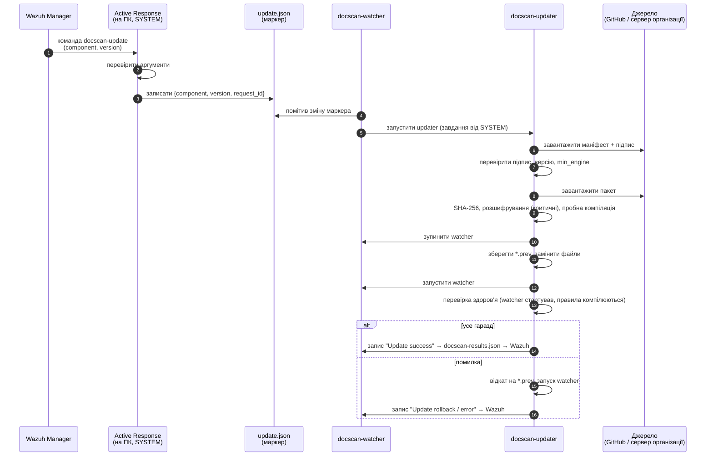

# DocScan — як працюватиме оновлення

**Стан (2026-11-19): оновлення програми зроблено** (розділ 0 нижче) — служба `DocScanUpdater`, підписаний
маніфест релізу, три режими. Решта документа (окремий репозиторій правил, критичні правила, оновлення лише
правил) — дизайн наступних етапів; де він розходиться з розділом 0, чинний розділ 0.

## 0. Що зроблено: оновлення програми

- **Служба `DocScanUpdater`** (`watcher-go/updater`, `updater\docscan-updater.exe` у пакеті) — ставить
  `install.ps1`, як і `DocScanWatcher` (автозапуск, SYSTEM, перезапуск після збою).
- **Як оновлюватися — конфіг `C:\ProgramData\DocScan\update\updater.json`** (пише інсталятор з `-UpdateMode`,
  `-UpdateMirror`, `-UpdateMarker`, `-UpdateEveryHours`, `-UpdateWindow`; далі можна правити; доступ лише SYSTEM +
  адміністратори). Кожна організація вибирає сама — Wazuh не обов'язковий:

  | `mode` | що робить служба |
  |---|---|
  | `github` (типово) | раз на `check_every_hours` (6) — `releases/latest/download/manifest.json` |
  | `mirror` | те саме з `mirror.url`: тека з файлами релізу (`manifest.json`, `manifest.sig`, пакет) — http(s), шлях або UNC |
  | `marker` | чекає файл `marker.file` (типово `update\update.json`), який пише агент (Wazuh чи будь-який інший): `{"version": "v1.0.5", "source": "github" \| "mirror" \| "<адреса теки>", "sha256": "<sha256 manifest.json>", "request_id": "…"}` — усі поля необов'язкові |
  | `off` | не оновлювати (служба не ставиться) |

  ```json
  {"mode": "github", "check_every_hours": 6, "github": {"repo": "rifatismailov/yara-docscan"},
   "mirror": {"url": ""}, "marker": {"file": "C:\\ProgramData\\DocScan\\update\\update.json"},
   "window": "", "extra_public_keys": []}
  ```
  `window` — напр. `"22:00-06:00"`: періодичні режими ставлять оновлення лише в цей час (маркер — одразу).
- **Довіра — лише підпис.** CI (`cirun publish`) кладе в реліз `manifest.json` (версія, пакет, sha256 кожного
  файлу) і `manifest.sig` (ed25519; приватний ключ — KeePassXC `CI/Release/signing-key`, секрет Forgejo
  `CI_SIGNING_KEY`; публічний — `watcher-go/manifest` `OfficialKeys`). Updater ставить лише підписане довіреним
  ключем (+ `extra_public_keys` організації), хоч із GitHub, хоч із дзеркала, хоч за адресою з маркера; лише
  новішу версію; пакет — розмір і sha256 з маніфесту, кожен файл — його sha256, зайвих немає.
- **Встановлює сам `install.ps1` нового пакета** з `-Reuse` (параметри ПК з `C:\ProgramData\DocScan\install.json`:
  `-DetectOnly`, `-WatchPath`, `-Workers`, …) і `-ResultFile`. Пакет поточної і попередньої версії лишається в
  `update\packages\<версія>`. Не встановилось (інсталятор упав, watcher не стартував, версія не та) — updater
  ставить попередній пакет так само = **відкат**; невдалу версію періодична перевірка більше не пробує (маркер — може).
- **Звіт для агента** — `C:\ProgramData\DocScan\results\docscan-updates.json` (інсталятор додає його в `ossec.conf`
  поруч із `docscan-results.json`): `{"event": "Update", "update": {"status": "success" | "rollback" | "failed" |
  "current" | "error", "from", "to", "mode", "source", "request_id", "message"}}`. Журнал — `results\updater.log`.
- Перевірено на ВМ (2026-11-19, тестовий ключ у `extra_public_keys`): маркер → v9.0.1 → v9.0.2 (`success`); зламаний
  v9.0.3 (правила не компілюються) → відкат на v9.0.2 (`rollback`).

**Правила окремо від програми (2026-11-19, етап 1):**
- репозиторій **github.com/rifatismailov/yara-docscan-rules** (публічний); реліз правил vX.Y.Z (`cirun rules-release
  --dir <checkout>`): `DocScan-rules.zip` (правила + `VERSION.txt`), `rules-manifest.json` / `.sig` (продукт
  `docscan-rules`, той самий ключ CI), `DocScan-rules-bundle.zip` (ці три файли — для ручного встановлення). Перед
  пакуванням правила компілюються нашим `yarac`;
- **встановлення:** правила завантажує той, хто ставить DocScan, **до встановлення**: `DocScan-Install.ps1 -Rules
  <файл | UNC | URL>`; `docscan-updater.exe -InstallRules` перевіряє підпис, кожен файл, компілює і кладе в
  `rules\`. Немає правил ніде — інсталятор не ставить DocScan. Окремі правила (`rules\VERSION.txt`) оновлення
  програми не чіпає;
- **оновлення лише правил:** `DocScanUpdater` після перевірки програми перевіряє реліз правил
  (`rules.github.repo`, дзеркало — `rules-manifest.json` у тій самій теці, маркер `{"component": "rules", …}`):
  підпис → пакет → пробна компіляція → зупинити watcher → `rules` → `rules.prev`, нові на місце → запуск, чекати
  `start: watching` → інакше відкат на `rules.prev`. Записи — `component: rules`. `rules.off: true` вимикає;
- **watcher без правил не сканує і чекає** (`waiting for rules`), а не падає;
- перевірено на ВМ: пакет програми без правил → відмова; `-Rules` з релізу v1.0.0 на GitHub → встановлено, HIT на
  `.docm`; маркер → правила v9.9.1 (тестовий ключ) — `success`, watcher перезапущено; правила, що не компілюються,
  — `failed`, не встановлені, watcher не чіпався; перевстановлення програми без `-Rules` правила лишило; без правил
  watcher чекав, з правилами — стартував.

**Списки організації (2026-11-21):** `whitelist.json` / `blacklist.json` (`<DataDir>\lists\`) — третій компонент
DocScanUpdater (`component: lists`, `updater/lists.go`): `updater.json` → `"lists": {"url", "check_every_hours": 24,
"public_keys"}` (`install.ps1 -ListsUrl / -ListsKey`), у будь-якому режимі, і `off` теж; ставиться лише список з
підписом ключем організації (окремо від ключа релізів), правильного формату і з більшим `serial`; попередній —
`.prev`. Для правил — `rules.mirror.url` (окреме дзеркало правил; порожньо — те саме, що для програми). Схеми —
[LISTS-FLOW.md](LISTS-FLOW.md).

**Етап 2 (2026-11-19): правил у проєкті програми більше немає** — `docscan-project/rules` прибрано з git (у
`.gitignore`); CI бере підписаний реліз правил (`cirun/rulesrc`, вхід `rules` workflow) — у робочу теку і на стенди;
пакет програми без правил, на новому ПК `-Rules` обов'язковий. Далі: CI репозиторію правил (корпуси, expected / clean)
перед кожним релізом правил. Критичні правила (§4.4), правило Wazuh на події `Update` — з OK.

**Зміст**
1. [Коротко](#1-коротко)
2. [Що оновлюється і звідки](#2-що-оновлюється-і-звідки)
3. [Хто запускає і як іде оновлення](#3-хто-запускає-і-як-іде-оновлення)
4. [Формати файлів](#4-формати-файлів)
5. [Покроково: що робить updater](#5-покроково-що-робить-updater)
6. [Безпека](#6-безпека)
7. [Звітність у Wazuh](#7-звітність-у-wazuh)
8. [Для інших організацій](#8-для-інших-організацій)
9. [Майбутнє: паролі й логіни як критична інформація](#9-майбутнє-паролі-й-логіни-як-критична-інформація)
10. [План робіт і відкриті питання](#10-план-робіт-і-відкриті-питання)

---

## 1. Коротко

- **Чотири компоненти** оновлюються окремо: програма (`yara64.exe` / `yarac64.exe`), watcher, правила
  виявлення, правила критичної інформації.
- **Три джерела:**
  - програма — **GitHub-релізи** цього репозиторію (як зараз);
  - правила виявлення — **окремий репозиторій правил** на GitHub;
  - критичні правила — **джерело, яке задає організація** (локальний сервер, свій git, файлова шара),
    у **зашифрованому** вигляді. На GitHub критичні правила не потрапляють.
- **Ініціатор — Wazuh.** Менеджер запускає Active Response на потрібних ПК; скрипт лише записує локальний
  маркер «онови компонент X до версії Y».
- **Встановлює окремий `docscan-updater.exe`:** завантажує, перевіряє підпис і SHA-256, пробно компілює
  правила, зупиняє watcher, міняє файли, запускає watcher, перевіряє, що він працює, — інакше **відкат**.
- **Результат** (успіх / відкат / помилка, з версіями) — запис у `docscan-results.json`, тобто подія в Wazuh.
- **Довіряємо лише підписаному:** кожен пакет підписує CI (ed25519); updater перевіряє підпис ключем,
  вшитим у програму (для критичних правил — ключем організації). Маркер від Wazuh не містить ні адрес,
  ні хешів.

---

## 2. Що оновлюється і звідки

| Компонент | Файли на ПК | Джерело | Вигляд | Хто отримує |
|---|---|---|---|---|
| Рушій | `C:\Program Files\DocScan\bin\yara64.exe`, `yarac64.exe`, VC++ runtime | GitHub-релізи DocScan (`releases/latest`) | підписаний пакет | усі ПК |
| Watcher | `C:\Program Files\DocScan\watcher\docscan-watcher.exe` | ті самі релізи | підписаний пакет | усі ПК |
| Updater | `C:\Program Files\DocScan\bin\docscan-updater.exe` | ті самі релізи | підписаний пакет | усі ПК |
| Правила виявлення | `C:\Program Files\DocScan\rules\` (`docscan-policy.yar`, `docscan-index.yar`, `file-index.yar`, `general\`, `maldoc\`) | **окремий репозиторій правил** на GitHub | підписаний пакет, файли відкриті | усі ПК |
| Критичні правила (E5Search) | `C:\Program Files\DocScan\critical\` | **джерело організації**: локальний вебсервер, свій git (через HTTPS), файлова шара | підписаний **зашифрований** пакет | лише ПК з увімкненою перевіркою критичної інформації |

Чому правила окремо від програми: правила змінюються часто (нові загрози, виправлення хибних спрацювань),
програма — рідко. Оновлення правил не має вимагати нової збірки `yara64.exe`, і навпаки. Кожен пакет правил
перед публікацією проходить ті самі перевірки, що й зараз у CI: корпуси, шкідливе ПЗ (`expected.txt` — усе
виявлено), чисті документи (`clean.txt` — жодної тривоги).

Чому критичні правила не на GitHub: вони описують, що в організації вважається критичною інформацією, — це
чутливі дані. Навіть зашифрований файл у публічному місці лишається там назавжди, і якщо ключ колись витече,
стануть читабельними всі версії. Тому кожна організація тримає їх у себе.

---

## 3. Хто запускає і як іде оновлення



Додатково (як в Android-версії): updater раз на добу сам перевіряє, чи є новий пакет правил
(`If-None-Match` / ETag — сервер відповідає `304 Not Modified`, якщо нічого не змінилось). Це на випадок,
коли ПК був вимкнений у момент команди з Wazuh. Вмикається налаштуванням; для програми (`yara64`, watcher)
автоматичного щоденного оновлення немає — лише за командою, щоб нова версія рушія не з'являлась на всіх
ПК без рішення адміністратора.

---

## 4. Формати файлів

Чотири файли. Перші два живуть на ПК, два інші — у джерелах.

### 4.1. Маркер від Wazuh — `C:\ProgramData\DocScan\update\update.json`

Пише скрипт Active Response. **Лише що і до якої версії** — ні адрес, ні хешів:

```json
{
  "schema": 1,
  "component": "rules",
  "version": "2026.11.18-1",
  "request_id": "wazuh-ar-1763470000-001"
}
```

| Поле | Значення |
|---|---|
| `schema` | версія формату |
| `component` | `rules` · `critical` · `watcher` · `engine` · `updater` · `all` |
| `version` | версія пакета (`2026.11.18-1` для правил, `20261116-53e5ce45` для програми) або `latest` |
| `request_id` | ідентифікатор команди; повертається в записі про результат |

### 4.2. Джерела оновлень — `C:\ProgramData\DocScan\update-sources.json`

Пише інсталятор. Змінювати можуть лише SYSTEM і адміністратори:

```json
{
  "schema": 1,
  "program": {
    "source": "https://github.com/rifatismailov/yara-docscan/releases/",
    "public_key": "ed25519:<ключ підпису релізів DocScan>"
  },
  "rules": {
    "source": "https://github.com/<org>/docscan-rules/releases/",
    "public_key": "ed25519:<ключ підпису пакетів правил>",
    "daily_check": true
  },
  "critical": {
    "enabled": true,
    "source": "https://updates.example.local/docscan/critical/",
    "auth": { "type": "none" },
    "public_key": "ed25519:<ключ організації>",
    "key": { "from": "wazuh-shared", "name": "docscan-critical.key" },
    "daily_check": true
  }
}
```

- `source` для критичних правил — будь-що з цього:
  - git-хостинг через HTTPS: `https://git.example.org/sec/critical/-/raw/main/`, адреса релізів;
  - локальний вебсервер: `https://updates.example.local/docscan/critical/`;
  - файлова шара: `\\fileserver\share\docscan\critical\`.
- `auth` — для приватного джерела: `none` · `bearer` (токен) · `basic`. Секрет зберігається зашифрованим
  Windows DPAPI на рівні машини (у полі `secret` лежить лише зашифроване значення з префіксом `dpapi:`), розшифрувати його може лише ця машина.
- `public_key` — чиїм ключем має бути підписаний пакет. Для критичних правил — ключ **організації**.
- `key` — звідки взяти ключ розшифрування критичного пакета: `wazuh-shared` (спільні файли агента Wazuh) або
  `file` (шлях до файлу з ACL SYSTEM + Admins).

### 4.3. Маніфест правил виявлення — `manifest.json` + `manifest.sig`

Лежить у релізі репозиторію правил разом із пакетом `docscan-rules-<version>.zip`. Формат той самий, що
вже працює в Android-версії DocScan, з трьома доданими полями (`schema`, `created`, `min_engine`):

```json
{
  "schema": 1,
  "bundle": "docscan-rules",
  "version": "2026.11.18-1",
  "created": "2026-11-18T14:30:00Z",
  "min_engine": "20261116-53e5ce45",
  "description": "docscan policy + vendor rules",
  "rules": [
    { "name": "docscan", "type": "detection", "path": "detection/docscan-index.yar", "version": "2026.11.18-1" },
    { "name": "old_rule", "remove": true }
  ],
  "files": {
    "detection/docscan-index.yar":  "8d1e3f6de2c6294153b6117bf868eb902e63a598580132caa53c78b2ba4482a8",
    "detection/docscan-policy.yar": "e850a9ad62434024a21e915336bfafcc087505d78aa5a1071fac9f7bb4bfd0fd",
    "detection/file-index.yar":     "b07d613d45f2c529fea80cdaddd05f9a2b81451729e08eff9e5867ec6e9380c1"
  }
}
```

| Поле | Значення |
|---|---|
| `schema` | версія формату — старий updater відмовиться від невідомої, а не зламається |
| `bundle`, `version`, `created`, `description` | що це за пакет і коли зібраний |
| `min_engine` | мінімальна версія `yara64`: правило з новою функцією модуля не поставиться на старий рушій |
| `rules[]` | правила, які пакет ставить / замінює (`name` — ключ заміни) або видаляє (`"remove": true`); `type` = `detection` |
| `files{}` | SHA-256 **кожного** файлу пакета (дерево `docscan` — ~1 600 файлів) |
| `manifest.sig` | підпис ed25519 самого `manifest.json` |

### 4.4. Маніфест критичних правил — `critical-manifest.json` + `critical-manifest.sig`

Лежить у джерелі організації разом із зашифрованим пакетом:

```json
{
  "schema": 1,
  "bundle": "docscan-critical",
  "version": "2026.11.18-1",
  "created": "2026-11-18T14:30:00Z",
  "min_engine": "20261116-53e5ce45",
  "encryption": {
    "alg": "AES-256-GCM",
    "key_id": "2026-11",
    "nonce": "base64…"
  },
  "payload": "critical-2026.11.18-1.bin",
  "payload_sha256": "<sha256 зашифрованого файлу>",
  "rules": [
    { "name": "e5search", "type": "critical_information",
      "path": "critical/yara_sender_critical_rules.yar", "version": "2026.11.18-1",
      "category": "documents" }
  ],
  "files": {
    "critical/yara_sender_critical_rules.yar": "<sha256 розшифрованого файлу>"
  }
}
```

| Поле | Значення |
|---|---|
| `encryption.alg` | AES-256-GCM (шифрування з перевіркою цілісності) |
| `encryption.key_id` | **який** ключ потрібен; самого ключа тут немає. Новий ключ — новий `key_id` |
| `payload`, `payload_sha256` | зашифрований пакет і його хеш (перевіряється **до** розшифрування) |
| `rules[].category` | `documents` (як зараз E5Search); у майбутньому `credentials` (§9) |
| `files{}` | SHA-256 розшифрованих файлів (перевіряється **після** розшифрування) |

### 4.5. Що встановлено — `C:\ProgramData\DocScan\update\installed.json`

Пише updater після кожного успішного оновлення:

```json
{
  "schema": 1,
  "engine":   { "version": "20261116-53e5ce45", "installed": "2026-11-18T15:02:11+02:00" },
  "watcher":  { "version": "20261118-5be474cc", "installed": "2026-11-18T15:02:11+02:00" },
  "rules":    { "bundle": "docscan-rules",    "version": "2026.11.18-1", "installed": "2026-11-18T15:04:40+02:00", "etag": "\"a1b2…\"" },
  "critical": { "bundle": "docscan-critical", "version": "2026.11.18-1", "installed": "2026-11-18T15:04:52+02:00", "key_id": "2026-11" }
}
```

---

## 5. Покроково: що робить updater

`docscan-updater.exe` — окрема програма (Go), запускається одноразовим завданням планувальника від SYSTEM.
Окремою вона є тому, що watcher не може замінити сам себе й `yara64.exe`, поки вони працюють.

1. **Прочитати маркер.** Перевірити `schema`, `component` (зі списку), `version` (формат). Невідоме —
   запис «Update error: bad marker», нічого не робити.
2. **Взяти джерело** з `update-sources.json` (не з маркера).
3. **Завантажити маніфест і підпис.** Перевірити підпис ключем з `update-sources.json` / вшитим у програму.
   Не той підпис — стоп.
4. **Перевірити версію:**
   - не старша за встановлену, якщо це не підписаний відкат;
   - `min_engine` ≤ встановленого рушія; для правил, що вимагають новішого рушія, — запис «needs engine X».
5. **Завантажити пакет** у `C:\ProgramData\DocScan\update\staging\`:
   - захист від zip-slip;
   - ліміти на кількість і розмір файлів;
   - для критичних — `payload_sha256` до розшифрування, потім розшифрування ключем `key_id`.
6. **SHA-256 кожного файлу** з `files{}`. Зайвий файл чи файл, якого бракує, — стоп.
7. **Пробна компіляція** в `staging`: `yarac64` для правил виявлення і критичних, `yara64 --version` для
   нового рушія. Не компілюється — стоп, старе не чіпаємо.
8. **Зупинити watcher** (завдання / служба), дочекатись завершення поточних сканів.
9. **Зберегти поточне:** `rules.prev\`, `critical.prev\`, `bin.prev\`, `watcher.prev\`.
10. **Замінити** файли — перейменуванням тек, а не копіюванням поверх (атомарно).
11. **Запустити watcher.**
12. **Перевірка здоров'я** (до ~60 с): у `watcher.log` з'явилось `start: watching`, правила скомпільовані
    (`rules.yarc` новий), немає `ERROR` на старті.
13. **Успіх:**
    - записати `installed.json`;
    - прибрати `staging`;
    - запис «Update success» у `docscan-results.json`.
14. **Невдача** на кроках 10–12:
    - повернути `*.prev`, запустити watcher, перевірити ще раз;
    - запис «Update rollback» з причиною і версіями.
15. **Маркер** перейменувати в `update.done.json` (або `update.failed.json`) — щоб та сама команда не
    виконувалась двічі.

Updater оновлює сам себе через watcher: новий `docscan-updater.exe` кладеться поруч як `.new`, і наступний
запуск підміняє його до старту.

---

## 6. Безпека

| Загроза | Захист |
|---|---|
| Хтось підсуне маркер з адресою свого «оновлення» | маркер не містить адрес і хешів — лише `component` і `version`; тека `update\` доступна лише SYSTEM і Administrators; значення перевіряються за списком і форматом |
| Підмінено пакет на сервері або в репозиторії (зламано обліковий запис GitHub, сервер організації) | приймається лише пакет із правильним **підписом ed25519**; приватний ключ — лише в CI (KeePassXC), не на GitHub і не на ПК |
| Пакет пошкоджено при завантаженні | SHA-256 пакета й **кожного** файлу; пробна компіляція |
| Відкат на стару версію з відомою вадою | версія не може зменшитись, якщо це не підписаний відкат |
| Критичні правила прочитає сторонній | пакет зашифрований (AES-256-GCM); джерело — у мережі організації, не публічне; ключ доставляє Wazuh лише на ПК з увімкненою перевіркою |
| Витік ключа розшифрування | новий `key_id` для наступних пакетів — старий ключ нових правил не відкриє |
| Токен приватного джерела на ПК | зашифрований DPAPI (на рівні машини); токен лише на читання; можна відкликати |
| Зламаний архів (zip-slip, «zip-бомба») | розпакування лише в `staging`, перевірка шляхів, ліміти кількості й розміру |
| Оновлення зламало watcher | перевірка здоров'я після запуску й автоматичний відкат на `*.prev` |
| Скрипт Active Response виконає зайве | скрипт приймає лише `component` + `version` (перевірка за списком і регулярним виразом) і нічого не запускає сам — тільки пише маркер |

Межа захисту: той, хто вже має права адміністратора на ПК, може прочитати розшифровані критичні правила
(`yara64` потребує їх у відкритому вигляді) і змінити будь-що. Від цього захищає ACL і контроль доступу до
машин, а не механізм оновлення.

---

## 7. Звітність у Wazuh

Updater пише в `docscan-results.json` той самий тип запису, що й watcher (Wazuh уже читає цей файл):

```json
{
  "timestamp": "2026-11-18T15:04:41.120+02:00",
  "source": "docscan",
  "host": "PC-0042",
  "event": "Update",
  "category": "update",
  "verdict": "INFO",
  "update": {
    "request_id": "wazuh-ar-1763470000-001",
    "component": "rules",
    "result": "success",
    "from": "2026.11.10-2",
    "to": "2026.11.18-1",
    "duration_s": 14
  },
  "summary": "rules updated 2026.11.10-2 -> 2026.11.18-1",
  "errors": []
}
```

- `result`: `success` · `rollback` · `error` · `up-to-date` · `needs-engine`;
- `verdict`: `INFO` для `success` / `up-to-date`, `MEDIUM` для `rollback` / `error` (щоб SOC побачив);
- на менеджері — окреме правило для `event = Update`, щоб збирати по `request_id`: скільки ПК оновились,
  на яких відкат.

---

## 8. Для інших організацій

DocScan можуть використовувати не лише ми. Кожна організація задає **своє** при встановленні:

```powershell
# критичні правила з локального вебсервера, ключ розшифрування — через Wazuh
DocScan-Install.ps1 -Critical https://updates.example.local/docscan/critical/ `
  -CriticalPublicKey ed25519:BBBB… -CriticalKeyFrom wazuh-shared

# з файлової шари
DocScan-Install.ps1 -Critical \\fileserver\share\docscan\critical\ -CriticalPublicKey ed25519:BBBB…

# зі свого git (приватний, токен лише на читання)
DocScan-Install.ps1 -Critical https://git.example.org/sec/critical/-/raw/main/ `
  -CriticalPublicKey ed25519:BBBB… -CriticalToken <token>

# свій набір правил виявлення (форк репозиторію правил)
DocScan-Install.ps1 -RulesSource https://github.com/<org>/docscan-rules/releases/ -RulesPublicKey ed25519:CCCC…
```

Параметр `-Critical` вже існує (файл, шлях або URL); він стане джерелом **оновлень**, а не одноразовою
копією. Нові: `-CriticalPublicKey`, `-CriticalKeyFrom`, `-RulesSource`, `-RulesPublicKey`.

Організація сама:
1. генерує свою пару ключів ed25519 (приватний — у себе, публічний — в інсталятор);
2. збирає пакет критичних правил інструментом з репозиторію (той самий генератор, що для Android-версії),
   підписує й шифрує його;
3. кладе пакет у своє джерело;
4. роздає ключ розшифрування агентам Wazuh (спільні файли групи ПК з перевіркою критичної інформації).

---

## 9. Майбутнє: паролі й логіни як критична інформація

Критичну інформацію можна розширити на облікові дані — шукати документи, у яких лежать паролі й логіни.
Для цього в маніфесті вже є `category`: `documents` (як зараз) і `credentials`.

- **Правила за ознаками — так:** «пароль:», «login=», шаблони облікових записів, ключі API, рядки
  підключення до баз даних, приватні ключі. Самі правила секретів не містять.
- **Справжні паролі в правилах — ні.** Правило з конкретним паролем опиниться на кожному ПК з DocScan
  (навіть зашифроване — ключ теж там), тобто саме стане витоком. Для перевірки «чи не потрапив у документ
  наш справжній пароль» потрібен інший механізм — порівняння хешів на сервері, а не на ПК.

---

## 10. План робіт і відкриті питання

**Етапи:**
1. **Підписи й маніфест програми:** CI підписує реліз (ed25519, ключ у KeePassXC); маніфест релізу з SHA-256
   кожного файлу.
2. **`docscan-updater.exe`** (Go): кроки §5 для програми й watcher-а; `installed.json`; запис у Wazuh.
3. **Active Response `docscan-update`:** скрипт пише маркер; правило й команда на менеджері; watcher стежить
   за маркером і запускає updater.
4. **Репозиторій правил:** перенести `rules/` і генератор; CI — корпуси, `expected.txt`, `clean.txt` перед
   публікацією; пакет і маніфест (формат Android-версії); `rules.source` в updater-і.
5. **Критичні правила:** шифрування пакета, `critical-manifest.json`, ключі через Wazuh, `update-sources.json`,
   параметри інсталятора.
6. **Щоденна перевірка** (ETag) для правил.
7. Go-watcher у релізі замість PowerShell-версії (передумова — див. [watcher-go/README.md](watcher-go/README.md) §8).

**Відкриті питання:**
- репозиторій правил — публічний чи приватний (правила виявлення не секретні; критичні в нього не потрапляють);
- ключ розшифрування критичних правил — лише через спільні файли Wazuh, чи потрібен варіант без Wazuh;
- як часто міняти `key_id` (кожен пакет чи раз на період);
- чи оновлювати рушій і watcher щоденною перевіркою, чи лише за командою (пропозиція — лише за командою);
- як Wazuh визначає, на які ПК слати `critical` (група агентів з перевіркою критичної інформації).
